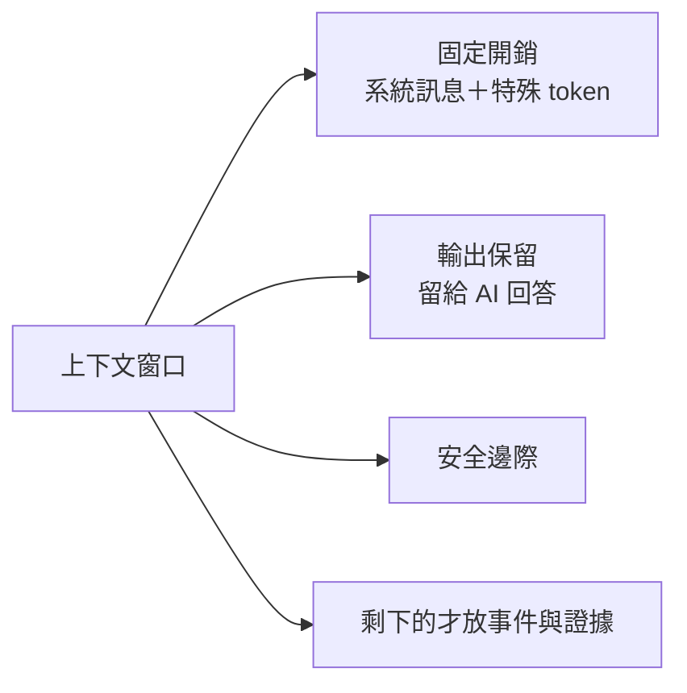
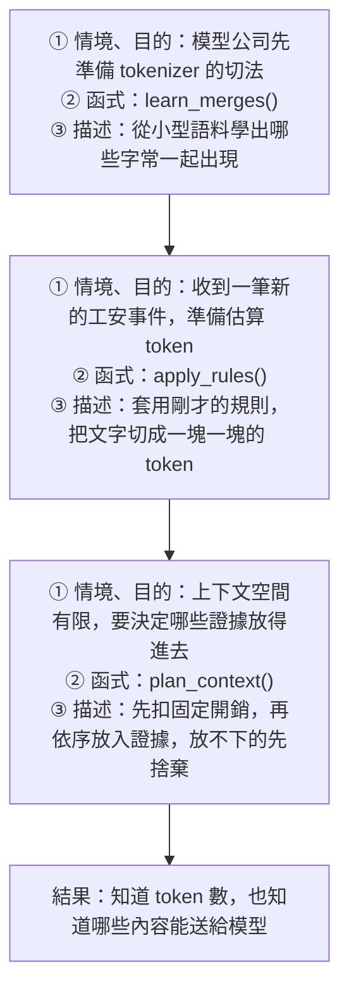
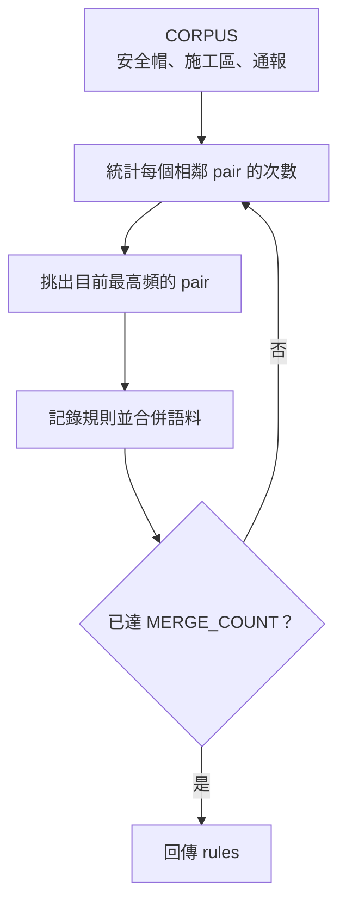
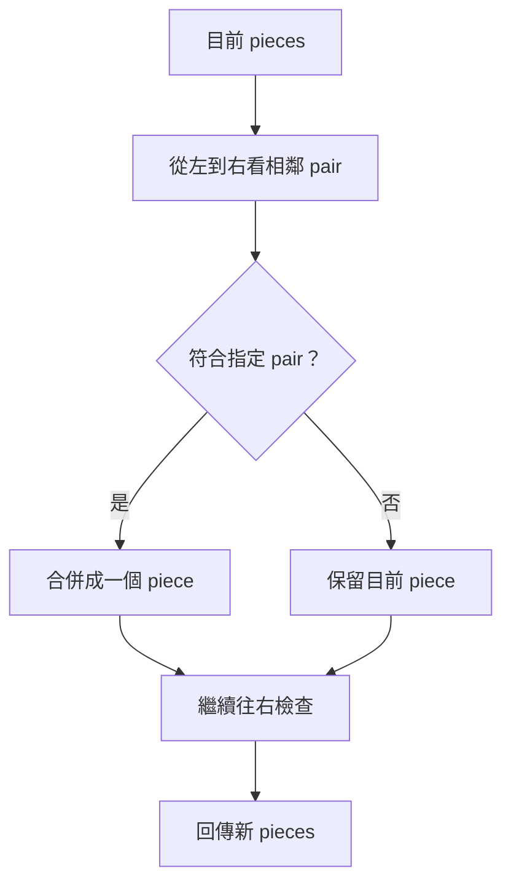
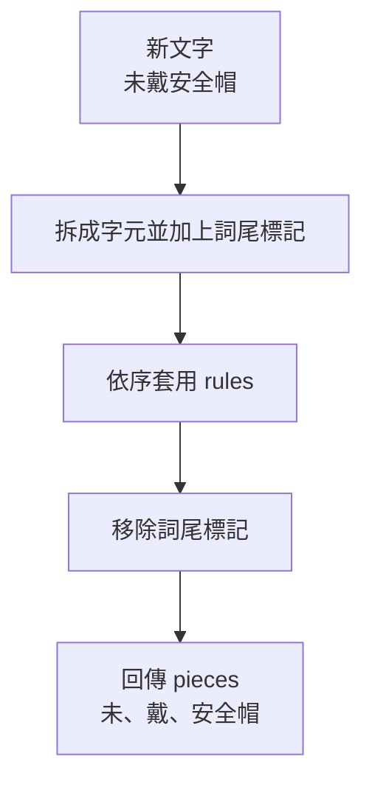
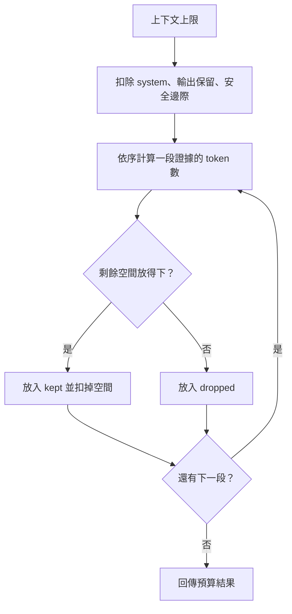

# 02｜一筆事件要花多少 token？

> **定位**：把事件丟給 AI 之前，先算出一筆事件吃多少 token、一天要多少，再學會把它變小。

## 學習目標

完成本節後，你應該能夠：
- 說明為什麼不能用「字數」估 AI 的成本，以及「要問哪個模型」才是對的問題
- 指出沒打字卻照樣占 token 的部分（特殊 token、chat template），並把上下文窗口拆成固定開銷、輸入、輸出保留
- 寫程式估算一筆工安事件的 token 數、乘出一天的總量，並做出更省 token 的精簡版

## 範例程式碼

- [demo](https://github.com/4-learn/llm-demo)：`02_token_budget.py`

---

## 情境

你是營建公司的軟體工程師。

上一節你做出了不用 AI 的基準版。主管看完分數，接著問：

> 「工地一天大概 300 筆事件，全部丟給 AI，要花多少 token？」

AI 是按 **token** 計費，上下文窗口也是用 token 算。要回答主管，你得先知道：**一筆事件是幾個 token？能不能讓它少一點？**

---

## 講解

### 一、token 不是字數

模型看不到文字，它看到的是一串整數 ID。把文字切成小塊再轉成 ID 的工具叫 **tokenizer**。**字元數、token 數是兩個不同的量**，計費和窗口吃的是 token。

下表是教師用兩個真實 tokenizer 實測、凍結在 `data/tokenizer-fixtures.json` 的數字（教師 fixture，不是你的本機實測）：

| 文字 | 字元 | `bge-small-zh-v1.5` | `Qwen2.5-0.5B-Instruct` |
| --- | ---: | ---: | ---: |
| `安全帽` | 3 | 5 | 2 |
| `工人未配戴安全帽，正在進入施工區。` | 17 | 19 | 12 |
| `頭盔` | 2 | 4 | 2 |
| `20E07-E03-05` | 10 | 8 | 10 |
| `AB-123` | 6 | 5 | 5 |

從表上讀出三件事：

| 觀察 | 意思 |
| --- | --- |
| 同一句話，兩個模型差很多 | 「這句幾個 token」是錯的問題，要問「**哪個模型、哪個版本**」 |
| 每字元的 token 數不固定 | 用字數換算成本，方向都可能錯 |
| 數字不一定便宜 | 日期在 Qwen 是 10 個 token，比字元還多；事件裡的時間、編號要實測 |

### 二、子詞切分：常見的合併、罕見的拆開

tokenizer 的詞彙表有限，做法是：**常見的字串合併成一個 token，罕見的拆到字元**。哪些會合併，取決於它當初看過什麼語料。

同一句「工人未配戴安全帽，正在進入施工區。」（fixture 紀錄的切法）：

| 模型 | 切法 | token 數 |
| --- | --- | ---: |
| `bge` | `[CLS]` 工 人 未 配 戴 安 全 帽 ， 正 在 進 入 施 工 區 。 `[SEP]` | 19 |
| `Qwen` | 工人 未 配 戴 安全 帽 ， 正在 進入 施工 區 。 | 12 |

課堂體驗（可選）：在 Hugging Face 上找有 tokenizer 視覺化的頁面，貼同一句話換不同模型看切法。網頁工具與模型版本會更新，**看到的數字可能和上表不同**，這正好說明「要指定模型與版本」。

### 三、沒打字也在吃 token

注意 `bge` 頭尾的 `[CLS]`、`[SEP]`：你沒打這兩個，但它們占了 2 個 token。生成模型也一樣，Chat API 會把你的對話套上 **chat template**，加上角色標記、回合分隔等特殊 token。

所以上下文窗口要拆成三塊來算：



| 區塊 | 誰決定 | 你能做什麼 |
| --- | --- | --- |
| 系統訊息＋特殊 token／template | 模型與供應商 | 只能量，**不能假設是 0** |
| 事件內容、證據 | 你的程式 | 精簡、排序、取捨 |
| 輸出保留 | 你設的上限 | 依任務設定 |

換供應商，template 和 tokenizer 都會變，**token 數要重測**。

### 四、示範：玩具 tokenizer 與預算

先看整條流程：三個函式各自做什麼？

這一節不是一開始就要你背程式，而是先看一條「從文字到預算」的路：



| 流程方塊 | 先記住什麼 |
| --- | --- |
| **情境、目的：先學規則**<br/>`learn_merges()`<br/>從小型語料找常一起出現的字 | 模型開發者事先做；一般使用者不會每次重做 |
| **情境、目的：切一筆新事件**<br/>`apply_rules()`<br/>用規則把文字切成 token | 實務上就是用模型附的 tokenizer 來數 token |
| **情境、目的：控制上下文預算**<br/>`plan_context()`<br/>依預算放入證據 | 它不是切 token，而是挑哪些證據放得進 prompt |

> **一句話記法：** `learn_merges()` **學規則**，`apply_rules()` **用規則切文字**，`plan_context()` **在有限空間挑證據**。

下面不要把整段程式一次讀完；請按照函式的順序，每次只回答三個問題：**這個函式要解決什麼問題？拿到什麼資料？回傳什麼結果？**

### 1. 先準備：常數、語料與共用工具

這一段還不是 tokenizer 的流程，而是在準備函式會用到的材料：

- `Counter`：統計相鄰 token pair 的出現次數。
- `END = "</w>"`：標記詞尾，避免不同詞的字被跨詞合併。
- `CORPUS`：很小的教學語料，不是真實模型的訓練資料。
- `MERGE_COUNT = 6`：最多學 6 條合併規則。

先把它記成：

```text
準備材料 → 交給 learn_merges() → 得到 rules
```

### 2. `learn_merges()`：建立規則

**要解決的問題：** 語料裡哪些相鄰 pieces 常常一起出現？

**輸入：** `CORPUS` 和要學幾條規則。

**輸出：** `rules`，例如 `安 + 全 → 安全`。



這是**建立 tokenizer 的階段**。實務上通常由模型開發者事先完成；一般 API 使用者不會每次請求都重新執行它。

### 3. `_merge()`：執行一條規則

**要解決的問題：** 已經知道一條規則，如何真的把相鄰 pieces 合併？

**輸入：** 一串 pieces 和一個 pair，例如 `安、全、帽、</w>` 與 `安 + 全`。

**輸出：** 合併後的 pieces，例如 `安全、帽、</w>`。



這是內部小工具：`learn_merges()` 用它更新語料，`apply_rules()` 用它處理新文字。

### 4. `apply_rules()`：使用規則切新文字

**要解決的問題：** 新收到的文字，依照已經建立的規則會被切成哪些 token？

**輸入：** 新文字和 `rules`。

**輸出：** token pieces，例如 `未戴安全帽 → 未、戴、安全帽`。



注意：`apply_rules()` **不會學新規則**，只會使用現有的 `rules`。實務上，這個位置通常是呼叫模型隨附的 tokenizer。

### 5. `plan_context()`：安排上下文預算

**要解決的問題：** 模型能接收的 token 有限，哪些證據要保留？

**輸入：** 上下文上限、固定開銷、證據清單，以及一個計數函式。

**輸出：** `kept`、`dropped` 和剩餘 token 數。



`plan_context()` 不會重新定義 token，也不會訓練 tokenizer；它只負責根據 token 數量做內容取捨。

### 6. 主程式：把函式串起來

```text
learn_merges() → 得到 rules
      ↓
apply_rules() → 計算文字的 toy token 數
      ↓
plan_context() → 在剩餘空間安排證據
      ↓
印出結果
```

接下來不要一次展開全部程式；每一段先看「輸入 → 處理 → 輸出」。完整可執行版本放在本節最後，方便複製執行。

### 對照程式 1：準備材料

```python
from collections import Counter

END = "</w>"
CORPUS = ["安全帽", "安全帽", "未戴安全帽", "已戴安全帽", "施工區", "施工區", "進入施工區", "通報", "通報", "現場通報"]
MERGE_COUNT = 6
```

這裡只是在準備資料，還沒有開始切文字。

### 對照程式 2：建立與執行合併規則

```python
def learn_merges(corpus, merge_count):
    # 反覆統計 pair、選最高頻 pair、合併語料
    ...


def _merge(symbols, pair):
    # 從左到右，把符合 pair 的 pieces 合成一個
    ...
```

`...` 只是本段的省略記號；完整函式請看下面的可執行版本。

### 對照程式 3：套用規則切新文字

```python
def apply_rules(text, rules):
    tokens = []
    for word in text.split():
        symbols = list(word) + [END]
        for pair in rules:
            symbols = _merge(symbols, pair)
        # 移除詞尾標記，留下 token pieces
        ...
    return tokens
```

這段的重點是：它拿現成的 `rules` 來切文字，不會在這裡產生新規則。

### 對照程式 4：安排上下文預算

```python
def plan_context(window, system_tokens, output_reserve,
                 safety_margin, evidences, count):
    fixed = system_tokens + output_reserve + safety_margin
    remaining = window - fixed
    kept, dropped, used = [], [], 0

    for name, text in evidences:
        cost = count(text)
        if used + cost <= remaining:
            kept.append((name, cost))
            used += cost
        else:
            dropped.append((name, cost))

    return {"kept": kept, "dropped": dropped, "used": used}
```

實際程式還會回傳完整的預算欄位，這裡先只保留理解流程需要的部分。

### 完整可執行 Demo

玩具 tokenizer 只示範機制，**它的數字不是任何真實模型的計數**。以下程式才是可直接執行的完整版本：

<details>
<summary>展開完整程式碼</summary>

<!-- demo: 02_token_budget.py -->
```python
"""第 02 節：子詞切分與上下文預算（只用 Python 標準函式庫）。

玩具 BPE 用頻率合併字元對，示範「子詞」怎麼來；它不是你的 API 用的
tokenizer，計數不可互換。plan_context() 的預算公式與計數器無關，
換一個 count 就能接真實 tokenizer。
"""

from collections import Counter

END = "</w>"
CORPUS = [
    "安全帽", "安全帽", "未戴安全帽", "已戴安全帽",
    "施工區", "施工區", "進入施工區",
    "通報", "通報", "現場通報",
]
MERGE_COUNT = 6
EVENT = {
    "event_id": "EVT-0042",
    "time": "20E07-E01-03 09:12",
    "site": "B 棟 3F",
    "detector": "camera-07",
    "label": "no_helmet",
    "confidence": 0.82,
    "note": "疑似有一人未戴安全帽",
    "image": "evt-0042.jpg",
}


def learn_merges(corpus, merge_count):
    words = [list(word) + [END] for word in corpus]
    rules = []
    for _ in range(merge_count):
        counts = Counter()
        for word in words:
            counts.update(zip(word, word[1:]))
        if not counts:
            break
        best = max(counts.items(), key=lambda item: (item[1], item[0]))[0]
        rules.append(best)
        words = [_merge(word, best) for word in words]
    return rules


def _merge(symbols, pair):
    merged, index = [], 0
    while index < len(symbols):
        if index + 1 < len(symbols) and (symbols[index], symbols[index + 1]) == pair:
            merged.append(symbols[index] + symbols[index + 1])
            index += 2
        else:
            merged.append(symbols[index])
            index += 1
    return merged


def apply_rules(text, rules):
    tokens = []
    for word in text.split():
        symbols = list(word) + [END]
        for pair in rules:
            symbols = _merge(symbols, pair)
        for symbol in symbols:
            if symbol == END:
                continue
            tokens.append(symbol[: -len(END)] if symbol.endswith(END) else symbol)
    return tokens


def plan_context(window, system_tokens, output_reserve, safety_margin, evidences, count):
    fixed = system_tokens + output_reserve + safety_margin
    if fixed >= window:
        raise ValueError("fixed overhead does not fit in the context window")
    remaining = window - fixed
    kept, dropped, used = [], [], 0
    for name, text in evidences:
        cost = count(text)
        if used + cost <= remaining:
            kept.append((name, cost))
            used += cost
        else:
            dropped.append((name, cost))
    return {
        "window": window,
        "fixed": fixed,
        "remaining": remaining,
        "used": used,
        "spare": remaining - used,
        "kept": kept,
        "dropped": dropped,
    }


if __name__ == "__main__":
    rules = learn_merges(CORPUS, MERGE_COUNT)
    print("rules:", ["+".join(pair) for pair in rules])
    toy_count = lambda text: len(apply_rules(text, rules))
    for text in ("安全帽", "未戴安全帽", "施工區", "現場通報", "頭盔", "AB-123"):
        print(f"{text} chars={len(text)} toy_tokens={toy_count(text)}")
    result = plan_context(
        16,
        system_tokens=5,
        output_reserve=4,
        safety_margin=1,
        evidences=[
            ("E1", "安全帽"),
            ("E2", "未戴安全帽"),
            ("E3", "施工區"),
            ("E4", "現場通報"),
            ("E5", "頭盔"),
        ],
        count=toy_count,
    )
    print("remaining:", result["remaining"], "used:", result["used"], "spare:", result["spare"])
    print("kept:", result["kept"])
    print("dropped:", result["dropped"])
    try:
        plan_context(8, 5, 4, 1, [], toy_count)
    except ValueError as exc:
        print("tiny window:", exc)
```

</details>

執行：

```bash
python3 02_token_budget.py
```

關鍵輸出（本機實跑）：

```text
rules: ['帽+</w>', '安+全', '安全+帽</w>', '通+報', '通報+</w>', '施+工']
安全帽 chars=3 toy_tokens=1
未戴安全帽 chars=5 toy_tokens=3
施工區 chars=3 toy_tokens=2
現場通報 chars=4 toy_tokens=3
頭盔 chars=2 toy_tokens=2
AB-123 chars=6 toy_tokens=6
remaining: 6 used: 6 spare: 0
kept: [('E1', 1), ('E2', 3), ('E3', 2)]
dropped: [('E4', 3), ('E5', 2)]
tiny window: fixed overhead does not fit in the context window
```

從輸出讀出來的事：

| 輸出 | 意思 |
| --- | --- |
| `安全帽` 3 字 → 1 個 token | 語料裡常見，被合併了 |
| `頭盔` 2 字 → 2 個 token | 語料沒看過，拆成單字。**常見詞和罕見詞成本不同** |
| `AB-123` 6 字 → 6 個 token | 沒學過英數字的合併，完全沒壓縮 |
| `kept` E1–E3、`dropped` E4、E5 | 窗口 16 扣掉固定開銷 10，只剩 6 格；**排在後面的證據被丟掉** |
| `tiny window` | 窗口 8、固定開銷 10，提示寫得再好也放不進去 |

`plan_context()` 的 `count` 是參數：之後換成真實模型的 tokenizer，只要換這一個函式，預算公式不用改。**但計數一定要來自你真正要用的那個模型。**

---

## Workshop

### 題目

本 Workshop 分成兩層：先用示範程式理解計數，再用**現成的模型 tokenizer**做一次比較接近實務的估算。你不需要自己重新訓練 tokenizer；工作重點是選對 tokenizer、量測 token，並把結果拿去做預算。

#### A. 先用迷你 tokenizer 理解流程

用示範程式的迷你 tokenizer（不需網路），回答主管「一天 300 筆要多少 token」，再做一個更省的版本。事件用全課共用格式：

```python
EVENT = {
    "event_id": "EVT-0042",
    "time": "20E07-E01-03 09:12",
    "site": "B 棟 3F",
    "detector": "camera-07",
    "label": "no_helmet",
    "confidence": 0.82,
    "note": "疑似有一人未戴安全帽",
    "image": "evt-0042.jpg",
}
```

1. 寫 `count_event_tokens(event)`：把事件轉成 JSON 字串，用玩具 tokenizer 算 token 數
2. 寫 `compact(event)`：回傳精簡版事件——拿掉 AI 判斷用不到的欄位（`detector`、`image`），並把鍵名縮短（例如 `event_id` → `id`）
3. 印出原版與精簡版的 JSON、字元數、token 數、省下幾 %（要 ≥ 30%），以及一天 300 筆的總量

提示：
1. 把示範程式的 `END`、`CORPUS`、`MERGE_COUNT`、`learn_merges()`、`_merge()`、`apply_rules()` 複製到你的檔案，先 `RULES = learn_merges(CORPUS, MERGE_COUNT)`
2. 轉 JSON 用 `json.dumps(event, ensure_ascii=False)`，不然中文會變成 `\u7591` 這種跳脫字元，token 數會暴增
3. 用一個 dict 對照「原鍵名 → 短鍵名」，只留下對照表裡有的欄位

### B. 使用現成 tokenizer 做實務估算

請安裝 Hugging Face 的 tokenizer 套件：

```bash
pip install transformers
```

使用指定的模型 tokenizer，重新計算同一份事件。這裡的 `event.txt` 不是 Python 的 `EVENT` dict；請把**同一筆事件轉成 JSON 文字**後存檔。

先建立 `event.txt`，內容如下（不要加 Markdown code fence）：

```json
{"event_id": "EVT-0042", "time": "20E07-E01-03 09:12", "site": "B 棟 3F", "detector": "camera-07", "label": "no_helmet", "confidence": 0.82, "note": "疑似有一人未戴安全帽", "image": "evt-0042.jpg"}
```

程式讀取這份檔案，再用 Qwen tokenizer 計數：

```python
from pathlib import Path
from transformers import AutoTokenizer

MODEL_ID = "Qwen/Qwen2.5-0.5B-Instruct"
tokenizer = AutoTokenizer.from_pretrained(MODEL_ID)

for filename in ("event.txt", "event-compact.txt"):
    text = Path(filename).read_text(encoding="utf-8")
    ids = tokenizer.encode(text, add_special_tokens=False)
    print(filename, "tokens:", len(ids))
```

精簡版也用同樣方式處理：把 A 題 `compact(EVENT)` 的結果轉成 JSON，存成 `event-compact.txt`，再計算一次。請建立 `event-compact.txt`，內容如下（不要加 Markdown code fence）：

```json
{"id": "EVT-0042", "t": "20E07-E01-03 09:12", "s": "B 棟 3F", "l": "no_helmet", "c": 0.82, "n": "疑似有一人未戴安全帽"}
```

你也可以直接用前一題程式裡的 `EVENT` 產生兩個檔案：`json.dumps(EVENT, ensure_ascii=False)` 寫入 `event.txt`，`json.dumps(compact(EVENT), ensure_ascii=False)` 寫入 `event-compact.txt`。第一次執行需要下載 tokenizer 檔；如果課堂環境不能連外，改用老師提供的本地快取或跳過這一小題，不要把網路下載當成唯一完成條件。

完成以下任務：

1. 把 A 題的 `EVENT` 轉成 JSON，存成 `event.txt`，用 Qwen tokenizer 計算原版 token 數。
2. 把 A 題的 `compact(EVENT)` 轉成 JSON，存成 `event-compact.txt`，再算一次，記錄節省幾個 token、百分比是多少。
3. 用下面的**假設價格**估算一天 300 筆事件；這不是任何廠商的報價：

   | 項目 | 教學假設 |
   | --- | ---: |
   | 輸入 | 每 1,000,000 token 10 元 |
   | 輸出 | 每 1,000,000 token 40 元 |
   | 每筆回答 | 50 token |
   | 每天事件 | 300 筆 |

4. 寫出 `daily_cost(tokens_in, tokens_out, events, input_price, output_price)`，分開計算輸入與輸出費用。
5. 解釋為什麼不能把迷你 tokenizer 的數字，直接當成 Qwen、OpenAI 或其他服務的計費數字。

費用公式：

```text
一天費用 = 事件數 ×（每筆輸入 token × 輸入單價 + 每筆輸出 token × 輸出單價）÷ 1,000,000
```

> 真實價格會變，第 15 節才查各家官方價格；本題的價格只是讓你練習公式。

### 預期輸出

```text
original: {"event_id": "EVT-0042", "time": "20E07-E01-03 09:12", "site": "B 棟 3F", "detector": "camera-07", "label": "no_helmet", "confidence": 0.82, "note": "疑似有一人未戴安全帽", "image": "evt-0042.jpg"}
compact:  {"id": "EVT-0042", "t": "20E07-E01-03 09:12", "s": "B 棟 3F", "l": "no_helmet", "c": 0.82, "n": "疑似有一人未戴安全帽"}
original chars=184 toy_tokens=165
compact  chars=106 toy_tokens=91
saved: 44.8% OK
per day (300 events): original=49500 compact=27300
```

做完之後想一想：
- 這些是**玩具 tokenizer** 的數字（它用空白切詞，空白本身不算 token），不是任何真實模型的計費；換成真實模型，數字會不同，但「拿掉欄位、縮短鍵名會變省」的方向可以實測驗證。
- 一天的總量還沒算系統訊息、chat template 和 AI 的回答（輸出保留）。實際送一次請求，固定開銷每一筆都要再付一次。
- 鍵名縮成 `l`、`c`，AI 還看得懂嗎？省 token 不能省到讓 AI 誤判，這要靠後面的評測來確認。

### 解答

- [迷你 tokenizer 解答](https://github.com/4-learn/llm-workshop)：`02_workshop.py`
- 現成 tokenizer 題目：請自己完成；重點是會安裝、載入、計數與估算，不提供固定 token 數。

---

## 教師紀錄

- 證據等級：**本機實測**（玩具 BPE，標準函式庫）；講解表格中的真實 tokenizer 計數為 **fixtures**（教師以 `tools/measure_tokenizers.py` 實測後凍結）。數字不是任何真實模型的計費。
