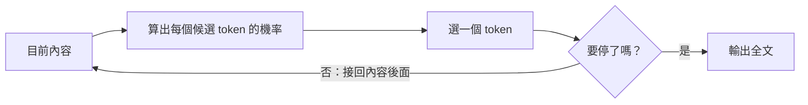
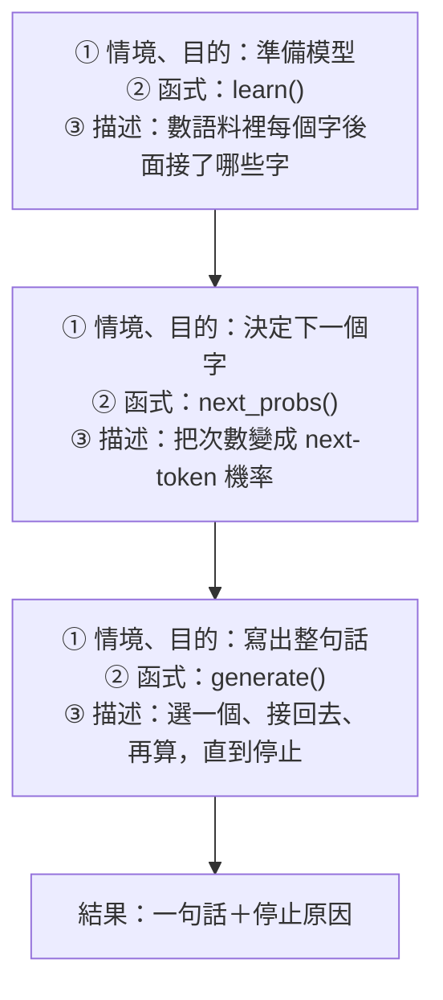
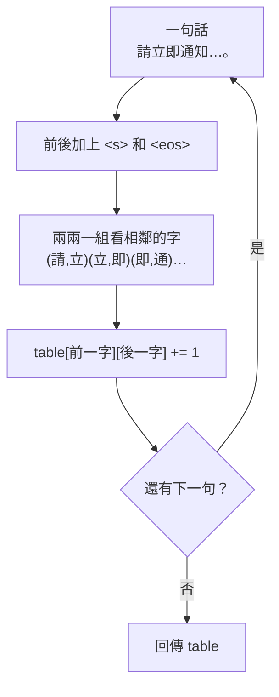
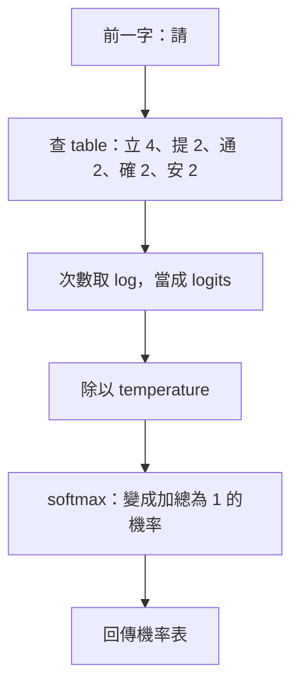
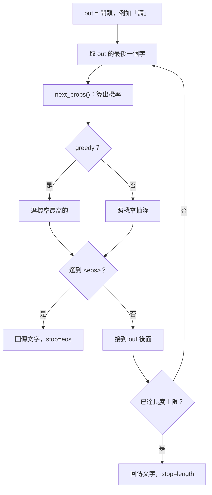

# 03｜模型怎麼一個字一個字寫出報告？

> **定位**：同一筆事件問兩次，AI 的寫法為什麼不一樣？這一節自己做一台「文字接龍機」，親眼看到 next-token 機率怎麼一步一步決定整句話。

## 學習目標

完成本節後，你應該能夠：
- 說出模型是「算出下一個 token 的機率、選一個、接回去再算」（自回歸），不是查出一整段預存答案
- 從語料算出 next-token 機率，並說明 greedy、sampling、seed、temperature 各自改變什麼
- 分辨停止原因（`eos`、`length`），並說明「機率高、句子通順」不等於內容正確

## 範例程式碼

- [demo](https://github.com/4-learn/llm-demo)：`03_inference_lab.py`

---

## 情境

你是營建公司的軟體工程師。

你把一筆事件丟給 AI，請它寫一句給安全人員的處理建議：

```python
event = {"event_id": "EVT-0042", "time": "20E07-E01-03 09:12", "site": "B 棟 3F", "detector": "camera-07", "label": "no_helmet", "confidence": 0.82, "note": "疑似有一人未戴安全帽", "image": "evt-0042.jpg"}
```

主管試了兩次，看完問你：

> 「同一筆事件，為什麼問兩次寫出來不一樣？而且有一次寫到一半就斷掉了？」

線上的 AI 是黑箱：只看得到輸入和回答，看不到它每一步怎麼選字。所以這一節不去猜黑箱，而是**自己做一台最小的語言模型**，把每一步的機率都印出來。

---

## 講解

### 一、訓練和推論不一樣

| 階段 | 做什麼 | 會改變什麼 |
| --- | --- | --- |
| 訓練（Training） | 用大量資料調整模型的權重 | 權重 |
| 推論（Inference） | 用已經訓練好的權重，處理新的輸入 | 只有這次的輸入與輸出；權重**不會**變 |

你在對話裡貼了新資料，模型並沒有「學會」它，只是這一次計算多了可以參考的上下文。等一下的接龍機也分這兩段：`learn()` 是訓練，`next_probs()` 和 `generate()` 是推論。

### 二、生成就是「文字接龍」

模型不是一次吐出整句話，而是重複做同一件事：

```text
P(下一個 token | 前面所有內容)
```

算出機率 → 選一個 token → 接回內容後面 → 再算下一個。這叫**自回歸**（autoregressive）。



所以兩次寫法不同的原因是：**只要某一步選了不同的 token，後面的內容就不同了**，接下來每一步都會跟著改變。

> 「一個字一個字」只是方便的說法。模型的單位是 **token**（第 02 節），一個 token 可能是一個字、一個詞或半個英文單字。本節的接龍機為了好懂，剛好用「一個字＝一個 token」。

### 三、接龍機和 LLM：流程一樣，看的範圍不同

| | 本節的接龍機 | 真實 LLM |
| --- | --- | --- |
| 機率從哪來 | 數語料裡「前一個字後面接什麼」 | 神經網路用權重計算 |
| 看多少上下文 | **只看前一個字** | 看前面**全部**內容（上下文窗口內） |
| 語料 | 12 句合成工安句子 | 海量文字 |
| 生成流程 | 算機率 → 選一個 → 接回去 → 再算 | **完全相同** |

接龍機的機率是程式**從語料算出來的**，不是老師編的數字；但它只看前一個字，所以會接出 LLM 不太會犯的錯。這些錯正好讓我們看清楚機率怎麼運作。

### 四、示範：文字接龍機

先看整條流程：三個函式各自做什麼？



> **一句話記法：** `learn()` **數次數**，`next_probs()` **算機率**，`generate()` **接龍**。

下面按照函式的順序，每次只回答三個問題：**這個函式要解決什麼問題？拿到什麼資料？回傳什麼結果？**

### 1. 先準備：語料與特殊 token

- `CORPUS`：12 句**合成**的工安處理建議，不是真實資料。
- `BOS = "<s>"`：句子開頭的記號，讓模型知道「第一個字」常是什麼。
- `EOS = "<eos>"`：句子結束的記號。模型選到它，就代表「寫完了」。

```python
BOS, EOS = "<s>", "<eos>"
CORPUS = [
    "請立即通知現場安全人員。",
    "請立即通知工安主任到場。",
    # ……共 12 句
]
```

### 2. `learn()`：訓練＝數次數

**要解決的問題：** 每個字後面，通常接什麼字？

**輸入：** `CORPUS`。

**輸出：** `table`，例如 `table["請"]` 是 `{'立': 4, '提': 2, '通': 2, '確': 2, '安': 2}`。



```python
def learn(sentences):
    table = defaultdict(Counter)
    for sentence in sentences:
        tokens = [BOS] + list(sentence) + [EOS]
        for prev, nxt in zip(tokens, tokens[1:]):
            table[prev][nxt] += 1
    return table
```

`zip(tokens, tokens[1:])` 把一句話變成一對一對的「前一字、後一字」。這就是整台接龍機的**訓練**：沒有神經網路，只有計數。

### 3. `next_probs()`：算出 next-token 機率

**要解決的問題：** 已知前一個字，下一個字是誰的機率各多少？

**輸入：** `table`、前一個字、`temperature`。

**輸出：** 機率表，例如 `{'立': 0.33, '提': 0.17, …}`，加總為 1。



```python
logits = {tok: math.log(n) for tok, n in counts.most_common()}
largest = max(logits.values())
weights = {tok: math.exp((z - largest) / temperature) for tok, z in logits.items()}
total = sum(weights.values())
return {tok: w / total for tok, w in weights.items()}
```

| 名詞 | 在接龍機裡 | 在真實 LLM 裡 |
| --- | --- | --- |
| logits | 次數取 log | 神經網路輸出的原始分數，可以是負數，加總不是 1 |
| softmax | `exp(z) / 總和` | 相同 |
| temperature | 除在 logits 上：小於 1 變尖、大於 1 變平 | 相同（第 04 節細講） |

`temperature=1` 時，機率剛好等於「次數 ÷ 總次數」：`立` 出現 4 次，總共 12 次，所以是 0.33。

如果前一個字在語料裡從沒出現過，表裡查不到，就丟出 `ValueError`。真實 LLM 不會「查不到」，但它遇到陌生內容時一樣會給出機率，只是那些機率不一定可靠。

### 4. `generate()`：接龍

**要解決的問題：** 從開頭一路寫到結束。

**輸入：** `table`、開頭 `prompt`、長度上限、要不要 greedy、`temperature`、`seed`。

**輸出：** `(整句文字, 停止原因)`。停止原因是 `eos` 或 `length`。



```python
for _ in range(max_new_tokens):
    prev = out[-1] if out else BOS
    probs = next_probs(table, prev, temperature)
    if greedy:
        tok = max(probs, key=probs.get)
    else:
        tok = rng.choices(list(probs), weights=list(probs.values()))[0]
    if tok == EOS:
        return "".join(out), "eos"
    out.append(tok)
return "".join(out), "length"
```

三個關鍵：

- `prev = out[-1]`：**只看最後一個字**。這就是接龍機和 LLM 最大的差別。
- `rng.choices(..., weights=...)`：照機率抽籤。機率 0.33 的字比較常被抽到，但 0.17 的字也有機會。
- `rng = random.Random(seed)`：同一個 `seed` 會抽出同一串籤，結果就能重現。

### 5. 主程式：把函式串起來

```text
learn(CORPUS) → table
      ↓
next_probs(table, "請") → 看「請」後面的機率
      ↓
generate(table, "請", …) → 用不同設定接龍，印出結果
```

### 完整可執行 Demo

只用 Python 標準函式庫，複製後可以直接執行：

<details>
<summary>展開完整程式碼</summary>

<!-- demo: 03_inference_lab.py -->
```python
"""第 03 節：文字接龍機（只用 Python 標準函式庫）。

從合成工安句子數出「前一個字後面接什麼字」，把次數當成 logits 轉成
next-token 機率，再一個一個接下去。它只看前一個字，是教學用的最小
語言模型，不是 LLM；但「算機率 → 選一個 → 接回去 → 再算」的生成
流程和 LLM 相同。
"""

import math
import random
from collections import Counter, defaultdict

BOS, EOS = "<s>", "<eos>"
CORPUS = [
    "請立即通知現場安全人員。",
    "請立即通知工安主任到場。",
    "請立即暫停施工並確認現場。",
    "請立即提醒人員配戴安全帽。",
    "請提醒人員配戴安全帽。",
    "請提醒人員離開施工區。",
    "請通知安全人員到場確認。",
    "請通知工安主任覆核影像。",
    "請確認人員是否配戴安全帽。",
    "請確認現場是否有人進入施工區。",
    "請安全人員到場確認。",
    "請安全人員覆核影像後回報。",
]


def learn(sentences):
    """訓練：數每個字後面接了哪些字、各幾次。"""
    table = defaultdict(Counter)
    for sentence in sentences:
        tokens = [BOS] + list(sentence) + [EOS]
        for prev, nxt in zip(tokens, tokens[1:]):
            table[prev][nxt] += 1
    return table


def next_probs(table, prev, temperature=1.0):
    """推論一步：次數 → logits → softmax → 下一個 token 的機率。"""
    if not (math.isfinite(temperature) and temperature > 0):
        raise ValueError("temperature must be finite and positive")
    counts = table.get(prev)
    if not counts:
        raise ValueError(f"語料裡沒看過「{prev}」後面接什麼")
    logits = {tok: math.log(n) for tok, n in counts.most_common()}
    largest = max(logits.values())
    weights = {tok: math.exp((z - largest) / temperature) for tok, z in logits.items()}
    total = sum(weights.values())
    return {tok: w / total for tok, w in weights.items()}


def generate(table, prompt="請", max_new_tokens=30, greedy=False,
             temperature=1.0, seed=None, trace=None):
    """接龍：算機率 → 選一個 → 接回去 → 再算，直到 <eos> 或長度上限。"""
    if max_new_tokens < 1:
        raise ValueError("max_new_tokens must be positive")
    rng = random.Random(seed)
    out = list(prompt)
    for _ in range(max_new_tokens):
        prev = out[-1] if out else BOS
        probs = next_probs(table, prev, temperature)
        if greedy:
            tok = max(probs, key=probs.get)
        else:
            tok = rng.choices(list(probs), weights=list(probs.values()))[0]
        if trace is not None:
            trace.append((prev, probs, tok))
        if tok == EOS:
            return "".join(out), "eos"
        out.append(tok)
    return "".join(out), "length"


def show(probs, top=4):
    return "｜".join(f"{tok} {p:.2f}" for tok, p in list(probs.items())[:top])


if __name__ == "__main__":
    table = learn(CORPUS)

    print("== 1. 「請」後面接什麼？")
    print("  次數：", dict(table["請"].most_common()))
    print("  機率：", show(next_probs(table, "請"), top=5))

    print("== 2. 從「請」開始接龍（seed=1，逐步列出）")
    steps = []
    text, reason = generate(table, "請", seed=1, trace=steps)
    for i, (prev, probs, tok) in enumerate(steps, 1):
        print(f"  step={i:<2} 前一字「{prev}」→ {show(probs)} → 選「{tok}」")
    print(f"  結果：{text}  stop={reason}")

    print("== 3. 同一個開頭，抽三次籤（seed=2、3、4）")
    for seed in (2, 3, 4):
        print(f"  seed={seed}：", *generate(table, "請", seed=seed))

    print("== 4. 固定 seed=7，跑三次")
    for _ in range(3):
        print("  ", *generate(table, "請", seed=7))

    print("== 5. greedy：每步都選最高機率")
    print("  ", *generate(table, "請", greedy=True))
    print("  ", *generate(table, "請", greedy=True, max_new_tokens=5))

    print("== 6. temperature 改變「請」後面的分布")
    for t in (0.5, 1.0, 2.0):
        print(f"  T={t}：", show(next_probs(table, "請", t), top=5))

    print("== 7. 沒看過的開頭")
    try:
        generate(table, "頭盔")
    except ValueError as error:
        print("  ", error)
```

</details>

執行：

```bash
python3 03_inference_lab.py
```

關鍵輸出（本機實跑）：

```text
== 1. 「請」後面接什麼？
  次數： {'立': 4, '提': 2, '通': 2, '確': 2, '安': 2}
  機率： 立 0.33｜提 0.17｜通 0.17｜確 0.17｜安 0.17
== 2. 從「請」開始接龍（seed=1，逐步列出）
  step=1  前一字「請」→ 立 0.33｜提 0.17｜通 0.17｜確 0.17 → 選「立」
  step=2  前一字「立」→ 即 1.00 → 選「即」
  step=3  前一字「即」→ 通 0.50｜暫 0.25｜提 0.25 → 選「提」
  step=4  前一字「提」→ 醒 1.00 → 選「醒」
  step=5  前一字「醒」→ 人 1.00 → 選「人」
  step=6  前一字「人」→ 員 0.89｜進 0.11 → 選「員」
  step=7  前一字「員」→ 配 0.25｜到 0.25｜。 0.12｜離 0.12 → 選「離」
  step=8  前一字「離」→ 開 1.00 → 選「開」
  step=9  前一字「開」→ 施 1.00 → 選「施」
  step=10 前一字「施」→ 工 1.00 → 選「工」
  step=11 前一字「工」→ 安 0.40｜區 0.40｜並 0.20 → 選「並」
  step=12 前一字「並」→ 確 1.00 → 選「確」
  step=13 前一字「確」→ 認 1.00 → 選「認」
  step=14 前一字「認」→ 現 0.40｜。 0.40｜人 0.20 → 選「現」
  step=15 前一字「現」→ 場 1.00 → 選「場」
  step=16 前一字「場」→ 。 0.33｜確 0.33｜安 0.17｜是 0.17 → 選「安」
  step=17 前一字「安」→ 全 0.78｜主 0.22 → 選「全」
  step=18 前一字「全」→ 人 0.57｜帽 0.43 → 選「帽」
  step=19 前一字「帽」→ 。 1.00 → 選「。」
  step=20 前一字「。」→ <eos> 1.00 → 選「<eos>」
  結果：請立即提醒人員離開施工並確認現場安全帽。  stop=eos
== 3. 同一個開頭，抽三次籤（seed=2、3、4）
  seed=2： 請安主任到場安全人員。 eos
  seed=3： 請立即通知現場。 eos
  seed=4： 請立即通知工區。 eos
== 4. 固定 seed=7，跑三次
   請立即暫停施工安全人員配戴安主任到場是否配戴安主任到場。 eos
   請立即暫停施工安全人員配戴安主任到場是否配戴安主任到場。 eos
   請立即暫停施工安全人員配戴安主任到場是否配戴安主任到場。 eos
== 5. greedy：每步都選最高機率
   請立即通知工安全人員配戴安全人員配戴安全人員配戴安全人員配戴安 length
   請立即通知工 length
== 6. temperature 改變「請」後面的分布
  T=0.5： 立 0.50｜提 0.12｜通 0.12｜確 0.12｜安 0.12
  T=1.0： 立 0.33｜提 0.17｜通 0.17｜確 0.17｜安 0.17
  T=2.0： 立 0.26｜提 0.18｜通 0.18｜確 0.18｜安 0.18
== 7. 沒看過的開頭
   語料裡沒看過「盔」後面接什麼
```

### 五、從輸出讀出來的事

**1. next-token 機率是從資料算出來的**

| 輸出 | 意思 |
| --- | --- |
| `次數： {'立': 4, '提': 2, …}` | 語料裡「請」後面接「立」4 次，其他各 2 次 |
| `機率： 立 0.33｜提 0.17…` | 4 ÷ 12 = 0.33；這就是「請」的 next-token 機率分布 |
| `step=2 前一字「立」→ 即 1.00` | 語料裡「立」後面一定是「即」，所以沒得選 |
| `step=7 前一字「員」→ 配 0.25｜到 0.25…` | 分岔點：好幾個字都有機會，這一步抽到「離」 |

**2. 同一個開頭，結果不同；固定 seed，結果相同**

| 輸出 | 意思 |
| --- | --- |
| `seed=2、3、4` 三句不同 | 都從「請」開始，某一步抽到不同的字，後面就整句不同 |
| `seed=7` 三次完全一樣 | 籤的順序固定，結果就能重現。**相同不代表正確** |
| greedy 每次都一樣 | 每步都選最高的，沒有抽籤，所以永遠同一句 |

這就是主管問題的答案：**同一筆事件寫法不同，是因為每一步都在照機率抽籤。**

**3. 停止原因：`eos` 和 `length`**

| 輸出 | 意思 |
| --- | --- |
| `stop=eos` | 模型抽到 `<eos>`，自己「選擇」結束 |
| greedy `…配戴安全人員配戴… length` | greedy 只看當下最高分，陷入「安→全→人→員→配→戴→安」的迴圈，靠長度上限才停 |
| `max_new_tokens=5` → `請立即通知工 length` | 被**截斷**：看起來像話，其實沒寫完 |

主管遇到的「寫到一半就斷掉」，最常見的原因就是 `length`。程式除了拿到文字，**也要記下停止原因**；是 `length` 的報告，不能當作完整報告送出。

| 停止原因 | 代表什麼 | 不代表什麼 |
| --- | --- | --- |
| `eos`：選到結束 token | 模型「選擇」結束 | 不保證內容完整或正確 |
| `stop`：遇到停止字 | 你的程式要求在這裡停（Workshop 會實作） | 不代表模型覺得寫完了 |
| `length`：達到長度上限 | 系統不讓它繼續寫 | 報告可能**寫到一半** |

**4. 通順不等於正確**

| 生成結果 | 問題在哪 |
| --- | --- |
| `請立即通知現場。` | 語料裡沒有這句，卻很合理：模型能組出新句子 |
| `請立即通知工區。` | 每一步單看都合理（「工」後面接「區」很常見），整句卻不通 |
| `…確認現場安全帽。` | 「現場安全」和「安全帽」都常見，接在一起就變成怪句子 |

接龍機只看前一個字，所以錯得很明顯。LLM 看得更遠，錯得比較隱蔽，但道理一樣：**機率高代表「常見」，不代表「符合這筆事件的事實」**。所以 AI 寫的處理建議，仍要和事件資料核對。

**5. temperature 改變分布的形狀**

| 輸出 | 意思 |
| --- | --- |
| `T=0.5：立 0.50` | 變尖：高的更高，抽籤更常抽到「立」 |
| `T=2.0：立 0.26` | 變平：各字機率接近，結果更多變 |
| 三種溫度最高的都是「立」 | temperature 不改變排名；它不是「創意」或「正確率」旋鈕 |

### 六、課後體驗：真實模型是同一回事嗎？

做完接龍機後，可以到線上的 LLM Playground 試試同一件事。例如 Hugging Face Space：

[JonathanColetti/Qwen3.8-27B-Uncensored-Demo](https://huggingface.co/spaces/JonathanColetti/Qwen3.8-27B-Uncensored-Demo)

1. 每次按垃圾桶清除對話，貼上同一段合成事件：

   ```text
   事件編號：EVT-0042
   地點：B 棟 3F
   偵測結果：疑似有一人未戴安全帽，正在進入施工區。
   信心分數：0.82

   請用一句話寫給安全人員的處理建議。
   ```

2. 送出三次，記下三次的回答。
3. 對照接龍機想一想：三次是否不同？從哪裡開始分岔？三次是否都符合事件事實？

這只是**黑箱觀察**，要清楚它的限制：

| 能觀察到 | 不能觀察到 |
| --- | --- |
| 同一輸入可能得到不同回答 | 每一步的 next-token 機率 |
| 回答是否通順、是否符合事實 | 實際的 token 切法、temperature、seed |

- 三次不同，**不能**證明模型是自回歸生成；三次相同，也**不能**證明它不是（可能 seed 固定或沒開抽樣）。要看到真實模型的機率，得能存取模型本身，第 07 節在本機載入模型時會做到。
- Space 是第三方服務，可能排隊、出錯或下架；名稱中的 `Uncensored` 代表它降低了拒答，不代表回答更正確。
- 只貼講義提供的合成事件。不要貼真實個資、工地資料、未公開影像、帳號、密碼或任何 API key／token。

---
## Workshop

### 題目

主管希望 AI 助理寫的處理建議「**一句話就好**」，而且不能無限寫下去。請你用下面這張人工分數表（每一步只看**上一個 token**，比真實模型簡化很多），自己寫出生成迴圈，加上停止條件：

```python
import math

# 人工設定的教學資料：key 是「上一個 token」，value 是下一個 token 的候選與 logits。
# 這不是真實模型；真實模型會看整段上下文重新計算。
NEXT = {
    "<BOS>": {"B 棟 3F": 3.0, "疑似": 1.0},
    "B 棟 3F": {"疑似": 2.5, "有人": 1.0},
    "疑似": {"有人": 3.0, "未戴安全帽": 1.5},
    "有人": {"未戴安全帽": 3.5, "，": 0.5},
    "未戴安全帽": {"，": 2.0, "。": 1.5},
    "，": {"建議": 3.0, "請": 1.0},
    "建議": {"覆核": 3.0, "確認": 1.0},
    "覆核": {"。": 2.0, "<EOS>": 1.0},
    "。": {"請": 2.0, "<EOS>": 1.5},
    "請": {"工安主任": 3.0, "覆核": 0.5},
    "工安主任": {"確認": 3.0, "覆核": 1.0},
    "確認": {"。": 2.0, "<EOS>": 1.0},
}
EOS = "<EOS>"


def softmax(logits):
    largest = max(logits)
    weights = [math.exp(x - largest) for x in logits]
    total = sum(weights)
    return [x / total for x in weights]
```

要做的事：

1. 寫 `generate(table, max_new_tokens=20, stop_tokens=())`：從 `"<BOS>"` 開始，每一步用 greedy 選機率最高的 token，回傳 `(output, trace, reason)`
2. 三種停止條件：選到 `<EOS>` 回 `"eos"`（`<EOS>` 不放進輸出）；選到 `stop_tokens` 裡的字回 `"stop"`（這個字**要**放進輸出）；寫滿 `max_new_tokens` 個回 `"length"`
3. `trace` 記下每一步選了什麼、機率多少（四捨五入到小數 3 位）
4. 跑三種設定，印出結果：遇到句號就停（並印出每一步）、最多 4 個 token、沒有停止字但最多 20 個 token

提示：
1. 用 `last` 記住上一個 token，`table[last]` 就是這一步的候選
2. 先檢查 EOS，再把 token 加進輸出，然後才檢查停止字
3. `"".join(output)` 把 token 接成一句話

### 預期輸出

```text
step=1 choose=B 棟 3F p=0.881
step=2 choose=疑似 p=0.818
step=3 choose=有人 p=0.818
step=4 choose=未戴安全帽 p=0.953
step=5 choose=， p=0.622
step=6 choose=建議 p=0.881
step=7 choose=覆核 p=0.881
step=8 choose=。 p=0.731
== 遇到句號就停
tokens: 8 stop: stop
output: B 棟 3F疑似有人未戴安全帽，建議覆核。
== 最多 4 個 token
tokens: 4 stop: length
output: B 棟 3F疑似有人未戴安全帽
== 沒有停止字，最多 20 個 token
tokens: 20 stop: length
output: B 棟 3F疑似有人未戴安全帽，建議覆核。請工安主任確認。請工安主任確認。請工安主任確認。
```

做完之後想一想：
- 「最多 4 個 token」那句停在「未戴安全帽」，看起來像一句完整的話，但它其實是被**截斷**的（`stop: length`），不能當成完整建議送出
- 「沒有停止字」那句一直重複「請工安主任確認。」：greedy 只看當下最高分，可能陷入迴圈，最後靠長度上限才停下來。這就是為什麼長度上限**一定要設**

### 解答

- [解答](https://github.com/4-learn/llm-workshop)：`03_workshop.py`

---

## 教師紀錄

- 證據等級：**本機實測**（文字接龍機從 12 句合成語料計算 next-token 機率，以及 Workshop 生成迴圈；未載入真實模型）。課後體驗（Hugging Face Space）結果每次不同，**待驗證**、不列入驗收。
- 20E07-E03-22 備課實測：`Belemort/Qwen-Qwen2.5-0.5B-Instruct` 顯示 `Runtime error: Scheduling failure`；`Qwen/Qwen3-Demo` 選 `Qwen3-0.6B`、關閉 Thinking 後仍回傳 `'NoneType' object has no attribute 'choices'`；`JonathanColetti/Qwen3.8-27B-Uncensored-Demo` 可正常回答。公開 Space 不適合當主要示範，因此本節改以接龍機為核心。
