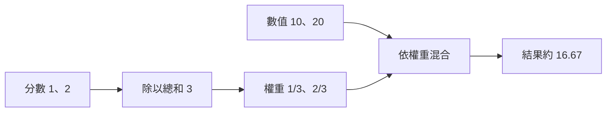

# 04｜Attention｜用權重混合資訊

> 本課只學一件事：不同權重會改變加權平均；權重總和為 1 時，可直接視為比例。

## 從熟悉的例子開始

兩家店的分數是 10 和 20。若更重視第二家，就給 20 較大的權重，平均結果會更靠近 20。Attention（注意力機制）也會依目前內容為不同位置分配權重，再混合它們的資訊。以下只是小型算術示意，不是完整模型，也不能證明模型理解或答案正確。

## Demo：計算加權平均

<!-- demo: 04_transformer_attention.py -->

```python
scores = [1, 2]
values = [10, 20]
total = scores[0] + scores[1]
first_weight = scores[0] / total
second_weight = scores[1] / total
result = first_weight * values[0] + second_weight * values[1]
print("權重：", first_weight, second_weight)
print("結果：", result)
```

實際輸出：
```text
權重： 0.3333333333333333 0.6666666666666666
結果： 16.666666666666664
```

程式只用已學過的串列索引、加減乘除和變數，沒有使用 `zip`、`sum` 或串列生成式。`scores` 先相加成 `total`，再各自除以總和，得到總和為 1 的權重；最後依權重混合 `values`。



## 為什麼與 LLM 有關

LLM（大型語言模型）的 Attention 會依上下文計算各位置的權重，混合表示後交給後續層處理。這不表示被分配較大權重的內容一定重要、正確，或能用來解釋模型答案。

## 練習與自我檢查

把 `scores` 改成 `[3, 1]` 再執行，觀察權重和結果；再把 `values` 改成 `[10, 30]`，比較同一組權重會如何混合不同數值。

1. 哪個權重變大時，結果會更靠近哪個數值？
2. 為什麼要把分數除以總和？
3. 這個玩具計算能證明模型理解輸入嗎？

**答案提示：**結果會更靠近該權重對應的數值；除以總和可將權重正規化成總和為 1 的比例；不能，這只是算術示意。
