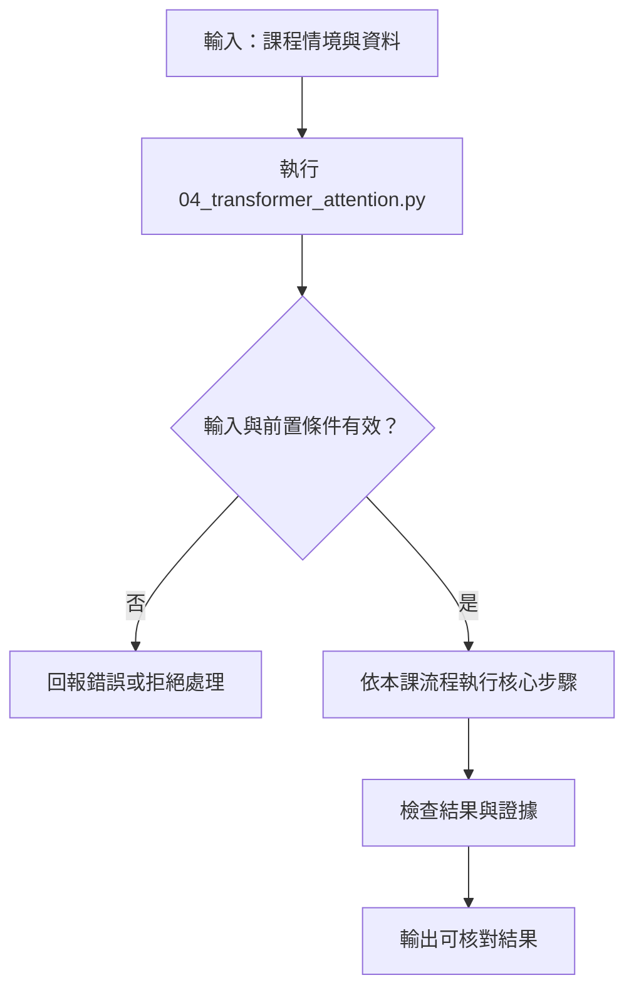

# Transformer、Attention、MoE 與推理模型

> **正文改版：2026-10-24｜對應新版 LLM 第 04 節：Transformer、Attention、MoE 與推理模型。**本節用可檢查的純 Python 玩具注意力，理解 Transformer 如何依上下文混合資訊，並辨認 MoE 與推理模型的概念；本節不是訓練大型模型，也不模擬真實模型效能。

[回 50 節課綱](https://hackmd.io/@yillkid/HJl8JXTNkl)

## 流程圖：Transformer、Attention、MoE 與推理模型



## 學習目標與時間

先備：能讀 Python 函式、列表與字典；不需要線性代數背景。全長 50 分鐘：概念 20 分、Demo 10 分、Workshop 15 分、回顧 5 分。完成後能解釋注意力權重如何影響輸出、說明多頭與 MoE 的分工，並指出玩具例子的限制。

## 一、Attention 是依相關性加權混合

給定查詢（Query）、鍵（Key）與值（Value），注意力先比較 Q、K 的相容程度，經 softmax 轉成總和為 1 的權重，再對 V 加權求和。權重不是「模型理解程度」或因果證據，只是特定表示與計算下的分配。因果語言模型還會遮住未來 token，避免預測時偷看答案。

## 二、堆疊與多頭帶來不同表示

Transformer 把注意力、逐位置前饋網路、殘差連接與正規化反覆堆疊。多頭注意力讓模型在不同投影空間計算多組混合，再合併結果；不能簡化成每個頭固定負責一種人類可命名語法。位置資訊也必須透過位置編碼等機制進入表示。

## 三、MoE 是稀疏路由，不是免費容量

混合專家（Mixture of Experts）以路由器挑選部分專家處理 token，可提高參數容量而只啟用部分網路。但路由可能失衡，專家參數仍佔記憶體，跨設備通訊也有成本。它不代表每次輸入都會由同一專家處理，也不必然更快或更準。

## 四、推理模型與可觀察輸出

推理型系統可能透過額外計算、搜尋或訓練提升多步任務表現；「推理」是產品與模型行為描述，不是保證答案正確的標籤。應以明確任務、固定資料與可重複條件評估，而非只看一段看似流暢的解釋。

## 五、可執行 Demo

下方以一維分數作簡化注意力：穩定 softmax 後加權平均。此例刻意不依賴第三方套件；它不是完整 Transformer。

<!-- demo: 04_transformer_attention.py -->
```python
import math

def attention(scores, values):
    if not isinstance(scores, (list, tuple)) or not isinstance(values, (list, tuple)):
        raise ValueError("scores and values must be lists or tuples")
    if len(scores) != len(values) or not scores:
        raise ValueError("scores and values must have equal nonzero length")
    if any(type(x) not in (int, float) for x in scores + values):
        raise ValueError("scores and values must be numbers")
    # 轉 float 後檢查，避免超大整數造成 math.isfinite OverflowError。
    try:
        finite = all(math.isfinite(float(x)) for x in scores + values)
    except (OverflowError, TypeError, ValueError):
        finite = False
    if not finite:
        raise ValueError("inputs must be finite")
    peak = max(scores)
    exps = [math.exp(x - peak) for x in scores]
    total = sum(exps)
    weights = [x / total for x in exps]
    return weights, sum(w * v for w, v in zip(weights, values))

if __name__ == "__main__":
    weights, result = attention([0.0, 1.0], [10.0, 20.0])
    print("weights:", [round(x, 3) for x in weights])
    print("weighted value:", round(result, 3))
```

執行：`python3 04_transformer_attention.py`。教師 trace（本次實際執行：2026-10-24；Linux、Python 3.11.2；標準函式庫；玩具輸入，模型 revision／外部量測不適用）：

```text
weights: [0.269, 0.731]
weighted value: 17.311
```

不代表學生實測或真實模型效能。

## Workshop

12 分鐘：手算兩個分數 `[0, 1]` 的權重，執行程式核對；再將分數改為 `[1, 0]`，觀察加權結果。3 分鐘：在函式加入空列表與長度不同的測試，並說明何以輸出會改變。

參考判讀：較大分數獲得較大權重；權重總和約為 1，輸出介於輸入值之間。驗收：執行改寫後程式，確認兩種輸入結果不同；空輸入及長度錯誤均拋出 `ValueError`；回答「這能證明模型理解嗎？」並答不能。

## 教師紀錄與下一步

證據級別：本機實測（僅此標準函式庫 demo）；限制：標量打分不含向量投影、多頭、遮罩、訓練或 MoE，也不能推論真實模型品質。實測環境與日期如上，無模型 revision、無外部量測。尚未實班試教。下一節：05 Sampling 與生成實驗（依 mapping）。舊教材僅歷史參照，未宣稱已同步。
