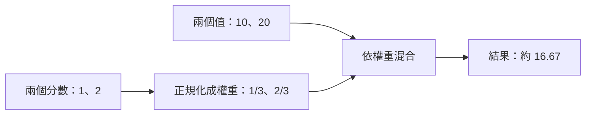

# 04｜Attention｜用權重混合資訊

> 本課只學一件事：不同權重會改變加權平均；權重總和為 1 才可直接視為比例。

## 從熟悉的例子開始

兩家店評分是 10 和 20。如果較喜歡第二家，就給第二家較大的權重，結果會更靠近 20。Attention 也會依目前內容分配權重，再混合資訊；這個玩具例子只說明「加權」，不是完整模型，也不代表模型真的理解或答案正確。

## Demo：加權平均

<!-- demo: 04_transformer_attention.py -->
```python
scores = [1, 2]
values = [10, 20]
total = scores[0] + scores[1]
weights = [scores[0] / total, scores[1] / total]
result = weights[0] * values[0] + weights[1] * values[1]
print(weights, result)
```

本程式只用已學過的串列索引與加減乘除，不需要串列推導式、`zip` 或 `sum`。程式印出兩個權重與加權結果。若權重原本總和不是 1，通用加權平均須除以權重總和；Attention 通常用 softmax 正規化分數（把分數轉成總和為 1 的權重），再加權求和。

## 為什麼與 LLM 有關

LLM 的 Attention 會依上下文計算各位置的權重，混合表示後供後續層使用。這不等於模型注意到的內容必然重要、正確或可解釋。

## 練習與自我檢查

修改 `scores` 的兩個分數，觀察權重及結果如何變化；程式會用 `scores` 計算比例，用 `values` 表示要混合的數值，兩組資料用途不同。提交程式、輸出及一句觀察。



1. 哪個權重變大時，結果會更靠近哪個數值？
2. 權重總和不是 1 時，為什麼需要正規化？
3. 這個玩具結果能否證明模型理解輸入？

答案提示：靠近對應數值；除以權重總和可取得比例；不能，這只是簡化計算示意。
