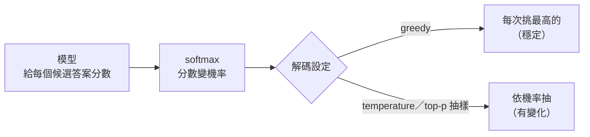

# 05｜報告要穩定，還是要活潑？

> **定位**：事件分類每次都要一樣，給工人的提醒可以口語一點；同一個模型，用兩種解碼設定分別處理。

## 學習目標

完成本節後，你應該能夠：
- 說出 temperature、top-p 各自改變什麼，以及被 top-p 切掉的答案為什麼「永遠抽不到」
- 依用途選解碼設定：分類用穩定設定、提醒文字用活潑設定，並用固定 seed 讓實驗可以重跑
- 分清楚「穩定」和「正確」：每次都一樣，不代表每次都對

## 範例程式碼

- [demo](https://github.com/4-learn/llm-demo)：`E02_sampling.py`

---

## 情境

你是營建公司的軟體工程師。

AI 工安助理開始試跑。每筆事件（例如 `EVT-0042`，B 棟 3F 疑似有人未戴安全帽）會做兩件事：先**分類**，再產生一句**給工人的提醒**。兩件事用同一個模型，但實習生寫設定時把兩邊填反了：

```text
事件分類：temperature=1.0（照機率抽籤）
工人提醒：greedy（每次都選機率最高的）
```

主管看了兩天的紀錄，提出兩個抱怨：

> 「同一筆事件，昨天分類是 no_helmet，今天重跑變 unknown，報表對不起來。可是那句提醒，每次都一模一樣，工人看到都麻痺了。」

模型沒換，換的是**怎麼從機率裡挑一個**。兩個抱怨其實是同一件事的兩面：

| 抱怨 | 原因 |
| --- | --- |
| 分類重跑會變 | 有抽籤：每次可能抽到不同標籤 |
| 提醒一模一樣 | 沒抽籤：每次都選同一條最高機率的路 |

上一節的接龍機已經看過這兩種行為：greedy 每次都輸出同一句，抽樣則每次都可能不同。這一節要回答：**哪個任務該穩定、哪個任務該有變化？抽樣時又怎麼避免抽到離譜的答案？**

---

## 講解

### 一、模型給分數，解碼負責挑

第 03 節已經做過：模型每一步給每個候選 token 一個分數（logits），`softmax` 把分數變成機率，接著從機率裡挑一個。第 03 節也看過 greedy、seed 和 temperature 的基本效果。這一節專心處理「**怎麼挑**」，也就是**解碼設定**。



解碼只改「怎麼挑」，**不改模型知道什麼**：

| 設定 | 做什麼 | 不保證什麼 |
| --- | --- | --- |
| `greedy` | 每次挑機率最高的，不抽樣 | 不保證最高分就是對的 |
| `temperature` | 縮放分數再算機率；低溫更集中、高溫更平均 | 不改排名，不新增證據 |
| `top-k` | 只留前 k 名，重新分配機率 | 被切掉的機率**恰為 0** |
| `top-p` | 只留累積機率達到 p 的最小集合，重新分配機率 | 同上，切掉就永遠抽不到 |
| `seed` | 固定亂數起點，讓抽樣可以重跑 | 只保證同一份程式、同一個實作 |
| `max_new_tokens` | 最多產生幾個 token 就硬停 | 被截斷 ≠ 模型說完了 |

> 「temperature 設 0 最準」是常見誤解。除以 0 在數學上沒有定義，各家服務通常偷偷改成 greedy，但做法不一定相同。示範程式遇到 `temperature <= 0` 直接報錯，不偷偷改。

### 二、示範：同一組分數，換六種設定

情境：模型要從 `missing`／`present`／`unknown`／`<EOS>` 裡挑下一個 token。**依證據正確的是 `missing`（token 0）**，但模型給 `present`（token 1）的分數最高。分數是人工設定的教學資料，不是真實模型輸出。

<!-- demo: E02_sampling.py -->
```python
"""第 04 節：解碼設定對照實驗（只用 Python 標準函式庫）。"""

import math
import random
from collections import Counter

TOKENS = ("missing", "present", "unknown", "<EOS>")
EOS = 3
MAX_NEW_TOKENS = 4
SEED = 20261005
TRIALS = 200

FIRST_LOGITS = (0.2, 2.6, 0.9, -1.0)
FOLLOWUP_LOGITS = {
    0: (0.0, -1.0, -1.0, 3.0),
    1: (-1.0, 0.0, -1.0, 2.0),
    2: (-1.0, -1.0, 0.0, 2.0),
}
# 依證據，第一步的正確答案是 token 0（missing）；分數最高的 token 1（present）是錯的。
CORRECT = 0


def step_logits(history):
    """玩具規則：第一步用固定分數，之後只看最後一個 token。"""
    if not history:
        return FIRST_LOGITS
    if history[-1] not in FOLLOWUP_LOGITS:
        raise ValueError("this toy table only continues from token 0, 1 or 2")
    return FOLLOWUP_LOGITS[history[-1]]


def softmax(logits, temperature=1.0):
    if not math.isfinite(temperature) or temperature <= 0:
        raise ValueError("temperature must be finite and positive")
    if not logits or not all(math.isfinite(x) for x in logits):
        raise ValueError("logits must be finite and non-empty")
    largest = max(logits)
    weights = [math.exp((x - largest) / temperature) for x in logits]
    total = sum(weights)
    return [w / total for w in weights]


def _keep_and_renormalize(probabilities, keep):
    total = sum(probabilities[index] for index in keep)
    if total <= 0:
        raise ValueError("kept probabilities sum to zero")
    return [
        probabilities[index] / total if index in keep else 0.0
        for index in range(len(probabilities))
    ]


def top_k(probabilities, k):
    if k < 1:
        raise ValueError("k must be positive")
    order = sorted(range(len(probabilities)), key=lambda i: -probabilities[i])
    return _keep_and_renormalize(probabilities, set(order[:k]))


def top_p(probabilities, p):
    if not 0 < p <= 1:
        raise ValueError("p must be in (0, 1]")
    order = sorted(range(len(probabilities)), key=lambda i: -probabilities[i])
    keep, cumulative = set(), 0.0
    for index in order:
        keep.add(index)
        cumulative += probabilities[index]
        if cumulative >= p:
            break
    return _keep_and_renormalize(probabilities, keep)


def sample_inverse_cdf(probabilities, rng):
    threshold = rng.random()
    cumulative = 0.0
    for index, probability in enumerate(probabilities):
        cumulative += probability
        if threshold < cumulative:
            return index
    return len(probabilities) - 1


def sample_gumbel_max(probabilities, rng):
    best_score, chosen = None, None
    for index, probability in enumerate(probabilities):
        if probability <= 0:
            continue
        score = math.log(probability) - math.log(-math.log(rng.random()))
        if best_score is None or score > best_score:
            best_score, chosen = score, index
    return chosen


def decode_step(logits, *, greedy=False, temperature=1.0, k=None, p=None, rng=None,
                sampler=sample_inverse_cdf):
    probabilities = softmax(logits, temperature)
    if k is not None:
        probabilities = top_k(probabilities, k)
    if p is not None:
        probabilities = top_p(probabilities, p)
    if greedy:
        return max(range(len(probabilities)), key=lambda i: probabilities[i])
    return sampler(probabilities, rng)


def generate(*, rng, max_new_tokens=MAX_NEW_TOKENS, **setting):
    history = []
    for _ in range(max_new_tokens):
        chosen = decode_step(step_logits(history), rng=rng, **setting)
        if chosen == EOS:
            return tuple(history), "eos"
        history.append(chosen)
    return tuple(history), "length"


def run(setting, trials, seed):
    rng = random.Random(seed)
    correct, outputs, reasons = 0, Counter(), Counter()
    for _ in range(trials):
        ids, reason = generate(rng=rng, **setting)
        outputs[ids] += 1
        reasons[reason] += 1
        correct += ids[:1] == (CORRECT,)
    return correct, outputs, reasons


if __name__ == "__main__":
    print("=== 第一步的分布（同一組 logits，只改 temperature）===")
    for temperature in (0.2, 1.0, 2.0):
        values = [round(x, 4) for x in softmax(step_logits([]), temperature)]
        print(f"T={temperature:<4} p={values}")

    print()
    base = softmax(step_logits([]))
    for label, truncated in (("top_k(k=2)", top_k(base, 2)), ("top_p(p=0.90)", top_p(base, 0.9))):
        keep = [i for i, x in enumerate(truncated) if x > 0]
        values = [round(x, 4) for x in truncated]
        print(f"{label:<14} keep={keep} p={values}  token0 機率={truncated[CORRECT]}")

    print()
    print(f"=== {TRIALS} 次解碼（seed={SEED}）===")
    settings = [
        ("greedy", {"greedy": True}),
        ("T=0.2", {"temperature": 0.2}),
        ("T=1.0", {"temperature": 1.0}),
        ("T=2.0", {"temperature": 2.0}),
        ("top_k=2, T=1.0", {"temperature": 1.0, "k": 2}),
        ("top_p=0.90, T=1.0", {"temperature": 1.0, "p": 0.9}),
    ]
    for label, setting in settings:
        correct, outputs, reasons = run(setting, TRIALS, SEED)
        reason_text = ",".join(f"{k}={v}" for k, v in sorted(reasons.items()))
        print(f"{label:<18} 正確 {correct:>3}/{TRIALS} = {correct / TRIALS:6.1%}  "
              f"不重複輸出={len(outputs):<2} 終止={reason_text}")

    print()
    print("=== 重現性：同一 seed、不同實作 ===")
    for label, sampler in (("inverse-CDF", sample_inverse_cdf), ("Gumbel-max", sample_gumbel_max)):
        rng = random.Random(SEED)
        first = [generate(rng=rng, temperature=2.0, sampler=sampler)[0] for _ in range(8)]
        print(f"{label:<12} 前 8 次={first}")
    for label in ("inverse-CDF 重跑", "inverse-CDF 重跑"):
        rng = random.Random(SEED)
        first = [generate(rng=rng, temperature=2.0, sampler=sample_inverse_cdf)[0] for _ in range(8)]
        print(f"{label:<12} 前 8 次={first}")
```

執行：

```bash
python3 E02_sampling.py
```

關鍵輸出（本機實跑）：

```text
=== 第一步的分布（同一組 logits，只改 temperature）===
T=0.2  p=[0.0, 0.9998, 0.0002, 0.0]
T=1.0  p=[0.0697, 0.7688, 0.1404, 0.021]
T=2.0  p=[0.159, 0.528, 0.2257, 0.0873]

top_k(k=2)     keep=[1, 2] p=[0.0, 0.8455, 0.1545, 0.0]  token0 機率=0.0
top_p(p=0.90)  keep=[1, 2] p=[0.0, 0.8455, 0.1545, 0.0]  token0 機率=0.0

=== 200 次解碼（seed=20261005）===
greedy             正確   0/200 =   0.0%  不重複輸出=1  終止=eos=200
T=0.2              正確   0/200 =   0.0%  不重複輸出=1  終止=eos=200
T=1.0              正確  16/200 =   8.0%  不重複輸出=11 終止=eos=200
T=2.0              正確  35/200 =  17.5%  不重複輸出=39 終止=eos=177,length=23
top_k=2, T=1.0     正確   0/200 =   0.0%  不重複輸出=5  終止=eos=200
top_p=0.90, T=1.0  正確   0/200 =   0.0%  不重複輸出=5  終止=eos=200

=== 重現性：同一 seed、不同實作 ===
inverse-CDF  前 8 次=[(1, 1, 1), (0, 0, 2, 2), (2,), (1,), (1, 0, 1, 2), (1, 1, 1), (), (0, 2)]
Gumbel-max   前 8 次=[(1,), (0,), (1,), (2, 0, 0, 0), (1, 2, 2, 1), (1,), (0, 0), (1, 1)]
inverse-CDF 重跑 前 8 次=[(1, 1, 1), (0, 0, 2, 2), (2,), (1,), (1, 0, 1, 2), (1, 1, 1), (), (0, 2)]
inverse-CDF 重跑 前 8 次=[(1, 1, 1), (0, 0, 2, 2), (2,), (1,), (1, 0, 1, 2), (1, 1, 1), (), (0, 2)]
```

### 三、四個重點

**① 穩定不等於正確**

| 設定 | 正確率 | 不重複輸出 | 讀法 |
| --- | ---: | ---: | --- |
| `greedy` | 0.0% | 1 | 200 次都一樣，200 次都錯 |
| `T=0.2` | 0.0% | 1 | 跟 greedy 一樣，很穩定地選錯 |
| `T=1.0` | 8.0% | 11 | 偶爾抽到正確答案 |
| `T=2.0` | 17.5% | 39 | 正確率最高，但有 23 次被截斷（`length=23`） |

模型本來就偏向錯的 `present`，低溫只會讓它**更堅定地選錯**。反過來，如果模型本來就偏向正確答案，低溫就會比較準。所以：**溫度改的是分布的形狀，不是答案的對錯。**

**② 截斷是「不可能」，低溫只是「很少見」**

`T=0.2` 時 token 0 的機率是 `0.0002`，很小但不是 0；`top_k=2`、`top_p=0.90` 把它變成**恰為 `0.0`**，抽一萬次也抽不到。`top_p` 是按名次累加：`0.7688 + 0.1404 = 0.9092 ≥ 0.90`，加到第二名就停了。

這個特性也能拿來**用**：把「絕對不該出現的說法」放在切掉的尾巴裡，它就永遠不會被抽到（Workshop 會用到）。

**③ 高溫有代價**

`T=2.0` 換到多樣性和一點正確率，也換到 23 次沒說完就被 `max_new_tokens` 停掉的輸出。

**④ 固定 seed 只保證你自己的程式**

| 比較 | 結果 |
| --- | --- |
| 同一實作（inverse-CDF）、同一 seed，重跑兩次 | 逐字相同 |
| 同一 seed，換實作（Gumbel-max） | 完全不同 |

兩種實作抽的是同一個分布，只是用亂數的方式不同。換到雲端服務，還有模型版本、伺服器實作等變因，所以紀錄裡要寫**完整設定＋seed＋實作與版本**，不能只寫 `temperature=0.7`。

### 四、回到工安助理：把設定對調

實習生的設定剛好放反了。對調之後：

| 用途 | 要什麼 | 建議設定 | 為什麼 |
| --- | --- | --- | --- |
| 事件分類（進報表） | 每次一樣，可以對帳 | `greedy` | 不抽樣，重跑一定相同 |
| 給工人的提醒 | 口語、有變化，不要麻痺 | `temperature` 抽樣 ＋ `top-p` | 有變化，又把最離譜的說法切掉 |

**課堂體驗**（可選）：回到第 03 節的接龍機，對調設定試試看：

- 用 `greedy=True` 跑三次：三次一模一樣，這就是主管說的「工人看到都麻痺了」。
- 改成 `temperature=1.0`、不固定 seed，再跑三次：說法開始有變化。
- 把 `temperature` 調到 `2.0`：低機率的字更常被抽到，句子更容易繞圈。備課實測 200 次，被長度上限截斷的次數從 2 次增加為 6 次。這就是要用 top-p 把機率很低的尾巴切掉的原因。

接龍機能看到每一步的機率；線上模型介面只能看到結果，所以這裡不用線上服務。

---

## Workshop

### 題目

延續示範程式的人工 logits 機制（不需要真模型），寫一支 `E02_workshop.py`，讓同一筆事件 `EVT-0042` 的分類穩定、提醒活潑：

1. 從 `E02_sampling.py` 複製 `softmax`、`_keep_and_renormalize`、`top_k`、`top_p`、`sample_inverse_cdf`、`decode_step`，**不要改**
2. 準備兩組人工分數：
   - 分類：`LABELS = ("no_helmet", "helmet_ok", "unknown")`，`CLASSIFY_LOGITS = (2.1, 0.4, 1.3)`
   - 提醒：5 句候選提醒，最後一句是不該出現的「沒戴帽子就扣薪水！」，`REMINDER_LOGITS = (1.2, 1.0, 0.9, 0.8, -1.5)`
3. 寫 `pick_setting(purpose)`：`"classify"` 回傳穩定設定、`"reminder"` 回傳活潑設定，其他用途丟 `ValueError`（主程式最後試 `pick_setting("poem")`，接住錯誤印出 `blocked:`）
4. 寫 `run_many(logits, choices, setting, runs, seed)`：用 `random.Random(seed)` 跑 `runs` 次，回傳挑到的文字
5. 用 `SEED = 20261107` 各跑 5 次，印出：分類 5 次**完全相同**、提醒 5 次**至少有差異**，以及「扣薪水」那句被 top-p 切掉後的機率

提示：
1. 分類用 `{"greedy": True}`；提醒用 `{"temperature": 1.0, "p": 0.9}`，設定 dict 可以直接 `**setting` 傳給 `decode_step`
2. 「完全相同」用 `len(set(labels)) == 1` 判斷
3. 要看被切掉的機率，算 `top_p(softmax(REMINDER_LOGITS, 1.0), 0.9)` 的最後一項

### 預期輸出

```text
事件: EVT-0042 B 棟 3F 疑似有一人未戴安全帽

[classify] 設定 = {'greedy': True}
  第 1 次: no_helmet
  第 2 次: no_helmet
  第 3 次: no_helmet
  第 4 次: no_helmet
  第 5 次: no_helmet
  5 次完全相同: True

[reminder] 設定 = {'temperature': 1.0, 'p': 0.9}
  第 1 次: B 棟 3F 的朋友，麻煩戴一下安全帽～
  第 2 次: 大哥，帽子戴好再上工，安全第一！
  第 3 次: 提醒：進入工區請戴安全帽。
  第 4 次: 師傅，安全帽先戴起來喔！
  第 5 次: B 棟 3F 的朋友，麻煩戴一下安全帽～
  不重複說法: 4 種，至少有差異: True
  「扣薪水」那句的機率: 0.0

blocked: unknown purpose: poem
```

做完之後想一想：把 `CLASSIFY_LOGITS` 改成 `(1.0, 0.4, 2.1)`，分類還是 5 次完全相同嗎？那還是對的嗎？事件寫的是「**疑似**」，穩定地判成 `unknown` 或 `no_helmet`，都還需要人工覆核來確認對不對。

### 解答

- [解答](https://github.com/4-learn/llm-workshop)：`E02_workshop.py`

---

## 教師紀錄

- 證據等級：**本機實測**（人工分數的解碼機制實驗，固定 seed，未呼叫任何模型）。
