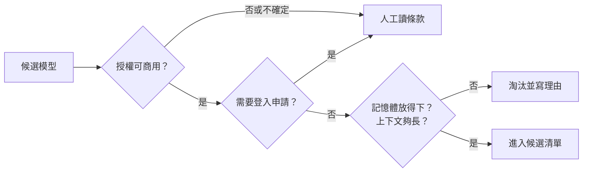

# 05｜該用哪個模型？

> **定位**：主管給了三個條件：可商用、能放在工地電腦（無 GPU、16 GB）、看得懂中文。這一節用可查核的資料，把候選模型一個一個篩過，留下選擇或淘汰的理由。

## 學習目標

完成本節後，你應該能夠：
- 讀懂 model card 上跟選型有關的欄位：授權、gated、參數量、上下文、`auto_map`
- 用「權重 + KV cache」估算一個模型大約要多少記憶體，並知道算不出來時要留白
- 寫程式把候選模型依工地條件篩選，替每個被淘汰的模型寫出理由

## 範例程式碼

- [demo](https://github.com/4-learn/llm-demo)：`E02_model_selection.py`

---

## 情境

你是營建公司的軟體工程師。

上一節你已經知道模型是怎麼「一個字一個字」產生輸出的。現在要真的挑一個模型，來幫忙整理工地每天上百筆偵測事件。主管說：

> 「網路上模型那麼多，挑一個能用的就好。條件只有三個：公司要拿來用，所以要**可以商用**；要放在工地那台電腦上跑，**沒有顯示卡、16 GB 記憶體**；事件跟回報都是中文，要**看得懂中文**。」

「能用」不是「最有名」或「排行榜第一」。這一節要回答：**哪個模型符合這三個條件？不符合的，理由是什麼？**

---

## 講解

### 一、排行榜不是選型依據

排行榜的分數是在別人的資料、別人的題目上量的，搬不到工地事件上。選型要照順序問，前面沒過，後面就不用看：

| 順序 | 問題 | 沒過會怎樣 |
| --- | --- | --- |
| ① | 這件事真的需要生成模型嗎？ | 分類、檢索常常用規則或小模型就夠了（第 01 節的基準版） |
| ② | **授權**允許商用嗎？ | 這是法律問題，跑得動不代表可以用 |
| ③ | **拿得到**嗎？（gated、要登入） | 程式沒辦法自動下載，全班卡住 |
| ④ | 工地電腦**放得下**嗎？ | 載入失敗，或一跑就記憶體不足 |
| ⑤ | 上下文**夠長**嗎？ | 事件和規範被截掉，你卻以為模型讀過了 |



### 二、model card 要看哪幾欄

每個 Hugging Face 模型頁面都有一份 model card（模型說明）和設定檔 `config.json`：

| 欄位 | 告訴你什麼 | 看漏會怎樣 |
| --- | --- | --- |
| `license` | 能不能商用、要不要標註 | 用到只能研究的模型 |
| `gated` | `false` 可直接下載；`manual` 要申請、等審核 | 程式下載時拿到 HTTP 401 |
| `revision` | 這個版本的編號 | 明天下載到的可能是別的版本 |
| 參數量、`torch_dtype` | 估算權重要多少記憶體 | 放不進工地電腦 |
| `num_key_value_heads` | 有沒有用 GQA（KV cache 會小很多） | 把記憶體高估好幾倍 |
| `max_position_embeddings` | 模型宣告的上下文上限 | 文件被截斷 |
| `auto_map` | 載入時可能執行模型倉庫裡的程式碼 | 你信任的不只是權重，還有別人的程式 |

### 三、記憶體怎麼估

```text
權重 ≈ 參數量 × 每個參數的位元組數（float32 = 4，bfloat16／float16 = 2）
KV cache = 2(K,V) × 層數 × kv_heads × head_dim × 上下文長度 × 位元組數
```

| 重點 | 說明 |
| --- | --- |
| 權重估得很準 | 就是參數量乘位元組數 |
| KV cache 隨上下文變長 | 上下文越長、同時處理越多筆，就越大 |
| `head_dim` | 是 `hidden_size ÷ num_attention_heads`，不是固定 128 |
| 編碼器沒有 KV cache | 例如 `BertModel` 一次看完整段文字，不用留 K、V |
| 這只是初篩 | 不含程式本身、作業系統的額外用量，實際會再高一些 |

### 四、示範：選型檢核

情境：機器給模型 **6,144 MB**，任務需要 **8,192 tokens** 的上下文。程式讀 `data/model-candidates.json`：老師在 20E07-E03-05 從 Hugging Face 公開 API 抓的五個真實模型資料（沒有下載任何權重）。只用 Python 標準函式庫。

<!-- demo: E02_model_selection.py -->
```python
"""第 05 節：模型選型與授權檢核（只用 Python 標準函式庫、不下載權重）。

資料是 `data/model-candidates.json`：教師於 20E07-E03-05 從 Hugging Face
公開 API 抓的真實快照，含授權、gated 狀態、官方參數量與權重檔大小。
授權與 gated 狀態會變，引用前必須重新查核。
"""

import json
from pathlib import Path

RAM_BUDGET_MB = 6144          # 這台教室機器願意給模型多少記憶體
NEEDED_CONTEXT = 8192         # 任務需要吃多長的上下文
AUTO_APPROVED = {"mit", "apache-2.0"}
DTYPE_ALIASES = {
    "float32": "float32", "fp32": "float32", "f32": "float32",
    "bfloat16": "bfloat16", "bf16": "bfloat16",
    "float16": "float16", "fp16": "float16", "f16": "float16",
}
BYTES_PER_DTYPE = {"float32": 4, "bfloat16": 2, "float16": 2}


def load_candidates():
    for base in (Path(__file__).resolve().parent, Path.cwd(), Path.cwd().parent):
        path = base / "data" / "model-candidates.json"
        if path.exists():
            return json.loads(path.read_text(encoding="utf-8"))
    raise FileNotFoundError("找不到 data/model-candidates.json")


def normalize_dtype(raw):
    return None if raw is None else DTYPE_ALIASES.get(str(raw).strip().lower())


def is_encoder_only(config):
    """BertModel 這種純編碼器沒有輸出層；Qwen2ForCausalLM 這種有。"""
    return not any("For" in name for name in config.get("architectures", []))


def estimate_parameters(config, naive=False):
    """由 config 估參數量。naive=True 是「所有模型都當 BERT」的天真公式。"""
    h, layers, heads = config["hidden_size"], config["num_hidden_layers"], config["num_attention_heads"]
    head_dim = h // heads
    if head_dim * heads != h:
        raise ValueError("hidden_size 必須能被 num_attention_heads 整除")
    if naive:
        mlp_factor, kv_heads, tied = 2, heads, False
        pos, pooler = config["max_position_embeddings"] * h, h * h
    else:
        bert = config["model_type"] == "bert"
        mlp_factor = 2 if bert else 3            # BERT 2 個矩陣；SwiGLU 3 個
        kv_heads = config.get("num_key_value_heads", heads)
        tied = config.get("tie_word_embeddings", False)
        pos = config["max_position_embeddings"] * h if bert else 0   # RoPE 無學習式位置嵌入
        pooler = h * h if bert else 0
    embed = config["vocab_size"] * h
    lm_head = 0 if (tied or is_encoder_only(config)) else config["vocab_size"] * h
    kv_dim = kv_heads * head_dim
    attn = 2 * h * h + 2 * h * kv_dim
    mlp = mlp_factor * h * config["intermediate_size"]
    return embed + lm_head + layers * (attn + mlp + 2 * h) + pos + pooler


def dtype_of(entry):
    for raw in entry["official_dtypes"]:
        if normalize_dtype(raw):
            return normalize_dtype(raw)
    return normalize_dtype((entry["config"] or {}).get("torch_dtype"))


def weight_mb(entry):
    """官方參數量 × dtype 位元組數。這是初篩用的估算，不是實測。"""
    dtype = dtype_of(entry)
    if entry["official_parameter_count"] is None or dtype is None:
        return None
    return entry["official_parameter_count"] * BYTES_PER_DTYPE[dtype] / 1024 ** 2


def actual_weight_mb(entry):
    """官方 safetensors 檔案的實際位元組數。"""
    total = entry["weight_file_bytes"]
    return total / 1024 ** 2 if total else None


def kv_cache(entry, seq_len):
    """回傳 (MB 或 None, 原因)。KV cache = 2(K,V) × 層 × kv_heads × head_dim × 長度 × 位元組。

    只有自迴歸解碼器需要 KV cache：它一次只算一個 token，得把前面算過的
    K、V 留著。BERT 這種編碼器一次看完整個序列，沒有 KV cache 可算——
    對它套這個公式會得到一個不存在、也不該拿去比大小的數字。
    """
    config = entry["config"]
    if config is None:
        return None, "config 不可讀"
    if is_encoder_only(config):
        return None, "編碼器，一次看完整個序列，沒有 KV cache"
    dtype = normalize_dtype(config.get("torch_dtype"))
    if dtype is None:
        return None, f"dtype {config.get('torch_dtype')} 未知"
    heads = config["num_attention_heads"]
    kv_heads = config.get("num_key_value_heads", heads)
    head_dim = config["hidden_size"] // heads
    mb = 2 * config["num_hidden_layers"] * kv_heads * head_dim * seq_len * BYTES_PER_DTYPE[dtype] / 1024 ** 2
    return mb, None


def review(entry):
    """回傳 (判決, 理由)。所有理由都收集，不短路——選型要看全貌。"""
    reject, check = [], []
    license_id, config = entry["license"], entry["config"]
    if license_id is None:
        reject.append("授權未知，不得直接核准")
    elif license_id not in AUTO_APPROVED:
        check.append(f"授權 '{license_id}' 不在自動核准清單，需人工確認條款")
    if entry["gated"]:
        check.append(f"gated={entry['gated']}，需先接受條款並登入才能下載")
    if config is None:
        check.append(f"config.json 回 HTTP {entry['config_status']}，架構未知、KV cache 算不出來")
    elif config.get("has_auto_map"):
        check.append("模型倉庫帶自訂程式碼（auto_map），載入時可能執行它")
    mb = weight_mb(entry)
    if mb is None:
        check.append("無法估算權重記憶體")
    elif mb > RAM_BUDGET_MB:
        reject.append(f"權重 {mb:.0f} MB 超過預算 {RAM_BUDGET_MB} MB")
    if config and config.get("max_position_embeddings", 0) < NEEDED_CONTEXT:
        reject.append(f"上下文只有 {config['max_position_embeddings']} tokens，不足 {NEEDED_CONTEXT}")
    return ("淘汰" if reject else "待人工複核" if check else "核准"), reject + check


def main():
    data = load_candidates()
    print(f"資料 {data['kind']}，抓取於 {data['fetched_at']}")
    print(f"情境：機器給模型 {RAM_BUDGET_MB} MB；任務需要 {NEEDED_CONTEXT} tokens 上下文")
    print()

    print("=== 1. 由 config 估參數量，對照官方公布值 ===")
    for entry in data["candidates"]:
        config, official = entry["config"], entry["official_parameter_count"]
        if config is None:
            print(f"{entry['id']:<33} config HTTP {entry['config_status']}，只能用官方值 {official:,}")
            continue
        naive, aware = estimate_parameters(config, True), estimate_parameters(config)
        print(f"{entry['id']:<33} 天真 {naive:>13,} ({naive / official - 1:+6.1%})"
              f"  看架構 {aware:>13,} ({aware / official - 1:+7.3%})")
    print()

    print("=== 2. 權重記憶體：估算 vs 實際 safetensors 檔案 ===")
    for entry in data["candidates"]:
        est, actual = weight_mb(entry), actual_weight_mb(entry)
        print(f"{entry['id']:<33} 估算 {est:8.1f} MB   實際 {actual:9.1f} MB   {(est / actual - 1):+6.2%}")
    print()

    print(f"=== 3. KV cache（{NEEDED_CONTEXT} tokens，單一序列）===")
    for entry in data["candidates"]:
        kv, why = kv_cache(entry, NEEDED_CONTEXT)
        if kv is None:
            print(f"{entry['id']:<33} 不適用／算不出來：{why}")
            continue
        config = entry["config"]
        heads = config["num_attention_heads"]
        kv_heads = config.get("num_key_value_heads", heads)
        note = (f"  ← GQA：{heads} 個 query head 只用 {kv_heads} 個 KV head"
                if kv_heads != heads else "")
        print(f"{entry['id']:<33} {kv:8.1f} MB{note}")
        if kv_heads != heads:
            same = dict(entry, config=dict(config, num_key_value_heads=heads))
            print(f"{'  同一個模型，假設它沒用 GQA':<33} {kv_cache(same, NEEDED_CONTEXT)[0]:8.1f} MB")
    print()

    print("=== 4. 選型檢核：授權 → gated → 記憶體 → 上下文 ===")
    for entry in data["candidates"]:
        verdict, reasons = review(entry)
        print(f"[{verdict}] {entry['id']}（授權 {entry['license']}）")
        for reason in reasons:
            print(f"        - {reason}")


if __name__ == "__main__":
    main()
```

執行：

```bash
python3 E02_model_selection.py
```

關鍵輸出（本機實跑）：

```text
資料 teacher-measurement，抓取於 20E07-E03-05T11:51:15+00:00
情境：機器給模型 6144 MB；任務需要 8192 tokens 上下文

=== 1. 由 config 估參數量，對照官方公布值 ===
BAAI/bge-small-zh-v1.5            天真    23,928,832 ( -0.1%)  看架構    23,928,832 (-0.107%)
Qwen/Qwen2.5-0.5B-Instruct        天真   588,736,512 (+19.2%)  看架構   494,004,224 (-0.006%)
microsoft/Phi-3.5-mini-instruct   天真 3,427,860,480 (-10.3%)  看架構 3,821,076,480 (-0.000%)
google/gemma-2-2b-it              config HTTP 401，只能用官方值 2,614,341,888
meta-llama/Llama-3.2-1B-Instruct  config HTTP 401，只能用官方值 1,235,814,400

=== 2. 權重記憶體：估算 vs 實際 safetensors 檔案 ===
BAAI/bge-small-zh-v1.5            估算     91.4 MB   實際      91.4 MB   -0.01%
Qwen/Qwen2.5-0.5B-Instruct        估算    942.3 MB   實際     942.3 MB   -0.00%
microsoft/Phi-3.5-mini-instruct   估算   7288.1 MB   實際    7288.2 MB   -0.00%
google/gemma-2-2b-it              估算   4986.5 MB   實際    4986.5 MB   -0.00%
meta-llama/Llama-3.2-1B-Instruct  估算   2357.1 MB   實際    2357.1 MB   -0.00%

=== 3. KV cache（8192 tokens，單一序列）===
BAAI/bge-small-zh-v1.5            不適用／算不出來：編碼器，一次看完整個序列，沒有 KV cache
Qwen/Qwen2.5-0.5B-Instruct            96.0 MB  ← GQA：14 個 query head 只用 2 個 KV head
  同一個模型，假設它沒用 GQA                    672.0 MB
microsoft/Phi-3.5-mini-instruct     3072.0 MB
google/gemma-2-2b-it              不適用／算不出來：config 不可讀
meta-llama/Llama-3.2-1B-Instruct  不適用／算不出來：config 不可讀

=== 4. 選型檢核：授權 → gated → 記憶體 → 上下文 ===
[淘汰] BAAI/bge-small-zh-v1.5（授權 mit）
        - 上下文只有 512 tokens，不足 8192
[核准] Qwen/Qwen2.5-0.5B-Instruct（授權 apache-2.0）
[淘汰] microsoft/Phi-3.5-mini-instruct（授權 mit）
        - 權重 7288 MB 超過預算 6144 MB
        - 模型倉庫帶自訂程式碼（auto_map），載入時可能執行它
[待人工複核] google/gemma-2-2b-it（授權 gemma）
        - 授權 'gemma' 不在自動核准清單，需人工確認條款
        - gated=manual，需先接受條款並登入才能下載
        - config.json 回 HTTP 401，架構未知、KV cache 算不出來
[待人工複核] meta-llama/Llama-3.2-1B-Instruct（授權 llama3.2）
        - 授權 'llama3.2' 不在自動核准清單，需人工確認條款
        - gated=manual，需先接受條款並登入才能下載
        - config.json 回 HTTP 401，架構未知、KV cache 算不出來
```

**怎麼讀這份輸出**：

| 發現 | 說明 |
| --- | --- |
| 天真公式會錯 | 把所有模型當 BERT 算，`Qwen` 差 +19.2%、`Phi` 差 −10.3%；**估算一定要對照官方參數量** |
| 權重估得準，KV cache 才是重點 | `Phi-3.5-mini` 權重 7,288 MB，8k 上下文的 KV cache 再加 3,072 MB |
| GQA 差很多 | `Qwen` 只有 2 個 KV head，KV cache 96 MB；沒用 GQA 會是 672 MB |
| gated 的模型連檢查都做不到 | `gemma`、`Llama` 的 `config.json` 回 HTTP 401，KV cache 只能**留白**，不能用猜的 |
| 授權過關 ≠ 安全過關 | `Phi-3.5-mini` 是 mit，但帶 `auto_map`，載入時可能執行別人的程式 |
| 「待人工複核」不是「通過」 | 自訂授權（`gemma`、`llama3.2`）要有人真的讀過條款 |
| 參數少不代表沒用 | `bge-small-zh` 只有 91 MB，但它是做檢索的編碼器，上下文 512，不能拿來生成回覆 |

> 這份資料是 **20E07-E03-05 的快照**。授權、gated 狀態都會變，正式選型前要重新查。

### 五、課堂體驗：到 Hugging Face 看真的模型

程式只能檢查「資料寫了什麼」；「看不看得懂中文」要自己去看、自己試。以下只說明做法，**實際看到的模型、授權與結果會隨時間改變**，請在筆記寫下你的**查詢日期**。

| 步驟 | 做法 | 記下什麼 |
| --- | --- | --- |
| ① 找候選 | 在 Hugging Face「Models」頁，任務選 Text Generation、語言選 Chinese，挑 3–5 個參數量較小（例如 3B 以下）的模型 | 模型 id、查詢日期 |
| ② 讀 model card | 看 `License`、是否要申請（gated）、參數量、說明裡有沒有寫支援中文 | 授權名稱、能不能商用、要不要申請 |
| ③ 試用 | 到 Spaces 找一個大模型和一個小模型的線上展示，問同一個問題（見下方） | 兩邊的回答、是否看懂事件 |
| ④ 比較 | 小模型講得通嗎？有沒有亂編事件裡沒有的內容？ | 你的判斷與理由 |

試用時用同一筆事件，例如：

```text
請用一句繁體中文，告訴工地安全人員這筆事件要做什麼：
{"event_id": "EVT-0042", "time": "20E07-E01-03 09:12", "site": "B 棟 3F", "detector": "camera-07", "label": "no_helmet", "confidence": 0.82, "note": "疑似有一人未戴安全帽", "image": "evt-0042.jpg"}
```

注意：
- Spaces 是別人架的展示，**不要貼真實工地資料**，只用上面這種練習事件
- 線上試用跑得順，不代表工地電腦跑得動；能不能真的載入，是第 07 節的事

---

## Workshop

### 題目

把示範程式改成主管的**工地條件**，重跑選型：

1. 記憶體預算改成工地電腦的 16 GB（`16 * 1024` MB），上下文需求維持 8,192 tokens
2. 加一個篩選條件：**可商用**（程式只認 `mit`、`apache-2.0`，其他授權一律當成「無法確認」）**且記憶體估計 ≤ 16 GB**；記憶體估計 = 權重 + KV cache
3. gated、`auto_map`、上下文不足，也都算淘汰理由
4. 印出每個模型的記憶體估計、**符合條件的候選清單**，以及**每個被淘汰模型的所有理由**

只能用 `data/model-candidates.json` 既有的資料，不連網。

提示：
1. 編碼器沒有 KV cache，可以當成 0；`config` 是 `null` 時 KV cache 算不出來，要回傳 `None`，**不能當成 0**
2. 理由要全部收集到一個 list 再判斷，不要遇到第一個就停
3. list 是空的，就是符合條件

### 預期輸出

```text
資料抓取於 20E07-E03-05T11:51:15+00:00（快照，授權與 gated 會變）
工地條件：可商用、記憶體估計 ≤ 16384 MB、上下文 ≥ 8192 tokens

=== 記憶體估計（權重 + KV cache）===
BAAI/bge-small-zh-v1.5            權重    91.4 MB + KV    0.0 MB =    91.4 MB
Qwen/Qwen2.5-0.5B-Instruct        權重   942.3 MB + KV   96.0 MB =  1038.3 MB
microsoft/Phi-3.5-mini-instruct   權重  7288.1 MB + KV 3072.0 MB = 10360.1 MB
google/gemma-2-2b-it              權重  4986.5 MB + KV 未知 = 算不出來
meta-llama/Llama-3.2-1B-Instruct  權重  2357.1 MB + KV 未知 = 算不出來

=== 符合條件（1 個）===
Qwen/Qwen2.5-0.5B-Instruct（授權 apache-2.0，revision 7ae5576）

=== 被淘汰（4 個）===
[淘汰] BAAI/bge-small-zh-v1.5（授權 mit）
        - 上下文只有 512 tokens，不足 8192
[淘汰] microsoft/Phi-3.5-mini-instruct（授權 mit）
        - 模型倉庫帶自訂程式碼（auto_map），載入時可能執行它
[淘汰] google/gemma-2-2b-it（授權 gemma）
        - 授權 'gemma' 無法由程式確認可商用，要有人讀過條款
        - gated=manual，需先接受條款並登入才能下載
        - config.json 回 HTTP 401，KV cache 算不出來，記憶體無法估計
[淘汰] meta-llama/Llama-3.2-1B-Instruct（授權 llama3.2）
        - 授權 'llama3.2' 無法由程式確認可商用，要有人讀過條款
        - gated=manual，需先接受條款並登入才能下載
        - config.json 回 HTTP 401，KV cache 算不出來，記憶體無法估計
```

做完之後想一想：
- `Phi-3.5-mini` 記憶體估計 10,360 MB，16 GB 放得下，為什麼還是被淘汰？如果有人審過它的程式碼，可以改成「待人工複核」嗎？
- 只剩 `Qwen2.5-0.5B` 一個符合。它「看得懂中文」嗎？資料檔裡**沒有**這一欄，這要靠課堂體驗或第 08 節的評測回答，不能憑程式通過就說它懂。
- `gemma`、`Llama` 被淘汰的理由是「不知道」，不是「不行」。要誰、根據什麼才能把它們加回來？

### 解答

- [解答](https://github.com/4-learn/llm-workshop)：`E02_workshop.py`

---

## 教師紀錄

- 證據等級：授權、gated、參數量為**遠端實測**（Hugging Face 中介資料，20E07-E03-05 凍結於 `data/model-candidates.json`）；記憶體為推算。課堂體驗（Spaces 試用）結果會變，**待驗證**。
