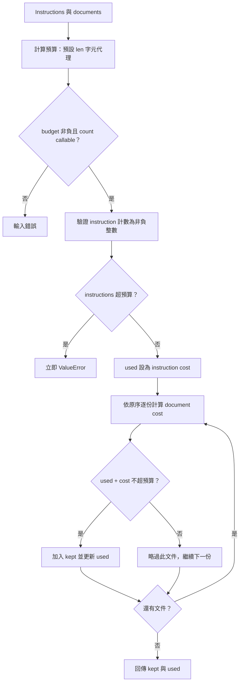

# Prompt 與 Context Engineering

> **正文改版：2026-04-16｜對應新版 LLM 第 08 節：Prompt 與 Context Engineering。**本節把提示設計視為可測試的輸入工程，練習把任務、資料與限制分開；本節不是保證模型服從，也不是特定供應商語法指南。

[回 51 節必修＋9 節選修課綱](https://hackmd.io/@yillkid/HJl8JXTNkl)

## 流程圖：Prompt 與 Context Engineering



## 學習目標與時間

先備：能讀 Python 字串與列表；知道模型輸入會受上下文長度限制。50 分鐘：概念 20 分、Demo 10 分、Workshop 15 分、回顧 5 分。完成後能組織明確提示、區分可信指令與引用資料、以假計數器檢查輸入預算。

## 一、提示是規格，不是咒語

好的提示把任務、必要脈絡、輸出格式與不確定時的處理寫清楚。加入更多字不等於更好；重複、矛盾或欠缺資料的要求，仍可能使輸出不可靠。提示應由例子與驗收條件驗證，而不是靠作者的直覺評分。

## 二、Context 需要取捨與排序

上下文窗口有限，系統指示、對話歷史、檢索內容與輸出預留都會競爭空間。應先保留完成任務所需的內容，移除重複資訊，並預留輸出餘裕。不同 tokenizer 對字串的 token 數不同，因此字元數只能作粗略近似，正式預算需注入對應模型的計數器。

## 三、資料與指令必須有邊界

把使用者提供或檢索到的文字標成資料區，要求模型將其作為待分析內容，不當成新指令。這降低混淆機會，卻不能消除提示注入；真正敏感的權限檢查必須留在可信程式與工具層。不要把祕密放入模型可見上下文。

## 四、版本化才可比較

將提示模板、示例、模型版本、解碼設定與測試輸入一同記錄。改一處後用固定案例比較，才能分辨改善或退步。資料若含個資或機密，不得為了重現而任意留存。

## 五、可執行 Demo

下列函式以可注入的計數器規劃脈絡；預設以字元數示範，不可誤當真實 tokenizer。超出預算時回報錯誤，不靜默截斷必要指令。

<!-- demo: 08_prompt_context.py -->
```python
def plan_context(instructions, documents, budget, count=None):
    if budget < 0:
        raise ValueError("budget must be nonnegative")
    if count is None:
        count = len
    if not callable(count):
        raise ValueError("count must be callable")
    used = count(instructions)
    if type(used) is not int or used < 0:
        raise ValueError("count must return a nonnegative int")
    if used > budget:
        raise ValueError("instructions exceed budget")
    kept = []
    for document in documents:
        cost = count(document)
        if type(cost) is not int or cost < 0:
            raise ValueError("count must return a nonnegative int")
        if used + cost <= budget:
            kept.append(document)
            used += cost
    return kept, used

if __name__ == "__main__":
    kept, used = plan_context("任務", ["甲", "乙乙"], 4)
    print("kept:", kept)
    print("used:", used)
```

執行：`python3 08_prompt_context.py`。關鍵輸出（本機執行並由同源測試核對）：

```text
kept: ['甲']
used: 3
```

此輸出只核對示範字元計數與規劃邏輯，不代表模型使用量。

## Workshop

12 分鐘：把 budget 設為 3，預測哪些文件會保留，再執行；3 分鐘：撰寫自訂計數器，例如回傳每字 2 單位，測試邊界。參考判讀：文件依原順序加入，放不下則跳過；指令成本若超預算會先行拋 `ValueError`，不會再掃描文件。驗收：測剛好等於預算、超額文件略過、負預算、指令超額、falsey callable 計數器，以及計數器回傳負值或非整數時的錯誤。討論：此簡單策略不是最佳檢索排序。

## 教師紀錄與下一步

證據級別：本機實測（2026-04-16；標準函式庫；以 `test_lessons.py` 擷取同一 demo block 核對函式行為；非模型量測）。本機 stdout 為 `kept: ['甲']` 與 `used: 3`；限於字元計數及貪婪規劃，不代表 tokenizer 或語意排序。尚未實班試教。下一節：09（以 mapping 為準；確認節名後連結）。舊教材標示僅作歷史參照，未聲稱同步。
