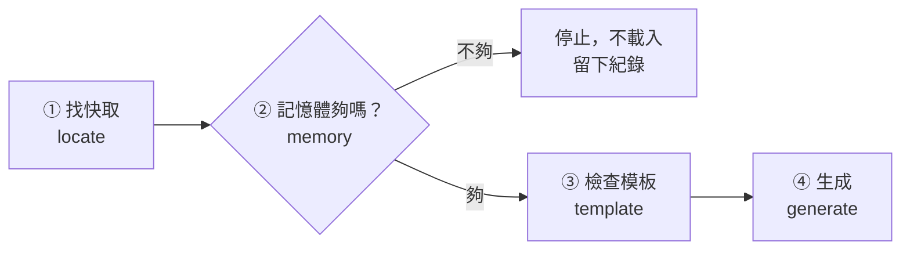

# 09｜工地電腦跑得動嗎？

> **定位**：選好模型後，下載到自己的電腦（沒有 GPU）跑跑看：證明它跑得動，或清楚說出為什麼跑不動。

## 學習目標

完成本節後，你應該能夠：
- 說出載入一個本機模型需要的四樣東西，以及四種失敗各在哪一步發生
- 解釋為什麼實際記憶體比「權重檔大小」多很多，並在載入前先擋下記憶體不夠的情況
- 用本機的 Qwen2.5-0.5B-Instruct 把一筆工安事件寫成一句報告，並量出耗時與峰值記憶體

## 範例程式碼

- [demo](https://github.com/4-learn/llm-demo)：`E02_cpu_smoke.py`

---

## 情境

你是營建公司的軟體工程師。

上一節你挑了一個小模型 Qwen2.5-0.5B-Instruct。工地辦公室只有一般筆電，沒有 GPU，而且事件照片和現場資料不想傳到外面。主管問你：

> 「這個模型，工地那台電腦跑得動嗎？跑得動的話，能不能把事件自動寫成一句報告？」

這一節先回答「跑不跑得動」：要多少記憶體、要等幾秒、失敗時會發生什麼事。至於「寫得好不好」，這一節只看一眼，第 08 節再正式評測。

---

## 講解

### 一、載入需要四樣東西

| 東西 | 是什麼 | 出錯時的樣子 |
| --- | --- | --- |
| 權重 | `model.safetensors`，本節 942 MiB | 本機快取裡沒有、版本（revision）不同 |
| tokenizer | 文字 ↔ token ID 的對照（第 02 節） | 和權重版本不同，輸出變亂碼 |
| 對話模板 | 把「誰說了什麼」包成模型訓練時看過的格式 | 模型不知道該它回答，只會接著寫 |
| 執行環境 | Python、torch、transformers 的版本與記憶體 | 匯入失敗、被系統的 OOM killer 殺掉 |

**revision 要固定**。同一個模型 ID，作者隨時可能更新權重；本課一律用 `7ae557604adf67be50417f59c2c2f167def9a775`，大家跑出來才會一樣。

### 二、四種失敗，要能說出是哪一種



| 哪一步（stage） | 原因（kind） | 什麼時候發現 | 怎麼處理 |
| --- | --- | --- | --- |
| locate | `missing_cache` | 載入前 | 有網路時先下載，或向老師拿預先下載的快取 |
| memory | `insufficient_ram`／`unknown_ram` | **載入前** | 不載入；換更小的模型 |
| template | `no_chat_template`／`template_drops_content` | 載入 tokenizer 後 | 不用對話格式，或換有模板的版本 |
| generate | `timeout` | 生成中 | 記下秒數與產生了幾個 token |

記憶體一定要在**載入前**判斷：記憶體不夠時，Linux 會直接殺掉程式，Python 的 `except` 接不到，連紀錄都寫不出來。

**離線載入的小坑**：在 `HF_HUB_OFFLINE=1` 下，transformers 4.57.3 用**模型 ID** 載入 tokenizer 會失敗（`OfflineModeIsEnabled`）。做法是先用 `snapshot_download(..., local_files_only=True)` 拿到快取的**資料夾路徑**，再把路徑傳給 `from_pretrained`。路徑最後一層就是 revision，順便可以核對版本。

### 三、記憶體：為什麼比權重檔大很多

| 項目 | 數字 |
| --- | --- |
| 權重檔（bf16，每個參數 2 bytes） | 942.3 MiB |
| CPU 上載成 float32（每個參數 4 bytes） | × 2 |
| 加上 Python、torch、載入暫存（程式先抓 1.5 倍） | × 1.5 = 預估 2827 MiB |
| 示範機實測峰值 | **3244 MiB**，比預估還多 |

結論：**1.5 倍的餘裕不夠**，所以一定要實測，並把實測結果寫回選型表。

### 四、示範：CPU smoke test

smoke test 的目的不是「回答得好」，而是「證明能跑，或說清楚為什麼不能跑」。標準輸出只印每次都一樣的內容；秒數與記憶體每次不同，印到標準錯誤（以 `[量測]` 開頭）。

<!-- demo: E02_cpu_smoke.py -->
```python
"""第 07 節：本地推論載入與 CPU smoke test。

每一步都可能失敗，而且失敗要能說出原因：快取缺檔、記憶體不夠、模板不合、逾時。
需要第 17 節的套件（另加 transformers 的生成模型）與已下載的 Qwen2.5-0.5B-Instruct 權重。
標準輸出只印可重現的內容；載入時間、延遲與記憶體每次不同，印到標準錯誤並寫進紀錄檔。
"""
import argparse
import json
import os
import platform
import resource
import sys
from pathlib import Path
from time import perf_counter

MODEL_ID = "Qwen/Qwen2.5-0.5B-Instruct"
REVISION = "7ae557604adf67be50417f59c2c2f167def9a775"   # 與第 02、05 節相同
PROMPT = "用一句話說明：工人進入工地前要做什麼安全檢查？"
MAX_NEW_TOKENS = 40
MAX_SECONDS = 120          # 單次生成的上限；超過就停，記為 timeout
OVERHEAD = 1.5             # 載入時的暫存、框架本身；第 05 節只算權重，實際一定更多


class SmokeFailure(Exception):
    """帶分類的失敗：stage 是哪一步、kind 是哪一類原因。"""

    def __init__(self, stage, kind, detail):
        super().__init__(f"[{stage}] {kind}: {detail}")
        self.stage, self.kind, self.detail = stage, kind, detail


def available_mib():
    """Linux 讀 /proc/meminfo 的 MemAvailable；其他系統回 None（要自己填）。"""
    try:
        for line in Path("/proc/meminfo").read_text().splitlines():
            if line.startswith("MemAvailable:"):
                return int(line.split()[1]) // 1024
    except OSError:
        pass
    return None


def peak_rss_mib():
    peak = resource.getrusage(resource.RUSAGE_SELF).ru_maxrss
    return peak // (1024 * 1024) if sys.platform == "darwin" else peak // 1024   # macOS 單位是 bytes


def locate(model_id, revision):
    """只找本機快取，絕不連網。缺檔時回報是哪一個 revision 找不到。"""
    from huggingface_hub import snapshot_download
    from huggingface_hub.errors import LocalEntryNotFoundError

    try:
        return Path(snapshot_download(model_id, revision=revision, local_files_only=True))
    except LocalEntryNotFoundError as error:
        raise SmokeFailure("locate", "missing_cache", f"{model_id}@{revision[:7]} 不在本機快取") from error


def weight_mib(path):
    return sum(f.stat().st_size for f in path.glob("*.safetensors")) / 2**20


def memory_gate(need_mib, have_mib):
    """載入前先判斷；不夠就不要載入（載到一半被 OOM killer 殺掉，連紀錄都留不下）。"""
    if have_mib is None:
        raise SmokeFailure("memory", "unknown_ram", "讀不到可用記憶體；請用 --ram-mib 手動填")
    if need_mib > have_mib:
        raise SmokeFailure("memory", "insufficient_ram", f"預估需要 {need_mib:.0f} MiB，可用 {have_mib} MiB")
    return True


def check_template(tokenizer):
    template = getattr(tokenizer, "chat_template", None)
    if not template:
        raise SmokeFailure("template", "no_chat_template", "這個 tokenizer 沒有對話模板；不能用 chat 格式")
    rendered = tokenizer.apply_chat_template([{"role": "user", "content": "測試"}],
                                             tokenize=False, add_generation_prompt=True)
    if "測試" not in rendered:
        raise SmokeFailure("template", "template_drops_content", "模板輸出不含使用者內容")
    return rendered


def generate(model, tokenizer, text, use_template, max_new_tokens=MAX_NEW_TOKENS, max_time=MAX_SECONDS):
    import torch

    if use_template:
        text = tokenizer.apply_chat_template([{"role": "user", "content": text}],
                                             tokenize=False, add_generation_prompt=True)
    inputs = tokenizer(text, return_tensors="pt")
    started = perf_counter()
    with torch.no_grad():
        # 明寫所有解碼參數：模型自帶的 generation_config 預設 do_sample=True、repetition_penalty=1.1
        output = model.generate(**inputs, max_new_tokens=max_new_tokens, max_time=max_time,
                                do_sample=False, temperature=None, top_p=None, top_k=None,
                                repetition_penalty=1.0)
    seconds = perf_counter() - started
    new = output[0][inputs["input_ids"].shape[1]:]
    if seconds >= max_time:
        raise SmokeFailure("generate", "timeout", f"{max_time} 秒內只產生 {len(new)} 個 token")
    return {"prompt_tokens": int(inputs["input_ids"].shape[1]), "new_tokens": int(len(new)),
            "text": tokenizer.decode(new, skip_special_tokens=True), "seconds": seconds}


def measure(record, key, value, unit):
    record["measurements"][key] = value
    print(f"[量測] {key}: {value}{unit}", file=sys.stderr)


def run(ram_mib=None, record_path=None):
    import torch
    import transformers
    from transformers import AutoModelForCausalLM, AutoTokenizer

    torch.set_num_threads(2)
    record = {"model": f"{MODEL_ID}@{REVISION}", "python": platform.python_version(),
              "torch": torch.__version__, "transformers": transformers.__version__,
              "machine": platform.machine(), "system": platform.system(),
              "threads": torch.get_num_threads(), "measurements": {}, "result": None}
    print("model:", MODEL_ID, "revision:", REVISION)

    print("\n== 一、只從本機快取找權重 ==")
    try:
        locate(MODEL_ID, "0" * 40)
    except SmokeFailure as failure:
        print("故意用不存在的 revision →", failure.kind, "｜", failure.detail)
    path = locate(MODEL_ID, REVISION)
    print("快取路徑最後一層 == revision:", path.name == REVISION)
    print("權重檔:", sorted(f.name for f in path.glob("*.safetensors")), f"{weight_mib(path):.1f} MiB")

    print("\n== 二、載入前先算記憶體 ==")
    need = weight_mib(path) * 2 * OVERHEAD   # 檔案是 bf16；載入成 float32 會變兩倍
    print(f"預估需要: 權重 {weight_mib(path):.1f} MiB × 2（bf16→float32）× {OVERHEAD} = {need:.0f} MiB")
    try:
        memory_gate(need, 1024)
    except SmokeFailure as failure:
        print("假設只有 1024 MiB →", failure.kind, "｜", failure.detail)
    have = ram_mib if ram_mib is not None else available_mib()
    record["measurements"]["available_mib_before_load"] = have
    try:
        memory_gate(need, have)
    except SmokeFailure as failure:
        print("本機 →", failure.kind, "（停止，不載入）")
        record["result"] = {"ok": False, "stage": failure.stage, "kind": failure.kind, "detail": failure.detail}
        return record
    print("本機記憶體足夠: True")

    print("\n== 三、載入 tokenizer 與模板 ==")
    started = perf_counter()
    tokenizer = AutoTokenizer.from_pretrained(path)   # 傳路徑，不傳 ID：見講義「離線載入的坑」
    rendered = check_template(tokenizer)
    print("模板檢查通過；模板把一句「測試」包成:")
    print(rendered)

    print("== 四、載入權重 ==")
    model = AutoModelForCausalLM.from_pretrained(path, dtype=torch.float32)
    model.eval()
    measure(record, "load_seconds", round(perf_counter() - started, 2), " 秒")
    measure(record, "peak_rss_mib_after_load", peak_rss_mib(), " MiB")
    print("dtype:", model.dtype, "參數量:", f"{sum(p.numel() for p in model.parameters()):,}")
    defaults = model.generation_config
    print("模型自帶的生成預設:", {k: getattr(defaults, k) for k in ("do_sample", "temperature", "top_p", "top_k", "repetition_penalty")})

    print("\n== 五、單次短生成（greedy，最多", MAX_NEW_TOKENS, "token）==")
    for use_template in (True, False):
        out = generate(model, tokenizer, PROMPT, use_template)
        label = "有模板" if use_template else "沒模板"
        measure(record, f"generate_seconds_{label}", round(out["seconds"], 2), " 秒")
        measure(record, f"tokens_per_second_{label}", round(out["new_tokens"] / out["seconds"], 1), "")
        print(f"[{label}] 輸入 {out['prompt_tokens']} token，產生 {out['new_tokens']} token")
        print(out["text"])
        print("---")
        if use_template:
            record["sample_output"] = out["text"]
    measure(record, "peak_rss_mib", peak_rss_mib(), " MiB")
    record["result"] = {"ok": True}
    print("smoke test: 通過")
    if record_path:
        Path(record_path).write_text(json.dumps(record, ensure_ascii=False, indent=2) + "\n", encoding="utf-8")
        print("紀錄已寫入", Path(record_path).name, file=sys.stderr)
    return record


if __name__ == "__main__":
    parser = argparse.ArgumentParser()
    parser.add_argument("--ram-mib", type=int, help="手動指定可用記憶體（讀不到或想模擬小機器時）")
    parser.add_argument("--record", help="把硬體、版本與量測寫成 JSON")
    args = parser.parse_args()
    os.environ.setdefault("HF_HUB_OFFLINE", "1")
    result = run(args.ram_mib, args.record)
    if not result["result"]["ok"]:
        if args.record:
            Path(args.record).write_text(json.dumps(result, ensure_ascii=False, indent=2) + "\n", encoding="utf-8")
        sys.exit(2)
```

執行（需要第 17 節的套件與已下載的模型）：

```bash
HF_HUB_OFFLINE=1 python E02_cpu_smoke.py
```

關鍵輸出（示範機 4-learn 實跑）：

```text
model: Qwen/Qwen2.5-0.5B-Instruct revision: 7ae557604adf67be50417f59c2c2f167def9a775

== 一、只從本機快取找權重 ==
故意用不存在的 revision → missing_cache ｜ Qwen/Qwen2.5-0.5B-Instruct@0000000 不在本機快取
快取路徑最後一層 == revision: True
權重檔: ['model.safetensors'] 942.3 MiB

== 二、載入前先算記憶體 ==
預估需要: 權重 942.3 MiB × 2（bf16→float32）× 1.5 = 2827 MiB
假設只有 1024 MiB → insufficient_ram ｜ 預估需要 2827 MiB，可用 1024 MiB
本機記憶體足夠: True

== 三、載入 tokenizer 與模板 ==
模板檢查通過；模板把一句「測試」包成:
<|im_start|>system
You are Qwen, created by Alibaba Cloud. You are a helpful assistant.<|im_end|>
<|im_start|>user
測試<|im_end|>
<|im_start|>assistant

== 四、載入權重 ==
dtype: torch.float32 參數量: 494,032,768
模型自帶的生成預設: {'do_sample': True, 'temperature': 0.7, 'top_p': 0.8, 'top_k': 20, 'repetition_penalty': 1.1}

== 五、單次短生成（greedy，最多 40 token）==
[有模板] 輸入 43 token，產生 40 token
工人進入工地前需要进行全面的安全檢查，包括但不限于以下方面：

1. **安全帽**：確保工人佩戴符合规定的安全帽，以防止头部受到伤害。
2. **安全鞋
---
[沒模板] 輸入 14 token，產生 40 token
 進行安全檢查是工人進入工地前的必經程序，目的是確保工人的安全和健康。安全檢查包括以下幾個方面：

1. **設備檢查**：檢查工人的工具
---
smoke test: 通過
```

標準錯誤的量測（**秒數隨機器而異**，示範機 i7-8565U、8 GB、無 GPU）：

```text
[量測] load_seconds: 4.03 秒
[量測] peak_rss_mib_after_load: 3244 MiB
[量測] generate_seconds_有模板: 6.05 秒
[量測] tokens_per_second_有模板: 6.6
[量測] generate_seconds_沒模板: 5.87 秒
[量測] tokens_per_second_沒模板: 6.8
[量測] peak_rss_mib: 3244 MiB
```

模擬一台只剩 2000 MiB 的電腦：

```bash
HF_HUB_OFFLINE=1 python E02_cpu_smoke.py --ram-mib 2000 --record smoke-small.json
```

關鍵輸出（程式在載入模型**之前**就停下，離開碼 2）：

```text
== 二、載入前先算記憶體 ==
預估需要: 權重 942.3 MiB × 2（bf16→float32）× 1.5 = 2827 MiB
假設只有 1024 MiB → insufficient_ram ｜ 預估需要 2827 MiB，可用 1024 MiB
本機 → insufficient_ram （停止，不載入）
```

### 五、結果怎麼讀

| 看到什麼 | 代表什麼 |
| --- | --- |
| 不存在的 revision → `missing_cache` | 缺檔在載入前就被分類，不會卡在等網路 |
| 1024 MiB → `insufficient_ram` | 記憶體不夠就不載入，失敗也有紀錄 |
| 模板多了一段 `You are Qwen...` | 你沒寫 system，模板自己補上；換模型模板就不同 |
| 自帶預設 `do_sample: True` | 不明寫 `do_sample=False`，每次輸出都會不同；**預設值是模型作者決定的，不是你的** |
| 沒模板的輸出以空白開頭 | 模型只是在「接著寫」，不是在回答 |
| 兩段都剛好 40 token、句子沒寫完 | `max_new_tokens` 是上限，不是目標長度 |

### 六、誠實看品質：跑得動 ≠ 能用

仔細看「有模板」那段輸出：

- **混用簡體字**：「进行」「不限于」「规定」「头部」「伤害」。0.5B 的小模型很常這樣。
- **沒照指示**：題目要「一句話」，它開始條列，而且被 40 token 截斷。

接下來 Workshop 你會看到它還會**編造資料裡沒有的內容**。smoke test 只證明「能跑」，品質要用第 08 節的評測集量。

| 常見說法 | 為什麼不對 |
| --- | --- |
| 「權重 942 MiB，有 2 GB 記憶體就夠」 | float32 變兩倍再加開銷，實測峰值約 3.2 GB |
| 「程式當掉，應該是記憶體不夠」 | 要分類：缺檔、記憶體、模板、逾時，處理方式都不同 |
| 「我沒設 temperature，所以輸出固定」 | 模型自帶 `do_sample=True`；不明寫就是抽樣 |
| 「smoke test 通過，模型可以上線了」 | 只證明能跑；品質要另外評測 |

---

## Workshop

### 題目

寫一支 `E02_workshop.py`，用本機的 Qwen2.5-0.5B-Instruct 把下面這筆事件寫成一句報告：

```python
EVENT = {"event_id": "EVT-0042", "time": "2026-11-03 09:12", "site": "B 棟 3F",
         "detector": "camera-07", "label": "no_helmet", "confidence": 0.82,
         "note": "疑似有一人未戴安全帽", "image": "evt-0042.jpg"}
```

1. 從本機快取載入模型，固定 revision `7ae557604adf67be50417f59c2c2f167def9a775`，不連網
2. 寫 `build_prompt(event)`：把時間、地點、偵測來源、類別、信心分數、備註放進提示，要求「用繁體中文寫一句報告，不要加入資料裡沒有的內容」
3. 寫 `summarize(event, tokenizer, model)`：套對話模板、用 greedy（`do_sample=False`）、`max_new_tokens=60`，回傳報告文字和產生的 token 數
4. 印出事件編號、報告、token 數、載入秒數、生成秒數、峰值記憶體

提示：
1. 載入方式照 demo：`snapshot_download(..., local_files_only=True)` 拿路徑，再傳給 `from_pretrained`；`torch.set_num_threads(2)`
2. `generate()` 要明寫 `do_sample=False, temperature=None, top_p=None, top_k=None, repetition_penalty=1.0`，輸出才會每次一樣
3. 峰值記憶體直接沿用 demo 的 `peak_rss_mib()`

### 預期輸出

示範機 4-learn 實跑結果。報告文字在同樣的模型版本與套件版本下應該一樣；**秒數隨機器而異（示範機 i7-8565U、8 GB、無 GPU）**，峰值記憶體也會因作業系統與套件版本略有不同。

```text
event: EVT-0042
report: 2026年11月3日09時12分，B樓3F，偵查人員使用攝影機在無頭盔情況下進行了目擊，疑似有人未戴安全帽。
new tokens: 48
load: 7.43 s
summarize: 8.46 s
peak memory: 3244 MiB
```

做完之後對照原始事件看一看：

| 報告寫的 | 事件裡有嗎？ |
| --- | --- |
| 「B樓3F」 | 原本是「B 棟 3F」，被改掉了 |
| 「偵查人員使用攝影機……進行了目擊」 | **沒有**。事件只說 camera-07 偵測到，沒有任何人員 |
| 「在無頭盔情況下」 | 把 `no_helmet` 硬翻成一句不通的話 |
| 信心分數 0.82 | 報告裡不見了 |

你明明寫了「不要加入資料裡沒有的內容」，它還是編了。**跑得動，不代表寫得對**——這樣的報告能不能交給安全人員？要用什麼標準判斷？這就是第 08 節要做的評測。

### 解答

- [解答](https://github.com/4-learn/llm-workshop)：`E02_workshop.py`

---

## 教師紀錄

- 證據等級：**遠端實測**（示範機 4-learn：i7-8565U、8 GB、無 GPU、Python 3.12.3、torch 2.8.0+cpu、transformers 4.57.3、Qwen2.5-0.5B-Instruct revision 7ae5576，greedy，離線）。報告文字與記憶體可重現，秒數隨機器而異。
