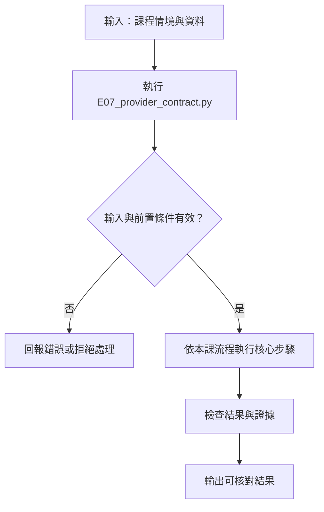

# 多供應商介面、LiteLLM 與 API 成本

> **新版正文：2026-10-06｜對應新版 LLM 第 17 節：多供應商介面、LiteLLM 與 API 成本。** 價格快照與凍結輸出是 **2026-10-06 歷史資料**，不得視為現價或目前供應商能力；實際使用前須重新查核官方來源。
> **審核注意：** README 已指出本課資料沿用舊 lesson code，且凍結輸出需同步修正。因此程式結果只能說明如何比較該歷史資料，不可當作已核實的現況或採購依據。
> 「OpenAI 相容」只保證**請求長得像**。同一段程式換一家供應商，可能有參數被默默忽略、usage 算法不同、價格差好幾倍。核心主張：**換供應商之前先跑契約測試；成本表上每個數字都要標來源與日期——而套件內建的價目表本身就會過期，本節實際抓到一筆。**

[回 50 節課綱](https://hackmd.io/@yillkid/HJl8JXTNkl)

## 流程圖：多供應商介面、LiteLLM 與 API 成本



## 學習目標與時間

先修第 15 節（輸出契約）、第 16 節（工具契約）。本節把那兩份契約拿去「換供應商」。

| 時間 | 內容 |
| --- | --- |
| 0–8 分鐘 | 三層抽象：官方 SDK、OpenAI 相容端點、LiteLLM |
| 8–18 分鐘 | 能力矩陣與契約測試 |
| 18–28 分鐘 | token 與價格：三種來源不能混加 |
| 28–35 分鐘 | 跑 Demo：價目過期、排名翻轉、預算上限 |
| 35–50 分鐘 | Workshop：替自己的請求做契約測試與成本表 |

驗收能力：交付**能力矩陣、鎖定版本、成本表**，每個數字標明是供應商回報（reported）、本地估算（estimated）還是離線模擬（simulated），價格附核對日期與來源網址。

## 一、三層抽象

| 層 | 例子 | 換供應商時 |
| --- | --- | --- |
| 官方 SDK | `openai`、`anthropic`、`google-genai` | 要改程式 |
| OpenAI 相容端點 | DeepSeek、Gemini、本地 vLLM 都提供 `/v1/chat/completions` | 改 `base_url` 與 `model`；**參數不一定都有效** |
| LiteLLM | `litellm.completion(model="deepseek/...")` | 改一個字串；LiteLLM 會**翻譯或丟掉**對方不支援的參數 |

抽象越高，換得越快，但「哪個參數被丟掉了」也越難看見。LiteLLM 的 `get_supported_openai_params()` 可以查它對每家支援哪些參數——這就是本節能力矩陣的資料來源之一。

## 二、能力矩陣與契約測試

能力矩陣的每一格有**三種值**：有、無、`?`（資料沒寫）。`?` 不能當成「無」，也不能當成「有」——這和第 16 節的 metadata 一樣，**unknown 不得默認為否**。

契約測試：把你的請求需要的參數列出來（例如 `tools`、`response_format`、`seed`、影像輸入），逐一對照。結果分三種：通過、不通過（明確不支援）、待確認（有 `?`）。

## 三、token 與價格的三種來源

| 來源 | 例子 | 可信度 |
| --- | --- | --- |
| reported（供應商回報） | API 回應裡的 `usage` | 計費依據，但各家算法不同 |
| estimated（本地估算） | `litellm.token_counter()`、tiktoken | **近似**；換 tokenizer 就不同 |
| simulated（離線模擬） | `mock_response` 的 usage | **與內容無關**，只能測流程 |

三種數字**不能混加**成一個「實際花費」。Demo 的 `Usage` 類別強制每一筆都要帶來源。

## 四、可執行 Demo

只用標準函式庫，**不呼叫任何付費 API、不需要金鑰**。讀兩份教師準備的資料：

- `data/provider-snapshot.json`：教師用 `tools/snapshot_providers.py` 從 **LiteLLM 1.104.0 套件內建**資料產生的能力與價目快照；資料時間為 **2026-10-06**（強制用本機副本，不連網更新）。這是歷史快照，不代表供應商目前能力或現價。
- `data/provider-prices-checked.json`：教師 **2026-10-06 手動**到四家官方價目頁核對的歷史價格，每筆附當時來源網址；不是現價。使用前要開啟官方網址重新核對並記錄新日期。

README 也註明：此資料快照沿用舊 lesson code，且凍結輸出可能需要同步修正。因此本 demo 的輸出是重現歷史資料的教學 fixture，不是即時核價結果，也不可據此作採購或預算決策。

<!-- demo: E07_provider_contract.py -->
```python
"""第 17 節：多供應商介面、契約測試與 API 成本。

「OpenAI 相容」只保證請求長得像，不保證每個參數都有效、usage 都可信、價格都一樣。
本程式只用標準函式庫，讀兩份資料：教師用 LiteLLM 產生的能力快照 data/provider-snapshot.json，
以及教師手動到官方價目頁核對的 data/provider-prices-checked.json；
不呼叫任何付費 API。資料與凍結輸出均為 2026-10-06 歷史快照，不是現價或即時能力；
使用前須重新查核官方來源。真實呼叫的部分在講義的 Workshop 由教師示範或以 fixtures 重播。
"""

# 這是歷史價格與能力資料的重播，不得作為目前價格或供應商能力的聲明。
print("歷史資料警告：本 demo 重播 2026-10-06 快照與凍結輸出；非現價/即時能力，使用前請重查官方來源。")
import argparse
import json
from pathlib import Path

HERE = Path(__file__).resolve().parent
SOURCES = ("reported", "estimated", "simulated")   # 供應商回報／本地估算／離線模擬


def load(name):
    for base in (HERE / "data", HERE.parent / "llm" / "data", Path.cwd() / "data"):
        path = base / name
        if path.exists():
            return json.loads(path.read_text(encoding="utf-8"))
    raise FileNotFoundError(f"找不到 data/{name}")


def price_drift(snapshot, checked):
    """LiteLLM 內建價目 vs 教師核對的官方價。回傳 {代號: (litellm, 官方, 是否相同)}。"""
    out = {}
    for alias, m in snapshot["models"].items():
        lite = (m["usd_per_1m_input"], m["usd_per_1m_output"])
        official = (checked["models"][alias]["usd_per_1m_input"], checked["models"][alias]["usd_per_1m_output"])
        out[alias] = (lite, official, lite == official)
    return out


def mark(value):
    """True／False／None 三種都要分開：None 是「沒寫」，不是「不支援」。"""
    return {True: "有", False: "無", None: "?"}[value]


def capability_matrix(models):
    rows = []
    for alias, m in models.items():
        rows.append([alias, mark(m["flags"]["supports_function_calling"]),
                     mark(m["flags"]["supports_response_schema"]), mark(m["flags"]["supports_vision"]),
                     mark(m["openai_params"]["seed"]), mark(m["openai_params"]["logprobs"]),
                     mark(m["openai_params"]["n"]), f'{m["max_input_tokens"]:,}'])
    return rows


def contract_check(model, required_params, required_flags=()):
    """請求需要的參數，這個供應商是否全部支援？回傳缺少的清單（空 = 通過）。"""
    missing = [p for p in required_params if not model["openai_params"].get(p)]
    unknown = [f for f in required_flags if model["flags"].get(f) is None]
    missing += [f for f in required_flags if model["flags"].get(f) is False]
    return missing, unknown


def cost_usd(model, input_tokens, output_tokens):
    return (input_tokens * model["usd_per_1m_input"] + output_tokens * model["usd_per_1m_output"]) / 1e6


class Usage:
    """一筆用量必須帶來源。不同來源的數字不能混加成同一個「實際花費」。"""

    def __init__(self, input_tokens, output_tokens, source):
        if source not in SOURCES:
            raise ValueError(f"source 必須是 {SOURCES} 之一，收到 {source!r}")
        self.input_tokens, self.output_tokens, self.source = input_tokens, output_tokens, source


class Budget:
    """送出前就擋：用「輸入 + max_tokens 上限」算最壞情況，而不是送出後才記帳。"""

    def __init__(self, max_usd, max_requests):
        self.max_usd, self.max_requests = max_usd, max_requests
        self.spent = {source: 0.0 for source in SOURCES}
        self.requests = 0

    def admit(self, model, input_tokens, max_output_tokens):
        worst = cost_usd(model, input_tokens, max_output_tokens)
        if self.requests >= self.max_requests:
            return False, "request_limit"
        if sum(self.spent.values()) + worst > self.max_usd:
            return False, f"budget（最壞 ${worst:.6f}，已用 ${sum(self.spent.values()):.6f}）"
        return True, "ok"

    def record(self, model, usage):
        self.requests += 1
        self.spent[usage.source] += cost_usd(model, usage.input_tokens, usage.output_tokens)


def show(snapshot, checked):
    models = snapshot["models"]
    print("能力快照:", snapshot["source"])
    print("litellm:", snapshot["environment"]["litellm"], "｜ 官方價目核對日期:", checked["checked_on"])

    print("\n== 一、能力矩陣（有／無／?=價目表沒寫）==")
    header = ["代號", "工具", "schema", "影像", "seed", "logprobs", "n", "輸入上限"]
    print(" | ".join(header))
    for row in capability_matrix(models):
        print(" | ".join(row))

    print("\n== 二、契約測試：同一個請求，換供應商還成立嗎？==")
    request = ["tools", "response_format", "seed"]
    print("請求需要:", request, "＋ 影像輸入")
    for alias, m in models.items():
        missing, unknown = contract_check(m, request, ["supports_vision"])
        verdict = "通過" if not missing and not unknown else ("不通過" if missing else "待確認")
        print(f"{alias:<14} {verdict:<4} 缺: {missing or '-'}  未知: {unknown or '-'}")

    print("\n== 三、token 數也要換算：LiteLLM 用哪個 tokenizer 估 ==")
    sample = "工人有沒有戴安全帽？"
    for alias, m in models.items():
        print(f"{alias:<14} {m['token_counter'][sample]:>3} token  ← {m['token_counter_tokenizer']}")

    print("\n== 四、套件內建價目會過期：LiteLLM vs 官方核對 ==")
    for alias, (lite, official, same) in price_drift(snapshot, checked).items():
        flag = "相同" if same else "不同 ←"
        print(f"{alias:<14} LiteLLM {lite}  官方 {official}  {flag}")
        if not same:
            print(f"{'':<14} 官方: {checked['models'][alias]['note']}")
    priced = {alias: dict(m, usd_per_1m_input=checked["models"][alias]["usd_per_1m_input"],
                          usd_per_1m_output=checked["models"][alias]["usd_per_1m_output"])
              for alias, m in models.items()}

    print("\n== 五、成本（官方價）：30 人 × 50 次 × (輸入 800、輸出 300 token) ==")
    calls, tin, tout = 30 * 50, 800, 300
    costs = {alias: cost_usd(m, tin * calls, tout * calls) for alias, m in priced.items()}
    stale = {alias: cost_usd(m, tin * calls, tout * calls) for alias, m in models.items()}
    cheapest = min(costs.values())
    for alias in models:
        note = "" if abs(costs[alias] - stale[alias]) < 1e-12 else f"（用 LiteLLM 舊價會算成 ${stale[alias]:.4f}）"
        print(f"{alias:<14} 全班 ${costs[alias]:.4f}  ×{costs[alias] / cheapest:.1f} {note}")
    longer = {alias: cost_usd(m, tin * calls, tout * 4 * calls) for alias, m in priced.items()}
    order = lambda d: [a for a, _ in sorted(d.items(), key=lambda kv: kv[1])]
    print("便宜→貴（輸出 300）:", order(costs))
    print("便宜→貴（輸出 1200）:", order(longer))
    print("便宜→貴（輸出 1200，LiteLLM 舊價）:", order({a: cost_usd(m, tin * calls, tout * 4 * calls) for a, m in models.items()}))

    print("\n== 六、usage 的來源 ==")
    for item in snapshot["mock_usage"]:
        print(f"mock 回覆 {item['reply_chars']:>3} 字 → prompt {item['prompt_tokens']}、completion {item['completion_tokens']}")
    try:
        Usage(10, 20, "actual")
    except ValueError as error:
        print("沒有來源的 usage →", error)

    print("\n== 七、預算上限：送出前擋 ==")
    m = priced["claude-haiku"]
    budget = Budget(max_usd=0.01, max_requests=5)
    for i in range(7):
        ok, why = budget.admit(m, 800, 1000)
        if not ok:
            print(f"第 {i + 1} 次 拒絕: {why}")
            break
        budget.record(m, Usage(800, 300, "estimated"))
        print(f"第 {i + 1} 次 放行，累計 ${sum(budget.spent.values()):.6f}（{budget.spent['estimated']:.6f} 為估算）")


def main(argv=None):
    parser = argparse.ArgumentParser()
    parser.add_argument("--cost", nargs=3, metavar=("MODEL", "IN", "OUT"), help="算單次費用，例：--cost deepseek-chat 1200 400")
    args = parser.parse_args(argv)
    snapshot, checked = load("provider-snapshot.json"), load("provider-prices-checked.json")
    if args.cost:
        alias, tin, tout = args.cost[0], int(args.cost[1]), int(args.cost[2])
        price = checked["models"][alias]
        print(f"{alias} 輸入 {tin}、輸出 {tout} → ${cost_usd(price, tin, tout):.6f}"
              f"（estimated，官方價 {checked['checked_on']}）")
        return
    show(snapshot, checked)


if __name__ == "__main__":
    main()
```

執行（程式也放在 [llm-demo](https://github.com/4-learn/llm-demo)）：

```bash
python3 E07_provider_contract.py  # 啟動時印出 2026-10-06 歷史快照／非現價警告
python3 E07_provider_contract.py --cost deepseek-chat 1200 400  # 成本行亦標示歷史日期
```

關鍵輸出（Linux x86_64／Python 3.10.15，2026-10-06）：

```text
能力快照: litellm 套件內建 model_prices_and_context_window_backup.json（LITELLM_LOCAL_MODEL_COST_MAP=True）
litellm: 1.104.0 ｜ 官方價目核對日期: 2026-10-06

== 一、能力矩陣（有／無／?=價目表沒寫）==
代號 | 工具 | schema | 影像 | seed | logprobs | n | 輸入上限
openai-mini | 有 | 有 | 有 | 有 | 有 | 有 | 128,000
deepseek-chat | 有 | 有 | ? | 有 | 有 | 有 | 131,072
claude-haiku | 有 | 有 | 有 | 無 | 無 | 無 | 200,000
gemini-flash | 有 | 有 | 有 | 無 | 有 | 有 | 1,048,576

== 二、契約測試：同一個請求，換供應商還成立嗎？==
請求需要: ['tools', 'response_format', 'seed'] ＋ 影像輸入
openai-mini    通過   缺: -  未知: -
deepseek-chat  待確認  缺: -  未知: ['supports_vision']
claude-haiku   不通過  缺: ['seed']  未知: -
gemini-flash   不通過  缺: ['seed']  未知: -

== 三、token 數也要換算：LiteLLM 用哪個 tokenizer 估 ==
openai-mini      8 token  ← o200k_base
deepseek-chat   13 token  ← cl100k_base
claude-haiku    13 token  ← huggingface:anthropic
gemini-flash    13 token  ← cl100k_base

== 四、套件內建價目會過期：LiteLLM vs 官方核對 ==
openai-mini    LiteLLM (0.15, 0.6)  官方 (0.15, 0.6)  相同
deepseek-chat  LiteLLM (0.28, 0.42)  官方 (0.3, 1.2)  不同 ←
               官方: 官方頁已改名 deepseek-flash（DeepSeek-V4.1-Flash），未列 deepseek-chat；上表為尖峰價（cache miss），離峰為一半 0.15／0.6；官方標示支援 Vision。LiteLLM 快照仍是舊名舊價 0.28／0.42
claude-haiku   LiteLLM (1.0, 5.0)  官方 (1.0, 5.0)  相同
gemini-flash   LiteLLM (0.3, 2.5)  官方 (0.3, 2.5)  相同

== 五、成本（官方價）：30 人 × 50 次 × (輸入 800、輸出 300 token) ==
openai-mini    全班 $0.4500  ×1.0 
deepseek-chat  全班 $0.9000  ×2.0 （用 LiteLLM 舊價會算成 $0.5250）
claude-haiku   全班 $3.4500  ×7.7 
gemini-flash   全班 $1.4850  ×3.3 
便宜→貴（輸出 300）: ['openai-mini', 'deepseek-chat', 'gemini-flash', 'claude-haiku']
便宜→貴（輸出 1200）: ['openai-mini', 'deepseek-chat', 'gemini-flash', 'claude-haiku']
便宜→貴（輸出 1200，LiteLLM 舊價）: ['deepseek-chat', 'openai-mini', 'gemini-flash', 'claude-haiku']

== 六、usage 的來源 ==
mock 回覆   7 字 → prompt 10、completion 20
mock 回覆 200 字 → prompt 10、completion 20
沒有來源的 usage → source 必須是 ('reported', 'estimated', 'simulated') 之一，收到 'actual'

== 七、預算上限：送出前擋 ==
第 1 次 放行，累計 $0.002300（0.002300 為估算）
第 2 次 放行，累計 $0.004600（0.004600 為估算）
第 3 次 拒絕: budget（最壞 $0.005800，已用 $0.004600）
```

## 五、結果怎麼讀

### 1. 相容不等於一致

四家在 LiteLLM 裡都支援 `tools` 和 `response_format`，但 `seed`（固定隨機種子）只有兩家有；Claude 連 `logprobs`、`n` 都沒有。第 04 節用 `seed` 讓輸出可重現——**換到 Claude 或 Gemini，那一招就失效**，而且 LiteLLM 預設會丟出錯誤或略過參數，取決於設定。

### 2. `?` 不是「無」

DeepSeek 的影像欄位在 LiteLLM 價目表是空的，所以契約測試判「待確認」。教師去官方頁核對，發現新版 `deepseek-flash` **標示支援 Vision**——如果把 `?` 當成「無」，就會錯誤排除它。

### 3. 同一句話，token 數差 60%

「工人有沒有戴安全帽？」用 `o200k_base` 是 8 個 token，用 `cl100k_base` 是 13 個。LiteLLM 對 DeepSeek 和 Gemini **沒有它們自己的 tokenizer**，所以退回 OpenAI 舊的 `cl100k_base` 估。這是 estimated，不是那兩家實際會收的數字。第 02 節講過：token 數要問「用哪個模型的 tokenizer」。

### 4. 套件內建價目會過期（本節實際發現）

教師在 2026-10-06 核對官方頁：OpenAI、Anthropic、Google 三家與 LiteLLM 1.104.0 內建價目相同；**DeepSeek 不同**。官方已改名為 `deepseek-flash`，價格 0.30／1.20（尖峰），LiteLLM 還是舊名舊價 0.28／0.42。輸出價差了將近 3 倍。

結果：全班成本從 $0.525 變成 $0.90；輸出加長到 1200 token 時，**用舊價會以為 DeepSeek 最便宜，用官方價則是 OpenAI 最便宜——排名翻轉**。用錯價格不只是金額錯，**選型結論也會錯**。

另外，DeepSeek 官方有尖峰與離峰兩種價格（離峰是一半）。成本表要寫明用哪一個；本節保守用尖峰價。

### 5. 模擬 usage 與內容無關

`mock_response` 回 7 個字和 200 個字，usage 都是 prompt 10、completion 20。用它來估成本完全錯誤；它只能用來測「程式有沒有正確讀 usage 欄位」。

### 6. 預算要在送出前擋

`Budget.admit()` 用「輸入 + `max_tokens` 上限」算**最壞情況**。上限 $0.01，前兩次放行，第三次最壞要 $0.0058，加上已用的 $0.0046 會超過，所以送出前就拒絕。等帳單來再停，錢已經花了。

## 六、常見誤判

| 說法 | 為什麼不對 |
| --- | --- |
| 「都是 OpenAI 相容，換 base_url 就好」 | 參數支援不同（seed、logprobs、n），可能被忽略或報錯 |
| 「價目表沒寫支援影像，就是不支援」 | `?` 是資料缺漏；DeepSeek 新版官方標示支援 |
| 「LiteLLM 的價格就是官方價格」 | 套件內建資料會過期；本節 DeepSeek 就過期了 |
| 「token_counter 算出來就是會被收的錢」 | 對非 OpenAI 模型多半是用 cl100k 近似 |
| 「mock 測試跑過，成本估好了」 | mock usage 是固定值，與內容無關 |
| 「免費額度很多，不用設上限」 | 免費層的資料政策不同（Gemini 免費層內容會被用於改進產品）；額度會變 |

## Workshop：替自己的請求做契約測試與成本表

### 任務

1. 寫下你在前置課程的請求需要哪些參數與能力（例如 `tools`、`response_format`、影像）。
2. 改 Demo 第二段的 `request`，跑契約測試，列出每家的結果。對每個「待確認」，到官方文件查證，寫下網址與日期。
3. 用 `--cost` 估你的請求（自己決定輸入與輸出 token 數）在四家的單次費用，再乘以全班 30 人 × 50 次。
4. 到任一家官方價目頁核對一個價格，填上**今天的日期**。若與 `provider-prices-checked.json` 不同，記錄差異。
5. 設一個預算（例如 $0.05）與請求上限，算出你的請求最多能放行幾次。

### 參考判讀

以下為使用 **2026-10-06 歷史快照與凍結輸出**的教師紀錄，並非目前供應商狀態或現價：

- 請求改成 `["tools", "response_format"]`、不要影像：四家都通過。加回 `seed`：Claude、Gemini 不通過。
- `--cost deepseek-chat 1200 400` → `$0.000840`；同樣用 LiteLLM 舊價會是 `$0.000504`。
- `--cost claude-haiku 1200 400` → `$0.003200`；`--cost openai-mini 1200 400` → `$0.000420`。
- 第 5 題：Claude Haiku、輸入 800、`max_tokens` 1000、每次實際用 300 的估算下，$0.01 只放行 2 次——因為擋的是最壞情況，不是平均。

### 驗收

- 能力矩陣：每格是有／無／?，每個 `?` 有後續查證或保留為待確認。
- 成本表：每列有模型、價格、**來源網址、核對日期**、token 數的來源（reported／estimated／simulated）。
- 不得把 mock usage 或 token_counter 估算寫成「實際花費」。

## 教師紀錄與下一步

- 證據等級：
  - 能力與 token 估算：**套件快照**（LiteLLM 1.104.0 內建資料，`LITELLM_LOCAL_MODEL_COST_MAP=True`，離線產生）。
  - 價格：**歷史快照**，教師手動核對官方頁（2026-10-06，四家各一個網址）；來源網址是核對時記錄，需重新開啟確認仍適用。不得視為現價。
  - **本節未做任何真實 API 呼叫**，所以沒有 reported usage 的實例。Workshop 若要示範真實呼叫，需要教師決定用哪一家、誰付費、金鑰如何管理。
- 撰寫時的實際紀錄：
  1. 原本打算只用 LiteLLM 內建價目，核對官方頁時發現 DeepSeek 已改名改價，於是把「價目過期」加成獨立一段，並另存手動核對檔。
  2. `token_counter` 對 DeepSeek、Gemini 的結果與 tiktoken `cl100k_base` 逐一相同，對 gpt-4o-mini 與 `o200k_base` 相同；快照工具用這個比對記下實際使用的 tokenizer。
  3. LiteLLM 預設會上網抓最新價目表（本機副本 4375 筆、線上 4479 筆）；快照工具強制用本機副本，否則同一版本兩天跑出不同結果。
- 代號 `deepseek-chat` 保留是因為 LiteLLM 仍用這個鍵；官方模型已是 `deepseek-flash`，講義與資料檔都已註明。
- 下一步：選修 E03 把 VLM 標籤寫成含 provenance 的 metadata；第 50 節的級聯路由會用到本節的成本表。
