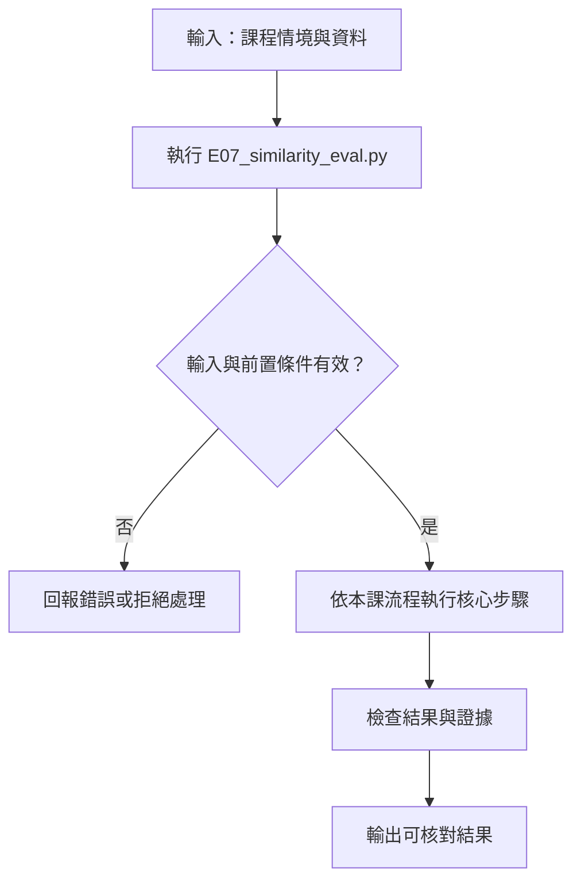

# 相似度、失敗案例與門檻評測

> **新版正文：20E07-E03-06｜對應新版 LLM 第 18 節：相似度、失敗案例與評測。**
> 第 17 節看到向量會把「有戴」和「沒戴」排在一起。本節把這件事量化：用 40 組人工標註的中文句對，看 cosine 分數在哪些地方會騙人，再用開發集挑門檻、保留集驗證。核心主張：**相似度分數是排序用的幾何量，不是「相關的機率」；同一個門檻搬到新資料，可能比全部猜「不相關」還差。**

[回 50 節課綱](https://hackmd.io/@yillkid/HJl8JXTNkl)

## 流程圖：相似度、失敗案例與評測



## 學習目標與時間

先修第 08 節（開發集與保留集）、第 17 節（embedding 與套件、模型安裝）。勞動部梯次已在 MariaDB 第 17 節用**同一個模型與 revision** 產生過向量，本節不重講安裝，直接看分數。

| 時間 | 內容 |
| --- | --- |
| 0–8 分鐘 | dot product 與 cosine：差在長度；正規化後兩者相同 |
| 8–18 分鐘 | 四種失敗：否定、數字、型號、字面重疊 |
| 18–28 分鐘 | 門檻怎麼挑：開發集挑、保留集只看一次 |
| 28–35 分鐘 | 跑 Demo，讀高分錯配與低分漏配 |
| 35–50 分鐘 | Workshop：自己造句對、預測再驗證 |

驗收能力：交付**標註句對、相似度表與失敗解釋**——至少一個高分錯配、一個低分漏配；門檻只在開發資料上選定，**不用測試資料挑最有利的 threshold**。

## 一、dot product 與 cosine

兩個向量 a、b：

- **dot product**：a·b ＝ Σ aᵢbᵢ。向量越長，數值越大。
- **cosine**：a·b ／（|a| |b|）。除掉長度，只看方向，範圍 −1 到 1。

所以兩者**只有在每個向量長度都相同時才給出相同排名**。第 17 節的程式加了 `normalize_embeddings=True`，把每個向量縮成長度 1，此時 dot 與 cosine 完全相等，可以用便宜的 dot 計算。

這個模型（`BAAI/bge-small-zh-v1.5`）的設定檔本身就含一層 Normalize。Demo 刻意建一個**少掉這一層**的版本，讓你看到未正規化時長度約 6 到 7.5 不等，排名會因此改變。**換模型時要查它有沒有正規化；不要假設。**

## 二、四種常見失敗

Embedding 擅長「說法不同、意思相近」；它不擅長下面這些，因為這些差異在句子裡只佔一兩個字：

| 類型 | 例子 | 為什麼會錯 |
| --- | --- | --- |
| 否定 | 「冷氣沒有漏水」vs「冷氣排水管漏水」 | 主題、用字幾乎相同，只差「沒有」 |
| 數字 | 「充電五百次」vs「充電五十次」 | 一個字的差別，意思完全不同 |
| 型號 | 「AX-300」vs「AX-500」 | 對模型而言是相似的符號串 |
| 字面重疊 | 「印表機卡紙」vs「印表機紙匣容量」 | 共用名詞多，但回答的是別的問題 |

這些應該交給**明確條件**處理：型號、日期、數字用欄位比對或 SQL `WHERE`（MariaDB 第 21 節），否定與條件交給後面的驗證步驟（第 24 節）。向量檢索負責「找候選」，不負責「判斷條件是否成立」。

## 三、門檻怎麼挑

很多系統會寫「相似度大於 0.8 才算相關」。這個數字有三個問題：

1. **不同模型的分數分布不同。** 這個模型的不相關句對常常也有 0.6 到 0.8；換一個模型，同樣句對可能是 0.3。門檻**不能跨模型共用**。
2. **門檻要用資料挑，而且只能用開發資料挑。** 在測試資料上挑最好看的門檻，報出來的數字就是自己騙自己（第 08 節）。
3. **門檻挑完要和簡單基準比。** 如果還比不上「全部猜不相關」，這個門檻就沒有用。

本節的 40 組句對分成開發集與保留集各 20 組。**保留集在跑出任何分數之前就寫好、凍結**，之後不因分數修改。

## 四、可執行 Demo

需要第 17 節裝好的套件與已下載的模型；不需要 API key。第一次載入模型需要網路，之後可用 `HF_HUB_OFFLINE=1` 離線執行。cosine、門檻與指標只用標準函式庫寫，方便你看清楚每一步。

<!-- demo: E07_similarity_eval.py -->
```python
"""第 18 節：相似度、失敗案例與門檻評測。

需要第 17 節的套件與模型；模型以外的函式（cosine、門檻挑選、指標）只用標準函式庫。
"""
import argparse
import math

MODEL_ID = "BAAI/bge-small-zh-v1.5"
REVISION = "7999e1d3359715c523056ef9478215996d62a620"
QUERY_PREFIX = "为这个句子生成表示以用于检索相关文章："  # 模型卡原字串，見第 17 節

# (查詢, 段落, 人工標註 1=相關 0=不相關, 類型)。全部為合成句。
# 開發集：用來看分數、挑門檻。
DEV = [
    ("如何把路由器恢復出廠設定？", "長按重設鍵十秒，路由器會回到出廠狀態。", 1, "同義"),
    ("如何把路由器恢復出廠設定？", "路由器出廠時的預設密碼印在底部貼紙。", 0, "字面重疊"),
    ("印表機卡紙怎麼處理？", "打開後蓋，輕輕拉出夾住的紙張。", 1, "同義"),
    ("印表機卡紙怎麼處理？", "印表機紙匣可放兩百五十張紙。", 0, "字面重疊"),
    ("冷氣沒有漏水", "冷氣排水管漏水，地上有水漬。", 0, "否定"),
    ("工人有戴安全帽", "工人未戴安全帽進入工地。", 0, "否定"),
    ("工人有戴安全帽", "施工人員頭盔配戴完整。", 1, "同義"),
    ("AX-300 的保固多久？", "AX-300 保固兩年。", 1, "型號"),
    ("AX-300 的保固多久？", "AX-500 保固三年。", 0, "型號"),
    ("電池可以充電五百次", "電池可以充電五十次。", 0, "數字"),
    ("電池可以充電五百次", "電池循環壽命約五百次。", 1, "數字"),
    ("會議改到星期三下午", "會議延到週三午後舉行。", 1, "同義"),
    ("會議改到星期三下午", "會議改到星期四下午。", 0, "數字"),
    ("如何申請退貨？", "退貨請於七天內填寫線上表單。", 1, "同義"),
    ("如何申請退貨？", "本店不提供換貨服務。", 0, "近義干擾"),
    ("咖啡機一直漏水", "咖啡機底部持續滲水。", 1, "同義"),
    ("咖啡機一直漏水", "咖啡機水箱容量一點二公升。", 0, "字面重疊"),
    ("手機螢幕破了能修嗎", "螢幕碎裂可送修更換面板。", 1, "同義"),
    ("手機螢幕破了能修嗎", "手機螢幕亮度可在設定中調整。", 0, "字面重疊"),
    ("密碼忘記了", "點選「忘記密碼」並收取驗證信即可重設。", 1, "同義"),
]
# 保留集：在看任何分數之前就寫好；門檻挑完後只看一次，不再回頭改門檻。
HOLDOUT = [
    ("洗衣機脫水時很吵", "洗衣機脫水階段發出巨大噪音。", 1, "同義"),
    ("洗衣機脫水時很吵", "洗衣機脫水轉速最高一千二百轉。", 0, "字面重疊"),
    ("門鎖電池沒電怎麼開門", "電子鎖沒電時，可用九伏特電池接觸底部端子臨時供電。", 1, "同義"),
    ("門鎖電池沒電怎麼開門", "門鎖電池建議每年更換一次。", 0, "字面重疊"),
    ("熱水器沒有異味", "熱水器運作時有瓦斯味，請立即關閉。", 0, "否定"),
    ("訂單尚未出貨", "您的訂單已於今日出貨。", 0, "否定"),
    ("訂單尚未出貨", "訂單目前仍在備貨中，還沒寄出。", 1, "同義"),
    ("BX-12 支援快充嗎？", "BX-12 支援十八瓦快充。", 1, "型號"),
    ("BX-12 支援快充嗎？", "BX-21 支援十八瓦快充。", 0, "型號"),
    ("耳機續航八小時", "耳機續航十八小時。", 0, "數字"),
    ("耳機續航八小時", "充飽電可連續播放約八個鐘頭。", 1, "數字"),
    ("班機改到早上七點起飛", "班機改為上午七時出發。", 1, "同義"),
    ("班機改到早上七點起飛", "班機改到晚上七點起飛。", 0, "數字"),
    ("怎麼取消訂閱？", "在帳戶設定中點選「停止續訂」即可。", 1, "同義"),
    ("怎麼取消訂閱？", "訂閱方案可升級為年繳享九折。", 0, "近義干擾"),
    ("冰箱不冷", "冰箱冷藏室溫度異常升高，食物不夠冰。", 1, "同義"),
    ("冰箱不冷", "冰箱冷凍室容量為一百公升。", 0, "字面重疊"),
    ("筆電開不了機", "按電源鍵沒有任何反應時，先接上變壓器再試。", 1, "同義"),
    ("筆電開不了機", "筆電開機後會自動更新系統。", 0, "字面重疊"),
    ("帳號被盜了", "發現帳號遭他人登入，請立即變更密碼並登出所有裝置。", 1, "同義"),
]
# 正規化實驗用的小語料：同一題用 dot 與 cosine 排名。
CORPUS = [
    "打開後蓋，輕輕拉出夾住的紙張。",
    "印表機紙匣可放兩百五十張紙。",
    "路由器出廠時的預設密碼印在底部貼紙。",
    "請參閱使用手冊。",
    "電池可以充電五十次。",
]


def load_models():
    """回傳 (正規化模型, 未正規化模型)；後者共用同一權重，只少了最後的 Normalize 層。"""
    import torch
    from sentence_transformers import SentenceTransformer

    torch.set_num_threads(2)
    model = SentenceTransformer(MODEL_ID, revision=REVISION, device="cpu",
                                trust_remote_code=False, model_kwargs={"use_safetensors": True})
    raw = SentenceTransformer(modules=[model[0], model[1]], device="cpu")
    return model, raw


def encode(model, texts, query=False):
    prefix = QUERY_PREFIX if query else ""
    vectors = model.encode([prefix + t for t in texts], batch_size=16, show_progress_bar=False)
    return [[float(x) for x in row] for row in vectors]


def dot(a, b):
    return sum(x * y for x, y in zip(a, b))


def cosine(a, b):
    na, nb = math.sqrt(dot(a, a)), math.sqrt(dot(b, b))
    if na == 0 or nb == 0:
        raise ValueError("零向量沒有方向，cosine 無定義")
    return dot(a, b) / (na * nb)


def score_pairs(model, pairs):
    queries = encode(model, [p[0] for p in pairs], query=True)
    passages = encode(model, [p[1] for p in pairs])
    return [round(cosine(q, d), 4) for q, d in zip(queries, passages)]


def confusion(scores, labels, threshold):
    tp = sum(s >= threshold and y == 1 for s, y in zip(scores, labels))
    fp = sum(s >= threshold and y == 0 for s, y in zip(scores, labels))
    fn = sum(s < threshold and y == 1 for s, y in zip(scores, labels))
    tn = sum(s < threshold and y == 0 for s, y in zip(scores, labels))
    return tp, fp, fn, tn


def metrics(scores, labels, threshold):
    tp, fp, fn, tn = confusion(scores, labels, threshold)
    precision = tp / (tp + fp) if tp + fp else 0.0
    recall = tp / (tp + fn) if tp + fn else 0.0
    return {"threshold": threshold, "tp": tp, "fp": fp, "fn": fn, "tn": tn,
            "accuracy": round((tp + tn) / len(labels), 3),
            "precision": round(precision, 3), "recall": round(recall, 3)}


def pick_threshold(scores, labels):
    """只看傳進來的資料挑門檻：候選為各分數本身，取 accuracy 最高者；同分取較高門檻（較保守）。"""
    if not scores or len(scores) != len(labels):
        raise ValueError("分數與標註數量必須相同且不為空")
    best = None
    for t in sorted(set(scores)):
        m = metrics(scores, labels, t)
        if best is None or m["accuracy"] >= best["accuracy"]:
            best = m
    return best["threshold"]


def report(name, pairs, scores):
    print(f"[{name}]")
    for (q, d, y, kind), s in sorted(zip(pairs, scores), key=lambda x: -x[1]):
        print(f"{s:.4f} {'相關' if y else '不相關'} {kind:4} {q} ｜ {d}")


def worst_cases(pairs, scores):
    """最高分的不相關（高分錯配）與最低分的相關（低分漏配）。"""
    wrong = max((s, p) for p, s in zip(pairs, scores) if p[2] == 0)
    miss = min((s, p) for p, s in zip(pairs, scores) if p[2] == 1)
    return wrong, miss


if __name__ == "__main__":
    parser = argparse.ArgumentParser()
    parser.add_argument("--pair", nargs=2, action="append", metavar=("QUERY", "PASSAGE"),
                        help="另外算一組句對的 cosine；可重複")
    args = parser.parse_args()
    model, raw = load_models()
    print("model:", MODEL_ID, "revision:", REVISION)

    print("\n== 一、正規化：同一題，dot 與 cosine 排名不同 ==")
    query = "手機螢幕破了能修嗎"
    q_raw, docs_raw = encode(raw, [query], query=True)[0], encode(raw, CORPUS)
    print("未正規化長度:", [round(math.sqrt(dot(v, v)), 2) for v in docs_raw])
    by_dot = sorted(range(len(CORPUS)), key=lambda i: -dot(q_raw, docs_raw[i]))
    by_cos = sorted(range(len(CORPUS)), key=lambda i: -cosine(q_raw, docs_raw[i]))
    print("dot   排名:", [CORPUS[i] for i in by_dot[:3]])
    print("cosine排名:", [CORPUS[i] for i in by_cos[:3]])
    q_norm, docs_norm = encode(model, [query], query=True)[0], encode(model, CORPUS)
    same = all(abs(dot(q_norm, d) - cosine(q_norm, d)) < 1e-5 for d in docs_norm)
    print("正規化後 dot == cosine:", same)

    print("\n== 二、開發集句對 ==")
    dev_scores = score_pairs(model, DEV)
    report("dev", DEV, dev_scores)
    wrong, miss = worst_cases(DEV, dev_scores)
    print(f"高分錯配: {wrong[0]:.4f} {wrong[1][0]} ｜ {wrong[1][1]}（{wrong[1][3]}）")
    print(f"低分漏配: {miss[0]:.4f} {miss[1][0]} ｜ {miss[1][1]}（{miss[1][3]}）")

    print("\n== 三、在開發集挑門檻，保留集只看一次 ==")
    labels_dev = [p[2] for p in DEV]
    threshold = pick_threshold(dev_scores, labels_dev)
    print("dev 挑出的門檻:", threshold, metrics(dev_scores, labels_dev, threshold))
    hold_scores = score_pairs(model, HOLDOUT)
    labels_hold = [p[2] for p in HOLDOUT]
    print("holdout 同一門檻:", metrics(hold_scores, labels_hold, threshold))
    print("對照：全部判「不相關」的 holdout accuracy:", round(labels_hold.count(0) / len(labels_hold), 3))
    cheat = pick_threshold(hold_scores, labels_hold)
    print("（錯誤示範）在 holdout 上挑門檻:", cheat, metrics(hold_scores, labels_hold, cheat))
    for kind in ("否定", "數字", "型號"):
        rows = [(s, p) for p, s in zip(HOLDOUT, hold_scores) if p[3] == kind]
        print(f"holdout {kind}:", [(f"{s:.4f}", "相關" if p[2] else "不相關") for s, p in rows])

    if args.pair:
        print("\n== 自訂句對 ==")
        for (q, d), s in zip(args.pair, score_pairs(model, [(q, d, None, "自訂") for q, d in args.pair])):
            print(f"{s:.4f} {q} ｜ {d}")
```

執行（程式也放在 [llm-demo](https://github.com/4-learn/llm-demo)：`git clone https://github.com/4-learn/llm-demo.git` 後在該目錄、啟用第 17 節的 venv 後執行）：

```bash
python E07_similarity_eval.py
python E07_similarity_eval.py --pair "冷氣漏水" "冷氣沒有漏水"
HF_HUB_OFFLINE=1 python E07_similarity_eval.py
```

關鍵輸出（Linux x86_64／Python 3.10.15，CPU，20E07-E03-06）：

```text
model: BAAI/bge-small-zh-v1.5 revision: 7999e1d3359715c523056ef9478215996d62a620

== 一、正規化：同一題，dot 與 cosine 排名不同 ==
未正規化長度: [6.48, 7.43, 6.7, 6.19, 7.27]
dot   排名: ['印表機紙匣可放兩百五十張紙。', '請參閱使用手冊。', '打開後蓋，輕輕拉出夾住的紙張。']
cosine排名: ['請參閱使用手冊。', '打開後蓋，輕輕拉出夾住的紙張。', '印表機紙匣可放兩百五十張紙。']
正規化後 dot == cosine: True

== 二、開發集句對 ==
[dev]
0.8292 相關 型號   AX-300 的保固多久？ ｜ AX-300 保固兩年。
0.8245 不相關 數字   電池可以充電五百次 ｜ 電池可以充電五十次。
0.8062 不相關 數字   會議改到星期三下午 ｜ 會議改到星期四下午。
0.7746 不相關 型號   AX-300 的保固多久？ ｜ AX-500 保固三年。
0.7388 相關 同義   如何把路由器恢復出廠設定？ ｜ 長按重設鍵十秒，路由器會回到出廠狀態。
0.7279 相關 數字   電池可以充電五百次 ｜ 電池循環壽命約五百次。
0.7277 相關 同義   會議改到星期三下午 ｜ 會議延到週三午後舉行。
0.7163 不相關 字面重疊 印表機卡紙怎麼處理？ ｜ 印表機紙匣可放兩百五十張紙。
0.7138 不相關 否定   冷氣沒有漏水 ｜ 冷氣排水管漏水，地上有水漬。
0.7000 相關 同義   如何申請退貨？ ｜ 退貨請於七天內填寫線上表單。
0.6912 相關 同義   手機螢幕破了能修嗎 ｜ 螢幕碎裂可送修更換面板。
0.6876 相關 同義   咖啡機一直漏水 ｜ 咖啡機底部持續滲水。
0.6722 相關 同義   密碼忘記了 ｜ 點選「忘記密碼」並收取驗證信即可重設。
0.6591 不相關 字面重疊 手機螢幕破了能修嗎 ｜ 手機螢幕亮度可在設定中調整。
0.6460 不相關 否定   工人有戴安全帽 ｜ 工人未戴安全帽進入工地。
0.6210 不相關 字面重疊 如何把路由器恢復出廠設定？ ｜ 路由器出廠時的預設密碼印在底部貼紙。
0.6203 不相關 字面重疊 咖啡機一直漏水 ｜ 咖啡機水箱容量一點二公升。
0.5745 相關 同義   工人有戴安全帽 ｜ 施工人員頭盔配戴完整。
0.5671 相關 同義   印表機卡紙怎麼處理？ ｜ 打開後蓋，輕輕拉出夾住的紙張。
0.4708 不相關 近義干擾 如何申請退貨？ ｜ 本店不提供換貨服務。
高分錯配: 0.8245 電池可以充電五百次 ｜ 電池可以充電五十次。（數字）
低分漏配: 0.5671 印表機卡紙怎麼處理？ ｜ 打開後蓋，輕輕拉出夾住的紙張。（同義）

== 三、在開發集挑門檻，保留集只看一次 ==
dev 挑出的門檻: 0.6722 {'threshold': 0.6722, 'tp': 8, 'fp': 5, 'fn': 2, 'tn': 5, 'accuracy': 0.65, 'precision': 0.615, 'recall': 0.8}
holdout 同一門檻: {'threshold': 0.6722, 'tp': 6, 'fp': 7, 'fn': 4, 'tn': 3, 'accuracy': 0.45, 'precision': 0.462, 'recall': 0.6}
對照：全部判「不相關」的 holdout accuracy: 0.5
（錯誤示範）在 holdout 上挑門檻: 0.7779 {'threshold': 0.7779, 'tp': 3, 'fp': 2, 'fn': 7, 'tn': 8, 'accuracy': 0.55, 'precision': 0.6, 'recall': 0.3}
holdout 否定: [('0.7264', '不相關'), ('0.7121', '不相關')]
holdout 數字: [('0.8477', '不相關'), ('0.5235', '相關'), ('0.8684', '不相關')]
holdout 型號: [('0.7993', '相關'), ('0.7744', '不相關')]
```

不同 CPU 或套件版本可能讓小數點後第四位不同；排名與結論應該一樣。如果差很多，先用 `check_env.py --full` 核對版本。

## 五、結果怎麼讀

### 1. 正規化會改變排名

未正規化時，「印表機紙匣可放兩百五十張紙。」的向量最長（7.43），dot 把它排第一；cosine 把它降到第三。**排名改變不是因為意思不同，只是因為長度。** 正規化後 dot 與 cosine 相等，所以第 17 節可以直接用矩陣乘法。

### 2. 開發集：分數最高的四組有三組不相關

開發集最上面四組依序是 0.8292（相關）、0.8245（**不相關**，五百次 vs 五十次）、0.8062（**不相關**，星期三 vs 星期四）、0.7746（**不相關**，AX-300 vs AX-500）。這三組全是數字、型號失敗。最低分漏配是「印表機卡紙怎麼處理？」對「打開後蓋，輕輕拉出夾住的紙張」（0.5671）——段落沒有「印表機」也沒有「卡紙」，用字完全不同。

高分錯配與低分漏配**同時存在**，表示不存在一個能把兩類分開的門檻：門檻提高到 0.83 以上，所有相關的都會被丟掉；降到 0.56，幾乎所有不相關的都會進來。

### 3. 門檻：開發集 0.65，保留集 0.45，比全猜不相關還低

在開發集挑出的門檻是 0.6722，開發集 accuracy 0.65。同一門檻用在保留集：**0.45**，低於「全部猜不相關」的 0.50。

這不代表 embedding 沒用——這 40 組刻意挑了最難的情況：每題的不相關段落都和題目共用很多字。真實檢索中多數段落和問題無關，排序仍然有用（第 17 節、第 23 節）。它代表的是：**相似度門檻不能當「是否相關」的判決**，尤其是遇到數字、型號、否定時。

「錯誤示範」那一行在保留集上挑門檻，得到 0.55——看起來比 0.45 好，但這是用答案挑出來的，不能報告。而且就算作弊，也只比全猜不相關多 0.05。

### 4. 保留集的失敗類型和開發集一樣

保留集的兩組否定都在 0.71 以上、兩組數字錯配在 0.85 左右，是保留集最高的兩組分數；「續航八小時」對「約八個鐘頭」只有 0.5235，是全部最低。開發集看到的失敗，換一批句子還是出現——這是**模型的性質**，不是這批資料剛好。

## 六、常見誤判

| 說法 | 為什麼不對 |
| --- | --- |
| 「0.8 代表 80% 機率相關」 | cosine 是夾角，沒有經過機率校準；不相關句對也有 0.87 |
| 「別人說門檻 0.75，我也用 0.75」 | 門檻跟模型、語料、查詢方式綁在一起，要在自己的開發資料上挑 |
| 「保留集分數不好，換個門檻再試」 | 那就變成在保留集上挑門檻；要改就要換一份新的保留集 |
| 「分數最高的那筆就是答案」 | 第 17 節的「未被堵住的出口」：第一名正好相反 |
| 「加上前綴一定比較好」 | 要實測；本頁程式照模型卡在**查詢**加前綴、段落不加 |

## Workshop：先預測，再執行

### 任務

1. 用 `--pair` 測「AX-300 的保固多久？」對「AX300 保固兩年。」（少一個連字號）和「這台機器保固兩年。」（沒有型號）。**先寫下你預期哪一個分數高**，再執行。
2. 寫一組否定句對，預測它會不會超過 0.6722；執行後記錄分數。
3. 把「電池可以充電五百次」對「電池可以充電 500 次。」（中文數字改阿拉伯數字）跑一次。它和「五十次」那組相比，誰比較高？這告訴你什麼？
4. 自己出 6 組句對（3 相關、3 不相關），**執行前**標好答案、寫好類型。跑完後用 0.6722 計算 accuracy，和「全部猜多數類」比較。
5. 說明在你的系統裡，型號與數字應該怎麼處理才不靠相似度。

### 參考判讀

以下皆為實跑（20E07-E03-06，同一模型與程式）：

- 第 1 題：少一個連字號 0.7607，沒有型號 0.5526。型號字面還在時分數仍高；拿掉型號之後，即使內容完全正確（就是在問那台的保固），分數也掉到開發集門檻以下。
- 第 2 題：例如「冷氣漏水」對「冷氣沒有漏水」是 0.7354，超過門檻，會被當成相關。
- 第 3 題：「500 次」是 0.8296，「五十次」是 0.8245——**錯的數字和對的數字只差 0.005**。分數幾乎不管數字是多少，數字要用明確比對。
- 第 4 題：結果因人而異；要交的是表格本身，不是要求門檻表現好。如果你的 6 組全部判對，再加一組數字或否定題。
- 第 5 題：從段落抽出型號、數字存成欄位，查詢時用欄位條件過濾（MariaDB 第 21 節的 `WHERE`），向量只在過濾後的候選中排序；或在生成前以驗證步驟比對（第 24 節）。

### 驗收

- 句對表：查詢、段落、執行前標註、類型、分數；至少 6 組。
- 至少一個高分錯配與一個低分漏配，各寫一句原因。
- 寫明門檻在哪份資料上選定；報告必須包含和「全部猜多數類」的比較。
- 寫明模型 ID、revision、是否正規化、查詢是否加前綴。

## 教師紀錄與下一步

- 證據等級：**本機實測**（Linux x86_64 CPU、Python 3.10.15、torch 2.8.0+cpu、sentence-transformers 5.1.2、transformers 4.57.3、離線快取）。兩次執行輸出逐位相同。單次執行約 6 秒、最高記憶體約 480 MB（含載入模型）；**不是學生 i5 的效能保證**。
- 句對全為合成句，由本節作者（AI）撰寫、**待教師覆核標註**。保留集在任何分數算出前寫定，之後未修改；開發集在寫程式前先試跑過一次（為了確認能看到失敗），因此開發集**不是**盲測。
- 撰寫時的實際紀錄：原本預期 dev 挑出的門檻在保留集上「略降」，實跑是降到比全猜不相關還低；講義改為直接寫出這個結果，並在第三節加上「要和簡單基準比」。
- 未包含：中文 tokenizer 對數字的切法（第 02 節）、其他模型的分數分布比較（需要另下載模型，屬教師安裝政策）。
- 下一步：第 19 節把段落切成 chunk、第 20 節做精確 top-k，第 23 節再談重排與檢索評估。
