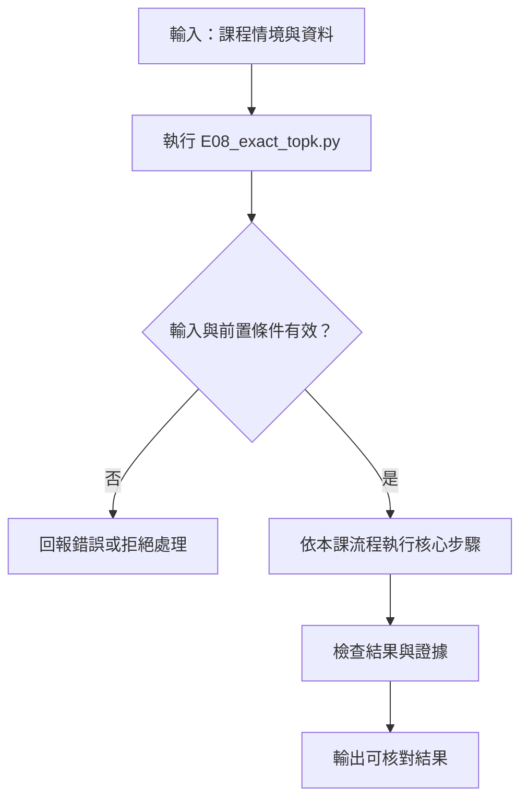

# 記憶體精確檢索 Baseline

> **新版正文：20E07-E03-06｜對應新版 LLM 第 20 節：記憶體精確檢索 Baseline。**
> 在用資料庫或索引加速之前，先做出一個**每一筆都算過**的版本：16 段向量放進一個矩陣，查詢時全部乘完再排序。它慢、但可以逐筆核對，所以它是之後所有近似方法的**標準答案**。核心主張：**精確 baseline 要能證明自己是精確的——自我查詢、逐筆核對、固定同分順序、記下模型與資料版本。**

[回 50 節課綱](https://hackmd.io/@yillkid/HJl8JXTNkl)

## 流程圖：記憶體精確檢索 Baseline



## 學習目標與時間

先修第 18 節（cosine 與正規化）、第 19 節（chunk 與來源欄位）。勞動部梯次已在 MariaDB 第 19 節用 SQL `VEC_DISTANCE_COSINE` 做過同一件事；本節用 Python 在記憶體裡重做一次，讓你**不靠資料庫**也能核對資料庫的結果。

| 時間 | 內容 |
| --- | --- |
| 0–8 分鐘 | 精確 top-k 是什麼：全部算、全部排 |
| 8–18 分鐘 | 怎麼證明它是精確的：自我查詢、逐筆核對、同分規則 |
| 18–28 分鐘 | 先過濾再排序；無答案題也會回 k 筆 |
| 28–35 分鐘 | 記憶體與時間：什麼時候需要索引 |
| 35–50 分鐘 | Workshop：存下 baseline、查自己的問題 |

驗收能力：交付**可重跑的精確檢索程式與排名 baseline**（含模型 revision、資料版本、k、每題排名與分數）。引用與生成不列入本節。

## 一、精確 top-k

查詢向量 q 和 N 段向量 v₁…v_N。精確 top-k 的做法只有一種：

1. 算出 N 個分數 q·vᵢ（向量已正規化，所以就是 cosine）；
2. 由大到小排序，取前 k 筆。

不跳過任何一筆，所以結果**一定**是這個模型、這份資料下分數最高的 k 筆。這不等於「最相關的 k 筆」——第 18 節已經看到分數和相關性是兩回事。

MariaDB 第 19 節用的是 **cosine distance＝1−similarity**，所以 SQL 是 `ORDER BY distance ASC`；本頁用 similarity，所以是由大到小。兩邊排名應該相同，**方向寫反是最常見的錯誤**。

## 二、怎麼證明它是精確的

| 檢查 | 做法 | 抓到什麼錯 |
| --- | --- | --- |
| 自我查詢 | 每一段拿自己的向量去查，應該排第一 | 排序方向寫反、向量和 ID 對錯位 |
| 逐筆核對 | 用不靠矩陣的迴圈再算一次，排名要相同 | 矩陣轉置錯、dtype 問題 |
| 同分規則 | 分數相同時以 chunk_id 小的在前 | 結果依插入順序而變，無法重現 |
| 版本紀錄 | 模型 revision、資料版本、k 寫進 baseline | 換了模型或資料卻拿舊 baseline 比 |

`ExactIndex` 在建立時也會拒絕沒有正規化的向量：第 18 節看過，長度不同時內積和 cosine 的排名不同。

## 三、先過濾，再排序

qrels-v1 的每一題都有分類（`category_id`）。合格段落的規則和 MariaDB 課相同：文件 active，且連到至少一個該分類、active 的產品。本頁**先過濾、再在合格段落裡排序**。

如果先取 top-3 再過濾，可能三筆全被過濾掉，結果是零筆——但合格段落裡其實有答案。MariaDB 第 21 節會用 SQL 處理同一件事；本頁的過濾規則與第 23 節相同，測試會核對兩邊一致。

## 四、可執行 Demo

需要第 17 節的套件與已下載的模型；不需要 API key。資料是 llm-demo 的 `data/sop_corpus.json`、`data/search_cases.json`（MariaDB 課同一份檔案）。

<!-- demo: E08_exact_topk.py -->
```python
"""第 20 節：記憶體精確檢索 baseline。

把 16 個 chunk 的向量放進一個矩陣，對每個查詢算出**全部**分數再排序。沒有索引、沒有近似。
需要第 17 節的套件與模型；語料與標註是 MariaDB 課的 sop-v1／qrels-v1（llm-demo 的 data/）。
numpy 在用到時才匯入，讓過濾與指標函式不裝套件也能測試。
"""
import argparse
import hashlib
import json
from pathlib import Path
from time import perf_counter

MODEL_ID = "BAAI/bge-small-zh-v1.5"
REVISION = "7999e1d3359715c523056ef9478215996d62a620"
QUERY_PREFIX = "为这个句子生成表示以用于检索相关文章："  # 模型卡原字串，見第 17 節

# products-v1 的類別與狀態（MariaDB 課 data/seed.sql 的兩欄；與第 23 節相同，測試會核對）
PRODUCTS = {
    "P001": (1, "active"), "P002": (1, "active"), "P003": (1, "inactive"), "P004": (2, "active"),
    "P005": (2, "active"), "P006": (1, "inactive"), "P007": (1, "active"), "P008": (1, "active"),
    "P009": (1, "active"), "P010": (1, "active"), "P011": (3, "active"), "P012": (1, "active"),
}


def load(name):
    here = Path(__file__).resolve().parent
    for base in (here, here.parent / "mariadb", Path.cwd(), Path.cwd().parent / "mariadb", Path.cwd().parent):
        path = base / "data" / name
        if path.exists():
            return json.loads(path.read_text(encoding="utf-8"))
    raise FileNotFoundError(f"找不到 data/{name}（llm-demo 的 data/，或 MariaDB 課的教材目錄）")


def load_model():
    import torch
    from sentence_transformers import SentenceTransformer

    torch.set_num_threads(2)
    return SentenceTransformer(MODEL_ID, revision=REVISION, device="cpu",
                               trust_remote_code=False, model_kwargs={"use_safetensors": True})


class ExactIndex:
    """全部向量放在一個 (N, d) 矩陣；查詢時一次乘完，再排序。"""

    def __init__(self, ids, vectors):
        import numpy as np

        vectors = np.asarray(vectors, dtype=np.float32)
        if len(ids) != len(vectors) or len(set(ids)) != len(ids):
            raise ValueError("ids 必須與向量一一對應且不重複")
        norms = np.linalg.norm(vectors, axis=1)
        if not np.allclose(norms, 1.0, atol=1e-4):
            raise ValueError("向量必須先正規化；否則內積不等於 cosine（第 18 節）")
        self.ids, self.vectors = list(ids), vectors

    def search(self, query_vector, k, allowed=None):
        """回傳 [(chunk_id, score)]；分數大到小，同分時 chunk_id 小的在前。"""
        if k < 1:
            raise ValueError("k 至少為 1")
        import numpy as np

        scores = self.vectors @ np.asarray(query_vector, dtype=np.float32)
        rows = [(cid, float(s)) for cid, s in zip(self.ids, scores) if allowed is None or cid in allowed]
        rows.sort(key=lambda row: (-row[1], row[0]))
        return rows[:k]

    def nbytes(self):
        return self.vectors.nbytes


def eligible_chunks(corpus, category_id, products):
    """MariaDB 課的合格規則：文件 active，且連到至少一個該類別的 active 產品。"""
    active_docs = {d["document_id"] for d in corpus["documents"] if d["status"] == "active"}
    linked = {doc for pid, doc in corpus["links"]
              if products.get(pid, (None, None))[0] == category_id and products[pid][1] == "active"}
    return {c["chunk_id"] for c in corpus["chunks"] if c["document_id"] in active_docs & linked}


def brute_force(ids, vectors, query_vector, k):
    """不用矩陣、一筆一筆算；拿來核對 ExactIndex 沒有寫錯。"""
    rows = []
    for cid, vector in zip(ids, vectors):
        rows.append((cid, sum(float(a) * float(b) for a, b in zip(vector, query_vector))))
    rows.sort(key=lambda row: (-row[1], row[0]))
    return rows[:k]


def recall_at(ranked, relevant, k):
    return len(set(ranked[:k]) & set(relevant)) / len(relevant)


def fingerprint(baseline):
    blob = json.dumps(baseline, ensure_ascii=False, sort_keys=True).encode("utf-8")
    return hashlib.sha256(blob).hexdigest()[:16]


def bench(sizes, dim=512, queries=20, seed=20261006):
    """隨機單位向量量測全量計算的時間與記憶體；時間依機器而定，不寫進講義凍結輸出。"""
    import numpy as np

    rng = np.random.default_rng(seed)
    for n in sizes:
        matrix = rng.standard_normal((n, dim), dtype=np.float32)
        matrix /= np.linalg.norm(matrix, axis=1, keepdims=True)
        q = rng.standard_normal((queries, dim), dtype=np.float32)
        q /= np.linalg.norm(q, axis=1, keepdims=True)
        started = perf_counter()
        for row in q:
            scores = matrix @ row
            np.argpartition(-scores, 10)[:10]
        per_query = (perf_counter() - started) / queries
        print(f"N={n:>9,} 矩陣 {matrix.nbytes / 2**20:8.1f} MiB  每次查詢 {per_query * 1000:8.2f} ms")


if __name__ == "__main__":
    parser = argparse.ArgumentParser()
    parser.add_argument("--k", type=int, default=3)
    parser.add_argument("--query", action="append", help="另外查自己的問題（不套分類過濾）；可重複")
    parser.add_argument("--save", help="把 baseline 排名寫成 JSON 到這個路徑")
    parser.add_argument("--bench", action="store_true", help="另外量測 1 千到 20 萬筆的時間（依機器而定）")
    args = parser.parse_args()

    corpus, cases = load("sop_corpus.json"), load("search_cases.json")
    model = load_model()
    ids = [c["chunk_id"] for c in corpus["chunks"]]
    vectors = model.encode([c["text"] for c in corpus["chunks"]], normalize_embeddings=True, show_progress_bar=False)
    index = ExactIndex(ids, vectors)
    print("model:", MODEL_ID, "revision:", REVISION)
    print("corpus:", corpus["dataset_version"], "qrels:", cases["annotation_version"],
          "chunks:", len(ids), "矩陣:", index.vectors.shape, index.vectors.dtype, index.nbytes(), "bytes")

    print("\n== 一、精確檢索要先自我核對 ==")
    self_hits = [index.search(v, 1)[0][0] for v in index.vectors]
    print("每段查自己排第一:", self_hits == ids)
    q0 = model.encode([QUERY_PREFIX + cases["cases"][0]["query"]], normalize_embeddings=True, show_progress_bar=False)[0]
    fast, slow = index.search(q0, 16), brute_force(ids, index.vectors, q0, 16)
    print("矩陣與逐筆計算排名相同:", [r[0] for r in fast] == [r[0] for r in slow],
          "最大分數差 < 1e-6:", max(abs(a[1] - b[1]) for a, b in zip(fast, slow)) < 1e-6)

    print("\n== 二、同分時的順序 ==")
    tie = ExactIndex(["C002", "C001", "C003"], [index.vectors[0], index.vectors[0], index.vectors[2]])
    print("兩筆向量完全相同，插入順序 C002, C001 →", [r[0] for r in tie.search(q0, 3)])
    print("沒有第二排序鍵時，同分的順序取決於插入順序；本頁固定以 chunk_id 為第二鍵")

    print(f"\n== 三、qrels-v1 八題（k={args.k}，先過濾合格段落，再排序）==")
    query_vectors = model.encode([QUERY_PREFIX + c["query"] for c in cases["cases"]],
                                 normalize_embeddings=True, show_progress_bar=False)
    baseline = {}
    for case, qv in zip(cases["cases"], query_vectors):
        allowed = eligible_chunks(corpus, case["category_id"], PRODUCTS)
        hits = index.search(qv, args.k, allowed)
        unfiltered = index.search(qv, 1)[0]
        ranked = [cid for cid, _ in hits]
        relevant = case["relevant_chunk_ids"]
        baseline[case["case_id"]] = [[cid, round(s, 4)] for cid, s in hits]
        note = f"recall@{args.k}={recall_at(ranked, relevant, args.k):.2f}" if relevant else "標註無答案"
        print(f"{case['case_id']} 合格 {len(allowed):2} 段 標註 {relevant or '[]'} → "
              f"{[f'{cid} {s:.4f}' for cid, s in hits]}  {note}"
              + ("" if hits else f"（不過濾時第一名是 {unfiltered[0]} {unfiltered[1]:.4f}）"))

    print("\n== 四、無答案題也會回 k 筆 ==")
    answered = [baseline[c["case_id"]][0][1] for c in cases["cases"] if c["relevant_chunk_ids"]]
    unanswered = [(c["case_id"], baseline[c["case_id"]][0][1]) for c in cases["cases"]
                  if not c["relevant_chunk_ids"] and baseline[c["case_id"]]]
    print("有答案題的第一名分數:", sorted(answered))
    print("無答案題的第一名分數:", unanswered)
    print("只有 8 題，不能據此訂門檻（第 18 節：dev 挑的門檻在保留集比全猜還差）")

    print("\n== 五、baseline 紀錄 ==")
    record = {"model": f"{MODEL_ID}@{REVISION}", "dataset_version": corpus["dataset_version"],
              "annotation_version": cases["annotation_version"], "k": args.k, "rankings": baseline}
    print("fingerprint:", fingerprint(record))
    for n in (16, E03_000, 1_000_000):
        print(f"記憶體估算 N={n:>9,}（float32、512 維）: {n * 512 * 4:>13,} bytes ≈ {n * 512 * 4 / 2**20:8.2f} MiB")
    if args.save:
        Path(args.save).write_text(json.dumps(record, ensure_ascii=False, indent=2) + "\n", encoding="utf-8")
        print("已寫入:", args.save)
    if args.query:
        print("\n== 自訂查詢（全部 16 段，不套分類過濾）==")
        extra = model.encode([QUERY_PREFIX + q for q in args.query], normalize_embeddings=True, show_progress_bar=False)
        for q, qv in zip(args.query, extra):
            print(q, "→", [f"{cid} {s:.4f}" for cid, s in index.search(qv, args.k)])
    if args.bench:
        print("\n== 量測（依機器而定）==")
        bench([1_000, E03_000, 100_000, 200_000])
```

執行（程式也放在 [llm-demo](https://github.com/4-learn/llm-demo)：`git clone https://github.com/4-learn/llm-demo.git` 後在該目錄、啟用第 17 節的 venv 後執行）：

```bash
python E08_exact_topk.py
python E08_exact_topk.py --k 5 --save baseline-k5.json
python E08_exact_topk.py --query "感測器電池怎麼換"
python E08_exact_topk.py --bench
```

關鍵輸出（Linux x86_64／Python 3.10.15，CPU，20E07-E03-06）：

```text
model: BAAI/bge-small-zh-v1.5 revision: 7999e1d3359715c523056ef9478215996d62a620
corpus: sop-v1 qrels: qrels-v1 chunks: 16 矩陣: (16, 512) float32 32768 bytes

== 一、精確檢索要先自我核對 ==
每段查自己排第一: True
矩陣與逐筆計算排名相同: True 最大分數差 < 1e-6: True

== 二、同分時的順序 ==
兩筆向量完全相同，插入順序 C002, C001 → ['C001', 'C002', 'C003']
沒有第二排序鍵時，同分的順序取決於插入順序；本頁固定以 chunk_id 為第二鍵

== 三、qrels-v1 八題（k=3，先過濾合格段落，再排序）==
Q01 合格 10 段 標註 ['C001'] → ['C001 0.7841', 'C002 0.7253', 'C011 0.7019']  recall@3=1.00
Q02 合格  2 段 標註 ['C003', 'C004'] → ['C004 0.8230', 'C003 0.7818']  recall@3=1.00
Q03 合格  2 段 標註 [] → ['C004 0.7453', 'C003 0.7310']  標註無答案
Q04 合格  2 段 標註 ['C003', 'C004'] → ['C004 0.8317', 'C003 0.7603']  recall@3=1.00
Q05 合格 10 段 標註 [] → ['C001 0.6412', 'C007 0.5942', 'C011 0.5881']  標註無答案
Q06 合格 10 段 標註 ['C015'] → ['C015 0.7794', 'C007 0.7561', 'C016 0.7533']  recall@3=1.00
Q07 合格  2 段 標註 ['C013', 'C014'] → ['C014 0.8096', 'C013 0.7049']  recall@3=1.00
Q08 合格  0 段 標註 [] → []  標註無答案（不過濾時第一名是 C001 0.7199）

== 四、無答案題也會回 k 筆 ==
有答案題的第一名分數: [0.7794, 0.7841, 0.8096, 0.823, 0.8317]
無答案題的第一名分數: [('Q03', 0.7453), ('Q05', 0.6412)]
只有 8 題，不能據此訂門檻（第 18 節：dev 挑的門檻在保留集比全猜還差）

== 五、baseline 紀錄 ==
fingerprint: b57e402af0a1c19f
記憶體估算 N=       16（float32、512 維）:        32,768 bytes ≈     0.03 MiB
記憶體估算 N=   10,000（float32、512 維）:    20,480,000 bytes ≈    19.53 MiB
記憶體估算 N=1,000,000（float32、512 維）: 2,048,000,000 bytes ≈  1953.12 MiB
```

不同 CPU 或套件版本可能讓分數的小數點後第四位不同，fingerprint 也會跟著不同；排名應該一樣。

## 五、結果怎麼讀

### 1. 自我核對都通過

16 段查自己全部排第一；矩陣算法和逐筆迴圈的排名完全相同，分數差都小於 1e-6（float32 的捨入；實際值依 CPU 而異，備課機 8.4e-08、示範機 4-learn 8.8e-08，所以程式只印「是否小於 1e-6」）。這兩行不通過，後面的數字都不能信。

### 2. 同分要有第二排序鍵

兩筆向量完全相同、插入順序是 C002 在前，輸出仍是 C001 在前。Python 的 `sort` 是穩定排序——**沒有第二鍵時，同分會照插入順序排**，換一次載入順序結果就不同。SQL 也一樣：MariaDB 第 19 節的 `ORDER BY distance ASC, chunk_id ASC` 就是這個用意。

### 3. 八題中，有答案的五題全部 recall@3＝1.00

這不代表檢索很好。過濾後，Q02、Q04、Q07 的合格段落**只有 2 段**，k=3 就全拿到了；只有 Q01、Q06 是真的在 10 段裡排名。第 23 節已經指出：qrels-v1 太容易，量不出差別，需要改寫題。

### 4. 無答案題也會回 k 筆

- **Q03**（要求支援 5 GHz 的閘道器）回了 C004、C003，分數 0.7453——比 Q06 正確答案的 0.7794 低沒多少。這兩段寫的正是「**不支援** 5 GHz」。
- **Q05**（P010 的專用重設 SOP）回了 C001——C001 是 A、B 的重設，不是 P010 的。
- **Q08**（分類 999）合格段落 0 段，回空清單。不過濾的話第一名是 C001、0.7199。**空結果是過濾正確的證據**，不是錯誤。

有答案題第一名的分數是 0.7794～0.8317，無答案題是 0.6412 和 0.7453。只有 8 題，這兩組重疊多少看不出來；**不要拿這 8 題訂門檻**（第 18 節）。

### 5. 記憶體與時間

512 維 float32，每筆 2 KiB。一萬筆約 20 MiB，一百萬筆約 2 GB。備課機實測 `--bench`（隨機向量，每題 20 次平均，數字依機器而定）：一千到一萬筆約 3 ms，十萬筆約 7～11 ms，二十萬筆約 20～30 ms。課堂資料量在記憶體裡算全部，**完全不需要索引**。需要索引的時機是：資料大到記憶體放不下，或者延遲不能接受——那時第 21 節的 ANN 要拿這份精確 baseline 來比對。

## 六、常見誤判

| 說法 | 為什麼不對 |
| --- | --- |
| 「top-3 就是最相關的 3 段」 | 是分數最高的 3 段；Q03 的前兩名意思正好相反 |
| 「回傳空清單是 bug」 | Q08 的分類沒有合格段落，空清單才是對的 |
| 「先 top-k，再過濾也一樣」 | 前 k 名可能全不合格，合格的答案就被丟了 |
| 「分數一樣，順序無所謂」 | 沒有第二鍵，結果依載入順序而變，baseline 無法重現 |
| 「ANN 和精確結果這次一樣，所以 ANN 是精確的」 | 一次相同不能證明；MariaDB 第 20 節要求看 EXPLAIN |

## Workshop：存下 baseline、查自己的問題

### 任務

1. 執行 `python E08_exact_topk.py --save baseline.json`，確認自我核對兩行都是 True，記下 fingerprint。
2. 用 `--k 5` 再跑一次。哪幾題的結果變長了、哪幾題沒變？為什麼？
3. 用 `--query` 查「感測器電池怎麼換」。**先預測**第一名，再執行。打開第一名的原文和它的文件狀態。
4. 查一個和語料完全無關的問題（例如咖啡機除垢），記下第一名分數。
5. 說明：如果要讓系統對第 3、4 題回答「查無」，你會怎麼做？為什麼不是單純加一個分數門檻？

### 參考判讀

以下皆為實跑（20E07-E03-06，同一模型與程式）：

- 第 2 題：Q01、Q05、Q06 變成 5 筆（合格 10 段）；Q02、Q03、Q04、Q07 仍是 2 筆（合格只有 2 段）；Q08 仍是空的。recall 沒有變，因為 k=3 時已經全拿到。
- 第 3 題：第一名 C006（0.7636）、第二名 C005（0.7186）。兩段都屬於 D003，**文件狀態 inactive**；C006 原文寫「本文件沒有現行更換電池指示」。分數最高的是一份已停用、而且明說不能用來回答的文件。`--query` 不套過濾；正式查詢必須先過濾 status。
- 第 4 題：「如何把咖啡機除垢」第一名 C006，0.3855。完全無關也有分數，而且三名的分數幾乎一樣（0.3855、0.3842、0.3832）。
- 第 5 題：先用 metadata 過濾（文件狀態、分類），擋掉第 3 題；第 4 題可以考慮門檻，但門檻要用另一份開發集挑、在保留集驗證（第 18 節）。Q03 的分數 0.7453 已經接近有答案題，**單一門檻分不開**；那要靠第 24 節的引用驗證。

### 驗收

- 交出 baseline JSON：模型與 revision、資料版本、annotation 版本、k、每題排名與分數、fingerprint。
- 自我核對兩行的輸出。
- 至少一個「分數高但不該用」的例子，寫出原因（狀態、否定、型號其中一種）。
- 不得手動調整排名讓結果好看；不得修改 qrels 讓 recall 變高。

## 教師紀錄與下一步

- 證據等級：**本機實測**（Linux x86_64 CPU、Python 3.10.15、torch 2.8.0+cpu、sentence-transformers 5.1.2、離線快取）。預設輸出兩次執行逐位相同；`--bench` 的時間每次不同，所以不放進凍結輸出，講義寫的是兩次的範圍。**不是學生 i5 的效能保證。**
- 語料、qrels 與產品分類都來自 MariaDB 課，本節不另外編寫；`PRODUCTS` 與第 23 節相同，測試會核對兩者及 `seed.sql`。
- 撰寫時的實際紀錄：原本打算用 qrels-v1 展示「精確 baseline 也會漏」，實跑五題全部 recall＝1，主要是因為過濾後合格段落太少。講義改為直接寫出這點，並把「狀態過濾」的例子移到 Workshop 第 3 題（用 `--query` 不套過濾才看得到）。
- 下一步：第 21 節把同一批向量放進 MariaDB，用這份 baseline 核對；第 22 節處理版本更新後的過濾；第 23 節用改寫題重新量檢索品質。
