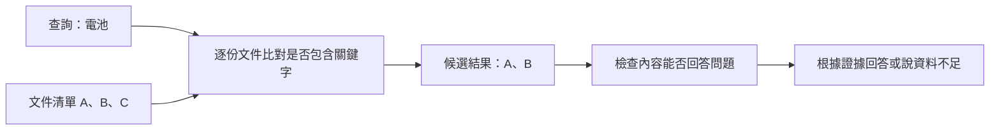

# 25｜關鍵字檢索

> 本課只學一件事：用關鍵字從小型文件清單找候選資料，並知道沒找到不等於答案不存在。

## 先用關鍵字找資料

查「電池」可以找到明確提到電池的文件；若文件只寫「續航」，關鍵字搜尋就可能漏掉。搜尋結果是候選資料，仍要檢查內容是否回答問題。

## Demo：關鍵字搜尋

<!-- demo: 25_hybrid_retrieval.py -->

```python
documents = {
    "A": "電池容量 5000 mAh",
    "B": "電池續航測試",
    "C": "充電器輸出功率",
}
query = "電池"
for name in documents:
    if query in documents[name]:
        print(name, documents[name])
```

實際輸出：
```text
A 電池容量 5000 mAh
B 電池續航測試
```



## 這與 LLM 有什麼關係？

RAG（檢索增強生成）先檢索資料，再把找到的內容提供給 LLM（大型語言模型）回答。若檢索漏掉重要資料，模型可能缺少回答依據。例如把「問題：電池容量多少？資料：A 電池容量 5000 mAh；B 電池續航測試」送給模型，可能得到「資料 A 記載電池容量為 5000 mAh。」這是可能回答，仍須核對來源。本課只做關鍵字檢索，不呼叫模型。

## Embedding 選讀：請既有 API 產生向量

Embedding（文字向量表示）是把文字交給模型轉成一串數字。本課不自行實作轉換或向量運算。以下使用 NVIDIA Build 的免費 API 服務（依帳戶可用條件與額度），以 `requests` 發出 HTTP 請求；向量由服務回傳，程式只讀取並印出結果。先在自己的終端機設定 `NVIDIA_API_KEY` 環境變數，不要將金鑰寫入程式或分享：

```bash
export NVIDIA_API_KEY="在自己的終端機設定實際金鑰，不要分享"
```

安裝 `requests` 後執行：

```python
import os
import requests

url = "https://integrate.api.nvidia.com/v1/embeddings"
headers = {
    "Authorization": "Bearer " + os.environ["NVIDIA_API_KEY"],
    "Accept": "application/json",
    "Content-Type": "application/json",
}
payload = {
    "model": "nvidia/nv-embedqa-e5-v5",
    "encoding_format": "float",
    "truncate": "NONE",
    "messages": [{"role": "user", "content": "電池容量 5000 mAh"}],
}
response = requests.post(url, headers=headers, json=payload, timeout=60)
response.raise_for_status()
result = response.json()
vector = result["data"][0]["embedding"]
print(vector)
print("向量長度：", len(vector))
```

模型卡記載輸出維度為 1024；實際回應會印出整串浮點數，本課不手寫或推測向量值。此示範只呼叫 API 並查看輸出，不做向量相似度或資料庫操作。API 是否可用、免費試用與額度，請以 NVIDIA Build 帳戶當下顯示為準。參考：[NVIDIA Build 模型卡與官方請求範例](https://build.nvidia.com/nvidia/nv-embedqa-e5-v5.md)。

## 練習與自我檢查

把 `query` 改成「充電器」，預期只印出 C；改成「續航」，預期只印出 B。

1. 查「電池」會找到哪些文件？
2. 搜尋「續航」沒有結果，能否斷定不存在相關資料？
3. RAG 中檢索與生成分別負責什麼？
4. API 範例中的向量由誰產生？

**答案：**A、B；不能，可能使用不同字詞；檢索找候選資料，生成組織回答；NVIDIA embedding API。
