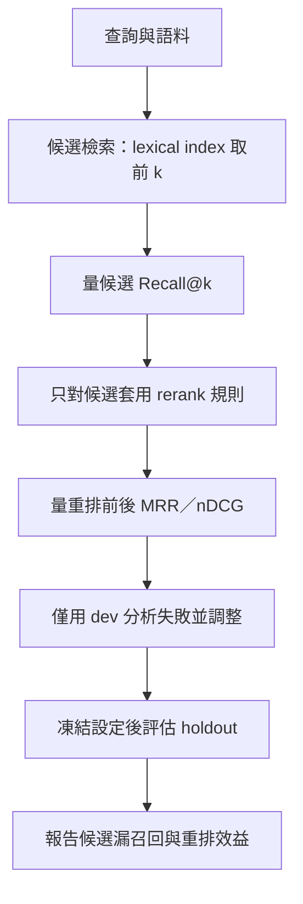

# Reranking 與 Retrieval Evaluation

> **新版正文：20E07-E03-05｜對應新版 LLM 第 26 節：Reranking 與 Retrieval Evaluation。**
> 檢索分兩段：先撈**候選**，再**重排**。本節的主張：**兩段要分開量**——重排只能調整候選內的順序，救不回沒進候選的段落；而「調整規則後分數變好」只有在**沒看過的題目**上成立才算數。只用 Python 標準函式庫；兩個階段都**不是神經網路**，它們只是站在 bi-encoder 與 cross-encoder 的位置上，讓評測方法可以在沒有模型的教室裡完整跑一遍。

[回 51 節必修＋9 節選修課綱](https://hackmd.io/@yillkid/HJl8JXTNkl)

## 流程圖：Reranking 與 Retrieval Evaluation



## 學習目標與時間

先修第 08 節（dev／holdout 切分）、第 19 節（chunk ID）；MariaDB 課第 21 節（合格集合、qrels、precision／recall）。

| 時間 | 內容 |
| --- | --- |
| 0–8 分鐘 | 兩段式檢索：候選負責「找得到」，重排負責「排得對」 |
| 8–20 分鐘 | Recall@k、MRR、nDCG：各量什麼、空 qrels 怎麼處理 |
| 20–30 分鐘 | 為什麼現成題目量不出差別；dev／holdout 與調參污染 |
| 30–35 分鐘 | 跑 Demo |
| 35–50 分鐘 | Workshop：調候選數、加同義詞、在 holdout 上作弊 |

驗收能力：交付**分開候選與重排的評測報告**——報出 Recall@k 與重排前後 MRR，指出哪些題目的失敗是重排無法處理的，並說明調整只依據 dev。

> **與 MariaDB 課的分工**（分工見[課綱](https://hackmd.io/SyC69urYGx?type=view)）：本節是 LLM 課獨有。MariaDB 課第 21 節已教過 `WHERE` 合格集合與 precision／recall；本節**直接沿用**該課的 `search_cases.json`（qrels-v1）與合格規則，不重教，只延伸到「排序品質」與「兩階段分開評估」。

## 一、兩段式檢索

| 階段 | 真實系統常用 | 本節的替身 | 責任 |
| --- | --- | --- | --- |
| 候選 | bi-encoder（第 17 節的 embedding）＋向量檢索 | 字元 bigram 的 TF-IDF cosine | **找得到**：相關段落要進前 k |
| 重排 | cross-encoder（查詢與段落一起輸入模型打分） | 同義詞規則加分 | **排得對**：相關段落排到最前面 |

為什麼要分兩段：cross-encoder 每個「查詢＋段落」都要跑一次模型，對全部語料做太貴，所以只對前 k 個候選做。這帶來一個結構性的限制——**重排的輸入就是候選，候選裡沒有的，重排看不到**。

## 二、三個指標

| 指標 | 算法 | 量什麼 |
| --- | --- | --- |
| Recall@k | 前 k 名裡的相關段數 ÷ 全部相關段數 | 候選階段有沒有**找到** |
| MRR | 第一個相關段落名次的倒數，再對題目取平均 | 使用者**最先看到**的是不是對的 |
| nDCG@k | 依名次折扣的得分 ÷ 理想排序的得分 | 多個相關段落時，**整體順序**好不好 |

**相關＝空集合的題目不能算 Recall**（分母是 0）。MariaDB 課的 Q03、Q05、Q08 就是這種題目，它們要測的是「該不該回答」，屬於第 24 節。把它們硬算成 0 或 1，都會扭曲平均。

## 三、可執行 Demo

讀 MariaDB 課的 `data/sop_corpus.json` 與 `data/search_cases.json`。第一段用現成的 qrels-v1；第二段用本節自編的 8 題**改寫題**——刻意不用原文的字眼——分成 dev 4 題與 holdout 4 題。同義詞表 `SYNONYMS` **只看過 dev 的失敗原因**。

<!-- demo: E07_rerank_eval.py -->
```python
"""第 26 節：Reranking 與 Retrieval Evaluation（只用 Python 標準函式庫）。

語料與標註都沿用 MariaDB 課：`sop_corpus.json`（16 段）與 `search_cases.json`（8 題 qrels）。

兩個階段，**都不是神經網路**：
  - 候選：字元 bigram 的 TF-IDF cosine（詞彙檢索；站在 bi-encoder 的位置）
  - 重排：同義詞規則，只在候選內加分調整順序（站在 cross-encoder 的位置；不會找新段落）
本節要教的是**評測方法**：候選召回與重排效益分開量、dev 與 holdout 分開看，
不是這兩個規則有多好。
"""

import json
import math
import re
from collections import Counter
from pathlib import Path

CANDIDATES = 4            # 第一階段交給重排的段落數
BOILERPLATE = "本段為虛構教學資料，不適用真實設備。"   # 每段都有，不該影響排序


def load(name):
    here = Path(__file__).resolve().parent
    for base in (here, here.parent / "mariadb", Path.cwd(), Path.cwd().parent / "mariadb"):
        path = base / "data" / name
        if path.exists():
            return json.loads(path.read_text(encoding="utf-8"))
    raise FileNotFoundError(f"找不到 data/{name}（在 MariaDB 課的教材目錄）")


def bigrams(text):
    text = re.sub(r"\s+", "", text.replace(BOILERPLATE, ""))
    return Counter(text[i:i + 2] for i in range(len(text) - 1))


class LexicalIndex:
    def __init__(self, chunks):
        self.ids = [c["chunk_id"] for c in chunks]
        self.texts = {c["chunk_id"]: c["text"] for c in chunks}
        grams = {cid: bigrams(self.texts[cid]) for cid in self.ids}
        df = Counter(g for counts in grams.values() for g in counts)
        n = len(self.ids)
        self.idf = {g: math.log((n + 1) / (d + 1)) + 1 for g, d in df.items()}
        self.vectors = {cid: self.weigh(counts) for cid, counts in grams.items()}

    def weigh(self, counts):
        vec = {g: c * self.idf.get(g, 0.0) for g, c in counts.items()}
        norm = math.sqrt(sum(v * v for v in vec.values())) or 1.0
        return {g: v / norm for g, v in vec.items()}

    def search(self, query, allowed=None):
        q = self.weigh(bigrams(query))
        scored = [(sum(w * self.vectors[cid].get(g, 0.0) for g, w in q.items()), cid)
                  for cid in self.ids if allowed is None or cid in allowed]
        # 分數 0 = 與查詢沒有任何共同 bigram：那不是「排在後面」，是「沒被檢出」。
        # 不濾掉的話，0 分段落會依 ID 排出假名次（本節第一版就犯了這個錯）。
        return sorted([x for x in scored if x[0] > 0], key=lambda item: (-item[0], item[1]))


# 本節自編的改寫題：刻意不用原文的字眼。作者為 AI agent，需教師覆核相關性。
# dev 用來調重排規則；holdout 調完才看，只看一次。
PARAPHRASES = (
    ("H01", "dev",     "感測器 F 要怎麼跟面板綁在一起？",             {"C009"}),
    ("H02", "dev",     "上傳卡住了，再按一次會不會算成兩筆？",         {"C012"}),
    ("H03", "dev",     "量出來跟基準對不上，可以直接改掉舊的數字嗎？", {"C008"}),
    ("H04", "dev",     "按了送出按鈕，就算傳到了嗎？",                 {"C011"}),
    ("H05", "holdout", "燈亮了是不是就代表連上了？",                   {"C002"}),
    ("H06", "holdout", "畫面跳出 E07 是什麼意思？",                    {"C016"}),
    ("H07", "holdout", "換成比較快的那個頻率能不能解決連不上的問題？", {"C003", "C004"}),
    ("H08", "holdout", "偏差太大的話，原本的紀錄要保留嗎？",           {"C008"}),
)

# 看 dev 四題失敗原因後寫的同義詞表：查詢用語 → 原文用語。只看過 dev。
SYNONYMS = {"綁": "配對", "基準": "參考值", "改掉": "覆寫", "卡住": "逾時", "兩筆": "第二筆", "傳到": "送達"}


def rerank(query, candidates, texts, weight=0.5):
    """只在候選內調整順序：查詢用語對上原文用語，每對加 weight 分。不會加入新段落。"""
    def hits(cid):
        return sum(1 for said, written in SYNONYMS.items() if said in query and written in texts[cid])
    return sorted(candidates, key=lambda item: (-(item[0] + weight * hits(item[1])), item[1]))


def first_hit(ranked, relevant):
    return next((i for i, cid in enumerate(ranked, 1) if cid in relevant), None)


def eligible_chunks(corpus, category_id, products):
    """MariaDB 課的合格規則：文件 active，且連到至少一個該類別的 active 產品。"""
    active_docs = {d["document_id"] for d in corpus["documents"] if d["status"] == "active"}
    linked = {doc for pid, doc in corpus["links"]
              if products.get(pid, (None, None))[0] == category_id and products[pid][1] == "active"}
    return {c["chunk_id"] for c in corpus["chunks"] if c["document_id"] in active_docs & linked}


# products-v1 的類別與狀態（MariaDB 課 data/seed.sql；此處只取兩欄，測試會核對）
PRODUCTS = {
    "P001": (1, "active"), "P002": (1, "active"), "P003": (1, "inactive"), "P004": (2, "active"),
    "P005": (2, "active"), "P006": (1, "inactive"), "P007": (1, "active"), "P008": (1, "active"),
    "P009": (1, "active"), "P010": (1, "active"), "P011": (3, "active"), "P012": (1, "active"),
}


def recall_at(ranked, relevant, k):
    return len(set(ranked[:k]) & relevant) / len(relevant)


def reciprocal_rank(ranked, relevant):
    for position, cid in enumerate(ranked, 1):
        if cid in relevant:
            return 1 / position
    return 0.0


def ndcg_at(ranked, relevant, k):
    dcg = sum(1 / math.log2(i + 2) for i, cid in enumerate(ranked[:k]) if cid in relevant)
    ideal = sum(1 / math.log2(i + 2) for i in range(min(k, len(relevant))))
    return dcg / ideal


def expand(query):
    """查詢擴充：把同義詞表用在**候選階段**——查詢裡出現的說法，補上原文的寫法。"""
    return query + "".join(f" {written}" for said, written in SYNONYMS.items() if said in query)


def evaluate(index, queries, allowed, k, expanded=False):
    rows = []
    for qid, split, query, relevant in queries:
        full = index.search(expand(query) if expanded else query, allowed)
        before = [cid for _, cid in full[:k]]
        after = [cid for _, cid in rerank(query, full[:k], index.texts)]
        rows.append((qid, split, relevant, [cid for _, cid in full], before, after))
    return rows


def summary(rows, split, k):
    picked = [r for r in rows if r[1] == split]
    cand = sum(recall_at(b, rel, k) for _, _, rel, _, b, _ in picked) / len(picked)
    mrr_b = sum(reciprocal_rank(b, rel) for _, _, rel, _, b, _ in picked) / len(picked)
    mrr_a = sum(reciprocal_rank(a, rel) for _, _, rel, _, _, a in picked) / len(picked)
    return cand, mrr_b, mrr_a


def main():
    corpus, cases = load("sop_corpus.json"), load("search_cases.json")
    index = LexicalIndex(corpus["chunks"])
    print(f"語料 {corpus['dataset_version']}（{len(index.ids)} 段）｜檢索：字元 bigram TF-IDF｜重排：同義詞規則（皆非神經網路）")
    print()

    print(f"=== 一、MariaDB 課的 {cases['annotation_version']}（{cases['provenance']['review_status']}）===")
    scored = []
    for case in cases["cases"]:
        allowed = eligible_chunks(corpus, case["category_id"], PRODUCTS)
        relevant = set(case["relevant_chunk_ids"])
        ranked = [cid for _, cid in index.search(case["query"], allowed)]
        if not relevant:
            print(f"  {case['case_id']} 合格 {len(allowed):>2} 段｜相關＝空集合（{case['kind']}）→ 不計 Recall／MRR")
            continue
        scored.append((recall_at(ranked, relevant, CANDIDATES), reciprocal_rank(ranked, relevant), ndcg_at(ranked, relevant, 3)))
        print(f"  {case['case_id']} 合格 {len(allowed):>2} 段｜相關 {' '.join(sorted(relevant)):<9}｜前 4 {' '.join(ranked[:4])}")
    r, m, n = (sum(col) / len(scored) for col in zip(*scored))
    print(f"  可計分 {len(scored)} 題：Recall@{CANDIDATES} {r:.3f}｜MRR {m:.3f}｜nDCG@3 {n:.3f}")
    print("  → 全部滿分：這組題目對詞彙檢索太容易，**量不出重排有沒有用**。")
    print()

    active = {c["chunk_id"] for c in corpus["chunks"]
              if c["document_id"] in {d["document_id"] for d in corpus["documents"] if d["status"] == "active"}}
    print(f"=== 二、改寫題（{len(PARAPHRASES)} 題；只在 {len(active)} 段 active 內檢索）===")
    for k, expanded, title in ((CANDIDATES, False, "k=4，同義詞只用於重排"),
                               (len(active), False, f"k={len(active)}（全部），同義詞只用於重排"),
                               (CANDIDATES, True, "k=4，同義詞也用於查詢擴充（候選階段）")):
        rows = evaluate(index, PARAPHRASES, active, k, expanded)
        print(f"  {title}")
        for qid, split, relevant, full, before, after in rows:
            where = "、".join(str(full.index(c) + 1) if c in full else "未檢出" for c in sorted(relevant))
            b, a = first_hit(before, relevant), first_hit(after, relevant)
            moved = "未進候選，重排無能為力" if b is None else f"候選第 {b} → 重排第 {a}"
            print(f"    {qid} {split:<7} 相關 {' '.join(sorted(relevant)):<9} 完整排序 {where:<7}｜{moved}")
        for split in ("dev", "holdout"):
            cand, mrr_b, mrr_a = summary(rows, split, k)
            print(f"    {split:<7} Recall@{k} {cand:.3f}｜MRR {mrr_b:.3f} → {mrr_a:.3f}")
        print()

    print("=== 三、不加合格過濾會怎樣（Q05：問的是沒有 SOP 的 P010）===")
    q05 = next(c for c in cases["cases"] if c["case_id"] == "Q05")
    print(f"  不過濾：前 3 名 {[cid for _, cid in index.search(q05['query'])[:3]]}")
    print("  檢索永遠會回傳東西；qrels 是空集合，所以這 3 段都不相關。是否拒答要另外判斷（第 24 節）。")


if __name__ == "__main__":
    main()
```

執行指令（在 [`llm-demo`](https://github.com/4-learn/llm-demo) 目錄下；語料與標註在 `data/`，**不需要網路、不需要模型**）：

```bash
python3 E07_rerank_eval.py
```

關鍵輸出（Linux／Python 3.10.15，20E07-E03-05）：

```text
語料 sop-v1（16 段）｜檢索：字元 bigram TF-IDF｜重排：同義詞規則（皆非神經網路）

=== 一、MariaDB 課的 qrels-v1（teacher_review_required）===
  Q01 合格 10 段｜相關 C001     ｜前 4 C001 C002 C009 C007
  Q02 合格  2 段｜相關 C003 C004｜前 4 C004 C003
  Q03 合格  2 段｜相關＝空集合（no-answer-negation）→ 不計 Recall／MRR
  Q04 合格  2 段｜相關 C003 C004｜前 4 C004 C003
  Q05 合格 10 段｜相關＝空集合（no-answer-model-number）→ 不計 Recall／MRR
  Q06 合格 10 段｜相關 C015     ｜前 4 C015 C016 C002 C007
  Q07 合格  2 段｜相關 C013 C014｜前 4 C014 C013
  Q08 合格  0 段｜相關＝空集合（empty-filter）→ 不計 Recall／MRR
  可計分 5 題：Recall@4 1.000｜MRR 1.000｜nDCG@3 1.000
  → 全部滿分：這組題目對詞彙檢索太容易，**量不出重排有沒有用**。

=== 二、改寫題（8 題；只在 14 段 active 內檢索）===
  k=4，同義詞只用於重排
    H01 dev     相關 C009      完整排序 3      ｜候選第 3 → 重排第 2
    H02 dev     相關 C012      完整排序 2      ｜候選第 2 → 重排第 1
    H03 dev     相關 C008      完整排序 未檢出    ｜未進候選，重排無能為力
    H04 dev     相關 C011      完整排序 1      ｜候選第 1 → 重排第 1
    H05 holdout 相關 C002      完整排序 4      ｜候選第 4 → 重排第 4
    H06 holdout 相關 C016      完整排序 2      ｜候選第 2 → 重排第 2
    H07 holdout 相關 C003 C004 完整排序 未檢出、未檢出｜未進候選，重排無能為力
    H08 holdout 相關 C008      完整排序 2      ｜候選第 2 → 重排第 2
    dev     Recall@4 0.750｜MRR 0.458 → 0.625
    holdout Recall@4 0.750｜MRR 0.312 → 0.312

  k=14（全部），同義詞只用於重排
    H01 dev     相關 C009      完整排序 3      ｜候選第 3 → 重排第 2
    H02 dev     相關 C012      完整排序 2      ｜候選第 2 → 重排第 1
    H03 dev     相關 C008      完整排序 未檢出    ｜未進候選，重排無能為力
    H04 dev     相關 C011      完整排序 1      ｜候選第 1 → 重排第 1
    H05 holdout 相關 C002      完整排序 4      ｜候選第 4 → 重排第 4
    H06 holdout 相關 C016      完整排序 2      ｜候選第 2 → 重排第 2
    H07 holdout 相關 C003 C004 完整排序 未檢出、未檢出｜未進候選，重排無能為力
    H08 holdout 相關 C008      完整排序 2      ｜候選第 2 → 重排第 2
    dev     Recall@14 0.750｜MRR 0.458 → 0.625
    holdout Recall@14 0.750｜MRR 0.312 → 0.312

  k=4，同義詞也用於查詢擴充（候選階段）
    H01 dev     相關 C009      完整排序 1      ｜候選第 1 → 重排第 1
    H02 dev     相關 C012      完整排序 1      ｜候選第 1 → 重排第 1
    H03 dev     相關 C008      完整排序 1      ｜候選第 1 → 重排第 1
    H04 dev     相關 C011      完整排序 1      ｜候選第 1 → 重排第 1
    H05 holdout 相關 C002      完整排序 4      ｜候選第 4 → 重排第 4
    H06 holdout 相關 C016      完整排序 2      ｜候選第 2 → 重排第 2
    H07 holdout 相關 C003 C004 完整排序 未檢出、未檢出｜未進候選，重排無能為力
    H08 holdout 相關 C008      完整排序 2      ｜候選第 2 → 重排第 2
    dev     Recall@4 1.000｜MRR 1.000 → 1.000
    holdout Recall@4 0.750｜MRR 0.312 → 0.312

=== 三、不加合格過濾會怎樣（Q05：問的是沒有 SOP 的 P010）===
  不過濾：前 3 名 ['C001', 'C015', 'C016']
  檢索永遠會回傳東西；qrels 是空集合，所以這 3 段都不相關。是否拒答要另外判斷（第 24 節）。
```

## 四、結果怎麼讀

### 1. 現成題目全部滿分——這是壞消息

qrels-v1 可計分的 5 題，詞彙檢索就拿到 Recall@4、MRR、nDCG@3 全部 1.000。這不代表檢索很好，代表**這組題目和原文用字太像**：Q02 問「頻段及密碼」，C004 原文就寫「頻段」「密碼」。指標全滿時，任何改進都量不出來，任何退步也量不出來。

此外 Q02、Q04、Q07 的合格集合只有 2 段，而且兩段都相關——只要不是空的就一定滿分。**評測集要能分出好壞，才叫評測集。**

### 2. k=4：重排在 dev 上有效，但 H03 救不回來

改寫題 dev 的 MRR 從 0.458 升到 0.625：H01 從第 3 名升到第 2 名，H02 從第 2 升到第 1。但 H03 的相關段落 C008 **未檢出**——「量出來跟基準對不上，可以直接改掉舊的數字嗎？」和 C008 的原文沒有任何一個共同的雙字組，檢索分數是 0。重排規則裡明明有「基準→參考值」「改掉→覆寫」，**它根本沒機會看到 C008**。

所以 dev 的 Recall@4 是 0.750，這是重排效果的**上限**：四題裡有一題，不管重排多好都救不回。

### 3. 把 k 加到全部也沒用；要改的是候選階段

直覺的修法是「候選放多一點」。第二張表把 k 加到 14——**全部的 active 段落**——結果 Recall 仍是 0.750，H03、H07 仍然未檢出。分數 0 的段落不是「排在後面」，是**沒被檢出**；k 再大也撈不到。

第三張表把**同一份**同義詞表改用在候選階段：查詢擴充（在查詢後面補上原文的寫法，例如「基準」補上「參考值」）。dev 的 Recall@4 升到 1.000、MRR 1.000——H03 直接排第 1。**同一份知識，放在重排只能調順序，放在候選才能找回東西。**

這也說明為什麼報告一定要分開列候選與重排：如果只報「最終 MRR」，你會以為第三張表是「重排變強了」。

> 本節第一版沒有濾掉 0 分段落，0 分的段落依 ID 排出了「第 6 名」這種假名次，還據此寫了「k=8 時重排把 C008 救回第 1 名」——那是同分 tie-break 造成的假象。已在教師紀錄中記錄。

### 4. holdout：重排完全沒幫上忙

holdout 在三張表裡的 MRR 都是 0.312 → 0.312，連查詢擴充也一樣。原因很直接：同義詞表是看 dev 寫的，holdout 用的是另一批說法（「燈亮」「連上」「頻率」「偏差」），表裡一個都沒有。

**這就是要留 holdout 的原因**。只看 dev，結論是「查詢擴充讓 MRR 從 0.458 變成 1.000」；加上 holdout，正確的結論是「這套規則只對寫規則時看過的說法有效」。第 48 節的路由閘門、第 08 節的關鍵字規則，都是同一個教訓。

### 5. 不加合格過濾

Q05 問的是 P010，而 P010 沒有任何 SOP。不加合格過濾直接檢索，前 3 名照樣回傳 C001、C015、C016——**檢索永遠會回傳東西**。這 3 段全都不相關，但光看排名看不出來。這要靠合格過濾（MariaDB 課第 21 節）與拒答判斷（第 24 節），不是靠排序指標。

## 五、常見誤判

| 誤判 | 為什麼錯 |
| --- | --- |
| 「指標全滿，檢索很好」 | 可能只是題目太簡單；要先確認評測集分得出好壞 |
| 「重排讓最終 MRR 變好了」 | 要分開報：是候選變多了，還是重排變好了 |
| 「重排可以補檢索的漏」 | 重排只看候選；Recall@k 是重排效果的上限 |
| 「k 越大越好」 | 分數 0 的段落 k 再大也撈不到；且重排成本隨 k 線性增加 |
| 「0 分的段落排在最後」 | 0 分是未檢出，不是名次；不濾掉會依 tie-break 排出假名次 |
| 「dev 上有效就是有效」 | 規則是看 dev 寫的；要看 holdout，而且只看一次 |
| 「空 qrels 的題目算 0 分」 | 分母是 0；那是拒答題，另外評估 |
| 「用 cross-encoder 就不用評測」 | 中文效果、CPU 延遲都要在自己的資料上量（課綱要求） |

## Workshop：分開量、不作弊

### 任務

以下每題都**重新執行原始程式**後單獨修改，不要累積前一題的修改。

1. 把 `CANDIDATES` 依序改成 1、2、3、4、5。dev 與 holdout 的 Recall 各在 k 等於多少時停止上升？停在多少？為什麼加到 14 也不會更高？
2. 在 `SYNONYMS` 加入 `"頻率": "頻段"`。比較「只用於重排」與「查詢擴充」兩種用法下，k=4 時 holdout 的 Recall 與 MRR。
3. 把重排的 `weight` 改成 0，再改成 5。k=4 時 dev 的重排後 MRR 各是多少？說明 weight=0 時重排在做什麼。
4. （作弊示範）看 holdout 失敗的 H05，在 `SYNONYMS` 加入 `"燈亮": "燈號"` 與 `"連上": "已連線"`。k=4、只用於重排時，holdout 的重排後 MRR 變成多少？這個數字還能代表「沒看過的題目」嗎？
5. 為改寫題再寫 2 題 holdout，**先寫下你預測的完整排序名次，再執行**，記錄預測與實際的差距。

### 參考判讀

以下每一題都是**重新載入程式後**單獨修改、實際執行的結果。

- 第 1 題：dev 在 **k=3** 停在 0.750，holdout 在 **k=4** 停在 0.750。H03 與 H07 的相關段落分數是 0、未檢出，k 再大也撈不到。
- 第 2 題：只用於重排時 holdout **不變**（Recall 0.750、MRR 0.312 → 0.312），因為 H07 的 C003／C004 根本沒被檢出；改成查詢擴充後 Recall 升到 **1.000**，MRR 0.438 → 0.562。同一條規則，放在哪一階段決定它有沒有用。
- 第 3 題：weight=0 時重排後 MRR 是 **0.458**（等於重排前）——加分是 0，排序只剩原分數與 ID，重排什麼都沒做。weight=5 時是 **0.625**，和 0.5 一樣：本例中只要有命中同義詞就足以排到前面，權重大小不影響名次。
- 第 4 題：holdout 重排後 MRR 從 0.312 升到 **0.500**（H05 從第 4 升到第 1）。這個數字**已經不是 holdout 的成績**：規則是看了 H05 才寫的。正確做法是把 H05 移進 dev，另找新的 holdout 題目——並在報告中寫明換過。
- 第 5 題：沒有標準答案。重點是先預測再執行；預測錯了照實記錄。

### 驗收

- 報告分開列出**候選階段**（Recall@k）與**重排階段**（重排前後 MRR），不能只給一個最終分數。
- 指出至少一題「未進候選，重排無能為力」，並說明它是排名太後面還是根本未檢出（分數 0）。
- 說明每一條重排規則是看哪一題寫的；所有規則只能來自 dev。
- 空 qrels 的題目單獨列出，不併入平均。
- 改寫題的相關性由你標註，必須寫明「作者自標、待教師覆核」。

## 教師紀錄與下一步

- 本節**不需要模型、網路或任何 SDK**。兩個階段都是規則，**不是** bi-encoder 與 cross-encoder；講義與輸出都明寫這點。證據等級：**本機實測（評測方法）**；中文 cross-encoder 的效果與 CPU 延遲屬**待驗證**，需在模型下載政策定案後補。
- 語料與 qrels-v1 與 MariaDB 課 `data/` 是同一份內容（llm-demo 由產生器逐字複製，不另行編輯）。`PRODUCTS` 的類別與狀態是從 MariaDB 課 `data/seed.sql` 抄來的兩欄；`test_lessons.py` 會逐筆核對它與 `seed.sql` 一致。
- 8 題改寫題與相關性是本節作者（AI agent）**自編自標**，未經教師覆核；它們不進 `search_cases.json`，以免改動 MariaDB 課的 qrels 版本。
- 撰寫時的實際紀錄：① 第一版重排用「查詢中的代碼（E01、P012）」加分，跑出來 qrels-v1 全部滿分、重排沒有任何作用——才發現現成題目量不出差別，改為加入改寫題與 dev／holdout 切分。② **第一版沒有濾掉 0 分段落**：H03、H07 的相關段落與查詢沒有任何共同 bigram，分數為 0，卻依 chunk ID 排出「第 6 名」「第 5、6 名」，講義據此寫了「k=8 時重排把 C008 救回第 1 名」。這是同分 tie-break 的假象，在撰寫 19–24 作業時才發現；已改為 0 分即未檢出，並新增第三張表（查詢擴充）說明真正有效的修法。③ 探測 Workshop 答案時，第一次在**同一個已載入的模組**上連續修改 `SYNONYMS`，前一題的修改帶進了下一題，得到「weight=0 時 holdout MRR 0.500」這種不可能的數字；改為每題重新載入後才是正確值。參考判讀已註明「重新載入後單獨修改」。
- 第 24 節接上：本節排出的前幾名，加上「空集合題目」的拒答判斷，組成有引用的回答。
- 待教師確認：是否把改寫題（或其中一部分）升級進 MariaDB 課的 qrels，作為 `qrels-v2`。這需要兩課同步改版。
