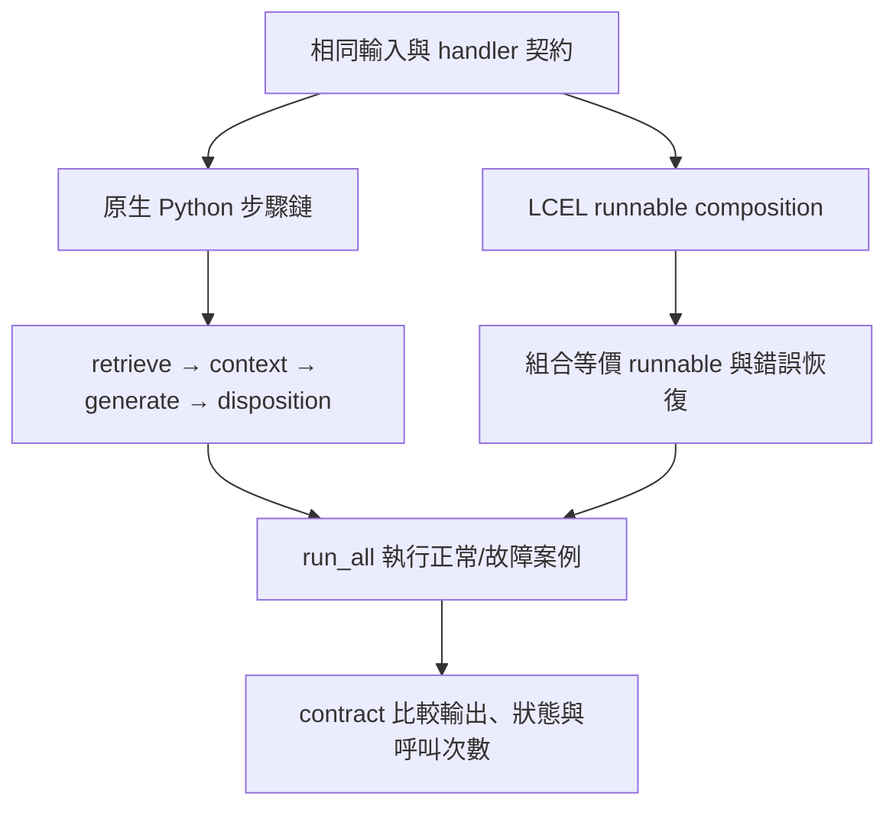
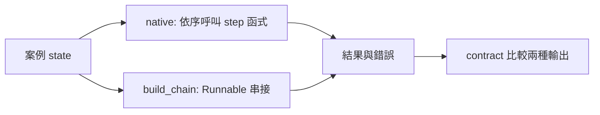
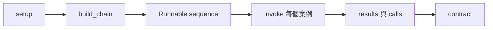

# Orchestration 與 LangChain LCEL

> **正文改版：20E07-E03-06｜對應新版 LLM 第 28 節：Orchestration 與 LangChain LCEL。**
> 第 24 節的 RAG 流程（合格過濾 → 檢索 → 上下文 → 生成 → 驗證 → 處置）已經可以跑、有測試。本節**不改任何一步**，只換「串接方式」：一版是普通的 Python 函式依序呼叫，一版是 LangChain 的 LCEL（每一步包成 Runnable，用 `|` 接起來，`invoke` 執行）。同一組 9 個案例、同一份契約跑三次（第 24 節原本的 `handle()`、純 Python、LCEL），結果逐案相同。然後看框架**做了什麼、沒做什麼**：錯誤怎麼傳遞、權限誰負責。核心主張：**框架是串接工具，不會讓模型變好，也不會替你補上權限檢查；先有契約測試，再換串接方式。**

[回 51 節必修＋9 節選修課綱](https://hackmd.io/@yillkid/HJl8JXTNkl)

## 流程圖：Orchestration 與 LangChain LCEL



## 學習目標與時間

先修第 14 節（工具回合）、第 15 節（供應商介面）、第 24 節（RAG 引用與查無答案）。

| 時間 | 內容 |
| --- | --- |
| 0–10 分鐘 | 為什麼要談 orchestration：步驟、資料流、錯誤 |
| 10–20 分鐘 | LCEL 的三個概念：Runnable、`|`、invoke |
| 20–35 分鐘 | 跑 Demo：三種跑法同一份契約；錯誤傳遞；拿掉權限檢查 |
| 35–50 分鐘 | Workshop：把一步換掉，用契約測試抓出來 |

驗收能力：交出**可重跑的 pipeline 與契約測試**；能說明每一步讀哪些欄位、加哪些欄位，以及錯誤在哪一層被處理。

## 一、先有契約，再換串接方式

把流程拆成五步，每一步都是「收一個 dict、回一個 dict」：

| 步驟 | 讀 | 加 | 第 24 節的函式 |
| --- | --- | --- | --- |
| `step_allowed` | `case`、`corpus` | `allowed` | `eligible` |
| `step_retrieve` | `index`、`case`、`allowed` | `ranked`（範圍為空時是 `None`） | `index.search` |
| `step_context` | `ranked` | `picked`、`used`、`block` | `build_context` |
| `step_generate` | `generator`、`case`、`block` | `answer`（範圍為空時不呼叫） | `generator.generate` |
| `step_disposition` | `answer`、`picked`、`used` | 最後的處置 | `verify`、`DISPOSITION` |

**契約**是第 24 節已經確認過的不變量，例如「A1 送出且附引用」「E1 不呼叫生成」「生成只被呼叫 7 次」。任何串接方式都要通過同一份契約；不通過，就是串接改壞了，不是「框架行為不同」。

N2 這一條要特別注意：第 24 節刻意讓它**通過驗證被送出**（引文逐字存在，但不支持主張），那是驗證器的已知盲點。契約照實寫「N2 送出」，不是寫成我們希望的樣子；否則三種跑法都會「失敗」，契約就失去意義。

## 二、LCEL 的三個概念

| 概念 | 是什麼 | 本節的用法 |
| --- | --- | --- |
| Runnable | 有 `invoke`、`batch`、`stream` 等方法的物件 | `RunnableLambda(step)` 把普通函式包起來 |
| `|` | 把兩個 Runnable 接成 `RunnableSequence`：前一個的輸出是下一個的輸入 | 五步接起來 |
| `with_fallbacks` | 指定某些例外發生時改跑另一個 Runnable | 只攔 `ConnectionError`，轉成「稍後重試」 |

LCEL 本身**沒有**提示模板、模型、檢索的魔法；那些是其他套件提供的 Runnable。本節只用 `langchain-core`，不接任何模型。

## 三、可執行 Demo

### Session 1：原生函式與 LCEL 共用步驟契約

**系統層：同一業務步驟、兩種 orchestration**



**函式內部：`native` 呼叫步驟並傳遞 state**

```mermaid
flowchart TD
    A[native(state)] --> B[step_allowed]
    B --> C[step_retrieve]
    C --> D[step_context]
    D --> E[step_generate]
    E --> F[step_disposition]
    F --> G[回傳結果 state]
```

### Session 2：LCEL 鏈建構、錯誤 fallback 與契約

**系統層：build、invoke 與契約驗證**



**函式內部：`build_chain` 的步驟與例外處理**

```mermaid
flowchart TD
    A[build_chain(steps, catch)] --> B[串接 steps]
    B --> C{catch 啟用?}
    C -- 是 --> D[with_fallbacks retrieval_failed]
    C -- 否 --> E[原始錯誤傳出]
    D --> F[回傳 Runnable]
    E --> F
```

需要 `langchain-core==1.6.6`（安裝 `langgraph==1.2.12` 時已一起裝，不必另外裝）；同資料夾要有第 24 節的程式（`E08_filter_update.py` 或講義）與 MariaDB 課共用的 `data/sop_corpus.json`、`data/search_cases.json`。不需要模型、不需要 API key，約 1 秒。

<!-- demo: 51_lcel.py -->
```python
"""第 25 節：Orchestration 與 LangChain LCEL。

把第 24 節的 RAG 流程（合格過濾 → 檢索 → 上下文 → 生成 → 驗證 → 處置）原封不動地重用，
只換「串接方式」：一版是普通 Python 函式呼叫，一版是 LCEL（Runnable 用 | 串起來、invoke 執行）。
同一組 9 個案例、同一份契約測試跑兩版，比較：輸出、錯誤怎麼傳遞、框架有沒有替你多做什麼。

需要 langchain-core==1.6.6（裝 langgraph 1.2.12 時已一起裝）；不需要模型、不需要 API key。

    python 51_lcel.py
"""
import re
import sys
import types
from pathlib import Path

from langchain_core.runnables import RunnableLambda

HERE = Path(__file__).resolve().parent


def lesson(nn):
    """同第 32 節：先找 NN_*.py，再找講義 NN-*.md；讀原始碼後 exec。"""
    found = [(p, p.read_text(encoding="utf-8")) for p in sorted(HERE.glob(f"{nn}_*.py"))]
    for md in sorted(HERE.glob(f"{nn}-*.md")):
        found += [(md, src) for _, src in re.findall(r"<!-- demo: ([\w.]+) -->\n```python\n(.*?)\n```",
                                                     md.read_text(encoding="utf-8"), re.S)]
    if not found:
        raise FileNotFoundError(f"找不到第 {nn} 節的程式（{nn}_*.py 或 {nn}-*.md）")
    path, source = found[0]
    module = types.ModuleType(f"lesson{nn}")
    module.__file__ = str(path)
    exec(compile(source, path.name, "exec"), module.__dict__)
    return module


L23 = lesson("24")


# ---------------------------------------------------------------- 共用的步驟（輸入、輸出都是 dict）
# 每一步只做一件事，明確寫出「讀哪些欄位、加哪些欄位」：這就是契約。

def step_allowed(state):
    """讀 case、corpus；加 allowed。"""
    case = state["case"]
    return {**state, "allowed": L23.eligible(state["corpus"], case["category_id"]) | case.get("extra_allowed", set())}


def step_retrieve(state):
    """讀 index、case、allowed；加 ranked。空範圍不檢索。"""
    if not state["allowed"]:
        return {**state, "ranked": None}
    return {**state, "ranked": state["index"].search(state["case"]["query"], state["allowed"])}


def step_context(state):
    """讀 ranked；加 picked、used、block。"""
    if state["ranked"] is None:
        return {**state, "picked": [], "used": 0, "block": ""}
    picked, used, block = L23.build_context(state["index"], state["ranked"])
    return {**state, "picked": picked, "used": used, "block": block}


def step_generate(state):
    """讀 generator、case、block；加 answer。合格範圍為空時不呼叫生成。"""
    if state["ranked"] is None:
        return {**state, "answer": None}
    case = state["case"]
    return {**state, "answer": state["generator"].generate(case["case_id"], case["query"], state["block"])}


def step_disposition(state):
    """讀 answer、picked、used；回傳與第 24 節 handle() 相同形狀的結果。"""
    if state["answer"] is None:
        return {"處置": "合格範圍為空 → 轉人工（不呼叫生成）", "上下文": []}
    verdict = L23.verify(state["answer"], state["index"], set(state["picked"]))
    if verdict != "通過":
        return {"處置": f"驗證失敗 → 不送出（{verdict}）", "上下文": state["picked"], "字數": state["used"]}
    return {"處置": L23.DISPOSITION[state["answer"]["status"]], "上下文": state["picked"], "字數": state["used"]}


STEPS = (step_allowed, step_retrieve, step_context, step_generate, step_disposition)


# ---------------------------------------------------------------- 兩種串接

def native(state):
    """純 Python：依序呼叫。檢索故障在這裡攔，轉成處置。"""
    try:
        for step in STEPS:
            state = step(state)
        return state
    except ConnectionError as error:
        return {"處置": f"檢索故障（{error}）→ 稍後重試，不可回答查無資料", "上下文": []}


def retrieval_failed(state_with_error):
    error = state_with_error["exception"]
    return {"處置": f"檢索故障（{error}）→ 稍後重試，不可回答查無資料", "上下文": []}


def build_chain(steps=STEPS, catch=True):
    chain = RunnableLambda(steps[0])
    for step in steps[1:]:
        chain = chain | RunnableLambda(step)
    if catch:                         # 只攔 ConnectionError；其他錯誤照樣往外丟
        chain = chain.with_fallbacks([RunnableLambda(retrieval_failed)],
                                     exceptions_to_handle=(ConnectionError,), exception_key="exception")
    return chain


# ---------------------------------------------------------------- 案例與契約測試

def setup():
    corpus, qrels = L23.load("sop_corpus.json"), L23.load("search_cases.json")
    corpus = dict(corpus, documents=corpus["documents"] + L23.EXTRA_DOCS)
    index = L23.LexicalIndex(corpus["chunks"] + L23.EXTRA_CHUNKS)
    by_id = {c["case_id"]: c for c in qrels["cases"]}
    states = []
    for case_id, label, qid, extra in L23.CASES:
        case = dict(by_id[qid], case_id=case_id, extra_allowed=extra or set())
        use = L23.BrokenIndex() if case_id == "E2" else index
        states.append((label, {"case": case, "corpus": corpus, "index": use}))
    return states


def run_all(runner):
    """runner(state) → 結果；每次都換一個新的生成器，才能數呼叫次數。"""
    generator = L23.ScriptedGenerator(L23.SCRIPT)
    out = {}
    for label, state in setup():
        out[state["case"]["case_id"]] = runner(dict(state, generator=generator))
    return out, generator.calls


def contract(results, calls):
    """與第 24 節講義相同的不變量：任何串接方式都要通過。"""
    checks = {
        "A1 送出且附引用": results["A1"]["處置"] == "回覆（附引用）",
        "A2、A3、I1 不送出": all(results[c]["處置"].startswith("驗證失敗") for c in ("A2", "A3", "I1")),
        "N2 照第 24 節送出（驗證器的已知盲點）": results["N2"]["處置"] == "回覆（附引用）",
        "N1 轉人工": results["N1"]["處置"].startswith("查無答案"),
        "C1 列出雙方": results["C1"]["處置"].startswith("資料衝突"),
        "E1 不呼叫生成": results["E1"]["處置"].startswith("合格範圍為空"),
        "E2 不說查無資料": "不可回答查無資料" in results["E2"]["處置"],
        "生成只被呼叫 7 次": calls == 7,
    }
    return checks


def main():
    reference = L23.handle
    print("同一組步驟（第 24 節的函式），三種跑法；9 個案例、同一份契約")
    print()
    rows = {}
    for name, runner in (
        ("第 24 節 handle()", lambda s: reference(s["case"], s["corpus"], s["index"], s["generator"])),
        ("純 Python 串接", native),
        ("LCEL chain", build_chain().invoke),
    ):
        results, calls = run_all(runner)
        checks = contract(results, calls)
        rows[name] = results
        print(f"{name:<16} 契約 {sum(checks.values())}/{len(checks)} 通過｜生成呼叫 {calls} 次")
    print(f"三種輸出逐案相同：{'是' if rows['純 Python 串接'] == rows['LCEL chain'] == rows['第 24 節 handle()'] else '否'}")

    print("\n== 一、LCEL 物件長什麼樣 ==")
    chain = build_chain()
    print(f"  型別：{type(chain).__name__}；裡面包的是 {type(chain.runnable).__name__}，"
          f"共 {len(chain.runnable.steps)} 步：" + " | ".join(s.name for s in chain.runnable.steps))
    print("  `|` 只是把函式依序接起來；每一步拿到的就是上一步回傳的 dict")

    print("\n== 二、錯誤怎麼傳遞 ==")
    no_catch = build_chain(catch=False)
    E2 = dict(next(s for _, s in setup() if s["case"]["case_id"] == "E2"), generator=L23.ScriptedGenerator(L23.SCRIPT))
    try:
        no_catch.invoke(E2)
        print("  沒有 fallback：沒有錯誤？")
    except ConnectionError as error:
        print(f"  沒有 fallback：ConnectionError 直接丟出（{error}）")
    print(f"  有 fallback（只攔 ConnectionError）：{build_chain().invoke(E2)['處置']}")
    A1 = dict(next(s for _, s in setup() if s["case"]["case_id"] == "A1"), generator=L23.ScriptedGenerator(L23.SCRIPT))
    broken = {k: v for k, v in A1.items() if k != "corpus"}
    for name, runner in (("純 Python", native), ("LCEL", build_chain().invoke)):
        try:
            runner(broken)
        except KeyError as error:
            print(f"  {name}：少了 corpus 欄位 → KeyError {error}（fallback 不攔，照樣丟出）")

    print("\n== 三、框架不會替你補權限 ==")
    def allow_everything(state):
        return {**state, "allowed": {c["chunk_id"] for c in state["corpus"]["chunks"]} | {"X01", "X02"}}

    script = dict(L23.SCRIPT, E1={"status": "unknown", "claims": []})     # E1 原本不會呼叫生成，劇本裡沒有

    def runner(state):
        return build_chain((allow_everything,) + STEPS[1:]).invoke(dict(state, generator=generator))

    generator = L23.ScriptedGenerator(script)
    results = {state["case"]["case_id"]: runner(state) for _, state in setup()}
    calls = generator.calls
    failed = [k for k, v in contract(results, calls).items() if not v]
    print(f"  把「合格過濾」換成全部放行：chain 照樣執行、沒有任何錯誤；契約失敗 {len(failed)} 項：" + "、".join(failed))
    changed = [k for k in results if results[k] != rows["LCEL chain"][k]]
    print(f"  結果改變的案例：{'、'.join(changed)}")
    for k in changed:
        print(f"    {k}：{rows['LCEL chain'][k]['上下文'] or '—'} → {results[k]['上下文']}｜{results[k]['處置']}")
    print("  X01、X02 是未審的同學筆記（X02 藏了指令）：原本只有 C1、I1 刻意放行，現在 5 個案例的上下文都混進來")
    print("  E1 的類別 999 不存在：原本不該檢索，現在檢索到別的產品的段落；換成會亂答的模型，就可能被送出")

    print("\n== 四、batch ==")
    states = [dict(s, generator=L23.ScriptedGenerator(L23.SCRIPT)) for _, s in setup()]
    batch = build_chain().batch(states, config={"max_concurrency": 1})
    print(f"  batch 9 案，與逐一 invoke 相同：{'是' if batch == list(rows['LCEL chain'].values()) else '否'}")
    print("  batch 預設會平行執行；生成器有狀態（計數）、檢索可能有副作用時，要確認可以平行，本節設 max_concurrency=1")

if __name__ == "__main__":
    main()
```

執行（程式與資料也放在 [llm-demo](https://github.com/4-learn/llm-demo)）：

```bash
python 51_lcel.py
```

關鍵輸出（示範機 4-learn：Ubuntu 24.04／Python 3.12.3／langchain-core 1.6.6，20E07-E03-06；備課機 Python 3.10.15 逐字相同）：

```text
同一組步驟（第 24 節的函式），三種跑法；9 個案例、同一份契約

第 24 節 handle()  契約 8/8 通過｜生成呼叫 7 次
純 Python 串接      契約 8/8 通過｜生成呼叫 7 次
LCEL chain       契約 8/8 通過｜生成呼叫 7 次
三種輸出逐案相同：是

== 一、LCEL 物件長什麼樣 ==
  型別：RunnableWithFallbacks；裡面包的是 RunnableSequence，共 5 步：step_allowed | step_retrieve | step_context | step_generate | step_disposition
  `|` 只是把函式依序接起來；每一步拿到的就是上一步回傳的 dict

== 二、錯誤怎麼傳遞 ==
  沒有 fallback：ConnectionError 直接丟出（vector service unavailable）
  有 fallback（只攔 ConnectionError）：檢索故障（vector service unavailable）→ 稍後重試，不可回答查無資料
  純 Python：少了 corpus 欄位 → KeyError 'corpus'（fallback 不攔，照樣丟出）
  LCEL：少了 corpus 欄位 → KeyError 'corpus'（fallback 不攔，照樣丟出）

== 三、框架不會替你補權限 ==
  把「合格過濾」換成全部放行：chain 照樣執行、沒有任何錯誤；契約失敗 2 項：E1 不呼叫生成、生成只被呼叫 7 次
  結果改變的案例：A1、A2、A3、N1、N2、E1
    A1：['C004', 'C003'] → ['C004', 'C003', 'X01']｜回覆（附引用）
    A2：['C004', 'C003'] → ['C004', 'C003', 'X01']｜驗證失敗 → 不送出（拒絕：C004 裡找不到引文「改用 5 GHz 即可排除連線失敗」）
    A3：['C015', 'C016', 'C002'] → ['C015', 'X02', 'C016']｜驗證失敗 → 不送出（拒絕：引用 C014 不在這次的上下文裡）
    N1：['C001', 'C015', 'C016'] → ['C001', 'X02', 'C015']｜查無答案 → 轉人工
    N2：['C004', 'C003'] → ['C004', 'X01', 'C003', 'X02']｜回覆（附引用）
    E1：— → ['C001', 'C009', 'C002']｜查無答案 → 轉人工
  X01、X02 是未審的同學筆記（X02 藏了指令）：原本只有 C1、I1 刻意放行，現在 5 個案例的上下文都混進來
  E1 的類別 999 不存在：原本不該檢索，現在檢索到別的產品的段落；換成會亂答的模型，就可能被送出

== 四、batch ==
  batch 9 案，與逐一 invoke 相同：是
  batch 預設會平行執行；生成器有狀態（計數）、檢索可能有副作用時，要確認可以平行，本節設 max_concurrency=1
```

## 四、結果怎麼讀

### 1. 三種跑法輸出逐案相同

第 24 節的 `handle()`、純 Python 串接、LCEL chain：契約 8/8、生成呼叫 7 次、9 個案例的處置與上下文全部相同。**換串接方式不會讓答案變好，也不應該讓答案變差。**

### 2. 錯誤怎麼傳遞

- 沒有 fallback 時，E2 的 `ConnectionError` 直接從 `invoke` 丟出來，跟純 Python 一樣。
- `with_fallbacks(..., exceptions_to_handle=(ConnectionError,))` 只攔這一種錯誤，轉成「稍後重試，不可回答查無資料」（第 24 節的處置）。
- 少了 `corpus` 欄位的 `KeyError` **不會被攔**：它是程式寫錯，應該讓它失敗，而不是悄悄轉成「查無資料」。

純 Python 版用 `try/except ConnectionError` 做同一件事。**錯誤處理的範圍是你決定的，不是框架決定的。**

### 3. 框架不會替你補權限

把「合格過濾」換成「全部放行」：chain 照樣順利執行，**沒有任何錯誤**。只有契約測試抓到問題（E1 被呼叫生成、生成次數變 8 次），而上下文的變化更嚴重：

- 未審的同學筆記 X01、X02（X02 藏了指令）混進了 5 個案例的上下文；原本只有 C1、I1 刻意放行。
- E1 問的是不存在的類別，原本根本不該檢索，現在檢索到別的產品的段落。

本節的劇本生成器剛好都沒有亂答，所以處置看起來大多沒變；換成真的模型，就可能把未審筆記當依據送出。**權限是你的程式邏輯，框架只負責把步驟接起來。**

### 4. batch

`batch` 對每個輸入跑一次 chain，結果與逐一 `invoke` 相同。它**預設會用執行緒平行跑**；本節的生成器會計數（有狀態），如果檢索或工具有副作用（第 26、29 節），平行執行要另外確認安全，所以設 `max_concurrency=1`。

## 五、要不要用框架

| 考量 | 純 Python | LCEL |
| --- | --- | --- |
| 可讀性 | 一般的函式呼叫，誰都看得懂 | 要先懂 Runnable 與 `|` |
| 錯誤處理 | `try/except` | `with_fallbacks`，語義相同 |
| batch、stream、非同步 | 要自己寫 | 每個 Runnable 都有 |
| 與 LangChain 其他元件串接 | 要自己轉接 | 直接接 |
| 版本變動 | 只受 Python 影響 | LangChain 改版快，要鎖版本 |
| 除錯 | 一般的 traceback | traceback 較長（經過框架的呼叫層） |

本課後面的第 27–32 節用 LangGraph（同一家族，處理有分支與狀態的流程）；本節的重點是：**換框架前先有契約測試**，換完跑同一份測試。

## 六、常見誤判

| 誤判 | 實際 |
| --- | --- |
| 「用了 LangChain，RAG 就會變好」 | 步驟沒變，輸出逐案相同 |
| 「框架會處理錯誤」 | 只處理你指定的例外；程式錯誤照樣丟出 |
| 「框架有權限控制」 | 拿掉過濾，chain 照樣執行，沒有任何錯誤 |
| 「batch 一定安全」 | 預設平行；有狀態或有副作用的步驟要另外確認 |
| 「契約寫成理想的樣子」 | 照實寫已知行為（N2），否則測試失去意義 |

## Workshop：把一步換掉，用契約抓出來

### 任務

1. （3 分鐘）跑 Demo，確認三種跑法契約 8/8、輸出相同。
2. （5 分鐘）把 `step_context` 換成「不限預算，全部放入」（提示：把 `L23.build_context` 換成直接取 `ranked` 的前 5 個），重跑 LCEL 版。契約有幾項失敗？哪些案例的上下文變了？
3. （4 分鐘）把 fallback 改成攔所有例外（`exceptions_to_handle=(Exception,)`）。少了 `corpus` 欄位時會發生什麼？為什麼這樣不好？
4. （3 分鐘）寫一句話：你的專案要不要用 LCEL？理由是什麼？

### 參考判讀

- 第 2 題：不同的實作結果可能不同；重點是契約有沒有抓到，以及你能不能用「上下文」欄位說明變了什麼。如果契約全部通過、但上下文變長，說明契約沒涵蓋預算，要補一條。
- 第 3 題：程式錯誤（少欄位）被轉成「檢索故障，稍後重試」，使用者會一直重試、問題永遠不會被修。攔截範圍要窄。
- 第 4 題：沒有標準答案。合理的理由例如「步驟少、團隊不熟 LangChain，用純 Python」或「要接 LangChain 的檢索器與 stream，用 LCEL 並鎖版本」。

### 驗收

- 第 2 題修改後的程式與契約結果（標本機實測）。
- 第 3 題的說明。

## 教師紀錄與下一步

- 證據等級：**本機實測**。20E07-E03-06 在示範機 4-learn（Ubuntu 24.04、Python 3.12.3、langchain-core 1.6.6）與備課機（Python 3.10.15）執行，輸出逐字相同。
- 撰寫時的實際紀錄：第一版契約把 N2 寫成「不送出」，結果三種跑法都 7/8；回頭看第 24 節才發現 N2 本來就是「驗證通過但主張不被支持」的盲點案例。契約改成照實描述已知行為。
- `langchain-core` 是 `langgraph==1.2.12` 的相依套件，安裝基線沒有另外釘選；若單獨安裝，請用 `langchain-core==1.6.6`。
- 只用 `langchain-core`，**沒有**用 `langchain`、`langchain-openai` 或任何模型整合；舊教材 [LangChain](https://hackmd.io/@yillkid/aBiDFnetRTmEHym7OBf5kQ)、[OpenAI LangChain](https://hackmd.io/@yillkid/rkNKy7dj-g) 的模型呼叫部分**沒有驗證**。
- 舊教材 [Why Orchestration](https://hackmd.io/@yillkid/wFKcfwF_TTOGnpHe75IHxQ) 等三頁**尚未合併改寫**。
- 下一步：第 26 節工具權限與副作用控制。
