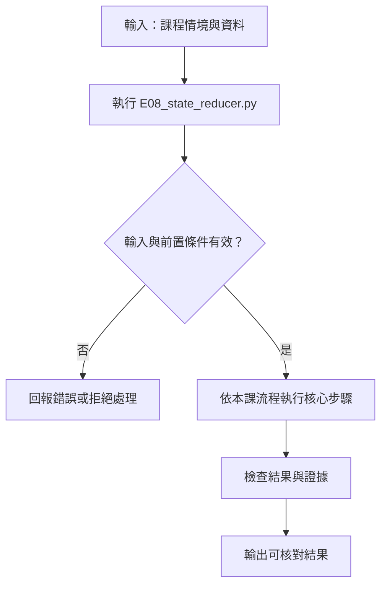

# LangGraph State 與 Reducer

> **新版正文：20E07-E03-06｜對應新版 LLM 第 27 節：LangGraph State 與 Reducer。**
> 第一次用 LangGraph。graph 裡每個節點只回傳「要更新哪些欄位」，**怎麼把更新併回 state 由 reducer 決定**。核心主張：**同一個 graph、同一份輸入，只差一行 reducer，結果就從「默默丟資料」「當掉」變成「正確合併」；而框架不會替你擋欄位打錯字。**

[回 50 節課綱](https://hackmd.io/@yillkid/HJl8JXTNkl)

## 流程圖：LangGraph State 與 Reducer



## 學習目標與時間

先修第 24 節（RAG 引用）、第 26 節（副作用政策）。第 28 節的條件分支、第 30 節的 HITL 都建立在本節的 state 上。

| 時間 | 內容 |
| --- | --- |
| 0–8 分鐘 | StateGraph：state schema、節點、邊、部分更新 |
| 8–18 分鐘 | 三種合併規則：覆寫、串接、依 id 合併 |
| 18–28 分鐘 | 並行寫入、順序、checkpoint 重跑造成的重複 |
| 28–35 分鐘 | 跑 Demo，逐段解讀 |
| 35–50 分鐘 | Workshop：加第三個節點、修 reducer |

驗收能力：能說出自己 state 中**每個欄位的合併規則**，並用同一份輸入跑出循序與並行兩種結果、解釋差異。

## 一、StateGraph 的四個部分

| 部分 | 是什麼 | 本節例子 |
| --- | --- | --- |
| state schema | 一個 `TypedDict`，列出所有欄位 | `report_id`、`findings` |
| 節點 | 一般 Python 函式，收到整份 state，**回傳要更新的欄位** | `vision`、`text` |
| 邊 | 誰之後跑誰 | `START → vision → text → END` |
| reducer | 某個欄位收到更新時，怎麼和舊值合併 | `Annotated[list, operator.add]` |

節點**不回傳整份 state**。它回傳 `{"findings": [...]}`，LangGraph 用這個欄位的 reducer 把它併進去。沒寫 reducer 的欄位，規則就是**覆寫**。

## 二、三種合併規則

| schema | 寫法 | 行為 | 風險 |
| --- | --- | --- | --- |
| `Overwrite` | `findings: list` | 後寫的蓋掉先寫的 | 循序時**默默丟資料**；並行時直接報錯 |
| `Append` | `Annotated[list, operator.add]` | 串接 | 不丟，但**重跑就重複**，修正變成新增 |
| `Keyed` | `Annotated[list, merge_by_id]` | 依 id 合併，結果依 id 排序 | 要自己寫、自己測；每筆都要有穩定的 id |

`merge_by_id` 是本節自己寫的 reducer，不是 LangGraph 內建的。它示範兩件事：reducer 就是一個「舊值、新值 → 合併後的值」的普通函式；以及結果排序要自己決定，**不要依賴節點執行順序**。

## 三、可執行 Demo

需要 `langgraph`（不需要模型、不需要 API key）。在第 17 節的 venv 內安裝：

```bash
python -m pip install "langgraph==1.2.12"
```

備課機實際版本：`langgraph 1.2.12`、`langgraph-checkpoint 4.2.0`、`langchain-core 1.6.6`。LangGraph 改版快，**不同版本的行為與錯誤訊息可能不同**，所以要鎖版本。

<!-- demo: E08_state_reducer.py -->
```python
"""第 27 節：LangGraph State 與 Reducer。

同一個 graph、同一份輸入，只差一行 reducer，結果就從「丟資料」「當掉」變成「正確合併」。
需要 langgraph（見講義安裝指令）；不需要模型、不需要 API key。
"""
import operator
from typing import Annotated, TypedDict

from langgraph.checkpoint.memory import InMemorySaver
from langgraph.graph import END, START, StateGraph
from langgraph.errors import InvalidUpdateError

REPORT = {"report_id": "R-001", "text": "三樓外牆鷹架，一名工人未扣安全帶。"}


# --- 三種 state schema：findings 欄位的合併規則不同 ---------------------------------

class Overwrite(TypedDict):
    report_id: str
    findings: list                                  # 沒有 reducer：後寫的蓋掉先寫的


class Append(TypedDict):
    report_id: str
    findings: Annotated[list, operator.add]         # 串接：不會丟，但會重複


def merge_by_id(current, update):
    """依 finding id 合併：同 id 以新的為準；結果依 id 排序，與節點執行順序無關。"""
    merged = {item["id"]: item for item in current or []}
    for item in update or []:
        merged[item["id"]] = item
    return [merged[key] for key in sorted(merged)]


class Keyed(TypedDict):
    report_id: str
    findings: Annotated[list, merge_by_id]


# --- 節點：每個節點只回傳「這次要更新的欄位」，不是整份 state ------------------------

def vision(state):
    return {"findings": [{"id": "F-vision", "by": "vision", "label": "未見安全帶"}]}


def text(state):
    return {"findings": [{"id": "F-text", "by": "text", "label": "高處作業"}]}


def build(schema, parallel, checkpointer=None):
    graph = StateGraph(schema)
    graph.add_node("vision", vision)
    graph.add_node("text", text)
    if parallel:                                     # 同一步同時執行兩個節點
        graph.add_edge(START, "vision")
        graph.add_edge(START, "text")
        graph.add_edge("vision", END)
        graph.add_edge("text", END)
    else:                                            # 先 vision 再 text
        graph.add_edge(START, "vision")
        graph.add_edge("vision", "text")
        graph.add_edge("text", END)
    return graph.compile(checkpointer=checkpointer)


def labels(state):
    return [item["by"] for item in state["findings"]]


def run(schema, parallel, initial=None):
    start = {"report_id": REPORT["report_id"], "findings": initial or []}
    try:
        return labels(build(schema, parallel).invoke(start))
    except InvalidUpdateError as error:
        return f"InvalidUpdateError：{str(error).splitlines()[0]}"


def main():
    import importlib.metadata as metadata
    print("langgraph:", metadata.version("langgraph"))
    print("通報:", REPORT["report_id"], REPORT["text"])

    print("\n== 一、三種 reducer × 循序／並行 ==")
    for schema in (Overwrite, Append, Keyed):
        for parallel in (False, True):
            mode = "並行" if parallel else "循序"
            print(f"{schema.__name__:<9} {mode}: {run(schema, parallel)}")

    print("\n== 二、初始值也會被 reducer 處理 ==")
    seed = [{"id": "F-manual", "by": "manual", "label": "人工先標"}]
    for schema in (Overwrite, Append, Keyed):
        print(f"{schema.__name__:<9} 循序: {run(schema, False, seed)}")

    print("\n== 三、同一 thread 再跑一次（checkpoint 保留舊 state）==")
    for schema in (Append, Keyed):
        app = build(schema, True, InMemorySaver())
        config = {"configurable": {"thread_id": "R-001"}}
        first = labels(app.invoke({"report_id": "R-001", "findings": []}, config))
        second = labels(app.invoke({"report_id": "R-001", "findings": []}, config))
        print(f"{schema.__name__:<9} 第 1 次 {first}  第 2 次 {second}")

    print("\n== 四、同 id 更新：修正而不是新增 ==")
    corrected = [{"id": "F-vision", "by": "reviewer", "label": "安全帶已扣（覆核修正）"}]
    for schema in (Append, Keyed):
        state = build(schema, False).invoke({"report_id": "R-001", "findings": []})
        final = schema.__annotations__["findings"].__metadata__[0](state["findings"], corrected)
        print(f"{schema.__name__:<9} {[(i['id'], i['by']) for i in final]}")

    print("\n== 五、框架不會替你擋的錯 ==")
    graph = StateGraph(Keyed)
    graph.add_node("typo", lambda state: {"finding": [{"id": "F-x", "by": "typo", "label": "?"}]})
    graph.add_node("forgot", lambda state: None)
    graph.add_edge(START, "typo")
    graph.add_edge("typo", "forgot")
    graph.add_edge("forgot", END)
    out = graph.compile().invoke({"report_id": "R-001", "findings": []})
    print("欄位打錯字（finding）與回傳 None → 結果:", out, "（沒有錯誤訊息）")


if __name__ == "__main__":
    main()
```

執行（程式也放在 [llm-demo](https://github.com/4-learn/llm-demo)）：

```bash
python E08_state_reducer.py
```

關鍵輸出（Linux x86_64／Python 3.10.15，langgraph 1.2.12，20E07-E03-06）：

```text
langgraph: 1.2.12
通報: R-001 三樓外牆鷹架，一名工人未扣安全帶。

== 一、三種 reducer × 循序／並行 ==
Overwrite 循序: ['text']
Overwrite 並行: InvalidUpdateError：At key 'findings': Can receive only one value per step. Use an Annotated key to handle multiple values.
Append    循序: ['vision', 'text']
Append    並行: ['text', 'vision']
Keyed     循序: ['text', 'vision']
Keyed     並行: ['text', 'vision']

== 二、初始值也會被 reducer 處理 ==
Overwrite 循序: ['text']
Append    循序: ['manual', 'vision', 'text']
Keyed     循序: ['manual', 'text', 'vision']

== 三、同一 thread 再跑一次（checkpoint 保留舊 state）==
Append    第 1 次 ['text', 'vision']  第 2 次 ['text', 'vision', 'text', 'vision']
Keyed     第 1 次 ['text', 'vision']  第 2 次 ['text', 'vision']

== 四、同 id 更新：修正而不是新增 ==
Append    [('F-vision', 'vision'), ('F-text', 'text'), ('F-vision', 'reviewer')]
Keyed     [('F-text', 'text'), ('F-vision', 'reviewer')]

== 五、框架不會替你擋的錯 ==
欄位打錯字（finding）與回傳 None → 結果: {'report_id': 'R-001', 'findings': []} （沒有錯誤訊息）
```

## 四、結果怎麼讀

### 1. 沒有 reducer：循序時默默丟資料

`Overwrite` 循序跑完只剩 `['text']`，`vision` 的發現被蓋掉了，**沒有任何錯誤或警告**。這是最危險的情況：graph 看起來正常結束，但影像那一路的證據不見了。

### 2. 沒有 reducer：並行時直接當掉

同樣的 schema，兩個節點在同一步更新 `findings`，LangGraph 丟出 `InvalidUpdateError`，訊息也直接提示要用 `Annotated`。**並行反而比較安全**，因為它會叫出來。

### 3. 有 reducer：不丟，但順序不是你寫的順序

`Append` 並行時結果是 `['text', 'vision']`，和加邊的順序（先 vision）相反。備課機實測：並行節點的寫入順序在 1.2.12 是**依節點名稱排序**（把節點改名 `z_vision`、`a_text` 後，順序跟著名稱變）。這是實作細節，**文件沒有保證**，換版本可能改變。要穩定的順序，就在 reducer 裡自己排序，像 `Keyed` 依 id 排序，循序與並行結果一致。

### 4. 初始值也會進 reducer

傳入 `findings` 初始值（人工先標的一筆），`Overwrite` 循序最後還是只剩 `['text']`——**人工標註也被蓋掉了**。`Append`、`Keyed` 都保留。

### 5. checkpoint 讓重跑變成重複

接上 checkpointer、用同一個 `thread_id` 再跑一次，`Append` 的結果從 2 筆變 4 筆：上一次的 state 被保留，這一次的更新又串接上去。`Keyed` 依 id 合併，仍是 2 筆。第 29 節談過重試要冪等；**reducer 也要冪等**，第 30 節的 resume 會重跑節點。

### 6. 修正是「取代」，不是「新增」

覆核者把 `F-vision` 改成「安全帶已扣」。`Append` 變成 3 筆：舊的錯誤判斷還在，和修正並列，下游不知道要信哪一筆。`Keyed` 用新的取代舊的。

### 7. 框架不會替你擋的錯

節點回傳 `finding`（少一個 s），LangGraph **直接忽略**這個不在 schema 裡的欄位；節點回傳 `None` 也被當成「不更新」。兩個錯誤都沒有任何訊息，結果是空的 `findings`。`TypedDict` 只是型別提示，執行時不檢查。要擋，得靠測試或自己在節點出口驗證（第 13 節的輸出驗證）。

## 五、常見誤判

| 說法 | 為什麼不對 |
| --- | --- |
| 「節點回傳的就是新的 state」 | 回傳的是**更新**，由 reducer 併入；沒寫 reducer 就是覆寫 |
| 「graph 沒報錯，資料就都在」 | 循序覆寫、欄位打錯字、回傳 None 都不會報錯 |
| 「`operator.add` 就夠了」 | 重跑、resume、修正都會變成重複 |
| 「並行節點會照我加邊的順序寫入」 | 實測是依節點名稱排序，且文件沒保證 |
| 「TypedDict 會檢查欄位名」 | 只是型別提示，執行時不檢查 |
| 「用了 LangGraph，流程就比較可靠」 | 框架只負責排程與合併；規則對不對要自己測 |

## Workshop：加第三個節點、修 reducer

### 任務

1. 加一個節點 `history`，回傳 `{"id": "F-history", "by": "history", "label": "上月同工地有墜落紀錄"}`，並讓它和 `vision`、`text` **一起並行**。分別用 `Append`、`Keyed` 跑，記錄結果。
2. 把 `vision` 節點改名為 `a_vision`（只改 `add_node` 的名稱與邊），用 `Append` 並行再跑一次。順序變了嗎？`Keyed` 呢？
3. `Overwrite` 加上第三個並行節點，錯誤訊息有變嗎？
4. 寫一個測試：`merge_by_id(merge_by_id(a, b), b) == merge_by_id(a, b)`（重複套用同一更新，結果不變），並說明為什麼 `operator.add` 不滿足。
5. 在 `Keyed` 的節點出口加檢查：回傳的 key 不在 schema 裡就 `raise`。用 `finding` 打錯字的節點驗證它會報錯。

### 參考判讀

以下為備課機實跑（langgraph 1.2.12，20E07-E03-06）：

- 第 1 題：`Append` 並行為 `['history', 'text', 'vision']`；`Keyed` 依 id 排序也是 `['history', 'text', 'vision']`——兩者剛好相同，是因為節點名稱順序與 id 順序一致，不是因為 `Append` 有排序。
- 第 2 題：改名 `a_vision` 後，`Append` 並行變成 `['vision', 'text']`；`Keyed` 不變，仍是 `['text', 'vision']`。
- 第 3 題：錯誤訊息相同，都是 `Can receive only one value per step`。
- 第 4 題：`operator.add` 重複套用會讓清單變長，不冪等；`merge_by_id` 冪等。
- 第 5 題：LangGraph 本身不會報錯，必須自己檢查。

### 驗收

- 交一張表：你的 state 每個欄位、它的 reducer、為什麼這樣選、重跑時會不會重複。
- 用同一份輸入跑循序與並行，結果相同；若不同，說明原因。
- 第 4、5 題的測試要能執行。

## 教師紀錄與下一步

- 證據等級：**本機實測**（Linux x86_64、Python 3.10.15、langgraph 1.2.12、langgraph-checkpoint 4.2.0）。兩次執行輸出逐字相同；Workshop 參考判讀逐題實跑並由測試覆蓋。
- 撰寫時的實際紀錄：
  1. 原本預期並行時 `Append` 會照加邊順序，實跑是 `['text', 'vision']`；改節點名稱驗證後，確認是依名稱排序，寫成講義第四段第 3 點。
  2. 原本以為打錯欄位名會報錯，實跑是靜默忽略，加成第 7 點。
- **安裝政策待教師確認**：本節是第一個需要 `langgraph` 的節次。INSTALL-BASELINE 已加入釘選，但教室 VM 是否允許安裝、是否和 MariaDB 課的環境共用，仍待確認。
- 下一步：第 28 節用 state 做條件分支與 unknown 路由；第 30 節用 checkpoint 做 HITL 中斷與恢復，屆時要回頭驗證第 31 節的 trace 在 resume 時會不會重複。
