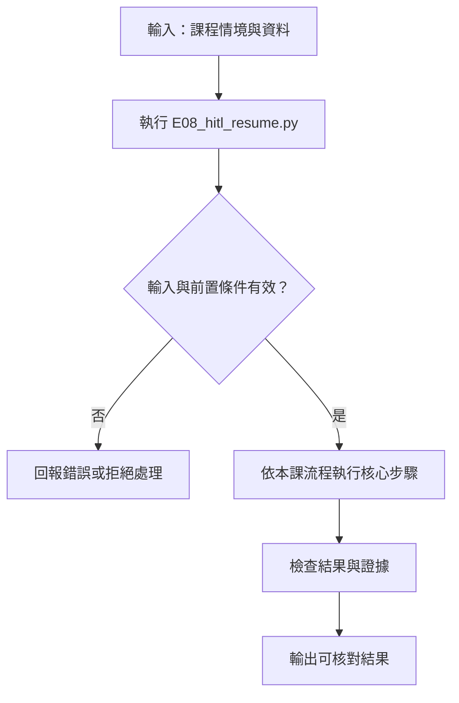
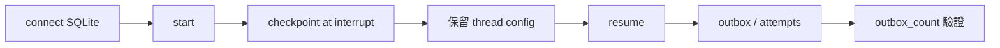

# HITL：真正拒絕與恢復

> **新版正文：20E07-E03-06｜對應新版 LLM 第 33 節：HITL：真正拒絕與恢復。**
> 「人在迴圈中」常被做成一個會跳出來的確認框：按什麼都繼續跑，或者通知早就寄出去了才問。核心主張：**人工的回答必須真正決定下一步——拒絕就不執行；流程中斷後，換一個程序也要能從存檔接著走；而 resume 會重跑節點，所以副作用要放在核准之後，而且要冪等。**

[回 51 節必修＋9 節選修課綱](https://hackmd.io/@yillkid/HJl8JXTNkl)

## 流程圖：HITL：真正拒絕與恢復



## 學習目標與時間

先修第 26 節（副作用政策）、第 27 節（state 與 reducer）、第 28 節（條件分支）、第 29 節（冪等）。本節把第 28 節的「需覆核」分支接成真正的人工關卡。

| 時間 | 內容 |
| --- | --- |
| 0–8 分鐘 | interrupt、checkpoint、thread ID、resume |
| 8–18 分鐘 | 拒絕要真的不執行；看不懂的回答怎麼辦 |
| 18–28 分鐘 | resume 會重跑節點：副作用放哪裡 |
| 28–35 分鐘 | 跑 Demo：跨程序恢復與錯誤示範 |
| 35–50 分鐘 | Workshop：核准、拒絕、重建 client 恢復 |

驗收能力：用同一份 checkpoint 檔，分別交出**核准**與**拒絕**兩條路的終態與寄出次數，並說明 resume 時哪些節點會重跑。

## 一、四個概念

| 概念 | 是什麼 | 本節 |
| --- | --- | --- |
| `interrupt(payload)` | 在節點中暫停，把 payload 交給人看 | 草稿、選項、第幾次問 |
| checkpointer | 每一步之後把 state 存起來 | `SqliteSaver`（存成一個 `.db` 檔） |
| thread ID | 一條流程的身分證，resume 靠它找存檔 | 用 `report_id` 當 thread ID |
| `Command(resume=值)` | 把人的回答送回去，從中斷處繼續 | `"approve"`／`"reject"` |

`InMemorySaver`（第 27 節用過）只存在記憶體，程序結束就沒了。要「關掉再開」還能接著走，必須用持久化的 checkpointer。本節用 SQLite，因為不需要另外架伺服器。

## 二、拒絕要真的不執行

人工關卡最常見的三種假象：

1. **問了但不看答案**：不管回什麼都走到執行節點。
2. **先做再問**：通知已經寄出，才跳確認框。
3. **看不懂就當成核准（或拒絕）**：回 `ok`、`好`、打錯字 `aprove`，程式默默選一邊。

本節的規則：`approve` 才執行；`reject` 走拒絕；**其他回答都再問一次，問滿 `MAX_ASKS` 次就當拒絕**——寧可不寄，也不猜。

## 三、resume 會重跑 interrupt 所在的節點

LangGraph 恢復時，會**從 interrupt 所在節點的開頭重新執行**，這次 `interrupt()` 直接回傳人的答案。所以：

- `interrupt()` **之前**的程式會跑兩次（第一次停下時一次、resume 時一次）。
- 寄信、寫資料庫、扣款等副作用若寫在 `interrupt()` 之前，人還沒回答就做了，而且 resume 時再做一次。
- 前面的節點（本節的 `draft`）不會重跑，它的輸出從 checkpoint 取。

正確做法：副作用放在**核准之後的獨立節點**（`execute`），並用冪等鍵（第 29 節）擋重複。

## 四、可執行 Demo

### Session 1：中斷點、核准與拒絕路徑

**系統層：interrupt 暫停副作用，等待人工決策**

```mermaid
flowchart LR
    S[start(conn, report_id)] --> G[LangGraph 節點]
    G --> I[interrupt 等待核准]
    I --> H[人工核准或拒絕]
    H --> R[resume(conn, report_id, answer)]
    R --> X{核准?}
    X -- 是 --> E[execute 寫入 outbox]
    X -- 否 --> Z[結束，不執行副作用]
```

**函式內部：`build` 把 interrupt 與 execute 分開**

```mermaid
flowchart TD
    A[build(conn, unsafe)] --> B[建立核准前節點]
    B --> C[interrupt 取得決策]
    C --> D{answer 核准?}
    D -- 是 --> E[獨立 execute 節點]
    D -- 否 --> F[記錄拒絕，不執行 send]
    E --> G[send(store, key, body)]
```

### Session 2：checkpoint 恢復與副作用冪等檢查

**系統層：持久化 checkpoint 後用同一 thread 恢復**



**函式內部：`resume` 以 `config` 定位中斷執行**

```mermaid
flowchart TD
    A[resume(conn, report_id, answer)] --> B[config(report_id)]
    B --> C[載入 checkpoint]
    C --> D[傳入 resume answer]
    D --> E[續跑 graph]
    E --> F[檢查 Store 與 outbox_count]
```

需要 `langgraph==1.2.12` 與 `langgraph-checkpoint-sqlite==3.1.1`；不需要模型。「寄出通知」寫進本機 SQLite 的 `outbox` 表，不會真的寄信。`attempts` 表記錄每一次**嘗試**寄出，用來看出重複。

```bash
python -m pip install "langgraph==1.2.12" "langgraph-checkpoint-sqlite==3.1.1"
```

<!-- demo: E08_hitl_resume.py -->
```python
"""第 30 節：HITL——真正拒絕與恢復。

人工核准才寄出停工通知；拒絕就真的不寄；流程中斷後，換一個新程序也能從存檔繼續。
需要 langgraph==1.2.12 與 langgraph-checkpoint-sqlite==3.1.1；不需要模型。
「寄出通知」寫進本機沙盒 outbox（SQLite 表），不會真的寄信。

整段示範：      python E08_hitl_resume.py
跨程序恢復：    python E08_hitl_resume.py --db hitl.db start R-101
               python E08_hitl_resume.py --db hitl.db resume R-101 approve
"""
import argparse
import sqlite3
import tempfile
from pathlib import Path
from typing import Optional, TypedDict

from langgraph.checkpoint.sqlite import SqliteSaver
from langgraph.graph import END, START, StateGraph
from langgraph.types import Command, interrupt

ANSWERS = ("approve", "reject")
MAX_ASKS = 3
CALLS = []                        # 每個節點被執行的紀錄（看出 resume 時誰重跑）


class State(TypedDict, total=False):
    report_id: str
    draft: str
    answer: Optional[str]
    asks: int
    result: Optional[str]


# --- 沙盒 outbox：唯一的副作用；以 report_id 當冪等鍵 ---------------------------------

def open_outbox(conn):
    conn.execute("CREATE TABLE IF NOT EXISTS outbox (key TEXT PRIMARY KEY, body TEXT)")
    conn.execute("CREATE TABLE IF NOT EXISTS attempts (n INTEGER)")   # 每次「嘗試寄出」都記一筆
    return conn


def send(store, key, body):
    conn = store.outbox
    conn.execute("INSERT INTO attempts VALUES (1)")
    inserted = conn.execute("INSERT OR IGNORE INTO outbox VALUES (?, ?)", (key, body)).rowcount
    conn.commit()
    return inserted == 1


def outbox_count(store):
    conn = store.outbox
    sent = conn.execute("SELECT COUNT(*) FROM outbox").fetchone()[0]
    tried = conn.execute("SELECT COUNT(*) FROM attempts").fetchone()[0]
    return sent, tried


# --- graph ---------------------------------------------------------------------------

def build(conn, unsafe=False):
    """unsafe=True：把寄出放在 interrupt() 之前（錯誤示範）。"""

    def draft(state):
        CALLS.append("draft")
        return {"draft": f"{state['report_id']}：三樓外牆鷹架暫停作業，待安全帶改善後復工。", "asks": 0}

    def ask(state):
        CALLS.append("ask")
        if unsafe:
            send(conn, state["report_id"], state["draft"])      # ← 在人回答前就寄了
        answer = interrupt({"report_id": state["report_id"], "draft": state["draft"],
                            "choices": list(ANSWERS), "asks": state["asks"] + 1})
        CALLS.append(f"ask→{answer}")
        return {"answer": answer, "asks": state["asks"] + 1}

    def after_ask(state):
        if state["answer"] == "approve":
            return "execute"
        if state["answer"] == "reject":
            return "rejected"
        return "ask" if state["asks"] < MAX_ASKS else "rejected"   # 看不懂的回答：再問，問太多次就當拒絕

    def execute(state):
        CALLS.append("execute")
        first = send(conn, state["report_id"], state["draft"])
        return {"result": "已寄出" if first else "已寄出（重複，冪等鍵擋下）"}

    def rejected(state):
        CALLS.append("rejected")
        reason = "人工拒絕" if state["answer"] == "reject" else f"回答無法辨識 {state['asks']} 次"
        return {"result": f"未寄出（{reason}）"}

    graph = StateGraph(State)
    for name, fn in (("draft", draft), ("ask", ask), ("execute", execute), ("rejected", rejected)):
        graph.add_node(name, fn)
    graph.add_edge(START, "draft")
    graph.add_edge("draft", "ask")
    graph.add_conditional_edges("ask", after_ask, {"execute": "execute", "rejected": "rejected", "ask": "ask"})
    graph.add_edge("execute", END)
    graph.add_edge("rejected", END)
    return graph.compile(checkpointer=SqliteSaver(conn.saver))


def config(report_id):
    return {"configurable": {"thread_id": report_id}}


def start(conn, report_id, unsafe=False):
    out = build(conn, unsafe).invoke({"report_id": report_id}, config(report_id))
    return out["__interrupt__"][0].value if "__interrupt__" in out else out


def resume(conn, report_id, answer, unsafe=False):
    out = build(conn, unsafe).invoke(Command(resume=answer), config(report_id))   # 每次都重建 graph
    return out["__interrupt__"][0].value if "__interrupt__" in out else out


class Store:
    """outbox 與 checkpointer 各用一條連線。

    共用同一條連線時，checkpointer 的交易與 outbox 的 commit 會互相干擾，
    備課機實測偶發 `cannot start a transaction within a transaction`。
    """

    def __init__(self, path):
        self.outbox = open_outbox(sqlite3.connect(path, check_same_thread=False))
        self.saver = sqlite3.connect(path, check_same_thread=False)

    def close(self):
        self.outbox.close()
        self.saver.close()


def connect(path):
    return Store(path)


def demo(db):
    import importlib.metadata as metadata
    print("langgraph:", metadata.version("langgraph"), "｜ checkpoint-sqlite:", metadata.version("langgraph-checkpoint-sqlite"))

    print("\n== 一、核准：中斷 → 關掉連線 → 新連線、新 graph 恢復 ==")
    conn = connect(db)
    CALLS.clear()
    waiting = start(conn, "R-001")
    print("等待人工:", waiting["report_id"], "選項", waiting["choices"])
    print("寄出前 outbox（寄出, 嘗試）:", outbox_count(conn))
    conn.close()                                            # 模擬程序結束
    conn = connect(db)                                      # 新程序：只靠 SQLite 檔
    final = resume(conn, "R-001", "approve")
    print("結果:", final["result"], "｜ outbox:", outbox_count(conn))
    print("節點執行順序:", CALLS)

    print("\n== 二、拒絕：真的不寄 ==")
    CALLS.clear()
    start(conn, "R-002")
    final = resume(conn, "R-002", "reject")
    print("結果:", final["result"], "｜ outbox:", outbox_count(conn), "｜ execute 執行次數:", CALLS.count("execute"))

    print("\n== 三、看不懂的回答：再問，不是默默當成拒絕或核准 ==")
    CALLS.clear()
    start(conn, "R-003")
    again = resume(conn, "R-003", "aprove")
    print("回 'aprove' → 再問第", again["asks"], "次")
    final = resume(conn, "R-003", "approve")
    print("回 'approve' →", final["result"], "｜ outbox:", outbox_count(conn))
    r003 = list(CALLS)
    CALLS.clear()
    start(conn, "R-004")
    for reply in ("ok", "好", "yes"):
        out = resume(conn, "R-004", reply)
    print("連 3 次看不懂 →", out["result"])

    print("\n== 四、resume 會重跑 interrupt 所在的節點 ==")
    print("R-003 節點紀錄:", r003)
    print("draft 執行", r003.count("draft"), "次；ask 執行", r003.count("ask"), "次（每次 resume 都從 ask 開頭重跑）")
    unsafe = connect(":memory:")
    CALLS.clear()
    start(unsafe, "R-009", unsafe=True)
    resume(unsafe, "R-009", "reject", unsafe=True)
    print("錯誤示範（寄出寫在 interrupt 前）: 人工拒絕，但 outbox（寄出, 嘗試）=", outbox_count(unsafe))
    print("ask 節點被執行:", CALLS.count("ask"), "次")

    print("\n== 五、結束後再 resume、重複核准 ==")
    final = resume(conn, "R-001", "approve")
    print("R-001 已結束再 resume → 結果:", final["result"], "｜ outbox:", outbox_count(conn))
    state = build(conn).get_state(config("R-001"))
    print("R-001 next:", state.next, "（空 = 已結束，不會再執行任何節點）")
    print("R-001 歷史 checkpoint 數:", len(list(build(conn).get_state_history(config("R-001")))))
    waiting = start(conn, "R-001")
    print("對已結束的 R-001 再 start → 又在等人工，第", waiting["asks"], "次問（整條流程重來）")
    final = resume(conn, "R-001", "approve")
    print("再核准一次 →", final["result"], "｜ outbox（寄出, 嘗試）:", outbox_count(conn))
    conn.close()


def main(argv=None):
    parser = argparse.ArgumentParser()
    parser.add_argument("--db", help="SQLite 檔；不給就用暫存資料夾")
    parser.add_argument("command", nargs="?", choices=("start", "resume", "status"))
    parser.add_argument("report_id", nargs="?")
    parser.add_argument("answer", nargs="?")
    args = parser.parse_args(argv)
    if args.command is None:
        if args.db:
            return demo(args.db)
        with tempfile.TemporaryDirectory() as tmp:
            return demo(str(Path(tmp) / "hitl.db"))
    if not args.db or not args.report_id:
        parser.error("start／resume／status 需要 --db 與 report_id")
    conn = connect(args.db)
    if args.command == "start":
        print("等待人工:", start(conn, args.report_id))
    elif args.command == "resume":
        print("結果:", resume(conn, args.report_id, args.answer))
    print("next:", build(conn).get_state(config(args.report_id)).next, "｜ outbox:", outbox_count(conn))
    conn.close()


if __name__ == "__main__":
    main()
```

執行（程式也放在 [llm-demo](https://github.com/4-learn/llm-demo)）：

```bash
python E08_hitl_resume.py
```

關鍵輸出（Linux x86_64／Python 3.10.15，langgraph 1.2.12、langgraph-checkpoint-sqlite 3.1.1，20E07-E03-06）：

```text
langgraph: 1.2.12 ｜ checkpoint-sqlite: 3.1.1

== 一、核准：中斷 → 關掉連線 → 新連線、新 graph 恢復 ==
等待人工: R-001 選項 ['approve', 'reject']
寄出前 outbox（寄出, 嘗試）: (0, 0)
結果: 已寄出 ｜ outbox: (1, 1)
節點執行順序: ['draft', 'ask', 'ask', 'ask→approve', 'execute']

== 二、拒絕：真的不寄 ==
結果: 未寄出（人工拒絕） ｜ outbox: (1, 1) ｜ execute 執行次數: 0

== 三、看不懂的回答：再問，不是默默當成拒絕或核准 ==
回 'aprove' → 再問第 2 次
回 'approve' → 已寄出 ｜ outbox: (2, 2)
連 3 次看不懂 → 未寄出（回答無法辨識 3 次）

== 四、resume 會重跑 interrupt 所在的節點 ==
R-003 節點紀錄: ['draft', 'ask', 'ask', 'ask→aprove', 'ask', 'ask', 'ask→approve', 'execute']
draft 執行 1 次；ask 執行 4 次（每次 resume 都從 ask 開頭重跑）
錯誤示範（寄出寫在 interrupt 前）: 人工拒絕，但 outbox（寄出, 嘗試）= (1, 2)
ask 節點被執行: 2 次

== 五、結束後再 resume、重複核准 ==
R-001 已結束再 resume → 結果: 已寄出 ｜ outbox: (2, 2)
R-001 next: () （空 = 已結束，不會再執行任何節點）
R-001 歷史 checkpoint 數: 5
對已結束的 R-001 再 start → 又在等人工，第 1 次問（整條流程重來）
再核准一次 → 已寄出（重複，冪等鍵擋下） ｜ outbox（寄出, 嘗試）: (2, 3)
```

### 真正跨程序恢復

上面的第一段是在同一個 Python 程序裡關掉連線、重開。要確認真的能跨程序，用命令列分三次執行（每次都是新程序）：

```bash
python E08_hitl_resume.py --db hitl.db start R-101
python E08_hitl_resume.py --db hitl.db status R-101
python E08_hitl_resume.py --db hitl.db resume R-101 approve
```

備課機實跑：`start` 後 `next: ('ask',)`、outbox `(0, 0)`；`status` 不變；`resume` 後 `result: '已寄出'`、`next: ()`、outbox `(1, 1)`。

## 五、結果怎麼讀

### 1. 存檔讓新程序接得上

R-001 中斷時 outbox 是 `(0, 0)`，關掉連線、重開、**重新建立 graph**，只靠 SQLite 檔 resume，結果寄出 1 次。節點紀錄 `['draft', 'ask', 'ask', 'ask→approve', 'execute']`：`ask` 出現兩次，就是第三點說的重跑。

### 2. 拒絕時 execute 一次都沒跑

R-002 拒絕後，outbox 仍是 `(1, 1)`（只有 R-001 那封），`execute` 執行次數 0。拒絕是一條真的路，不是「執行後再撤回」。

### 3. 看不懂就再問

R-003 回 `aprove`（打錯字），流程停在 ask 等第 2 次回答，而不是被當成拒絕或核准。R-004 連續三次回 `ok`、`好`、`yes`，第 3 次後走拒絕，原因寫明「回答無法辨識 3 次」。

### 4. 把副作用放錯位置

R-003 的紀錄裡 `draft` 只跑 1 次，`ask` 跑了 4 次（兩次 resume，每次都從頭重跑）。

錯誤示範把寄出寫在 `interrupt()` 之前：人**拒絕了**，outbox 卻有 1 封，`attempts` 有 2 次——第一次停下前寄了一次，resume 重跑又嘗試一次（冪等鍵擋下第二次）。冪等只能防重複，**防不了「不該寄卻寄了」**。

### 5. 已結束的 thread

- 對已結束的 R-001 再 `resume`：什麼都不執行，回傳最後的 state，outbox 不變。
- `get_state().next` 是空的，代表沒有待執行的節點；`get_state_history()` 保留 5 個 checkpoint，可以回溯每一步。
- 但對已結束的 R-001 **再 `start`**，LangGraph 會把它當成新的一輪，從 `draft` 重來、再問一次人。若又被核准，`execute` 會再嘗試寄一次——這次靠 `report_id` 冪等鍵擋下（attempts 從 2 變 3，寄出仍是 2）。**沒有冪等鍵，同一份通報就會寄兩次。**

## 六、常見誤判

| 說法 | 為什麼不對 |
| --- | --- |
| 「有跳確認框就是 HITL」 | 回答必須決定下一步；拒絕要有不執行的路 |
| 「resume 是從 interrupt 那一行接著跑」 | 是從該**節點開頭**重跑，前面的程式會再執行 |
| 「有冪等鍵，副作用放哪都可以」 | 冪等防重複，不防「人拒絕了卻已經寄出」 |
| 「InMemorySaver 也能恢復」 | 程序結束就沒了；跨程序要持久化 checkpointer |
| 「同一個 thread 不會重跑」 | 對已結束的 thread 再 start 就是新的一輪 |
| 「看不懂的回答就當拒絕，比較安全」 | 比當核准安全，但應該先再問；問滿次數再拒絕，並記錄原因 |

## Workshop：核准、拒絕、重建 client 恢復

### 任務

1. 用命令列跑完 R-101 核准流程（見「真正跨程序恢復」），再對 R-102 跑拒絕流程。每一步記下 `next` 與 outbox。
2. 拒絕後的 R-102 再 `resume R-102 approve`。會寄出嗎？為什麼？
3. 對一個**從沒 start 過**的 R-199 直接 `resume R-199 approve`，看會發生什麼，並說明原因。
4. 把 `build(conn, unsafe=True)` 用在核准流程（不是拒絕），outbox 的（寄出, 嘗試）是多少？結果文字說了什麼？為什麼這個結果文字會誤導人？
5. 把回答改成 dict：`resume(conn, "R-105", {"answer": "approve"})`。流程怎麼處理？若要支援「核准 + 備註」，應該改哪裡？

### 參考判讀

以下為備課機實跑（20E07-E03-06）：

- 第 1 題：R-101 依序 `('ask',)`／`(0, 0)` → `()`／`(1, 1)`；R-102 拒絕後 `next: ()`，outbox 不變。
- 第 2 題：**不會寄出**。thread 已結束，resume 不執行任何節點，回傳的仍是 `未寄出（人工拒絕）`。要改決定，必須開新的審核，而不是對舊的 thread resume。
- 第 3 題：`KeyError: 'report_id'`。沒有存檔的 thread 會從 START 開始跑，但輸入只有 resume 值、沒有 `report_id`，`draft` 節點就失敗了。正式系統要先查 `get_state().next`，確認確實在等人才送 resume。
- 第 4 題：outbox `(1, 3)`，結果文字是「已寄出（重複，冪等鍵擋下）」。`ask` 跑兩次各嘗試一次、`execute` 再嘗試一次；**真正寄出的是 ask 在人回答前那一次**，`execute` 反而被擋下，所以結果文字把「核准後才寄」說反了。
- 第 5 題：dict 不等於 `"approve"`，被當成看不懂的回答，再問第 2 次。要支援備註，就改 `after_ask` 的判斷（例如讀 `answer["decision"]`）並把格式寫進 interrupt 的 payload，讓人知道該回什麼。

### 驗收

- 交兩條 thread（核准、拒絕）的 `next`、outbox、節點紀錄。
- 說明你的流程中，哪一行是副作用，它是否在核准之後的節點、是否有冪等鍵。
- 第 3 題的處理方式寫成程式：resume 前先檢查 thread 確實在等待人工。

## 教師紀錄與下一步

- 證據等級：**本機實測**（Linux x86_64、Python 3.10.15、langgraph 1.2.12、langgraph-checkpoint 4.2.0、langgraph-checkpoint-sqlite 3.1.1）。兩次執行輸出逐字相同；命令列三步驟為三個獨立程序實跑；Workshop 參考判讀逐題實跑並由測試覆蓋。
- 撰寫時的實際紀錄：
  1. 本節是第一個需要 `langgraph-checkpoint-sqlite` 的節次，教師 venv 於 20E07-E03-06 安裝（帶入 `aiosqlite 0.22.1`、`sqlite-vec 0.1.9`）。
  2. 原本沒有想到「對已結束的 thread 再 start」，是用命令列測跨程序時意外跑出來的，加成第五段第 5 點。
  3. 第 4 題原本預期 outbox 是 `(1, 2)`，實跑是 `(1, 3)`：核准時 `execute` 也會嘗試寄一次。
  4. 第一版讓 outbox 和 checkpointer 共用同一條 SQLite 連線，測試時出現 `cannot start a transaction within a transaction`（在 `execute` 寫 outbox 時）。改成各用一條連線（`Store` 類別）後消失。**副作用的儲存和流程的存檔最好分開**，這也是正式系統的做法。
- 本節用 thread ID = report_id。若同一份通報可能被審兩次（例如退回修改後重送），thread ID 應另外產生，否則會撞上「再 start 就重來」的情況。這要依實際業務流程由教師決定。
- 第 31 節（本機 trace）目前用純 Python 小流程代替本節的 graph；下一步要回頭換成本節的 graph，並驗證 resume 時 span 會不會重複記錄。
