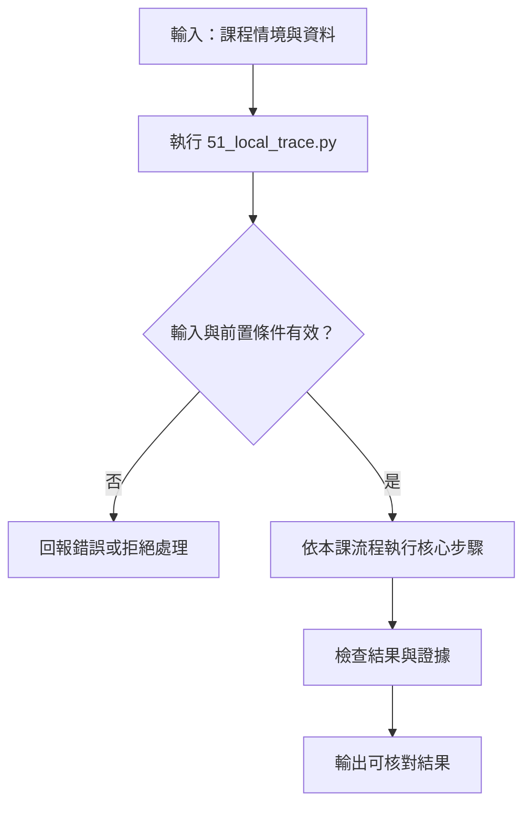

# Trace 觀測與本地免費備援

> **新版正文：20E07-E03-05｜對應新版 LLM 第 31 節：Trace 觀測與本地免費備援。**
> 流程出錯時，要能回答三件事：**錯在哪一步、時間花在哪裡、紀錄裡有沒有不該留下的個資**。本節用 Python 標準函式庫寫一個本地 tracer：每一步記一個 span，寫成 JSONL，再載入 SQLite 查詢。**不需要 LangSmith 帳號，也不上傳任何資料。**

[回 50 節課綱](https://hackmd.io/@yillkid/HJl8JXTNkl)

## 流程圖：Trace 觀測與本地免費備援



## 學習目標與時間

先修第 26 節（政策檢查）、第 29 節（重試與冪等）。課綱的先修還有第 15 節（成本）與第 30 節（HITL）；兩節都還沒寫，本節的流程改用**純 Python 的小流程**代替第 30 節的 LangGraph graph，token 數字是劇本給的。

| 時間 | 內容 |
| --- | --- |
| 0–8 分鐘 | trace、span、parent：一次請求如何拆成一棵樹 |
| 8–18 分鐘 | 每個 span 要記什麼：耗時、狀態、模型版本、token、分支原因、資料來源 |
| 18–28 分鐘 | 遮罩：只看欄位名稱為什麼不夠 |
| 28–35 分鐘 | 跑 Demo：JSONL → SQLite 查詢 |
| 35–50 分鐘 | Workshop：改故障劇本、找遮罩漏洞、拆掉 parent 看會發生什麼 |

驗收能力：交付一份**能定位拒絕與工具故障位置**的本地 trace，並證明紀錄裡沒有合成個資。

## 一、trace 與 span

一個使用者請求是一個 **trace**。trace 裡的每一步——檢索、生成、政策檢查、呼叫工具、每一次重試——各是一個 **span**。span 用 `parent_id` 指向它的上一層，整個 trace 因此是一棵樹：

```text
request (T3)
├── retrieve
├── generate          model=…@7ae5576…  prompt_tokens=455
├── policy            decision=allow
└── tool:create_ticket   idempotency_key=T3
    ├── attempt n=1   error=timeout
    ├── attempt n=2   error=timeout
    └── attempt n=3   error=timeout
```

每個 span 至少要有：

| 欄位 | 為什麼需要 |
| --- | --- |
| `trace_id`、`span_id`、`parent_id` | 把散落的紀錄拼回一棵樹 |
| `start_ms`、`end_ms` | 算耗時；父 span 扣掉子 span 就是它**自己**花的時間（self time） |
| `status` | `ok`／`denied`／`error`；查詢「哪裡出問題」靠這一欄 |
| 模型與 **revision** | 「上週還好好的」時，第一個要查的是模型有沒有換 |
| token 數 | 成本與延遲都跟它走（第 15、45 節） |
| 分支原因 | 被拒絕時記下**為什麼**，不是只記「拒絕」 |
| 資料來源 | 檢索命中哪些 chunk ID（第 19 節） |

## 二、LangSmith 與本地備援

LangSmith 是可選的雲端服務。用之前要先查**目前的方案與資料政策**：trace 會上傳到第三方，裡面可能有使用者輸入。本課**不承諾任何雲端服務永遠免費**，所以先做本地備援：JSONL 一行一個 span，任何工具都讀得懂；SQLite 是 Python 內建的，可以直接用 SQL 查詢。

本地備援也要遮罩：trace 檔案一樣會被複製、備份、貼到 Issue 裡。

## 三、可執行 Demo

流程：三個請求各走一次「檢索 → 生成（劇本）→ 政策檢查 → 工具（最多 3 次嘗試）」。

| 請求 | 角色 | 劇本 |
| --- | --- | --- |
| T1 | staff | 開單，一次成功；使用者文字裡留了電話 |
| T2 | staff | 要求通知工地，但 `notify_site` 只允許 manager → 拒絕 |
| T3 | manager | 開單，工具連續 3 次逾時；使用者文字裡留了 email |

<!-- demo: 51_local_trace.py -->
```python
"""第 31 節：Trace 觀測與本地免費備援（只用 Python 標準函式庫）。

一條小流程：檢索 → 生成（劇本）→ 政策檢查 → 工具（含重試）。
每一步記一個 span，寫成 JSONL，再載入 SQLite 查詢「錯在哪一步」。
不需要 LangSmith 帳號，也不上傳任何資料；時間由 FakeClock 決定，所以輸出可重現。
"""

import json
import re
import sqlite3
import tempfile
from pathlib import Path

MODEL = "Qwen/Qwen2.5-0.5B-Instruct@7ae557604adf67be50417f59c2c2f167def9a775"   # 第 05 節核准的 revision
PHONE = re.compile(r"09\d{2}-?\d{3}-?\d{3}")
EMAIL = re.compile(r"[\w.]+@[\w.]+\.\w+")
SENSITIVE_KEYS = {"phone", "email", "password", "token"}


class FakeClock:
    def __init__(self):
        self.now = 0

    def advance(self, ms):
        self.now += ms


class Tracer:
    def __init__(self, clock, mask, link_parent=True):
        self.clock, self.mask, self.link_parent = clock, mask, link_parent
        self.spans, self.stack, self.counter = [], [], 0

    def start(self, trace_id, name, **attrs):
        self.counter += 1
        parent = self.stack[-1]["span_id"] if self.stack and self.link_parent else None
        span = {"trace_id": trace_id, "span_id": f"s{self.counter:02d}", "parent_id": parent, "name": name,
                "start_ms": self.clock.now, "end_ms": None, "status": "ok", "attrs": self.mask(attrs)}
        self.stack.append(span)
        self.spans.append(span)
        return span

    def end(self, span, status="ok", **attrs):
        span["end_ms"], span["status"] = self.clock.now, status
        span["attrs"].update(self.mask(attrs))
        self.stack.remove(span)

    def jsonl(self):
        return "\n".join(json.dumps(s, ensure_ascii=False, sort_keys=True) for s in self.spans)


def mask_by_key(attrs):
    """第一版：只看欄位名稱。"""
    return {k: ("***" if k in SENSITIVE_KEYS else v) for k, v in attrs.items()}


def mask_by_value(attrs):
    """第二版：欄位名稱＋內容樣式。自由文字裡的電話、email 也要遮。"""
    out = {}
    for k, v in mask_by_key(attrs).items():
        if isinstance(v, str):
            v = EMAIL.sub("<email>", PHONE.sub("<phone>", v))
        out[k] = v
    return out


# ---- 流程 ----
POLICY = {"notify_site": {"roles": {"manager"}}, "create_ticket": {"roles": {"staff", "manager"}}}
SCRIPT = {   # 劇本模型：每個請求要呼叫哪個工具
    "T1": {"tool": "create_ticket", "prompt_tokens": 412, "completion_tokens": 38},
    "T2": {"tool": "notify_site", "prompt_tokens": 398, "completion_tokens": 41},
    "T3": {"tool": "create_ticket", "prompt_tokens": 455, "completion_tokens": 36},
}
TOOL_FAULTS = {"T3": ["timeout", "timeout", "timeout"]}
REQUESTS = (
    ("T1", "staff",   "A 區感測器離線，請開單。聯絡人 0912-345-678"),
    ("T2", "staff",   "請通知 B 工地停工"),
    ("T3", "manager", "C 區閘道器連不上，請開單，回覆寄 lin@example.com"),
)


def handle(tracer, clock, trace_id, role, text, phone="0912-345-678"):
    root = tracer.start(trace_id, "request", role=role, user_text=text, phone=phone)
    span = tracer.start(trace_id, "retrieve", top_k=3)
    clock.advance(35)
    tracer.end(span, hits=["C011", "C012"] if trace_id != "T2" else [])
    plan = SCRIPT[trace_id]
    span = tracer.start(trace_id, "generate", model=MODEL)
    clock.advance(900)
    tracer.end(span, prompt_tokens=plan["prompt_tokens"], completion_tokens=plan["completion_tokens"],
               tool_call=plan["tool"])
    span = tracer.start(trace_id, "policy", tool=plan["tool"], role=role)
    allowed = role in POLICY[plan["tool"]]["roles"]
    tracer.end(span, status="ok" if allowed else "denied", decision="allow" if allowed else "deny",
               reason="" if allowed else f"角色 {role} 不在 {sorted(POLICY[plan['tool']]['roles'])}")
    if not allowed:
        tracer.end(root, status="denied")
        return
    tool = tracer.start(trace_id, f"tool:{plan['tool']}", idempotency_key=trace_id)
    faults = list(TOOL_FAULTS.get(trace_id, []))
    for attempt in range(1, 4):
        span = tracer.start(trace_id, "attempt", n=attempt)
        clock.advance(2000 if faults else 120)
        if faults:
            faults.pop(0)
            tracer.end(span, status="error", error="timeout")
            if attempt < 3:                                # 最後一次失敗後不再退避
                clock.advance(500 * 2 ** (attempt - 1))   # 退避（第 29 節）
            continue
        tracer.end(span)
        tracer.end(tool, attempts=attempt)
        tracer.end(root)
        return
    tracer.end(tool, status="error", attempts=3)
    tracer.end(root, status="error")


def run(mask, link_parent=True):
    clock = FakeClock()
    tracer = Tracer(clock, mask, link_parent)
    for trace_id, role, text in REQUESTS:
        handle(tracer, clock, trace_id, role, text)
    return tracer


def leaks(jsonl):
    return sorted(set(PHONE.findall(jsonl) + EMAIL.findall(jsonl)))


def orphans(spans):
    roots = [s for s in spans if s["parent_id"] is None]
    return sum(1 for s in roots if s["name"] != "request")


def load_sqlite(jsonl):
    db = sqlite3.connect(":memory:")
    db.execute("CREATE TABLE span (trace_id, span_id, parent_id, name, start_ms, end_ms, status, attrs)")
    for line in jsonl.splitlines():
        s = json.loads(line)
        db.execute("INSERT INTO span VALUES (?,?,?,?,?,?,?,?)",
                   (s["trace_id"], s["span_id"], s["parent_id"], s["name"], s["start_ms"], s["end_ms"],
                    s["status"], json.dumps(s["attrs"], ensure_ascii=False)))
    return db


def main():
    print(f"模型 {MODEL.split('@')[0]}（劇本，非真實推論）｜時間由 FakeClock 決定")
    print()

    print("=== 一、遮罩：只看欄位名稱 vs 也看內容 ===")
    for label, mask in (("只看欄位名稱", mask_by_key), ("名稱＋內容樣式", mask_by_value)):
        tracer = run(mask)
        print(f"  {label:<8} span {len(tracer.spans)} 個｜JSONL 中仍可見的個資：{leaks(tracer.jsonl()) or '無'}")
    print("  phone 欄位兩版都遮了；漏的是使用者在自由文字裡寫的電話與 email。")
    print()

    print("=== 二、父子關係：忘了傳 parent ===")
    for label, link in (("沒傳 parent", False), ("有傳 parent", True)):
        spans = run(mask_by_value, link_parent=link).spans
        print(f"  {label}：根 span {sum(1 for s in spans if s['parent_id'] is None)} 個，其中不是 request 的孤兒 {orphans(spans)} 個")
    print("  孤兒 span 不知道屬於哪一步，失敗的 attempt 看不出是哪個工具、哪次請求。")
    print()

    tracer = run(mask_by_value)
    with tempfile.TemporaryDirectory() as tmp:            # 教學示範：寫到暫存目錄，結束即刪
        out = Path(tmp) / "trace.jsonl"
        out.write_text(tracer.jsonl() + "\n", encoding="utf-8")
        db = load_sqlite(out.read_text(encoding="utf-8"))
    print(f"=== 三、寫成 {out.name}（{len(tracer.spans)} 行），載入 SQLite（{sqlite3.sqlite_version}）查詢 ===")
    print("  每個 trace 的結果，與最早出問題的 span：")
    for trace_id, status in db.execute("SELECT trace_id, status FROM span WHERE name='request' ORDER BY trace_id"):
        # 最早出問題、且底下沒有出問題子 span 的那一個：失敗的源頭，不是一路往上傳的外層
        first = db.execute("""SELECT s.span_id, s.name, s.status, s.attrs, p.name FROM span s
                              LEFT JOIN span p ON p.span_id = s.parent_id
                              WHERE s.trace_id=? AND s.status!='ok' AND NOT EXISTS
                                (SELECT 1 FROM span c WHERE c.parent_id=s.span_id AND c.status!='ok')
                              ORDER BY s.start_ms, s.span_id LIMIT 1""", (trace_id,)).fetchone()
        if first is None:
            where = "—"
        else:
            attrs = json.loads(first[3])
            where = f"{first[0]} {first[4]} › {first[1]}（{first[2]}）{attrs.get('reason') or attrs.get('error', '')}"
        total = db.execute("SELECT end_ms-start_ms FROM span WHERE trace_id=? AND name='request'", (trace_id,)).fetchone()[0]
        print(f"    {trace_id} {status:<7} {total:>5} ms｜{where}")
    print()
    print("  T3 的時間花在哪裡（self time＝自己的時間扣掉子 span）：")
    rows = db.execute("""SELECT p.name, p.span_id, (p.end_ms-p.start_ms) -
                                COALESCE((SELECT SUM(c.end_ms-c.start_ms) FROM span c WHERE c.parent_id=p.span_id), 0)
                         FROM span p WHERE p.trace_id='T3' ORDER BY 3 DESC, p.span_id""").fetchall()
    for name, span_id, self_ms in rows:
        print(f"    {span_id} {name:<20} {self_ms:>5} ms")
    tokens = db.execute("""SELECT SUM(json_extract(attrs,'$.prompt_tokens')), SUM(json_extract(attrs,'$.completion_tokens'))
                           FROM span WHERE name='generate'""").fetchone()
    print(f"  三個請求的 token：prompt {tokens[0]}、completion {tokens[1]}（劇本數字，不是實際計量）")


if __name__ == "__main__":
    main()
```

執行指令（在 [`llm-demo`](https://github.com/4-learn/llm-demo) 目錄下；**不需要網路、不需要模型、不需要任何套件**；JSONL 寫在暫存目錄，結束即刪）：

```bash
python3 51_local_trace.py
```

關鍵輸出（Linux／Python 3.10.15，20E07-E03-05）：

```text
模型 Qwen/Qwen2.5-0.5B-Instruct（劇本，非真實推論）｜時間由 FakeClock 決定

=== 一、遮罩：只看欄位名稱 vs 也看內容 ===
  只看欄位名稱   span 18 個｜JSONL 中仍可見的個資：['0912-345-678', 'lin@example.com']
  名稱＋內容樣式  span 18 個｜JSONL 中仍可見的個資：無
  phone 欄位兩版都遮了；漏的是使用者在自由文字裡寫的電話與 email。

=== 二、父子關係：忘了傳 parent ===
  沒傳 parent：根 span 18 個，其中不是 request 的孤兒 15 個
  有傳 parent：根 span 3 個，其中不是 request 的孤兒 0 個
  孤兒 span 不知道屬於哪一步，失敗的 attempt 看不出是哪個工具、哪次請求。

=== 三、寫成 trace.jsonl（18 行），載入 SQLite（3.31.1）查詢 ===
  每個 trace 的結果，與最早出問題的 span：
    T1 ok       1055 ms｜—
    T2 denied    935 ms｜s10 request › policy（denied）角色 staff 不在 ['manager']
    T3 error    8435 ms｜s16 tool:create_ticket › attempt（error）timeout

  T3 的時間花在哪裡（self time＝自己的時間扣掉子 span）：
    s16 attempt               2000 ms
    s17 attempt               2000 ms
    s18 attempt               2000 ms
    s15 tool:create_ticket    1500 ms
    s13 generate               900 ms
    s12 retrieve                35 ms
    s11 request                  0 ms
    s14 policy                   0 ms
  三個請求的 token：prompt 1265、completion 115（劇本數字，不是實際計量）
```

## 四、結果怎麼讀

### 1. 遮罩：欄位名稱擋不住自由文字

兩版遮罩都把 `phone` 欄位換成 `***`。但第一版只看欄位名稱，使用者在 `user_text` 裡自己寫的 `0912-345-678` 和 `lin@example.com` 原樣進了 JSONL。**個資最常出現的地方是自由文字**，不是名為 `phone` 的欄位。第二版再用樣式（電話、email 的 regex）掃一次字串內容才擋住。

樣式只擋得住**你寫了樣式**的東西。Workshop 第 2 題會看到身分證字號照樣漏出去。

### 2. 父子關係：少傳一個 parent，trace 就散了

沒傳 `parent_id` 時，18 個 span 全都變成根，其中 15 個是孤兒：你看得到 3 個逾時的 attempt，卻不知道它們是哪一次請求、哪一個工具的重試。有傳 parent 時只有 3 個根，正好是 3 個請求。

### 3. 「最早出問題」要找源頭，不是外層

T3 的 `request`、`tool:create_ticket`、`attempt` 三層都是 error。查詢條件是「狀態不是 ok，**而且底下沒有出問題的子 span**」，這樣找到的是 `attempt`（逾時）這個源頭，而不是一路往上傳的外層。T2 的源頭是 `policy`（denied），原因欄寫著「角色 staff 不在 ['manager']」——**拒絕要記原因**，否則 trace 只能告訴你「被拒絕」。

### 4. self time：時間花在哪裡

T3 總共 8,435 ms。三次 attempt 各 2,000 ms，`tool:create_ticket` 自己的 1,500 ms 是兩次退避（500＋1,000）——**最後一次失敗之後不再退避**。生成 900 ms 只占一成多。如果只看總時間，很容易以為是模型太慢。

時間都是 `FakeClock` 推進的劇本數字，目的是讓輸出可重現；**不是**本機效能實測。

## 五、常見誤判

| 誤判 | 為什麼錯 |
| --- | --- |
| 「遮了 phone／password 欄位就安全」 | 使用者會把電話寫在自由文字裡 |
| 「regex 遮罩可以擋住所有個資」 | 只擋得住寫了樣式的類型；要搭配「不記錄原文」的選項 |
| 「每一步都有記錄，就能追」 | 少了 parent_id 就拼不回樹；孤兒 span 看不出屬於誰 |
| 「最早的 error 就是源頭」 | 外層會跟著變 error；要找底下沒有出問題子 span 的那一個 |
| 「總時間長 = 模型慢」 | 要看 self time；本例是工具逾時與退避 |
| 「拒絕記 status 就夠了」 | 沒有原因，事後無法判斷是政策對、還是政策錯 |
| 「LangSmith 免費，直接用」 | 方案與資料政策會變；trace 裡有使用者輸入，要先查 |

## Workshop：改故障劇本、找遮罩漏洞

### 任務

以下每題都**重新載入原始程式**後單獨修改，不要累積前一題的修改。

1. 把 `TOOL_FAULTS["T3"]` 改成只逾時 2 次。T3 的狀態與總時間變成多少？「最早出問題」的查詢結果會變嗎？為什麼這是對的？
2. 新增一個請求 T4，使用者文字是「我的身分證 A123456789，請開單」。用第二版遮罩跑，JSONL 裡看得到身分證字號嗎？你會怎麼修？
3. 用 `link_parent=False` 跑，再對 T3 算 self time。`request` 和 `tool:create_ticket` 的 self time 各是多少？為什麼和正確版不同？
4. 列出 trace 裡所有 attrs 欄位。哪些欄位即使遮罩了也**不應該**記錄？
5. 寫一份 trace 檢核報告：遮罩規則、測過的個資類型、孤兒 span 數、兩個失敗案例各自的源頭 span。

### 參考判讀

以下每一題都是**重新載入程式後**單獨修改、實際執行的結果。

- 第 1 題：T3 變成 **ok**、**6,555 ms**。「最早出問題」仍然找到 `s16 tool:create_ticket › attempt（error）timeout`：請求最後成功了，但中間兩次逾時是真的發生過的。**最終成功不代表過程沒問題**，trace 要保留這些重試。
- 第 2 題：**看得到**。第二版只認電話和 email 的樣式，身分證字號不在其中。補一條身分證樣式只是一種修法；更根本的做法是**不把 `user_text` 原文寫進 trace**，只記長度或雜湊。
- 第 3 題：`request` 是 **8,435 ms**、`tool:create_ticket` 是 **7,500 ms**（正確版分別是 0 與 1,500）。沒有 parent 時，沒有任何子 span 可以扣，self time 就等於總時間，看起來好像「request 自己很慢」。
- 第 4 題：共 16 個欄位。`user_text` 即使遮罩過仍然是使用者原文；`phone` 本來就不需要記錄。其他欄位的判斷沒有標準答案，要寫出理由。
- 第 5 題：沒有標準答案。

### 驗收

- 交付本地 trace（JSONL）與至少兩條 SQLite 查詢：找出每個失敗的源頭 span、算出 self time。
- 一次拒絕與一次工具失敗都能定位到具體 span，並有原因。
- 列出測過的個資類型與結果；至少一種類型是第一版遮罩漏掉、第二版擋住的。
- 孤兒 span 為 0。
- 不需要 LangSmith 帳號，也不上傳資料。

## 教師紀錄與下一步

- 本節**不需要模型、網路或任何套件**。生成是劇本、時間是 `FakeClock`、token 是劇本數字。證據等級：**本機實測（trace 結構、遮罩與查詢）**；延遲與 token **不是**效能實測。
- 課綱寫的是「為 29 流程接入 logger」。第 30 節（LangGraph HITL）還要等安裝政策，本節先用純 Python 的小流程代替；第 30 節完成後要回頭換成真正的 graph，並驗證 resume 時 span 會不會重複。
- 撰寫時的實際紀錄：① 第一版政策拒絕時 span 的 status 仍是 `ok`，只有 `decision=deny`，查詢必須特例處理；改為 status `denied`。② 第一版「最早出問題」直接取時間最早的 error，T3 找到的是外層 `tool:create_ticket`，不是逾時的 attempt；改為「底下沒有出問題子 span」。③ 第一版在最後一次失敗後仍然退避，T3 多算了 2,000 ms（10,435 → 8,435）。④ 第一版把 trace.jsonl 寫在目前目錄再刪除；改為寫在暫存目錄。⑤ token 註解原本寫「見第 15 節的實際計價」，但第 15 節尚未撰寫；改成「不是實際計量」。
- 下一步：第 39 節（單／多 Agent 比較）要用同一種 trace 計算呼叫數與延遲。
