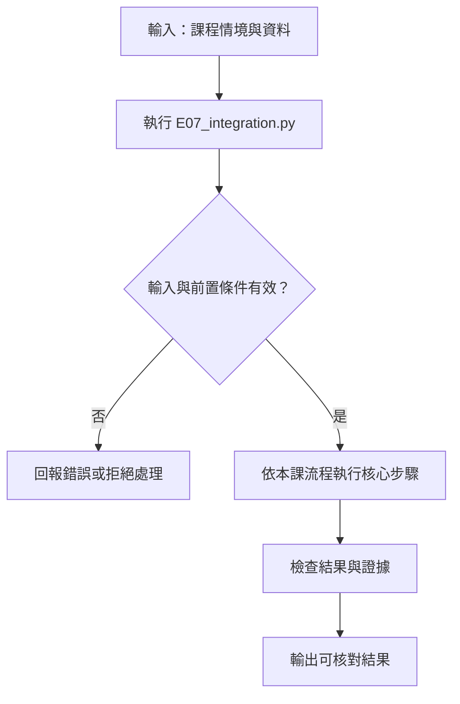
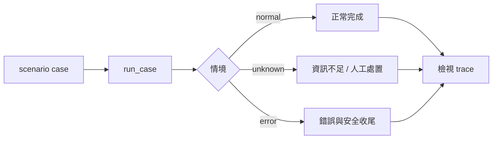

# 流程里程碑：沿用骨架整合

> **新版正文：20E07-E03-06｜對應新版 LLM 第 35 節：流程里程碑：沿用骨架整合。**
> 前面八節各自做好了一塊：引用驗證、副作用政策、重試與冪等、trace、分支、HITL。各自的測試都通過，不代表接在一起還對。核心主張：**里程碑不是重寫，而是直接載入前面各節的程式接成一條流程，用固定案例證明「正常、unknown、拒絕、工具失敗」四類都走對、拒絕時副作用為零、失敗也留下紀錄，並誠實列出還沒涵蓋的風險。**

[回 51 節必修＋9 節選修課綱](https://hackmd.io/@yillkid/HJl8JXTNkl)

## 流程圖：流程里程碑：沿用骨架整合



## 學習目標與時間

先修第 16、24–31 節，課前已完成各節產物。

| 時間 | 內容 |
| --- | --- |
| 0–10 分鐘 | 資料流：題目 → RAG 引用 → 分支 → 政策／人工 → 工具 → trace |
| 10–20 分鐘 | 介面斷點：各節的程式在哪裡交接 |
| 20–35 分鐘 | 跑 Demo：9 個整合案例與四項檢查 |
| 35–50 分鐘 | Workshop：修一個接線問題、記錄阻塞 |

驗收能力：交出整合測試摘要、**拒絕零副作用**證據與待辦清單。成果不等於工安認證。

## 一、整合不是重寫

本節的程式**沒有複製**任何前面節次的邏輯，而是用 `lesson("24")` 直接載入：

| 節次 | 沿用什麼 | 在流程裡的位置 |
| --- | --- | --- |
| 24 | `handle`、`verify`、劇本生成、檢索索引 | `rag` 節點 |
| 26 | `decide`、`call`、`Sandbox` | `act` 的權限檢查、`ask` 的政策判斷、`notify` |
| 29 | `TicketService`（含故障劇本）、`with_retry` | `act` 的開單 |
| 31 | `Tracer`、`mask_by_value`、`leaks` | 每個節點的 span |
| 27、28、30 | state、conditional edges、`interrupt` | graph 本身 |

好處：前面某節修了 bug，整合測試立刻跟著用到新版。代價：前面某節改了函式名稱或回傳格式，這裡會壞——**這正是整合測試要抓的事**。

`lesson()` 先找同資料夾的 `NN_*.py`（llm-demo repo），找不到再從講義 `NN-*.md` 抽出程式，所以在 llm-demo 和教材目錄都能跑。

## 二、資料流與介面斷點

```text
題目 ─► rag（第 24 節）──回覆?──┬─ create_ticket ─► act：權限（26）→ 重試＋冪等開單（29）
                               │
                               └─ notify_site ───► ask：政策（26）→ 拒絕 → stop
                                                              └→ 待核准 → interrupt（30）→ approve → notify
       └─ 查無／衝突／驗證失敗／檢索故障 ─► review（人工）
每一步都寫 span（第 31 節），遮罩後才寫出
```

接線時要確認的三個斷點：

1. **處置是字串**：第 24 節回傳「回覆（附引用）」這類中文處置。本節以 `startswith("回覆")` 判斷，等於把文案當成介面。改一個字就會整批轉人工——比起放行還算安全，但應該改成結構化欄位。
2. **冪等鍵由誰產生**：第 29 節的 `TicketService` 認 key，本節用 `案件代號:動作`。同一案件跑兩次只會開一張單。
3. **trace 是否涵蓋每條結束路徑**：Workshop 會看到它沒有。

## 三、可執行 Demo

### Session 1：整合圖與跨課節點接線

**系統層：沿用課程模組串起整合圖**

```mermaid
flowchart LR
    A[輸入案件] --> B[build(world, script_case)]
    B --> C[LangGraph 整合流程]
    C --> D[課程模組：RAG / policy / retry / trace]
    D --> E[結果與節點紀錄]
```

**函式內部：`build` 建圖並注入依賴**

```mermaid
flowchart TD
    A[build(world, script_case)] --> B[設定節點與 state]
    B --> C[連接正常路徑]
    C --> D[連接 unknown / error 分支]
    D --> E[編譯 graph]
    E --> F[回傳可執行 graph]
```

### Session 2：正常、unknown 與錯誤結果觀察

**系統層：三類情境經同一整合入口**



**函式內部：`run_case` 執行並收集結果**

```mermaid
flowchart TD
    A[run_case(case, unmasked)] --> B[建立 World]
    B --> C[build]
    C --> D[invoke graph]
    D --> E[擷取 final state]
    E --> F[回傳結果供 main 報告]
```

需要 `langgraph==1.2.12`，不需要模型；語料讀 MariaDB 課的 `data/sop_corpus.json` 與 `data/search_cases.json`（同第 24 節）。

<!-- demo: E07_integration.py -->
```python
"""第 32 節：流程里程碑——沿用骨架整合。

不重寫任何東西：直接載入第 23（RAG 引用）、25（副作用政策）、28（重試與冪等）、
30（trace 與遮罩）節的程式，用第 27–30 節的 LangGraph 寫法接成一條流程，
跑「正常、unknown、拒絕、工具失敗」四類整合案例。
需要 langgraph==1.2.12；不需要模型（生成沿用第 24 節的劇本）。
"""
import re
import types
from pathlib import Path
from typing import Optional, TypedDict

from langgraph.checkpoint.memory import InMemorySaver
from langgraph.graph import END, START, StateGraph
from langgraph.types import Command, interrupt

HERE = Path(__file__).resolve().parent


def lesson(nn):
    """先找 llm-demo 裡的 NN_*.py；找不到就從講義 NN-*.md 抽出內嵌程式。

    兩種都是讀原始碼後 exec，不用 import：import 會在資料夾裡留下 __pycache__。
    """
    found = [(p, p.read_text(encoding="utf-8")) for p in sorted(HERE.glob(f"{nn}_*.py"))]
    for md in sorted(HERE.glob(f"{nn}-*.md")):
        found += [(md, src) for _, src in re.findall(r"<!-- demo: ([\w.]+) -->\n```python\n(.*?)\n```",
                                                     md.read_text(encoding="utf-8"), re.S)]
    if not found:
        raise FileNotFoundError(f"找不到第 {nn} 節的程式（{nn}_*.py 或 {nn}-*.md）")
    path, source = found[0]
    module = types.ModuleType(f"lesson{nn}")
    module.__file__ = str(path)
    exec(compile(source, path.name, "exec"), module.__dict__)
    return module


RAG, POLICY, RETRY, TRACE = lesson("27"), lesson("29"), lesson("32"), lesson("34")


class State(TypedDict, total=False):
    case_id: str
    role: str
    action: str                 # 通過 RAG 後要做的事：create_ticket 或 notify_site
    qid: str
    disposition: str
    route: str
    answer: Optional[str]
    result: str


# --- 共用環境：一次整合測試一份 -------------------------------------------------------

class World:
    def __init__(self, ticket_failures=(), unmasked=False):
        corpus = RAG.load("sop_corpus.json")
        self.corpus = dict(corpus, documents=corpus["documents"] + RAG.EXTRA_DOCS)
        self.index = RAG.LexicalIndex(corpus["chunks"] + RAG.EXTRA_CHUNKS)
        self.cases = {c["case_id"]: c for c in RAG.load("search_cases.json")["cases"]}
        self.generator = RAG.ScriptedGenerator(RAG.SCRIPT)
        self.sandbox = POLICY.Sandbox()                         # 通知寫在這裡
        self.tickets = RETRY.TicketService(list(ticket_failures))   # 開單走這裡（含故障劇本）
        self.clock = TRACE.FakeClock()
        self.tracer = TRACE.Tracer(self.clock, (lambda a: dict(a)) if unmasked else TRACE.mask_by_value)

    def side_effects(self):
        return len(self.tickets.tickets) + len(self.sandbox.notifications)


def build(world, script_case=None):
    tracer, clock = world.tracer, world.clock

    def rag(state):
        span = tracer.start(state["case_id"], "rag", qid=state["qid"])
        case = dict(world.cases[state["qid"]], case_id=script_case or state["case_id"])
        out = RAG.handle(case, world.corpus, world.index, world.generator)
        clock.advance(900)
        tracer.end(span, disposition=out["處置"], context=out["上下文"])
        return {"disposition": out["處置"]}

    def route(state):
        if state["disposition"].startswith("回覆"):
            return "act" if state["action"] == "create_ticket" else "ask"
        return "review"                                      # 查無、衝突、驗證失敗、檢索故障：一律人工

    def act(state):
        span = tracer.start(state["case_id"], "tool:create_ticket", role=state["role"])
        verdict, reason = POLICY.decide("create_ticket", {"site": "A", "priority": "low"}, state["role"])
        if verdict != "執行":
            tracer.end(span, status="denied", reason=reason)
            return {"result": f"未開單（{reason}）"}
        key = f"{state['case_id']}:create_ticket"           # 冪等鍵：同一案件只開一張
        ticket, log = RETRY.with_retry(lambda: world.tickets.create("A", key), 3, RETRY.FakeClock())
        clock.advance(120 * len(log))
        tracer.end(span, status="ok" if ticket else "error", attempts=len(log), last=log[-1])
        return {"result": f"已開單 {ticket['id']}" if ticket else f"開單失敗（{log[-1]}）→ 轉人工"}

    def ask(state):
        verdict, reason = POLICY.decide("notify_site", {"site": "A", "message": "停工"}, state["role"])
        if verdict == "拒絕":
            tracer.start(state["case_id"], "policy", decision="deny")
            tracer.end(tracer.stack[-1], status="denied", reason=reason)
            return {"answer": "denied_by_policy"}
        answer = interrupt({"case_id": state["case_id"], "action": "notify_site", "reason": reason})
        return {"answer": answer}

    def after_ask(state):
        return "notify" if state["answer"] == "approve" else "stop"

    def notify(state):
        span = tracer.start(state["case_id"], "tool:notify_site", approved=True)
        verdict, reason, _ = POLICY.call(world.sandbox, "notify_site",
                                         {"site": "A", "message": f"{state['case_id']} 停工"}, state["role"], approved=True)
        tracer.end(span, decision=verdict)
        return {"result": "已通知工地"}

    def stop(state):
        why = "政策拒絕" if state["answer"] == "denied_by_policy" else "人工拒絕"
        return {"result": f"未通知（{why}）"}

    def review(state):
        span = tracer.start(state["case_id"], "review_queue")
        tracer.end(span, status="needs_review")
        return {"result": "轉人工覆核"}

    graph = StateGraph(State)
    for name, fn in (("rag", rag), ("act", act), ("ask", ask), ("notify", notify), ("stop", stop), ("review", review)):
        graph.add_node(name, fn)
    graph.add_edge(START, "rag")
    graph.add_conditional_edges("rag", route, {"act": "act", "ask": "ask", "review": "review"})
    graph.add_conditional_edges("ask", after_ask, {"notify": "notify", "stop": "stop"})
    for name in ("act", "notify", "stop", "review"):
        graph.add_edge(name, END)
    return graph.compile(checkpointer=InMemorySaver())


# 整合案例：(代號, 類別, 角色, 動作, 題目, 借用第 24 節哪一個劇本, 人工回答, 開單故障, 預期結果, 預期副作用數)
CASES = (
    ("I-OK",     "正常",     "staff",   "create_ticket", "Q02", "A1", None,      (),                             "已開單 T1",       1),
    ("I-RETRY",  "正常",     "staff",   "create_ticket", "Q02", "A1", None,      ("timeout_after_write",),       "已開單 T1",       1),
    ("I-UNK",    "unknown",  "staff",   "create_ticket", "Q05", "N1", None,      (),                             "轉人工覆核",      0),
    ("I-BADCIT", "unknown",  "staff",   "create_ticket", "Q02", "A2", None,      (),                             "轉人工覆核",      0),
    ("I-REJ",    "拒絕",     "manager", "notify_site",   "Q02", "A1", "reject",  (),                             "未通知（人工拒絕）", 0),
    ("I-DENY",   "拒絕",     "staff",   "notify_site",   "Q02", "A1", None,      (),                             "未通知（政策拒絕）", 0),
    ("I-APPR",   "正常",     "manager", "notify_site",   "Q02", "A1", "approve", (),                             "已通知工地",      1),
    ("I-FAIL",   "工具失敗", "staff",   "create_ticket", "Q02", "A1", None,      ("rate_limited",) * 3,          "開單失敗",        0),
    ("I-AUTH",   "工具失敗", "staff",   "create_ticket", "Q02", "A1", None,      ("unauthorized",),              "開單失敗",        0),
)


def run_case(case, unmasked=False):
    case_id, _, role, action, qid, script, answer, faults, _, _ = case
    world = World(faults, unmasked)
    app = build(world, script)
    config = {"configurable": {"thread_id": case_id}}
    out = app.invoke({"case_id": case_id, "role": role, "action": action, "qid": qid}, config)
    if "__interrupt__" in out:
        out = app.invoke(Command(resume=answer), config)
    return out, world


def main():
    import importlib.metadata as metadata
    print("langgraph:", metadata.version("langgraph"), "｜ 沿用：第 24、26、29、31 節程式；生成為第 24 節劇本")

    print("\n== 一、整合案例 ==")
    print(f"{'代號':<9} {'類別':<5} {'結果':<38} 副作用 trace 狀態")
    passed = 0
    for case in CASES:
        out, world = run_case(case)
        expected, effects = case[8], case[9]
        ok = out["result"].startswith(expected) and world.side_effects() == effects
        passed += ok
        statuses = ",".join(f"{s['name']}={s['status']}" for s in world.tracer.spans)
        print(f"{case[0]:<9} {case[1]:<5} {out['result']:<38} {world.side_effects()}   {statuses}{'' if ok else '  ← 不符'}")
    print(f"通過 {passed}／{len(CASES)}")

    print("\n== 二、拒絕零副作用 ==")
    for case in CASES:
        if case[1] == "拒絕":
            out, world = run_case(case)
            print(f"{case[0]}: 通知 {len(world.sandbox.notifications)}、開單 {len(world.tickets.tickets)}、"
                  f"沙盒寫入紀錄 {world.sandbox.writes}")

    print("\n== 三、失敗也看得到 ==")
    for case_id in ("I-RETRY", "I-FAIL", "I-AUTH"):
        out, world = run_case(next(c for c in CASES if c[0] == case_id))
        span = next(s for s in world.tracer.spans if s["name"] == "tool:create_ticket")
        print(f"{case_id}: status={span['status']} attempts={span['attrs']['attempts']} last={span['attrs']['last']}")

    print("\n== 四、介面斷點：沒有遮罩的 trace ==")
    case = ("I-PII", "正常", "staff", "create_ticket", "Q02", "A1", None, (), "已開單", 1)
    for unmasked in (False, True):
        world = World((), unmasked)
        app = build(world, "A1")
        app.invoke({"case_id": "I-PII", "role": "staff", "action": "create_ticket", "qid": "Q02"},
                   {"configurable": {"thread_id": "I-PII"}})
        span = world.tracer.start("I-PII", "note", text="回報人 09E02-3E09-678")
        world.tracer.end(span)
        print(f"{'不遮罩' if unmasked else '遮罩'}: trace 中的個資 {TRACE.leaks(world.tracer.jsonl()) or '無'}")

    print("\n== 五、尚未涵蓋（不是工安認證）==")
    for gap in ("生成是劇本，未接真實模型；第 24 節 N2 的否定句誤引仍會通過驗證",
                "checkpoint 用 InMemorySaver；跨程序恢復見第 30 節，尚未接進本流程",
                "開單與通知是沙盒，未接真實系統；權限只有兩種角色",
                "SOP 為虛構教學資料，未對照正式法規來源與版本"):
        print("-", gap)


if __name__ == "__main__":
    main()
```

執行（程式也放在 [llm-demo](https://github.com/4-learn/llm-demo)，需和 `E07_*.py`、`51_*.py`、`51_*.py`、`E08_*.py` 放在同一資料夾）：

```bash
python E07_integration.py
```

關鍵輸出（Linux x86_64／Python 3.10.15，langgraph 1.2.12，20E07-E03-06）：

```text
langgraph: 1.2.12 ｜ 沿用：第 24、26、29、31 節程式；生成為第 24 節劇本

== 一、整合案例 ==
代號        類別    結果                                     副作用 trace 狀態
I-OK      正常    已開單 T1                                 1   rag=ok,tool:create_ticket=ok
I-RETRY   正常    已開單 T1                                 1   rag=ok,tool:create_ticket=ok
I-UNK     unknown 轉人工覆核                                  0   rag=ok,review_queue=needs_review
I-BADCIT  unknown 轉人工覆核                                  0   rag=ok,review_queue=needs_review
I-REJ     拒絕    未通知（人工拒絕）                              0   rag=ok
I-DENY    拒絕    未通知（政策拒絕）                              0   rag=ok,policy=denied
I-APPR    正常    已通知工地                                  1   rag=ok,tool:notify_site=ok
I-FAIL    工具失敗  開單失敗（第 3 次：429 限流 → 預算用完，放棄）→ 轉人工      0   rag=ok,tool:create_ticket=error
I-AUTH    工具失敗  開單失敗（第 1 次：401 未授權 → 永久錯誤，不重試）→ 轉人工    0   rag=ok,tool:create_ticket=error
通過 9／9

== 二、拒絕零副作用 ==
I-REJ: 通知 0、開單 0、沙盒寫入紀錄 []
I-DENY: 通知 0、開單 0、沙盒寫入紀錄 []

== 三、失敗也看得到 ==
I-RETRY: status=ok attempts=2 last=第 2 次：成功
I-FAIL: status=error attempts=3 last=第 3 次：429 限流 → 預算用完，放棄
I-AUTH: status=error attempts=1 last=第 1 次：401 未授權 → 永久錯誤，不重試

== 四、介面斷點：沒有遮罩的 trace ==
遮罩: trace 中的個資 無
不遮罩: trace 中的個資 ['09E02-3E09-678']

== 五、尚未涵蓋（不是工安認證）==
- 生成是劇本，未接真實模型；第 24 節 N2 的否定句誤引仍會通過驗證
- checkpoint 用 InMemorySaver；跨程序恢復見第 30 節，尚未接進本流程
- 開單與通知是沙盒，未接真實系統；權限只有兩種角色
- SOP 為虛構教學資料，未對照正式法規來源與版本
```

## 四、結果怎麼讀

### 1. 四類案例都走對

9 個案例全部符合預期結果與副作用數。重點不是「通過 9／9」，而是每個案例都**同時**檢查結果文字與副作用數：只看文字，會漏掉「說沒寄、其實寄了」。

- I-RETRY：第一次開單逾時、但寫入其實完成（第 29 節的 `timeout_after_write`）；重試時冪等鍵擋下重複，只有 1 張單。
- I-UNK、I-BADCIT：第 24 節判斷查無答案或引文是編的，流程都走人工覆核，沒有開單。

### 2. 拒絕零副作用

I-REJ（人工拒絕）與 I-DENY（政策拒絕）：通知 0、開單 0、沙盒寫入紀錄空的。這是本節的核心驗收。

### 3. 失敗也看得到

工具失敗的 span 狀態是 `error`，並記下嘗試次數與最後一次的原因：限流重試 3 次後放棄、401 不重試。I-RETRY 的 span 是 `ok`，但 `attempts=2`——**成功的 trace 也要看次數**，否則看不到系統其實在重試。

### 4. 介面斷點：遮罩

把第 31 節的遮罩拿掉，trace 裡就出現電話號碼。遮罩是接線時最容易漏掉的一環：每個節點自己記 span，只要有一處沒走遮罩就會外洩。

### 5. 尚未涵蓋

第五段列出的四項不是謙虛，是**交付的一部分**：這條流程證明的是接線正確，不是答案正確、也不是工安合規。

## 五、常見誤判

| 說法 | 為什麼不對 |
| --- | --- |
| 「各節測試都過了，整合就沒問題」 | 介面（字串處置、冪等鍵、遮罩）只有接起來才會壞 |
| 「整合就是把程式複製到一個檔案」 | 複製後前面節次的修正不會跟上；要直接沿用 |
| 「只看結果文字就好」 | 要同時檢查副作用數，文字和實際行為可能不一致 |
| 「成功的案例不用看 trace」 | 成功但重試了 2 次，是系統不穩的早期訊號 |
| 「9／9 通過，可以上線」 | 生成是劇本、工具是沙盒、SOP 是虛構的；這是接線驗收，不是工安認證 |

## Workshop：修一個接線問題、記錄阻塞

### 任務

1. 看第一段 I-REJ 的 trace 狀態，只有 `rag=ok`。如果明天有人問「這份通報為什麼沒通知？」，trace 能回答嗎？修改 `stop` 節點，讓兩種拒絕都留下 span，並寫出拒絕原因。
2. 有人想在 `ask` 節點的 `interrupt()` **之前**加一個 `ask=waiting` 的 span，表示「正在等人」。加上後跑 I-REJ 與 I-APPR，trace 有什麼問題？回想第 30 節，說明原因。
3. 新增案例：題目 `Q03`、借用第 24 節劇本 `N2`、員工開單。預期應該怎樣？實際怎樣？這是哪一節的問題，該在這裡修嗎？
4. 同一個 `World` 裡，用兩個不同的 thread ID 各跑一次 I-OK，會開幾張單？為什麼？
5. 寫一份待辦清單：本流程上線前還缺什麼？每項標明是「可以在課程內完成」或「需要外部決定」。

### 參考判讀

以下為備課機實跑（20E07-E03-06）：

- 第 1 題：修改前 I-REJ 只有 `rag=ok`，看不出流程走到哪裡。在 `stop` 加上 `tracer.start(..., "stop", answer=...)`／`tracer.end(span, status="rejected", reason=why)` 後：I-REJ 是 `rag=ok, stop=rejected`，I-DENY 是 `rag=ok, policy=denied, stop=rejected`。
- 第 2 題：I-REJ 變成 `rag=ok, ask=waiting, ask=waiting`，I-APPR 也出現兩個 `ask=waiting`。resume 會從 `ask` 節點開頭重跑（第 30 節），`interrupt()` 之前的程式會跑兩次。trace 也是副作用，同樣要放在 interrupt 之後，或用冪等鍵去重。
- 第 3 題：Q03 沒有支援 5 GHz 的答案，應該轉人工；實際結果是**「已開單 T1」、副作用 1**。第 24 節的驗證器只檢查引文是否逐字存在，否定句「不支援 5 GHz」被當成證據（第 24 節已列為已知限制）。整合測試抓到了它，但修正應該回到第 24 節（例如評測題與人工抽查），而不是在整合層加特例。把它寫進待辦清單。
- 第 4 題：只開 **1 張**。冪等鍵是 `案件代號:動作`，與 thread ID 無關，所以換 thread 重跑也不會重複開單。
- 第 5 題：參考第五段的四項。至少要有：真實模型的評測結果（第 08 節）、跨程序 checkpoint（第 30 節，課程內可完成）、真實工具與權限（需要外部決定）、正式法規來源與版本（需要業界顧問）。

### 驗收

- 交整合測試摘要（第一段的表格）與拒絕零副作用證據（第二段）。
- 交第 1 題修好後的 trace，以及第 3 題的阻塞紀錄：現象、原因、應該在哪一節修。
- 交待辦清單。

## 教師紀錄與下一步

- 證據等級：**本機實測**（Linux x86_64、Python 3.10.15、langgraph 1.2.12）；生成是第 24 節的**劇本**，工具是沙盒。兩次執行輸出逐字相同；Workshop 參考判讀逐題實跑並由測試覆蓋。
- 撰寫時的實際紀錄：
  1. 第 1 題的接線問題不是刻意埋的：第一版寫好跑完才發現拒絕路徑在 trace 中沒有任何紀錄。留著當 Workshop。
  2. 第 3 題也是實跑才確認：第 24 節的已知限制在整合流程中會直接變成「錯誤開單」。
  3. 第一版的 `lesson()` 用 `importlib` 載入 llm-demo 的 `.py`，會在資料夾留下 `__pycache__`，公開 repo 的檢查測試因讀到二進位檔而失敗。改成讀原始碼後 `exec`，兩種來源走同一條路。
  4. 第 2 題回答了第 31 節留下的問題（resume 時 span 會不會重複）：會。第 31 節仍保留純 Python 的小流程，因為它要示範的是遮罩與父子關係，不是 LangGraph。
- 課綱原本寫要沿用 [工安整合](https://hackmd.io/@yillkid/r1CQxzuj-x) 舊教材；本節改用前面各節的虛構教學資料。舊教材是否改寫為匿名合成事件，請教師決定。
- 下一步：第 33 節開始進入 MCP，整合流程中的開單與通知工具將改由 MCP server 提供。
