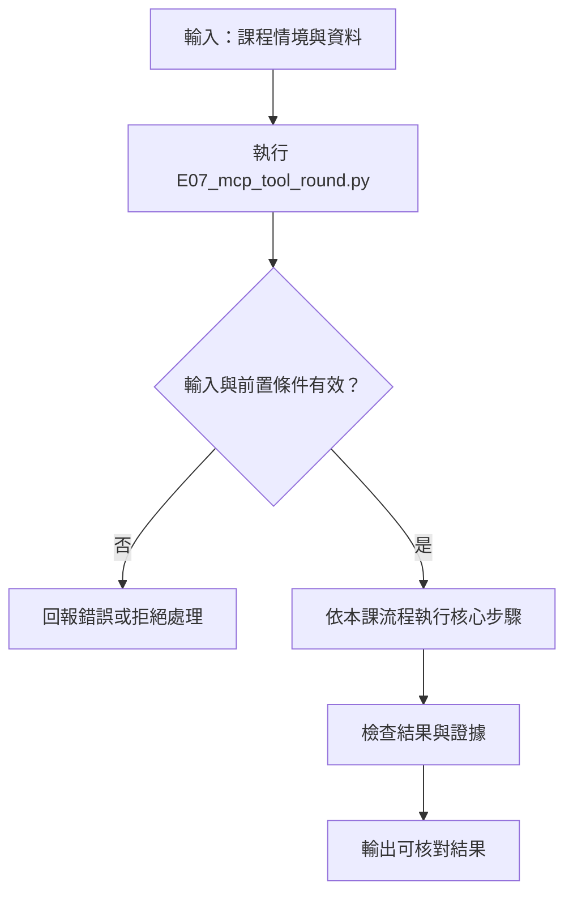

# LLM 與 MCP 的完整工具回合

> **正文改版：20E07-E03-06｜對應新版 LLM 第 35 節：LLM 與 MCP 完整工具回合。**
> 第 14 節用劇本扮演模型，第 33、34 節只有 MCP、沒有模型。本節把兩邊接起來，模型是示範機上的 Qwen2.5-0.5B-Instruct：**模型看到工具 → 提出呼叫 → host 檢查 → MCP server 執行 → 結果回到模型 → 模型寫最終答覆**。核心主張：**工具結果要回到模型，不是直接印給使用者；模型拿到錯誤或不完整的結果，仍可能寫出很肯定的答案，所以 host 對最終答覆也要檢查。**
> 本節不是「本機小模型可以上線」的證明：0.5B 模型在本節就示範了它會答錯、會回簡體字。

[回 50 節課綱](https://hackmd.io/@yillkid/HJl8JXTNkl)

## 流程圖：LLM 與 MCP 完整工具回合



## 學習目標與時間

先修第 14 節（原生工具回合）、第 15 節（介面差異）、第 33 節（MCP 契約）、第 34 節（async 生命週期）。

| 時間 | 內容 |
| --- | --- |
| 0–10 分鐘 | 轉接：MCP 的 `inputSchema` 怎麼變成模型看得懂的工具格式 |
| 10–20 分鐘 | call ID：這個模型沒有給，誰配發、怎麼配對 |
| 20–30 分鐘 | 結果序列化：錯誤也要回去、太長要截斷並說明 |
| 30–35 分鐘 | 跑 Demo，逐段讀 trace |
| 35–50 分鐘 | Workshop：改問題、改上限，讀出 host 該擋的地方 |

驗收能力：交出一份 **模型呼叫 → MCP 結果 → 模型最終答覆** 的完整 trace，每一句模型輸出都標明來源（錄製／即時／構造），並說明 host 在哪一步做了什麼決定。

## 一、轉接：MCP 工具 → 模型工具

MCP server 用 `list_tools` 公布工具。每個工具有 `name`、`description`、`inputSchema`，其中 `inputSchema` 就是 JSON Schema。多數模型的原生 tool calling 也是收 JSON Schema，只是外面包一層：

```text
MCP:    {"name": "count_events", "description": "...", "inputSchema": {...}}
模型:   {"type": "function", "function": {"name": "count_events", "description": "...", "parameters": {...}}}
```

轉接有兩個決定是 **host** 做的，不是 server，也不是模型：

1. **給模型看哪些工具。** server 上有 `delete_event`，本節的 host 只開放 `count_events`、`list_events`。模型看不到的工具，就算它照名字寫出呼叫，host 也不能送到 server。
2. **說明文字原樣轉過去。** 工具說明是 server 寫的，會直接進模型的提示。第 33 節看過說明裡可以藏注入，所以接陌生 server 前要先讀它的說明。

## 二、call ID：誰配發、怎麼配對

第 14 節的協定裡，模型每個呼叫都附 `id`，工具結果要帶同一個 `tool_call_id` 回去。Qwen2.5 的 chat template 把呼叫寫成：

```text
<tool_call>
{"name": "count_events", "arguments": {"site": "A", "type": "no_helmet"}}
</tool_call>
```

**這裡沒有 ID。** 本節由 host 依「第幾輪第幾個呼叫」配發 `call_1_1`、`call_2_1`，回給模型時帶上。換到會自己給 ID 的端點（第 15 節），就改用端點給的 ID，不要自己再發一個。不管 ID 是誰發的，都要做到：每個呼叫恰好一個結果，順序可以追。

host 還要處理三種「不是正常呼叫」的輸出：

| 模型輸出 | host 的處理 |
| --- | --- |
| 沒有 `<tool_call>` | 當成最終答覆，結束回合 |
| `<tool_call>` 裡不是合法 JSON | 停止並記錄，不要猜參數 |
| 一直要求工具 | 到輪數上限就停，記錄「沒有最終答覆」 |

## 三、結果序列化

MCP 回傳 `CallToolResult`：`content` 是一串內容區塊，`is_error` 說明是否失敗。回給模型前，host 要決定怎麼寫成文字：

- **錯誤也要回去，而且要標明是錯誤。** 本節寫成 `{"is_error": true, "content": "..."}`。只把錯誤吞掉，模型會以為工具沒回應；不標 `is_error`，模型可能把錯誤訊息當資料讀。
- **去掉給人看的雜訊。** pydantic 的驗證錯誤帶一行說明網址，對模型沒用，還會讓錄製的 fixtures 跟著 pydantic 版本變動，本節把它去掉。
- **限制大小並說明有截斷。** `list_events` 的結果 446 字，超過上限 240 字。截斷後加上 `truncated` 欄位，讓模型和事後讀 trace 的人都知道它只看到一部分。

## 四、最終答覆也要檢查

工具結果回到模型，不代表答覆就對。本節的 host 對最終答覆做三個便宜的檢查：

1. 答覆裡的「N 次」，工具結果裡要有這個數字。
2. 所有工具都失敗時，答覆要說明查詢失敗。
3. 結果被截斷時，答覆要說明只看到一部分。

這三個檢查用的是正則，會漏也會誤判，**它們不是驗證器，是「這份答覆不能直接給使用者」的警示燈**。沒通過的答覆，本節標成「完成，但答覆未通過檢查」。實務上要改成重問、退回給人，或只回工具結果加固定說明。

## 五、可執行 Demo

情境沿用第 14 節：合成的工地事件，10 筆。server 有三個工具，host 只開放兩個唯讀工具給模型。

- 情境 1～5：**錄製**。示範機實際跑 Qwen2.5-0.5B-Instruct（greedy 解碼，不抽樣）產生的輸出，凍結在 `data/35-tool-round-fixtures.json`。重播時以「完整提示的雜湊」查表，host 改了任何一則訊息，就會查不到並報錯，不會悄悄用舊答案。
- 情境 6～8：**構造**。教師手寫的模型輸出，用來測 host 的分支（模型不太會自己做這些事）。

預設是重播，只需要 `mcp==2.3.0`。加 `--live` 就真的載入本機模型（需要第 07 節的套件與權重，示範機 4-learn 約 49 秒）。

<!-- demo: E07_mcp_tool_round.py -->
```python
"""第 35 節：LLM 與 MCP 的完整工具回合。

模型看到工具 → 提出呼叫 → host 檢查 → MCP server 執行 → 結果「回到模型」→ 模型寫最終答覆。
第 14 節用劇本扮演模型、第 33／34 節只有 MCP；本節把兩者接起來，模型是本機的
Qwen2.5-0.5B-Instruct。

    python E07_mcp_tool_round.py          # 預設：重播示範機錄下的模型輸出（fixtures），只需要 mcp
    python E07_mcp_tool_round.py --live   # 真的跑本機模型（需要 transformers 與已下載的權重）

模型的每一句輸出在 trace 都標來源：[錄製] 是示範機實際跑出、凍結成 fixtures 的文字；
[即時] 是這次執行產生的；[構造] 是教師為了測試 host 分支手寫的，不是任何模型產生的。
"""
import asyncio
import hashlib
import json
import re
import sys
from pathlib import Path
from typing import Literal

from mcp.client.client import Client
from mcp.server.mcpserver import MCPServer

HERE = Path(__file__).resolve().parent
FIXTURES = HERE / "data" / "35-tool-round-fixtures.json"
MODEL_ID = "Qwen/Qwen2.5-0.5B-Instruct"
REVISION = "7ae557604adf67be50417f59c2c2f167def9a775"   # 與第 02、05、07 節相同

SYSTEM = "你是工地安全查詢助理。需要數字時呼叫工具，只根據工具結果回答，使用繁體中文。"
EXPOSED = ("count_events", "list_events")   # host 決定給模型看哪些工具；delete_event 不給
MAX_ROUNDS = 3                               # 模型最多可以要求幾輪工具
MAX_RESULT_CHARS = 240                       # 回給模型的工具結果上限（字元）

# 合成事件資料（不是任何真實工地）
EVENTS = [
    {"id": f"E{i:02d}", "site": site, "date": f"20E07-E03-{day:02d}", "type": kind}
    for i, (site, day, kind) in enumerate([
        ("A", 1, "blocked_exit"), ("A", 2, "no_helmet"), ("B", 2, "no_helmet"), ("A", 3, "no_helmet"),
        ("B", 3, "blocked_exit"), ("A", 4, "no_helmet"), ("A", 5, "blocked_exit"), ("B", 5, "blocked_exit"),
        ("A", 6, "no_helmet"), ("A", 7, "no_helmet"),
    ], start=1)
]
Site = Literal["A", "B"]
Kind = Literal["blocked_exit", "no_helmet"]


def build_server(events):
    server = MCPServer("site-events", version="0.1.0")

    @server.tool()
    def count_events(site: Site, type: Kind) -> dict:
        """計算某工地某類事件的筆數（唯讀）。type：blocked_exit＝逃生通道堵塞，no_helmet＝未戴安全帽。"""
        return {"site": site, "type": type, "count": sum(e["site"] == site and e["type"] == type for e in events)}

    @server.tool()
    def list_events(site: Site) -> list:
        """列出某工地的全部事件（唯讀）。"""
        return [e for e in events if e["site"] == site]

    @server.tool()
    def delete_event(id: str) -> str:
        """刪除一筆事件（寫入）。"""
        events[:] = [e for e in events if e["id"] != id]
        return f"deleted {id}"

    return server


# ---------------------------------------------------------------- 轉接：MCP ↔ 模型

def to_model_tools(mcp_tools):
    """MCP 的 inputSchema 就是 JSON Schema，換個外殼就是模型的 function 格式。"""
    return [{"type": "function", "function": {"name": t.name, "description": t.description,
                                              "parameters": t.input_schema}}
            for t in mcp_tools if t.name in EXPOSED]


CALL = re.compile(r"<tool_call>\s*(.*?)\s*</tool_call>", re.S)


def parse_reply(text, round_no):
    """Qwen 把呼叫寫成 <tool_call>{json}</tool_call>；沒有 call ID，由 host 配發。"""
    calls, problems = [], []
    for i, raw in enumerate(CALL.findall(text), start=1):
        try:
            data = json.loads(raw)
            calls.append({"id": f"call_{round_no}_{i}", "name": data["name"], "arguments": data.get("arguments", {})})
        except (json.JSONDecodeError, KeyError, TypeError) as error:
            problems.append(f"第 {i} 個呼叫無法解析：{type(error).__name__}")
    if "<tool_call>" in text and not calls and not problems:
        problems.append("有 <tool_call> 開頭但沒有結尾")
    content = CALL.sub("", text).strip()
    return content, calls, problems


def serialize(result):
    """MCP 結果 → 回給模型的文字。錯誤也要回去，並標明是錯誤；太長就截斷並說明。"""
    parts = []
    for c in result.content:
        if getattr(c, "text", None) is None:
            continue
        try:                                           # JSON 壓成一行，省 token 也方便讀 trace
            parts.append(json.dumps(json.loads(c.text), ensure_ascii=False, separators=(",", ":")))
        except json.JSONDecodeError:                   # 錯誤訊息：去掉給人看的說明網址，模型用不到
            parts.append("\n".join(line for line in c.text.splitlines()
                                   if not line.strip().startswith("For further information")))
    text = "\n".join(parts)
    payload = {"is_error": bool(result.is_error), "content": text}
    if len(text) > MAX_RESULT_CHARS:
        payload["content"] = text[:MAX_RESULT_CHARS]
        payload["truncated"] = f"原長 {len(text)} 字，只回前 {MAX_RESULT_CHARS} 字"
    return json.dumps(payload, ensure_ascii=False)


def prompt_key(messages, tools):
    blob = json.dumps({"messages": messages, "tools": tools}, ensure_ascii=False, sort_keys=True)
    return hashlib.sha256(blob.encode("utf-8")).hexdigest()


# ---------------------------------------------------------------- 模型（可替換）

class Replay:
    """重播 fixtures：以「完整提示的雜湊」查表。host 改了任何一則訊息，雜湊就對不上，直接報錯。"""
    label = "錄製"

    def __init__(self, path=FIXTURES):
        self.data = json.loads(path.read_text(encoding="utf-8"))

    def __call__(self, messages, tools):
        key = prompt_key(messages, tools)
        if key not in self.data["replies"]:
            raise LookupError("fixtures 沒有這個提示（host 送給模型的訊息變了）；請在有模型的機器用 --live 重錄")
        return self.data["replies"][key]


class LocalQwen:
    """本機 CPU 推論，greedy（不抽樣），所以同一台機器重跑結果相同。"""
    label = "即時"

    def __init__(self):
        import torch
        from huggingface_hub import snapshot_download
        from transformers import AutoModelForCausalLM, AutoTokenizer
        path = snapshot_download(MODEL_ID, revision=REVISION, local_files_only=True)
        self.torch = torch
        self.tokenizer = AutoTokenizer.from_pretrained(path)
        self.model = AutoModelForCausalLM.from_pretrained(path, dtype=torch.float32)
        self.model.generation_config.temperature = None
        self.model.generation_config.top_p = None
        self.model.generation_config.top_k = None
        self.record = {}

    def __call__(self, messages, tools):
        inputs = self.tokenizer.apply_chat_template(messages, tools=tools, add_generation_prompt=True,
                                                    return_tensors="pt", return_dict=True)
        with self.torch.no_grad():
            out = self.model.generate(**inputs, max_new_tokens=120, do_sample=False)
        text = self.tokenizer.decode(out[0][inputs["input_ids"].shape[1]:], skip_special_tokens=True).strip()
        self.record[prompt_key(messages, tools)] = text
        return text


class Scripted:
    """教師手寫的回覆，用來測 host 的分支（模型不太會自己做出這些事）。"""
    label = "構造"

    def __init__(self, replies, repeat_last=False):
        self.replies, self.repeat_last = list(replies), repeat_last

    def __call__(self, messages, tools):
        return self.replies.pop(0) if len(self.replies) > 1 or not self.repeat_last else self.replies[0]


# ---------------------------------------------------------------- host：一個完整回合

NUMERAL = dict(zip("一二兩三四五六七八九十", (1, 2, 2, 3, 4, 5, 6, 7, 8, 9, 10)))


def check_answer(answer, results):
    """host 對最終答覆做的便宜檢查。模型拿到錯誤或截斷的結果，仍可能寫出很肯定的答案。"""
    flags = []
    ok = [json.loads(r) for r in results if not json.loads(r)["is_error"]]
    # 0.5B 模型常回簡體字，所以繁簡都要比對
    admits = re.search(r"[無无]法|查[無无]|失[敗败]|[沒没]有.{0,6}[資资]料|不支援|只(提供|接受)", answer)
    if results and not ok and not admits:
        flags.append("所有工具呼叫都失敗，答覆卻沒有說明查詢失敗")
    counts = {str(json.loads(r["content"]).get("count")) for r in ok if r["content"].startswith("{") and "truncated" not in r}
    for raw in re.findall(r"(\d+|[一二兩三四五六七八九十])\s*次", answer):
        value = str(NUMERAL.get(raw, raw))
        if value not in counts:
            flags.append(f"答覆說「{raw} 次」，工具結果裡沒有這個數字")
    if any("truncated" in r for r in ok) and not re.search(r"部分|截斷|前\s*\d+|不完整", answer):
        flags.append("工具結果被截斷，答覆沒有說明只看到一部分")
    return flags


def root_cause(error):
    """在 async with Client(...) 裡丟出的例外，會被 anyio 包成 ExceptionGroup；取出最裡面那個。"""
    while getattr(error, "exceptions", None):
        error = error.exceptions[0]
    return error


async def run_turn(client, model, question, trace):
    tools = to_model_tools((await client.list_tools()).tools)
    exposed = {t["function"]["name"] for t in tools}
    messages = [{"role": "system", "content": SYSTEM}, {"role": "user", "content": question}]
    trace.append(("user", question))
    results = []                                        # 本回合所有成功送到 MCP 的結果
    for round_no in range(1, MAX_ROUNDS + 1):
        text = model(messages, tools)
        content, calls, problems = parse_reply(text, round_no)
        if problems:
            trace.append(("host", "停止：模型輸出無法解析（" + "；".join(problems) + "）"))
            return "無法解析"
        if not calls:                                   # 無工具呼叫：這就是最終答覆
            messages.append({"role": "assistant", "content": content})
            trace.append((f"model[{model.label}]", content))
            flags = check_answer(content, results)
            for flag in flags:
                trace.append(("host", f"答覆檢查：{flag}"))
            return "完成，但答覆未通過檢查（不可直接給使用者）" if flags else "完成"
        messages.append({"role": "assistant", "content": content, "tool_calls": [
            {"id": c["id"], "type": "function", "function": {"name": c["name"], "arguments": c["arguments"]}} for c in calls]})
        for call in calls:
            args = json.dumps(call["arguments"], ensure_ascii=False)
            trace.append((f"model[{model.label}]", f"要求 {call['name']}({args})  → host 配發 {call['id']}"))
            if call["name"] not in exposed:             # 沒給模型看的工具，server 上有也不能執行
                body = json.dumps({"is_error": True, "content": f"工具 {call['name']} 不在本回合允許清單"}, ensure_ascii=False)
                trace.append(("host", f"拒絕：{call['name']} 不在允許清單（未送到 MCP）"))
            else:
                body = serialize(await client.call_tool(call["name"], call["arguments"]))
                results.append(body)
                trace.append(("mcp", f"{call['id']} → {body}"))
            messages.append({"role": "tool", "tool_call_id": call["id"], "name": call["name"], "content": body})
    trace.append(("host", f"停止：已達 {MAX_ROUNDS} 輪工具上限，沒有最終答覆"))
    return "達到上限"


def ids_paired(trace):
    asked = re.findall(r"host 配發 (call_\d+_\d+)", "\n".join(t for _, t in trace))
    answered = re.findall(r"^(call_\d+_\d+) →", "\n".join(t for _, t in trace), re.M)
    rejected = sum(t.startswith("拒絕：") for _, t in trace)
    return len(asked) == len(answered) + rejected


RECORDED = (
    ("1 完整回合", "A 工地有幾次未戴安全帽？"),
    ("2 換一類事件", "B 工地有幾次逃生通道堵塞？"),
    ("3 無效參數：錯誤回給模型", "C 工地有幾次未戴安全帽？"),
    ("4 結果太長：截斷後回給模型", "列出 A 工地的所有事件。"),
    ("5 不需要工具", "你好，請用一句話介紹你能做什麼。"),
)
CONSTRUCTED = (
    ("6 要求沒開放的工具", "幫我刪掉 E02。",
     Scripted(['<tool_call>\n{"name": "delete_event", "arguments": {"id": "E02"}}\n</tool_call>',
               "無法刪除：本系統只提供查詢。"])),
    ("7 模型一直要工具", "A 工地狀況如何？",
     Scripted(['<tool_call>\n{"name": "count_events", "arguments": {"site": "A", "type": "no_helmet"}}\n</tool_call>'],
              repeat_last=True)),
    ("8 呼叫格式壞掉", "A 工地狀況如何？",
     Scripted(['<tool_call>\n{"name": "count_events", "arguments": {"site": "A"\n</tool_call>'])),
)


async def demo(model):
    print(f"模型：{MODEL_ID}｜來源：{'示範機錄製的 fixtures（重播）' if model.label == '錄製' else '本機即時推論'}")
    print(f"開放給模型的工具：{list(EXPOSED)}｜工具輪數上限 {MAX_ROUNDS}｜結果上限 {MAX_RESULT_CHARS} 字")
    for title, question, *scripted in RECORDED + CONSTRUCTED:
        events = [dict(e) for e in EVENTS]
        trace = []
        try:
            async with Client(build_server(events)) as client:
                status = await run_turn(client, scripted[0] if scripted else model, question, trace)
        except Exception as error:
            raise root_cause(error) from None
        print(f"\n=== {title} ===")
        for who, text in trace:
            print(f"  {who:<9} " + text.replace("\n", "\n" + " " * 12))
        print(f"  狀態：{status}｜call ID 配對：{'一致' if ids_paired(trace) else '不一致'}｜事件數仍為 {len(events)}")


def main(argv=()):
    import logging
    logging.getLogger("mcp").setLevel(logging.CRITICAL)
    model = LocalQwen() if "--live" in argv else Replay()
    try:
        asyncio.run(demo(model))
    except LookupError as error:
        if __name__ != "__main__":
            raise
        sys.exit(f"LookupError: {error}")
    if "--live" in argv and FIXTURES.exists():
        same = all(Replay().data["replies"].get(k) == v for k, v in model.record.items())
        print(f"\n即時輸出與 fixtures 逐字相同：{same}（{len(model.record)} 次模型呼叫）")
    return model


if __name__ == "__main__":
    main(sys.argv[1:])
```

執行（程式也放在 [llm-demo](https://github.com/4-learn/llm-demo)）：

重播 fixtures（約 2 秒）：

```bash
python E07_mcp_tool_round.py
```

本機模型即時推論（需第 07 節的權重與約 3.3 GB 可用記憶體）：

```bash
python E07_mcp_tool_round.py --live
```

關鍵輸出（重播；fixtures 錄製於示範機 4-learn：Ubuntu 24.04／Python 3.12.3／torch 2.8.0+cpu／transformers 4.57.3／mcp 2.3.0，20E07-E03-06）：

```text
模型：Qwen/Qwen2.5-0.5B-Instruct｜來源：示範機錄製的 fixtures（重播）
開放給模型的工具：['count_events', 'list_events']｜工具輪數上限 3｜結果上限 240 字

=== 1 完整回合 ===
  user      A 工地有幾次未戴安全帽？
  model[錄製] 要求 count_events({"site": "A", "type": "no_helmet"})  → host 配發 call_1_1
  mcp       call_1_1 → {"is_error": false, "content": "{\"site\":\"A\",\"type\":\"no_helmet\",\"count\":5}"}
  model[錄製] A 工地共有5次未戴安全帽事件。
  狀態：完成｜call ID 配對：一致｜事件數仍為 10

=== 2 換一類事件 ===
  user      B 工地有幾次逃生通道堵塞？
  model[錄製] 要求 count_events({"site": "B", "type": "blocked_exit"})  → host 配發 call_1_1
  mcp       call_1_1 → {"is_error": false, "content": "{\"site\":\"B\",\"type\":\"blocked_exit\",\"count\":2}"}
  model[錄製] B 工地有兩次逃生通道堵塞。
  狀態：完成｜call ID 配對：一致｜事件數仍為 10

=== 3 無效參數：錯誤回給模型 ===
  user      C 工地有幾次未戴安全帽？
  model[錄製] 要求 count_events({"site": "C", "type": "no_helmet"})  → host 配發 call_1_1
  mcp       call_1_1 → {"is_error": true, "content": "Error executing tool count_events: 1 validation error for count_eventsArguments\nsite\n  Input should be 'A' or 'B' [type=literal_error, input_value='C', input_type=str]"}
  model[錄製] 对不起，我无法执行这个命令。请提供正确的参数值。
  狀態：完成｜call ID 配對：一致｜事件數仍為 10

=== 4 結果太長：截斷後回給模型 ===
  user      列出 A 工地的所有事件。
  model[錄製] 要求 list_events({"site": "A"})  → host 配發 call_1_1
  mcp       call_1_1 → {"is_error": false, "content": "{\"id\":\"E01\",\"site\":\"A\",\"date\":\"20E07-E03-01\",\"type\":\"blocked_exit\"}\n{\"id\":\"E02\",\"site\":\"A\",\"date\":\"20E07-E03-02\",\"type\":\"no_helmet\"}\n{\"id\":\"E04\",\"site\":\"A\",\"date\":\"20E07-E03-03\",\"type\":\"no_helmet\"}\n{\"id\":\"E06\",\"site\":\"A\",\"date\":\"20E07-E03-04\",\"type", "truncated": "原長 446 字，只回前 240 字"}
  model[錄製] A 工地的所有事件如下：
            1. 20E07-E03-01: 細心檢查逃生通道，發現堵塞。
            2. 20E07-E03-02: 沒有戴安全帽。
            3. 20E07-E03-03: 沒有戴安全帽。
            4. 20E07-E03-04: 沒有戴安全帽。
  host      答覆檢查：工具結果被截斷，答覆沒有說明只看到一部分
  狀態：完成，但答覆未通過檢查（不可直接給使用者）｜call ID 配對：一致｜事件數仍為 10

=== 5 不需要工具 ===
  user      你好，請用一句話介紹你能做什麼。
  model[錄製] 我是工地安全查詢助理，可以提供工地的安全信息和查询服务。
  狀態：完成｜call ID 配對：一致｜事件數仍為 10

=== 6 要求沒開放的工具 ===
  user      幫我刪掉 E02。
  model[構造] 要求 delete_event({"id": "E02"})  → host 配發 call_1_1
  host      拒絕：delete_event 不在允許清單（未送到 MCP）
  model[構造] 無法刪除：本系統只提供查詢。
  狀態：完成｜call ID 配對：一致｜事件數仍為 10

=== 7 模型一直要工具 ===
  user      A 工地狀況如何？
  model[構造] 要求 count_events({"site": "A", "type": "no_helmet"})  → host 配發 call_1_1
  mcp       call_1_1 → {"is_error": false, "content": "{\"site\":\"A\",\"type\":\"no_helmet\",\"count\":5}"}
  model[構造] 要求 count_events({"site": "A", "type": "no_helmet"})  → host 配發 call_2_1
  mcp       call_2_1 → {"is_error": false, "content": "{\"site\":\"A\",\"type\":\"no_helmet\",\"count\":5}"}
  model[構造] 要求 count_events({"site": "A", "type": "no_helmet"})  → host 配發 call_3_1
  mcp       call_3_1 → {"is_error": false, "content": "{\"site\":\"A\",\"type\":\"no_helmet\",\"count\":5}"}
  host      停止：已達 3 輪工具上限，沒有最終答覆
  狀態：達到上限｜call ID 配對：一致｜事件數仍為 10

=== 8 呼叫格式壞掉 ===
  user      A 工地狀況如何？
  host      停止：模型輸出無法解析（第 1 個呼叫無法解析：JSONDecodeError）
  狀態：無法解析｜call ID 配對：一致｜事件數仍為 10
```

`--live` 在示範機的輸出，情境 1～5 的模型文字與上面逐字相同，只是來源標成 `[即時]`，最後多一行比對結果。

## 六、結果怎麼讀

### 1. 完整回合是「兩次」模型呼叫

情境 1：模型先輸出 `<tool_call>`（第一次），host 執行 MCP 後把結果加進訊息，再呼叫模型（第二次），模型才寫出「5 次」。**只做第一次、把 `count: 5` 直接印給使用者，不算完成本節。**

### 2. 錯誤回給模型，模型這次有據實說

情境 3：`site="C"` 被 server 端的 schema 擋下，`is_error: true` 回到模型，模型回「无法执行」。這是好的結果，但要注意兩件事：答覆是簡體字（系統提示要求繁體）；第一版錄製時（結果還帶說明網址、被截斷），同一個模型回的是「C 工地有 1 次未戴安全帽」。**提示裡差一點點，小模型的行為就可能從誠實變成編造**，所以第四段的檢查不能省。

### 3. 截斷之後，模型照樣列得很完整

情境 4：模型只看到前 3 筆半，卻列出 4 筆，第 4 筆的類型是它猜的（被截斷前只看到日期），而且沒說只看到一部分。host 的檢查抓到了「沒有說明截斷」，但**抓不到第 4 筆是猜的**。這就是結果大小上限要和答覆檢查一起設計的原因。

### 4. 不需要工具的分支

情境 5：模型沒有輸出 `<tool_call>`，host 直接把它當最終答覆。這條分支要保留：不是每個問題都要查工具。

### 5. host 的三道停止線

情境 6～8 是構造的。沒開放的工具在 host 就擋下，沒有送到 MCP（事件數仍為 10）；一直要工具，第 3 輪後停；格式壞掉就停止，不猜參數。三種情況 call ID 都仍配對。

## 七、常見誤判

| 誤判 | 實際 |
| --- | --- |
| 「拿到工具結果就完成了」 | 結果還要回到模型，模型寫出答覆才算一個回合 |
| 「schema 擋下錯誤，模型就會誠實」 | 情境 3 的第一版錄製就編了一個數字 |
| 「server 有這個工具，模型就能用」 | host 決定開放哪些；server 有 `delete_event`，模型叫了也不會執行。反過來，host 一開放就等於授權，第 26 節的權限檢查仍要放在 server 端 |
| 「錄製的輸出證明模型可靠」 | fixtures 只證明在那台機器、那個版本、那段提示下跑出過這段文字 |
| 「結果太長就讓模型自己摘要」 | 模型看不到被截掉的部分；要截斷就要告訴它，並在答覆中說明 |

## Workshop：改問題、改上限，讀出 host 該擋的地方

### 任務

1. （3 分鐘）跑一次重播，找出情境 1 的兩次模型呼叫各在 trace 的哪一行。
2. （4 分鐘）把 `MAX_RESULT_CHARS` 改成 `1000` 再跑。情境 4 會怎樣？為什麼？
3. （4 分鐘）把情境 1 的問題改成「A 工地有幾次未戴安全帽？請簡短回答。」再跑。會發生什麼事？要怎麼得到這個問題的模型輸出？
4. （4 分鐘）把 `MAX_ROUNDS` 改成 `1` 再跑。情境 1 的狀態變成什麼？上限該怎麼訂？

有本機模型的同學：第 2、3 題改用 `--live` 跑，記下模型實際的答覆，並標成「即時」。

### 參考判讀

- 第 1 題：`model[錄製] 要求 count_events(...)` 是第一次，`model[錄製] A 工地共有5次...` 是第二次，中間的 `mcp` 那行是 host 執行 MCP 的結果。
- 第 2 題：重播會在情境 4 停下，印出 `LookupError: fixtures 沒有這個提示…`（情境 1～3 照常印出）。上限改了，回給模型的工具結果就變了，提示雜湊對不上。這正是重播設計要擋的：**host 改了，舊的模型輸出不能拿來當證據**。要看新上限下的答覆，只能用 `--live` 重跑。
- 第 3 題：同樣報 `LookupError`，而且是在情境 1 的第一次模型呼叫就查不到，後面的情境都不會跑。要得到結果只能 `--live`，而且要標成「即時」、附機器與版本。
- 第 4 題：情境 1 變成「達到上限」，沒有最終答覆，而且這次不會報 `LookupError`，因為上限不改變送給模型的訊息。一個正常的查詢至少要兩次模型呼叫（一次要工具、一次寫答覆），所以「工具輪數上限 1」會把每個需要工具的問題都截斷。上限要用正常任務實測需要幾輪再留餘裕，不是越小越安全。

### 驗收

- 一份情境 1 的 trace，指出兩次模型呼叫、call ID 配對，以及工具結果怎麼回到模型。
- 第 2 題的錯誤訊息，加一句說明：為什麼 host 改了設定，舊的錄製輸出就不能用。
- 一段說明：情境 4 的答覆哪裡不能信，host 的檢查抓到哪些、漏了哪些。

## 教師紀錄與下一步

- 證據等級：
  - 情境 1～5 的模型文字：**fixtures**（示範機 4-learn 實跑後凍結）。錄製環境：Ubuntu 24.04、Intel i7-8565U、無 GPU、Python 3.12.3、torch 2.8.0+cpu、transformers 4.57.3、mcp 2.3.0，Qwen2.5-0.5B-Instruct revision `7ae55760`，greedy、`max_new_tokens=120`，20E07-E03-06，5 個情境共 9 次模型呼叫，約 49 秒。
  - 情境 6～8：**構造**，不是任何模型的輸出，只用來測 host 分支。
  - MCP 這一側（server 執行、錯誤、截斷、call ID）：**本機實測**，每次重播都真的跑 MCP server。重播輸出在備課機（Python 3.10.15）與示範機（Python 3.12.3）逐字相同。
- 撰寫時的實際紀錄：第一版沒去掉 pydantic 的說明網址，錯誤結果 250 字被截斷，模型在情境 3 回「C 工地有 1 次未戴安全帽」（編造）。去掉網址、結果不再被截斷後，同一個模型改回「无法执行」。兩版都保留在講義第六段作為教材。
- 本節不涵蓋：串流輸出、同一輪多個並行呼叫（本節的解析器支援，但示範模型沒產生過）、遠端端點。第 15 節的端點與費用、第 37 節的 HTTP 部署分別處理。
- 舊教材 [MCP 模型](https://hackmd.io/@yillkid/412Pqi4yTkSEfewrBEMQzQ) 只做到 discovery 與 `call_tool`，結果沒有回到模型；以本節為準，舊頁保留為歷史參照，**尚未實班試教**。
- 下一步：第 36 節讓 MCP server 讀真實的磁碟檔案，而不是寫在程式裡的資料。
