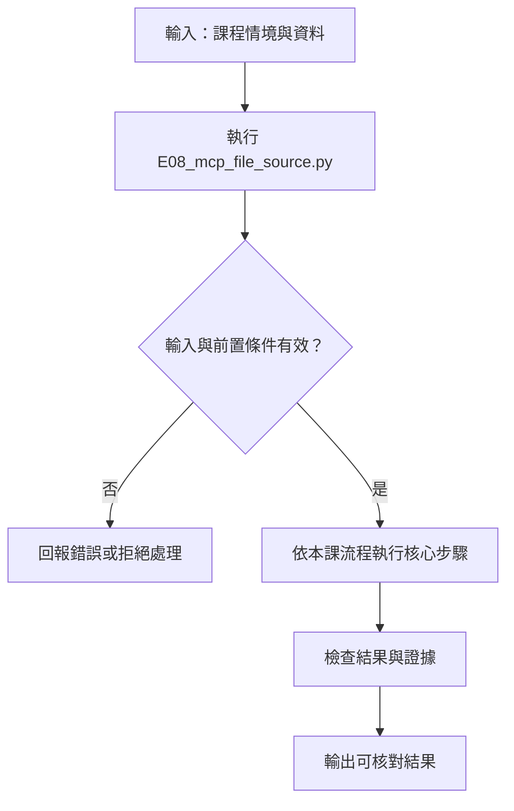
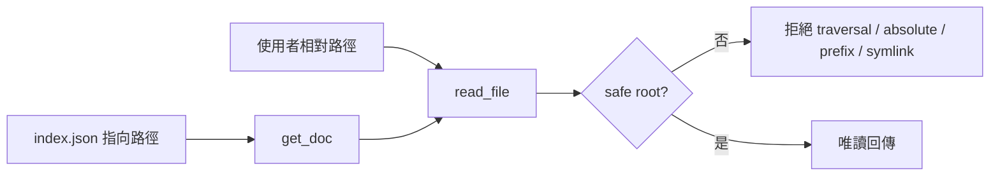

# 讀真實檔案的 MCP Server

> **正文改版：20E07-E03-06｜對應新版 LLM 第 39 節：真實檔案資料來源的 MCP Server。**
> 第 33～35 節的工具都讀寫在程式裡的資料。本節讓 MCP server 每次呼叫都去讀磁碟上的檔案：改了檔案，結果就跟著變，並附上來源雜湊。核心主張：**「讀真檔案」就要處理路徑。模型（或任何呼叫者）給的路徑都不可信，要先 `resolve()` 解開 `..` 與符號連結，再確認仍在允許的目錄內。字串比字首、只消去 `..` 都擋不完。**
> 「真資料來源」指的是真的做磁碟 I/O，**不是**使用真實個資。本節所有檔案都是程式當場寫出的合成資料。

[回 51 節必修＋9 節選修課綱](https://hackmd.io/@yillkid/HJl8JXTNkl)

## 流程圖：真實檔案資料來源的 MCP Server



## 學習目標與時間

先修第 19 節（來源欄位）、第 26 節（權限）、第 34 節（stdio 子程序）、第 35 節（完整回合）。

| 時間 | 內容 |
| --- | --- |
| 0–10 分鐘 | 資料目錄由誰決定；為什麼每次呼叫都要重新讀檔 |
| 10–25 分鐘 | 路徑防護：四種寫法，五種路徑 |
| 25–30 分鐘 | 來源雜湊、不存在的 ID、回傳上限 |
| 30–35 分鐘 | 跑 Demo |
| 35–50 分鐘 | Workshop：改檔重查、補一個攻擊路徑 |

驗收能力：交出一份「改檔前後」的查詢紀錄，兩次的來源雜湊不同、結果跟著變；並證明目錄外的四種讀法都被拒絕。**沒有實作防護，就不能宣稱安全。**

## 一、誰決定 server 能讀哪裡

資料目錄是**啟動 server 的人**決定的，本節用命令列參數傳進去（`server.py <資料目錄> <寫法>`）。模型看不到這個參數，也不能改。

server 有四個唯讀工具：

| 工具 | 做什麼 |
| --- | --- |
| `list_sources` | 列出資料目錄裡的檔案、大小、內容雜湊 |
| `count_events` | 讀 `events.csv`，算某工地的事件數，回傳時附上來源雜湊與筆數 |
| `get_doc` | 用 `index.json` 把文件 ID 換成路徑，再讀出來 |
| `read_file` | 讀資料目錄內的一個文字檔，最多回 300 字 |

**每次呼叫都重新讀檔**，不在啟動時快取。代價是每次都有 I/O，好處是檔案改了結果就變，而且每個結果都能用雜湊對回「是哪一版檔案算出來的」。資料量大時可以加快取，但快取要用檔案的修改時間或雜湊當鍵，不能一直沿用啟動時讀到的內容。

## 二、路徑防護：四種寫法

呼叫者給一個相對路徑，server 要把它換成磁碟路徑，並確認還在資料目錄內。下面四種寫法都很常見：

| 寫法 | 做法 | 漏掉什麼 |
| --- | --- | --- |
| `concat` | `str(ROOT) + "/" + path`，不檢查 | 全部 |
| `prefix` | 有 `resolve()`，但用 `str(path).startswith(str(ROOT))` 比對 | `/srv/data-private` 也以 `/srv/data` 開頭 |
| `normpath` | `os.path.normpath` 消去 `..`，再比字首（含分隔符） | 不解符號連結：連結本身在目錄內，指向的檔案在外面 |
| `safe` | 拒絕絕對路徑；`(ROOT / path).resolve()` 後用 `is_relative_to(ROOT)` 比對 | — |

`safe` 的兩個重點：**先 `resolve()` 再比**（`..` 和符號連結都會被解開成真實位置）；**用路徑比、不用字串比**（`is_relative_to` 比的是路徑的每一層，`data-private` 不等於 `data`）。

還有兩件事 `safe` 也沒處理，要知道界線：

- **檢查與開檔之間有時間差。** 檢查時是普通檔案，開檔前被換成符號連結，就會繞過（TOCTOU）。資料目錄要設成 server 帳號唯讀、別人不能寫，這個時間差才不會被利用。
- **檔案內容本身可能是注入。** 第 33 節看過工具說明可以藏指令；檔案內容也一樣，讀出來交給模型前，第 24 節的「引用不等於指令」照樣適用。

## 三、來源雜湊、不存在的 ID、回傳上限

- **來源雜湊**：`count_events` 回傳 `source.sha256`（前 12 碼）與筆數。答案錯了，可以先查是哪一版檔案算出來的，再查程式。
- **不存在的 ID 要回錯誤**，不是空字串或 `null`。空結果會被模型讀成「查到了，內容是空的」。
- **索引本身也是輸入。** `index.json` 裡的 `SOP-03` 指向 `../secret.txt`。`get_doc` 把索引裡的路徑也送進同一個 `read_file` 檢查，所以照樣被拒絕。只檢查「使用者給的路徑」、不檢查「索引查出來的路徑」，是很常見的漏洞。
- **回傳上限**：超過 300 字就截斷並加 `truncated`，理由同第 35 節。

## 四、可執行 Demo

需要 `mcp==2.3.0`，不需要模型。程式在暫存資料夾排出這樣的目錄，server 用子程序啟動（同第 34 節）：

```text
暫存資料夾/
├── data/                  ← 允許讀取的資料目錄
│   ├── events.csv
│   ├── index.json         ← SOP-03 指向 ../secret.txt
│   └── docs/
│       ├── ladder.md
│       ├── exit.md        ← 超過 300 字
│       └── shortcut.md    ← 符號連結，指向 ../../secret.txt
├── data-private/          ← 名字以 data 開頭，但不是 data/
│   └── salary.csv
└── secret.txt             ← 資料目錄外
```

Windows 建立符號連結需要系統管理員權限或開發人員模式；沒有的話這段會在建立目錄時失敗。請在示範機或 WSL 上跑。

### Session 1：允許的資料根目錄與唯讀讀取

**系統層：工具只能讀取明確 sandbox root**

```mermaid
flowchart LR
    A[build_workspace(base)] --> B[data root 與合成檔案]
    B --> C[MCP server tools]
    C --> D[list_sources / count_events / get_doc]
    D --> E[read_file 路徑檢查]
    E --> F[唯讀內容與 source hash]
```

**函式內部：`read_file` 驗證路徑再讀檔**

```mermaid
flowchart TD
    A[read_file(path)] --> B[locate(path)]
    B --> C{解析後是否位於允許 root?}
    C -- 否 --> D[拒絕路徑]
    C -- 是 --> E{檔案存在且可讀?}
    E -- 否 --> F[回傳明確錯誤]
    E -- 是 --> G[讀取 bytes]
    G --> H[sha 與長度上限]
    H --> I[回傳內容及來源資訊]
```

### Session 2：攻擊路徑與隔離測試

**系統層：惡意路徑與索引路徑都走同一防護**



**函式內部：`locate` 正規化並限制 root**

```mermaid
flowchart TD
    A[locate(relative)] --> B[拒絕絕對路徑]
    B --> C[resolve 相對於 base]
    C --> D{resolved path 在 base 下?}
    D -- 否 --> E[拒絕]
    D -- 是 --> F[回傳安全路徑]
```

<!-- demo: E08_mcp_file_source.py -->
```python
"""第 36 節：讀真實檔案的 MCP Server。

server 是獨立子程序（stdio，同第 34 節），每次呼叫都從磁碟讀資料，不寫死答案。
示範：來源雜湊、改檔後結果跟著變、路徑防護（..、絕對路徑、同字首目錄、symlink）、
不存在的 ID、回傳量上限。資料全是程式當場寫出的合成檔，不是任何真實工地。
需要 mcp==2.3.0；不需要模型。
"""
import asyncio
import json
import sys
import tempfile
from pathlib import Path

from mcp.client.client import Client
from mcp.client.stdio import StdioServerParameters

SERVER_SOURCE = r'''
import csv, hashlib, json, logging, os, sys
from pathlib import Path
from mcp.server.mcpserver import MCPServer
from mcp.server.mcpserver.exceptions import ToolError

ROOT = Path(sys.argv[1]).resolve()        # 允許讀取的資料目錄；由啟動 server 的人決定
GUARD = sys.argv[2]                       # 路徑檢查的寫法；只有 "safe" 是正確的
MAX_CHARS = 300                           # 單次回傳上限
logging.getLogger("mcp").setLevel(logging.CRITICAL)   # 拒絕是預期結果，不要每次都印到 stderr

server = MCPServer("site-files", version="0.1.0")


def sha(data):
    return hashlib.sha256(data).hexdigest()[:12]


def locate(relative):
    """把使用者（模型）給的相對路徑換成磁碟路徑，並確認仍在 ROOT 內。"""
    # ---- 三種常見的錯誤寫法（教學用）----
    if GUARD == "concat":                 # 只把字串接起來，沒有檢查
        return Path(str(ROOT) + "/" + relative)
    if GUARD == "prefix":                 # 有 resolve，但用字串比字首：/data-private 也以 /data 開頭
        path = (ROOT / relative).resolve()
        if not str(path).startswith(str(ROOT)):
            raise ToolError("拒絕：路徑在資料目錄外")
        return path
    if GUARD == "normpath":               # 只在字面上消去 ..，不解 symlink
        path = Path(os.path.normpath(ROOT / relative))
        if not str(path).startswith(str(ROOT) + os.sep):
            raise ToolError("拒絕：路徑在資料目錄外")
        return path
    # ---- 正確寫法 ----
    candidate = Path(relative)
    if candidate.is_absolute():
        raise ToolError("拒絕：只接受資料目錄內的相對路徑")
    path = (ROOT / candidate).resolve()   # 先解開 .. 與 symlink，再比對
    if not path.is_relative_to(ROOT):
        raise ToolError("拒絕：路徑在資料目錄外")
    return path


def read(relative):
    path = locate(relative)
    if not path.is_file():
        raise ToolError(f"查無檔案：{relative}")
    data = path.read_bytes()
    return path, data


@server.tool()
def list_sources() -> dict:
    """列出資料目錄內的檔案與內容雜湊（唯讀）。"""
    return {"files": [{"path": p.relative_to(ROOT).as_posix(), "bytes": p.stat().st_size, "sha256": sha(p.read_bytes())}
            for p in sorted(ROOT.rglob("*")) if p.is_file() and not p.is_symlink()]}


@server.tool()
def count_events(site: str) -> dict:
    """從 events.csv 計算某工地的事件數（每次呼叫都重新讀檔）。"""
    _, data = read("events.csv")
    rows = list(csv.DictReader(data.decode("utf-8").splitlines()))
    return {"site": site, "count": sum(r["site"] == site for r in rows),
            "source": {"path": "events.csv", "sha256": sha(data), "rows": len(rows)}}


@server.tool()
def get_doc(doc_id: str) -> dict:
    """依 index.json 的文件 ID 取文件內容。"""
    _, index = read("index.json")
    entry = json.loads(index).get(doc_id)
    if entry is None:
        raise ToolError(f"查無文件 ID：{doc_id}")
    return read_file(entry)


@server.tool()
def read_file(path: str) -> dict:
    """讀資料目錄內的一個文字檔。"""
    _, data = read(path)
    text = data.decode("utf-8", errors="replace")
    result = {"path": path, "sha256": sha(data), "text": text[:MAX_CHARS]}
    if len(text) > MAX_CHARS:
        result["truncated"] = f"原長 {len(text)} 字，只回前 {MAX_CHARS} 字"
    return result


if __name__ == "__main__":
    server.run("stdio")
'''

EVENTS_CSV = """id,site,date,type
E01,A,20E07-E03-01,blocked_exit
E02,A,20E07-E03-02,no_helmet
E03,B,20E07-E03-02,no_helmet
E04,A,20E07-E03-03,no_helmet
"""
INDEX = {"SOP-01": "docs/ladder.md", "SOP-02": "docs/exit.md", "SOP-03": "../secret.txt"}
DOCS = {
    "docs/ladder.md": "# 合梯作業\n使用合梯前確認開閉防滑裝置已扣上，作業高度 2 公尺以上須另行評估。\n",
    "docs/exit.md": "# 逃生通道\n" + "逃生通道寬度內不得堆放物料，每日收工前巡查一次。\n" * 12,
}
SECRET = "這是資料目錄外的檔案：不該被讀到。\n"


def build_workspace(base):
    """在暫存資料夾裡排出：允許的 data/、旁邊的 secret.txt、字首相同的 data-private/、指向外面的 symlink。"""
    root = base / "data"
    (root / "docs").mkdir(parents=True)
    (root / "events.csv").write_text(EVENTS_CSV, encoding="utf-8")
    (root / "index.json").write_text(json.dumps(INDEX, ensure_ascii=False), encoding="utf-8")
    for name, text in DOCS.items():
        (root / name).write_text(text, encoding="utf-8")
    (base / "secret.txt").write_text(SECRET, encoding="utf-8")
    (base / "data-private").mkdir()
    (base / "data-private" / "salary.csv").write_text("name,amount\n合成員工,1\n", encoding="utf-8")
    (root / "docs" / "shortcut.md").symlink_to(base / "secret.txt")
    return root


def show(result):
    text = result.content[0].text if result.content else ""
    if result.is_error:
        return "錯誤 " + text.splitlines()[0].replace("Error executing tool ", "")
    data = json.loads(text)
    if isinstance(data, dict) and "text" in data:
        data["text"] = data["text"].splitlines()[0] + ("…" if "\n" in data["text"].rstrip("\n") else "")
    return json.dumps(data, ensure_ascii=False)


ATTACKS = (
    ("正常檔案", "docs/ladder.md"),
    ("上層跳出", "../secret.txt"),
    ("絕對路徑", "{base}/secret.txt"),
    ("同字首目錄", "../data-private/salary.csv"),
    ("符號連結", "docs/shortcut.md"),
)
GUARDS = ("concat", "prefix", "normpath", "safe")


def outcome(result):
    if not result.is_error:
        return "讀到"
    text = result.content[0].text
    return "拒絕" if "拒絕" in text else "查無" if "查無" in text else "錯誤"


async def demo(base):
    root = build_workspace(base)
    server_file = base / "server.py"
    server_file.write_text(SERVER_SOURCE, encoding="utf-8")

    def params(guard):
        return StdioServerParameters(command=sys.executable, args=[str(server_file), str(root), guard])

    async with Client(params("safe")) as client:
        print("== 一、資料來源：server 讀的是磁碟上的檔案 ==")
        for item in json.loads((await client.call_tool("list_sources", {})).content[0].text)["files"]:
            print(f"  {item['path']:<16} {item['bytes']:>4} bytes  sha256 {item['sha256']}")

        print("\n== 二、改檔後，同一條連線的結果跟著變 ==")
        print("  修改前", show(await client.call_tool("count_events", {"site": "A"})))
        with open(root / "events.csv", "a", encoding="utf-8") as f:
            f.write("E05,A,20E07-E03-04,blocked_exit\n")
        print("  修改後", show(await client.call_tool("count_events", {"site": "A"})))

        print("\n== 三、文件 ID 與回傳上限 ==")
        for doc_id in ("SOP-01", "SOP-02", "SOP-99", "SOP-03"):
            print(f"  {doc_id:<7}", show(await client.call_tool("get_doc", {"doc_id": doc_id})))

    print("\n== 四、路徑防護：四種寫法 × 五種路徑 ==")
    table = {}
    for guard in GUARDS:
        async with Client(params(guard)) as client:
            for label, path in ATTACKS:
                table[label, guard] = outcome(await client.call_tool("read_file", {"path": path.format(base=base)}))
    # 每格都是全形字，終端機裡才對得齊
    print(("  " + " " * 9 + "".join(label + "　" * (6 - len(label)) for label, _ in ATTACKS)).rstrip("　"))
    for g in GUARDS:
        cells = [table[label, g] + ("！" if table[label, g] == "讀到" and label != "正常檔案" else "　") + "　" * 3
                 for label, _ in ATTACKS]
        print(("  " + g.ljust(9) + "".join(cells)).rstrip("　"))
    leaks = {g: sum(table[l, g] == "讀到" for l, _ in ATTACKS[1:]) for g in GUARDS}
    print("  目錄外的檔案被讀到：" + "、".join(f"{g} {n}/4" for g, n in leaks.items()))


def main():
    import logging
    logging.getLogger("mcp").setLevel(logging.CRITICAL)
    with tempfile.TemporaryDirectory() as tmp:
        asyncio.run(demo(Path(tmp)))


if __name__ == "__main__":
    main()
```

執行（程式也放在 [llm-demo](https://github.com/4-learn/llm-demo)），約 5 秒：

```bash
python E08_mcp_file_source.py
```

關鍵輸出（示範機 4-learn：Ubuntu 24.04／Python 3.12.3／mcp 2.3.0，20E07-E03-06；備課機 Python 3.10.15 逐字相同）：

```text
== 一、資料來源：server 讀的是磁碟上的檔案 ==
  docs/exit.md      891 bytes  sha256 49b59c75e814
  docs/ladder.md    112 bytes  sha256 78df0e27af22
  events.csv        129 bytes  sha256 d48577004a78
  index.json         81 bytes  sha256 81cad6a3035e

== 二、改檔後，同一條連線的結果跟著變 ==
  修改前 {"site": "A", "count": 3, "source": {"path": "events.csv", "sha256": "d48577004a78", "rows": 4}}
  修改後 {"site": "A", "count": 4, "source": {"path": "events.csv", "sha256": "f44c7ae0f8db", "rows": 5}}

== 三、文件 ID 與回傳上限 ==
  SOP-01  {"path": "docs/ladder.md", "sha256": "78df0e27af22", "text": "# 合梯作業…"}
  SOP-02  {"path": "docs/exit.md", "sha256": "49b59c75e814", "text": "# 逃生通道…", "truncated": "原長 307 字，只回前 300 字"}
  SOP-99  錯誤 get_doc: 查無文件 ID：SOP-99
  SOP-03  錯誤 get_doc: 拒絕：路徑在資料目錄外

== 四、路徑防護：四種寫法 × 五種路徑 ==
           正常檔案　　上層跳出　　絕對路徑　　同字首目錄　符號連結
  concat   讀到　　　　讀到！　　　查無　　　　讀到！　　　讀到！
  prefix   讀到　　　　拒絕　　　　拒絕　　　　讀到！　　　拒絕
  normpath 讀到　　　　拒絕　　　　拒絕　　　　拒絕　　　　讀到！
  safe     讀到　　　　拒絕　　　　拒絕　　　　拒絕　　　　拒絕
  目錄外的檔案被讀到：concat 3/4、prefix 1/4、normpath 1/4、safe 0/4
```

## 五、結果怎麼讀

### 1. server 讀的是磁碟

第一段的雜湊是檔案內容算出來的。用 `sha256sum` 算同一個檔案，前 12 碼會相同（暫存資料夾跑完就刪了，Workshop 第 1 題改成自己建目錄來對）。

### 2. 改檔後結果跟著變

同一條連線，`events.csv` 加一行後，A 工地的事件數從 3 變 4，來源雜湊也變了。如果 server 在啟動時把檔案讀進記憶體，這裡會一直是 3。

### 3. 不存在與越界是兩種錯誤

`SOP-99`「查無文件 ID」，`SOP-03`「拒絕：路徑在資料目錄外」。兩者都是錯誤，但原因不同，trace 要分得出來：前者是資料問題，後者是安全事件，應該記錄並通知管理者。

### 4. 每種錯誤寫法都漏一種

| 寫法 | 漏掉的路徑 |
| --- | --- |
| `concat` | 上層跳出、同字首目錄、符號連結（3/4） |
| `prefix` | 同字首目錄（1/4） |
| `normpath` | 符號連結（1/4） |
| `safe` | 無（0/4） |

`concat` 的絕對路徑是「查無」而不是「拒絕」：它把絕對路徑接在資料目錄後面，變成一個不存在的路徑，碰巧沒讀到。這不是防護，換一種寫法（例如 `ROOT / path`，Python 遇到絕對路徑會直接丟掉 `ROOT`）就會讀到。

## 六、常見誤判

| 誤判 | 實際 |
| --- | --- |
| 「有檢查 `..` 就安全」 | 同字首目錄和符號連結都不需要 `..` |
| 「`startswith` 比對夠了」 | `data-private` 以 `data` 開頭 |
| 「索引是我們自己寫的，不用檢查」 | 索引檔被改過，就是一條繞過的路 |
| 「讀真檔案，所以資料是真的」 | 本節的檔案全是合成的；「真來源」指 I/O，不是內容 |
| 「找不到就回空的」 | 模型會把空結果當成「查到了」 |

## Workshop：改檔重查、補一個攻擊路徑

### 任務

1. （5 分鐘）把 Demo 的 `tempfile.TemporaryDirectory()` 改成一個固定的資料夾（例如 `~/mcp-lab`，先確認是空的），跑一次。用 `sha256sum ~/mcp-lab/data/events.csv` 算雜湊，和輸出第一段的前 12 碼比對。
2. （4 分鐘）手動在 `~/mcp-lab/data/events.csv` 加一行 B 工地的事件，寫一段程式用 `safe` server 查 B 工地，看數字和雜湊是否改變。
3. （4 分鐘）在 `ATTACKS` 加一筆 `("ID 跳出", "docs/../../secret.txt")`，看四種寫法的結果。
4. （2 分鐘）說明：為什麼 `normpath` 擋得住第 3 題，卻擋不住符號連結？

### 參考判讀

- 第 1 題：前 12 碼相同。注意：第二段會在 `events.csv` 加一行 `E05`，所以要比對第一段印出的雜湊，就要在第二段跑之前算；跑完後算的是修改後的雜湊，會和第二段「修改後」那行一樣。第二次執行前要先清空資料夾，否則 `mkdir` 會失敗。
- 第 2 題：B 工地的事件數加 1，`source.sha256` 改變，`rows` 加 1。
- 第 3 題：`concat` 讀到，其餘三種拒絕。這條路徑在字面上就有 `..`，`normpath` 能消去。
- 第 4 題：`normpath` 只看字串，`docs/shortcut.md` 這個字串完全在資料目錄內；要問檔案系統才知道它指向外面，那是 `resolve()` 做的事。

### 驗收

- 第 1、2 題：一份改檔前後的查詢紀錄，兩次來源雜湊不同、結果跟著變。
- 第 3 題的四格結果，加上第 4 題的說明。
- 一句話：你的 server 若要讓別人新增檔案，還要處理什麼（提示：第二段的 TOCTOU）。

## 教師紀錄與下一步

- 證據等級：**本機實測**（真實 stdio 子程序、真實磁碟 I/O、真實符號連結）。示範機 4-learn（Ubuntu 24.04、Python 3.12.3、mcp 2.3.0）與備課機（Python 3.10.15）各跑一次，輸出逐字相同；備課機連跑 3 次逐字相同、stderr 為空，執行後無殘留 server 子程序。
- `Path.is_relative_to` 需要 Python 3.9 以上；本課基線是 3.10，沒有問題。
- 本節只做讀取。寫入檔案的工具要再加上第 26 節的權限、第 29 節的冪等，而且資料目錄的檔案系統權限是最後一道防線，不能只靠程式檢查。
- 舊教材 [MCP 真資料](https://hackmd.io/@yillkid/OC56rJxWRYOjcJ78K4kSmg) 的資料寫在程式裡，沒有路徑防護；以本節為準，舊頁保留為歷史參照，**尚未實班試教**。
- 下一步：第 37 節把這個 server 改成 Streamable HTTP 服務，由另一個程序經網路連線。
