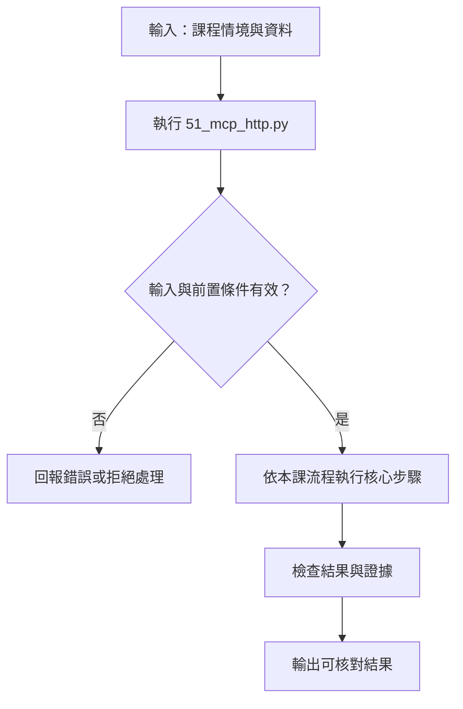

# Streamable HTTP MCP 服務

> **正文改版：20E07-E03-06｜對應新版 LLM 第 37 節：Streamable HTTP MCP 服務與部署。**
> 第 34～36 節的 server 都是 client 開的子程序（stdio），只活在同一台機器的同一個使用者底下。本節把第 36 節讀檔的 server 掛進 FastAPI，用 Uvicorn 啟動成獨立的 HTTP 服務，再從另一個程序連進去。核心主張：**一旦走網路，server 就不再「只有啟動它的人能用」。驗證身分（token）、檢查來源（Origin／Host）、逾時與關閉，都要自己做，而且要用實際被拒絕的請求證明，不能只畫架構圖。**
> 本節只綁 `127.0.0.1`，不對外公開。對外部署需要 TLS、正式的身分系統與教師受控的主機，列為**待驗證**。

[回 50 節課綱](https://hackmd.io/@yillkid/HJl8JXTNkl)

## 流程圖：Streamable HTTP MCP 服務與部署



## 學習目標與時間

先修第 33～36 節。課前安裝：`fastapi==0.142.2`（Uvicorn、Starlette 已隨 `mcp==2.3.0` 安裝）。

| 時間 | 內容 |
| --- | --- |
| 0–10 分鐘 | Streamable HTTP 是什麼：一個 `/mcp` 端點，POST 送請求，回應可以是 JSON 或 SSE 串流 |
| 10–25 分鐘 | 掛進 FastAPI：lifespan、Bearer token、Origin／Host 檢查 |
| 25–35 分鐘 | 跑 Demo：啟動紀錄、HTTP 工具呼叫、四種被拒絕的請求、逾時、關閉 |
| 35–50 分鐘 | Workshop：自己啟動服務，從另一個終端機連進去 |

驗收能力：交出**啟動紀錄、端點 URL、一次完整的 HTTP 工具呼叫、一次被拒絕的請求**。只有 localhost 時，要註明「遠端部署待驗證」。

## 一、Streamable HTTP 與舊的 HTTP+SSE

MCP 現行的遠端 transport 是 **Streamable HTTP**：只有一個端點（本節是 `/mcp/`），client 用 POST 送 JSON-RPC 請求，server 可以直接回 JSON，也可以回 SSE 串流（用來送進度或多則訊息）。

舊版的 **HTTP+SSE transport** 要兩個端點（一個 GET 開 SSE、一個 POST 送訊息），已被取代。看到舊教材或舊套件用 `/sse` 端點，那是遷移背景，不是本節主線。「回應用了 SSE」不等於「用的是舊協定」。

## 二、掛進 FastAPI 的四件事

### 1. lifespan 要自己接

`server.streamable_http_app()` 回傳一個 Starlette app，裡面的 session manager 要在 app 啟動時開始運作。**把它 `mount` 進 FastAPI 之後，子 app 的 lifespan 不會自動執行**，所以外層 FastAPI 的 lifespan 要自己 `async with server.session_manager.run()`。

漏掉這一步，服務照樣啟動、`/healthz` 照樣回 200，但每次 MCP 連線都失敗，client 只看到 `MCPError: Server returned an error response`。教師備課時實際拿掉這行驗證過。

### 2. Bearer token

本節用最簡單的做法：啟動時產生一個隨機 token，放進環境變數 `MCP_TOKEN`，FastAPI 的 middleware 檢查每個 `/mcp` 請求的 `Authorization: Bearer ...`。

- **token 不寫在程式裡，也不寫在命令列**（同一台機器的人用 `ps` 看得到命令列）。
- **用 `hmac.compare_digest` 比對**，不用 `==`：`==` 遇到第一個不同的字元就停，回應時間會洩漏猜對了幾個字。
- `/healthz` 不需要 token，但也不回任何資料。
- 這只是骨架。正式環境要用有期限、可撤銷、每人不同的憑證（例如 OAuth）；MCP SDK 有 `token_verifier`、`auth` 參數可以接，本節不展開。

### 3. Origin 與 Host 檢查

瀏覽器裡的惡意網頁可以對 `http://127.0.0.1:埠號` 發請求。**DNS rebinding** 是更進一步的手法：讓一個外部網域名稱在解析時指到 127.0.0.1，瀏覽器就會把對那個網域的請求送到你本機的服務，請求裡的 `Host` 是攻擊者的網域。所以 server 要檢查：

| 標頭 | 不在允許清單時 |
| --- | --- |
| `Origin`（瀏覽器發的請求才有） | 403 |
| `Host` | 421 |

SDK 在 `host="127.0.0.1"` 時預設會開這個保護。本節仍然明確寫出 `TransportSecuritySettings`，因為改綁其他位址時預設就不會開，要自己列清單。

### 4. 逾時與關閉

- **逾時是 client 決定的。** 本節的 client 讀取上限 1 秒，工具要跑 3 秒，client 就放棄。server 不一定知道 client 已經走了，工具可能照樣跑完，第 34 節看過同步工具「逾時後照樣寫入」。
- **關閉要有紀錄。** 送 SIGINT（等同 Ctrl-C），Uvicorn 會跑完 lifespan 的關閉段落。結束碼 0、埠不再監聽，才算真的關掉。

## 三、可執行 Demo

服務是另一個程序（`python -m uvicorn app:app`），Demo 主程式是 client，兩者只透過 HTTP 溝通。服務直接載入第 36 節的 server（路徑防護用 `safe`），另外加一個慢工具 `slow_report` 來示範逾時。同資料夾要有 `E08_mcp_file_source.py` 或第 36 節講義（Markdown）。

<!-- demo: 51_mcp_http.py -->
```python
"""第 37 節：Streamable HTTP MCP 服務。

把第 36 節讀檔的 MCP server 掛進 FastAPI，用 Uvicorn 在 127.0.0.1 啟動成獨立程序；
這支程式是另一個程序，經 HTTP 連進去。示範：啟動紀錄、discovery 與工具呼叫、
Bearer token、Origin／Host 檢查、逾時、關閉。只綁 127.0.0.1，不對外公開。
需要 mcp==2.3.0、fastapi==0.142.2、uvicorn（mcp 已帶入）；不需要模型。
"""
import asyncio
import json
import re
import secrets
import signal
import socket
import subprocess
import sys
import tempfile
import time
import types
from pathlib import Path

import httpx2
from mcp.client.client import Client
from mcp.client.streamable_http import streamable_http_client

HERE = Path(__file__).resolve().parent

APP_SOURCE = r'''
"""FastAPI＋MCP。由 uvicorn 載入；設定全部走環境變數：MCP_TOKEN、MCP_SERVER35、MCP_ROOT。"""
import asyncio, contextlib, hmac, logging, os, runpy, sys
from fastapi import FastAPI
from fastapi.responses import JSONResponse
from mcp.server.transport_security import TransportSecuritySettings

SERVER35, ROOT = os.environ["MCP_SERVER35"], os.environ["MCP_ROOT"]
TOKEN = os.environ["MCP_TOKEN"]                      # 不寫在程式裡、不寫在命令列（ps 看得到命令列）
logging.getLogger("mcp").setLevel(logging.CRITICAL)

sys.argv = [SERVER35, ROOT, "safe"]                  # 沿用第 36 節的 server，路徑防護用 safe
server = runpy.run_path(SERVER35, run_name="server35")["server"]


@server.tool()
async def slow_report(seconds: float) -> str:
    """模擬很慢的報表（唯讀）。"""
    await asyncio.sleep(seconds)
    return f"報表完成，耗時 {seconds} 秒"


mcp_app = server.streamable_http_app(
    streamable_http_path="/",                        # 掛在 /mcp 底下，所以這裡是 /
    transport_security=TransportSecuritySettings(
        enable_dns_rebinding_protection=True,
        allowed_hosts=["127.0.0.1:*", "localhost:*"],
        allowed_origins=["http://127.0.0.1:*", "http://localhost:*"],
    ),
)


@contextlib.asynccontextmanager
async def lifespan(app):
    # 掛進別的 ASGI app 時，子 app 的 lifespan 不會自動跑；session manager 要在這裡啟動
    async with server.session_manager.run():
        print("lifespan：MCP session manager 已啟動", flush=True)
        yield
    print("lifespan：MCP session manager 已關閉", flush=True)


app = FastAPI(lifespan=lifespan)


@app.middleware("http")
async def bearer_auth(request, call_next):
    if request.url.path.startswith("/mcp"):
        given = request.headers.get("authorization", "")
        if not hmac.compare_digest(given.encode(), f"Bearer {TOKEN}".encode()):   # 固定時間比對
            return JSONResponse({"error": "unauthorized"}, status_code=401,
                                headers={"WWW-Authenticate": "Bearer"})
    return await call_next(request)


@app.get("/healthz")
def healthz():
    return {"ok": True}                              # 不需要 token，也不透露任何資料


app.mount("/mcp", mcp_app)
'''


def lesson(nn):
    """同第 33 節：先找 NN_*.py，再找講義 NN-*.md。"""
    found = [(p, p.read_text(encoding="utf-8")) for p in sorted(HERE.glob(f"{nn}_*.py"))]
    for md in sorted(HERE.glob(f"{nn}-*.md")):
        found += [(md, src) for _, src in re.findall(r"<!-- demo: ([\w.]+) -->\n```python\n(.*?)\n```",
                                                     md.read_text(encoding="utf-8"), re.S)]
    if not found:
        raise FileNotFoundError(f"找不到第 {nn} 節的程式（{nn}_*.py 或 {nn}-*.md）")
    path, source = found[0]
    module = types.ModuleType(f"lesson{nn}")
    module.__file__ = str(path)
    exec(compile(source, path.name, "exec"), module.__dict__)
    return module


L35 = lesson("36")


def free_port():
    with socket.socket() as s:
        s.bind(("127.0.0.1", 0))
        return s.getsockname()[1]


def start_service(base, token):
    root = L35.build_workspace(base)
    (base / "server35.py").write_text(L35.SERVER_SOURCE, encoding="utf-8")
    (base / "app.py").write_text(APP_SOURCE, encoding="utf-8")
    port = free_port()
    log = open(base / "uvicorn.log", "w", encoding="utf-8")
    proc = subprocess.Popen(
        [sys.executable, "-m", "uvicorn", "app:app", "--host", "127.0.0.1", "--port", str(port),
         "--log-level", "info", "--no-access-log"],
        cwd=base, stdout=log, stderr=subprocess.STDOUT,
        env={"MCP_TOKEN": token, "MCP_SERVER35": str(base / "server35.py"), "MCP_ROOT": str(root),
             "PATH": "", "PYTHONPATH": str(base), "PYTHONUNBUFFERED": "1", "PYTHONIOENCODING": "utf-8"},
    )
    return proc, port, log, root


def wait_ready(port, proc, deadline=20):
    start = time.monotonic()
    while time.monotonic() - start < deadline:
        if proc.poll() is not None:
            raise RuntimeError("服務啟動失敗，見 uvicorn.log")
        try:
            if httpx2.get(f"http://127.0.0.1:{port}/healthz", timeout=1).status_code == 200:
                return
        except httpx2.TransportError:
            time.sleep(0.2)
    raise TimeoutError("服務沒有在時限內就緒")


def log_lines(base):
    """啟動紀錄：去掉每次不同的 PID 與埠號。"""
    text = (base / "uvicorn.log").read_text(encoding="utf-8")
    text = re.sub(r"\[\d+\]", "[PID]", text)
    return re.sub(r"127\.0\.0\.1:\d+", "127.0.0.1:PORT", text).splitlines()


def mcp_client(url, token, timeout=None):
    headers = {"Authorization": f"Bearer {token}"} if token else {}
    http = httpx2.AsyncClient(headers=headers, timeout=httpx2.Timeout(30, read=timeout or 300))
    return Client(streamable_http_client(url, http_client=http)), http


def root_cause(error):
    while getattr(error, "exceptions", None):
        error = error.exceptions[0]
    return error


async def scenarios(port, token):
    url = f"http://127.0.0.1:{port}/mcp/"

    print("\n== 二、另一個程序經 HTTP：discovery 與工具呼叫 ==")
    client, http = mcp_client(url, token)
    async with http, client:
        names = sorted(t.name for t in (await client.list_tools()).tools)
        print("  工具：", names)
        result = await client.call_tool("count_events", {"site": "A"})
        print("  count_events(A)：", json.dumps(json.loads(result.content[0].text), ensure_ascii=False))
        result = await client.call_tool("read_file", {"path": "../secret.txt"})
        print("  read_file(../secret.txt)：", "錯誤" if result.is_error else "讀到！",
              result.content[0].text.replace("Error executing tool ", ""))

    print("\n== 三、在 MCP 之前就擋下的請求（直接送 HTTP） ==")
    body = {"jsonrpc": "2.0", "id": 1, "method": "tools/list"}
    base_headers = {"Content-Type": "application/json", "Accept": "application/json, text/event-stream"}
    cases = (
        ("沒有 token", {}),
        ("錯的 token", {"Authorization": "Bearer wrong"}),
        ("token 對，Origin 是外站", {"Authorization": f"Bearer {token}", "Origin": "https://evil.example"}),
        ("token 對，Host 不在清單", {"Authorization": f"Bearer {token}", "Host": "attacker.example"}),
    )
    async with httpx2.AsyncClient(timeout=5) as raw:
        for label, extra in cases:
            r = await raw.post(url, json=body, headers={**base_headers, **extra})
            print(f"  HTTP {r.status_code}  {r.text[:24]:<24}  ← {label}")

    print("\n== 四、MCP client 用錯 token：連線階段就失敗 ==")
    client, http = mcp_client(url, "wrong")
    try:
        async with http, client:
            await client.list_tools()
        print("  竟然連上了！")
    except Exception as error:
        error = root_cause(error)
        print(f"  {type(error).__name__}：{str(error)[:60]}")

    print("\n== 五、逾時：client 讀取上限 1 秒，工具要 3 秒 ==")
    client, http = mcp_client(url, token, timeout=1)
    started = time.monotonic()
    try:
        async with http, client:
            await client.call_tool("slow_report", {"seconds": 3})
        print("  沒有逾時")
    except Exception as error:
        waited = time.monotonic() - started
        print(f"  {type(root_cause(error)).__name__}，{'不到 3 秒就放棄（沒等工具做完）' if waited < 3 else f'等了 {waited:.0f} 秒'}")
    client, http = mcp_client(url, token)
    async with http, client:
        print("  服務仍可用：", (await client.call_tool("slow_report", {"seconds": 0.1})).content[0].text)


def main():
    import logging
    logging.getLogger("mcp").setLevel(logging.CRITICAL)
    logging.getLogger("httpx2").setLevel(logging.CRITICAL)
    token = secrets.token_urlsafe(24)                 # 每次啟動產生；正式環境由祕密管理系統給
    with tempfile.TemporaryDirectory() as tmp:
        base = Path(tmp)
        proc, port, log, root = start_service(base, token)
        try:
            wait_ready(port, proc)
            print("== 一、啟動紀錄（PID、埠號已遮蔽） ==")
            for line in log_lines(base):
                print("  " + line)
            asyncio.run(scenarios(port, token))
        finally:
            proc.send_signal(signal.SIGINT)           # 等同在終端機按 Ctrl-C
            code = proc.wait(timeout=20)
            log.close()
        print("\n== 六、關閉 ==")
        tail = log_lines(base)
        for line in tail[tail.index(next(l for l in tail if "Shutting down" in l)):]:
            print("  " + line)
        print(f"  程序結束碼 {code}；埠 {'仍在聽' if probe(port) else '已關閉'}")


def probe(port):
    with socket.socket() as s:
        return s.connect_ex(("127.0.0.1", port)) == 0


if __name__ == "__main__":
    main()
```

執行（程式也放在 [llm-demo](https://github.com/4-learn/llm-demo)），約 6 秒：

```bash
python -m pip install "fastapi==0.142.2"
python 51_mcp_http.py
```

關鍵輸出（示範機 4-learn：Ubuntu 24.04／Python 3.12.3／mcp 2.3.0／fastapi 0.142.2／uvicorn 0.54.0，20E07-E03-06；備課機 Python 3.10.15 逐字相同）：

```text
== 一、啟動紀錄（PID、埠號已遮蔽） ==
  INFO:     Started server process [PID]
  INFO:     Waiting for application startup.
  lifespan：MCP session manager 已啟動
  INFO:     Application startup complete.
  INFO:     Uvicorn running on http://127.0.0.1:PORT (Press CTRL+C to quit)

== 二、另一個程序經 HTTP：discovery 與工具呼叫 ==
  工具： ['count_events', 'get_doc', 'list_sources', 'read_file', 'slow_report']
  count_events(A)： {"site": "A", "count": 3, "source": {"path": "events.csv", "sha256": "d48577004a78", "rows": 4}}
  read_file(../secret.txt)： 錯誤 read_file: 拒絕：路徑在資料目錄外

== 三、在 MCP 之前就擋下的請求（直接送 HTTP） ==
  HTTP 401  {"error":"unauthorized"}  ← 沒有 token
  HTTP 401  {"error":"unauthorized"}  ← 錯的 token
  HTTP 403  Invalid Origin header     ← token 對，Origin 是外站
  HTTP 421  Invalid Host header       ← token 對，Host 不在清單

== 四、MCP client 用錯 token：連線階段就失敗 ==
  MCPError：Server returned an error response

== 五、逾時：client 讀取上限 1 秒，工具要 3 秒 ==
  ReadTimeout，不到 3 秒就放棄（沒等工具做完）
  服務仍可用： 報表完成，耗時 0.1 秒

== 六、關閉 ==
  INFO:     Shutting down
  INFO:     Waiting for application shutdown.
  lifespan：MCP session manager 已關閉
  INFO:     Application shutdown complete.
  INFO:     Finished server process [PID]
  程序結束碼 0；埠 已關閉
```

## 四、結果怎麼讀

### 1. 啟動紀錄要看到 lifespan

第一段的 `lifespan：MCP session manager 已啟動` 出現在 `Application startup complete` 之前。沒有這行，就是第二段第 1 點的錯誤。

### 2. 走 HTTP，路徑防護照樣有效

第二段 `read_file(../secret.txt)` 被拒絕。換 transport 不會改變工具本身的檢查，但也不會「多一層保護」：HTTP 層只管誰能連進來，連進來之後能做什麼，還是工具自己決定。

### 3. 四種請求在 MCP 之前就被擋下

第三段直接送 HTTP，沒有經過 MCP client。401 是 FastAPI 的 middleware 擋的，403、421 是 SDK 的 transport security 擋的。它們都沒有進到工具。

### 4. client 看到的錯誤不夠具體

第四段：錯的 token 在 HTTP 層是清楚的 401，但 MCP client 只回報 `MCPError: Server returned an error response`。漏掉 lifespan 時，client 看到的也是同一句。**連不上時，先用 `curl` 或第三段那種直接的 HTTP 請求看狀態碼，再看服務端的紀錄**，不要只讀 client 的錯誤訊息。

### 5. 逾時之後服務還在

第五段 client 1 秒就放棄，下一個連線照樣能用。

## 五、常見誤判

| 誤判 | 實際 |
| --- | --- |
| 「綁 127.0.0.1 就不用驗證」 | 同一台機器的其他使用者、瀏覽器裡的網頁都連得到 |
| 「有 token 就安全」 | 還要檢查 Origin／Host，token 也要能撤銷、有期限 |
| 「`/healthz` 回 200，服務就正常」 | 漏掉 lifespan 時 `/healthz` 正常，MCP 全部失敗 |
| 「回應有 SSE，就是舊的 HTTP+SSE 協定」 | Streamable HTTP 也可以用 SSE 回應 |
| 「client 逾時，server 就停了」 | 工具可能照樣跑完；有寫入的工具要搭配第 29 節的冪等 |

## Workshop：自己啟動服務，從另一個終端機連進去

### 任務

1. （5 分鐘）把 Demo 裡的 `APP_SOURCE` 存成 `app.py`，`L35.SERVER_SOURCE` 存成 `server35.py`，用第 36 節的 `build_workspace` 建一個資料目錄。在終端機 A 設好三個環境變數後啟動：

```bash
export MCP_TOKEN=自己產生的一串亂數
export MCP_SERVER35=$PWD/server35.py
export MCP_ROOT=$PWD/lab/data
python -m uvicorn app:app --host 127.0.0.1 --port 8036
```

2. （4 分鐘）在終端機 B 用 `curl` 送一個沒有 token 的請求，再送一個有 token 的 `tools/list`：

```bash
curl -i -X POST http://127.0.0.1:8036/mcp/ -H "Content-Type: application/json" -d '{"jsonrpc":"2.0","id":1,"method":"tools/list"}'
```

3. （4 分鐘）在終端機 B 寫一小段 Python，用 `mcp_client` 連 `http://127.0.0.1:8036/mcp/` 呼叫 `count_events`。
4. （2 分鐘）在終端機 A 按 Ctrl-C，把關閉紀錄貼上來。

有教師提供的遠端服務時，第 2、3 題改連教師給的 URL 與 token，並測一次錯的 token。

### 參考判讀

- 第 1 題：看到 `lifespan：MCP session manager 已啟動` 與 `Uvicorn running on http://127.0.0.1:8036`。
- 第 2 題：沒有 token 是 `HTTP/1.1 401 Unauthorized`。加上 `-H "Authorization: Bearer $MCP_TOKEN"` 和 `-H "Accept: application/json, text/event-stream"` 後，備課機實測得到 `HTTP/1.1 400 Bad Request`，內容是 `Missing session ID`。這是 **MCP 層**的回應：請求已經通過 token 檢查，只是沒先做初始化協商。**重點是它通過了 401**；完整的協商交給 MCP client（第 3 題）。
- 第 3 題：結果與 Demo 第二段相同（count 3）；如果先跑過第 36 節第二段那種改檔，數字會不同，看 `source.sha256` 就知道是哪一版檔案。
- 第 4 題：`Shutting down`、`lifespan：MCP session manager 已關閉`、`Finished server process`。

### 驗收

- 啟動紀錄（第 1 題）與端點 URL。
- 一次完整的 HTTP 工具呼叫（第 3 題，含來源雜湊）。
- 一次被拒絕的請求（第 2 題的 401），說明是哪一層擋的。
- 一句：只有 localhost 時，寫明「遠端部署待驗證」。

## 教師紀錄與下一步

- 證據等級：**本機實測**（兩個獨立程序經 127.0.0.1 的 HTTP 溝通；真實 Uvicorn、FastAPI、MCP SDK）。示範機 4-learn（Python 3.12.3）連跑 2 次、備課機（Python 3.10.15）連跑 3 次，輸出逐字相同、stderr 為空。
- 漏掉 lifespan 的行為：備課機實測，把 `session_manager.run()` 換成空的 context manager 後，`/healthz` 正常，MCP client 得到 `MCPError: Server returned an error response`。
- **遠端部署：待驗證。** 沒有在對外的主機上跑過，也沒有 TLS。Workshop 的遠端選項需要教師先準備受控的服務與 token。
- Workshop 第 2 題：備課機照講義步驟手動啟動在 8036 埠實測，無 token 得 401，有 token 得 400 `Missing session ID`（MCP 層）。回應內容可能隨 SDK 版本變，講義只要求「通過 401」；**這一題尚未在學生機實跑**。
- `fastapi==0.142.2` 是 20E07-E03-06 實裝的版本，裝在 `~/.venvs/llm-course` 不會改動 Starlette（1.7.0）。已加入安裝基線。
- 舊教材的 SSE 範例對應舊的 HTTP+SSE transport，以本節為準，**尚未實班試教**。
- 下一步：第 38 節回到 LangGraph，比較固定 workflow 與多代理，處理並行結果的合併。
