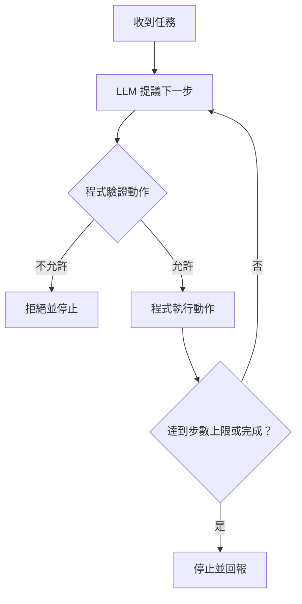

# 41｜Agent 設計｜依結果選擇下一步

> 本課只學一件事：Agent 依結果選下一步，並設步數上限。

## 固定流程與 Agent

固定流程預先排好每一步；Agent 會依結果決定下一步。步數上限限制重試次數，但不會自動去重（辨認並移除重複動作）或確保選擇正確。

## Demo：模型提議，程式驗證並執行

<!-- demo: 41_agent_patterns.py -->
```python
weather = "未知"
step_limit = 3
for step in range(step_limit):
    if weather == "未知":
        next_step = "查詢天氣"
    else:
        next_step = "整理並回答"
    print("第", step + 1, "步：模擬模型選擇：", next_step)
    if next_step == "查詢天氣":
        weather = "晴天"
    else:
        break
```

實際輸出：
```text
第 1 步：模擬模型選擇： 查詢天氣
第 2 步：模擬模型選擇： 整理並回答
```

本例用 `if` 模擬模型提議；真實 Agent 會由 LLM（大型語言模型）依結果提出下一步，程式先驗證允許的動作，再執行並限制步數。



## 這跟 LLM 的關係

LLM 可依對話或工具結果建議動作，但不應直接擁有無限制權限。程式要驗證動作、限制工具和設定停止條件。本例沒有呼叫模型或天氣服務。

## 動手試試

把 `step_limit` 改成 `1`，實際輸出第一步查天氣；若增加「達到步數上限，停止」的 else 區塊，還會印出該停止訊息。步數上限防止模型或流程反覆重試而無限執行，也限制時間、成本和副作用；它不負責去重。

## 自我檢查

1. Agent 流程中誰提議下一步，誰驗證並執行？

答案：LLM 提議下一步，程式驗證並執行。

2. 範例裡的 `if` 本身是 LLM 嗎？

答案：不是，`if` 是程式規則，用來模擬模型選擇。

3. 為什麼要設定步數上限？

答案：避免無限重試或執行，限制時間、成本與可能的副作用。
