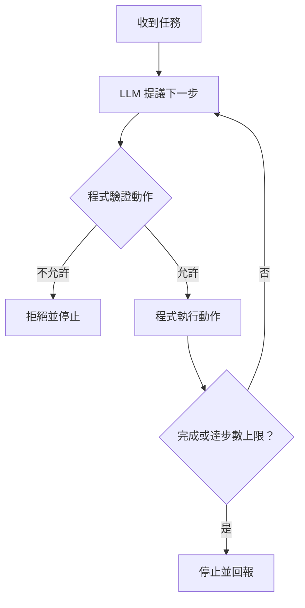

# 41｜Agent 設計｜依結果選擇下一步

> 本課只學一件事：Agent 依結果選下一步，並設定步數上限。

## 固定流程與 Agent

固定流程預先排好每一步；Agent 則會根據結果決定下一步。步數上限限制重試次數，但不會自動移除重複動作，也不能保證選擇正確。

## Demo：模擬選擇下一步

<!-- demo: 41_agent_patterns.py -->

```python
weather = "未知"
step_limit = 3
for step in range(step_limit):
    if weather == "未知":
        next_step = "查詢天氣"
    else:
        next_step = "整理並回答"
    print("第", step + 1, "步：模擬模型選擇：", next_step)
    if next_step == "查詢天氣":
        weather = "晴天"
    else:
        break
```

實際輸出：
```text
第 1 步：模擬模型選擇： 查詢天氣
第 2 步：模擬模型選擇： 整理並回答
```

本例由 `if` 模擬模型提出選擇；真實 Agent 會由 LLM（大型語言模型）依結果提出下一步，再由程式檢查是否允許並執行。



## 這與 LLM 有什麼關係？

LLM 可以根據對話或工具回傳結果建議下一個動作，但不應直接擁有無限制權限。程式要驗證動作、限制可用工具並設定停止條件。本例沒有呼叫模型或天氣服務。

## 練習與自我檢查

把 `step_limit` 改成 `1`，程式只會印出查詢天氣的第一步便停止。加入 `else` 可在迴圈耗盡時印出停止訊息。

1. 誰提出下一步，誰驗證並執行？
2. 範例中的 `if` 是 LLM 嗎？
3. 為什麼要設定步數上限？

**答案：**LLM 提議，程式驗證與執行；不是，`if` 是用來模擬選擇的程式規則；避免無限重試，限制時間、成本與副作用。
