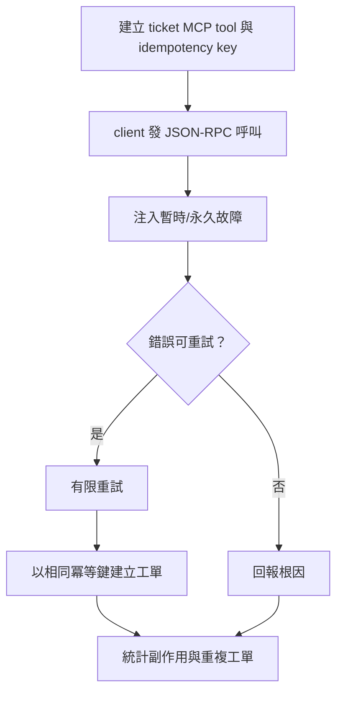
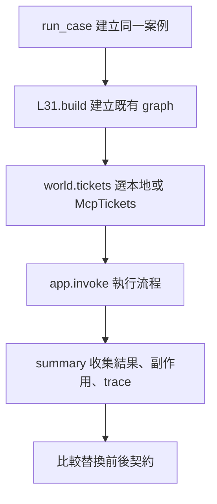
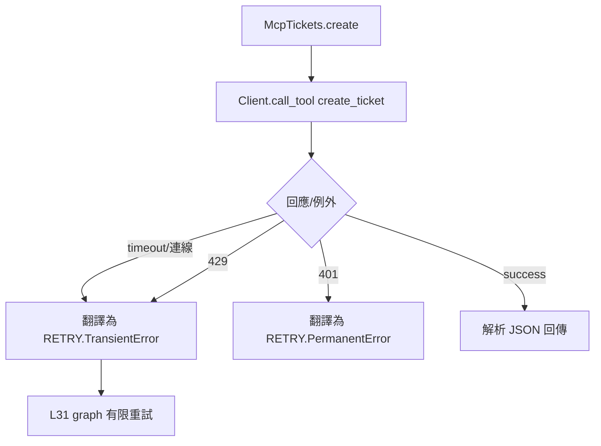
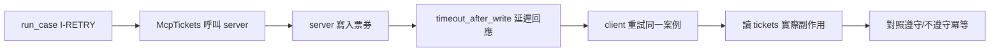
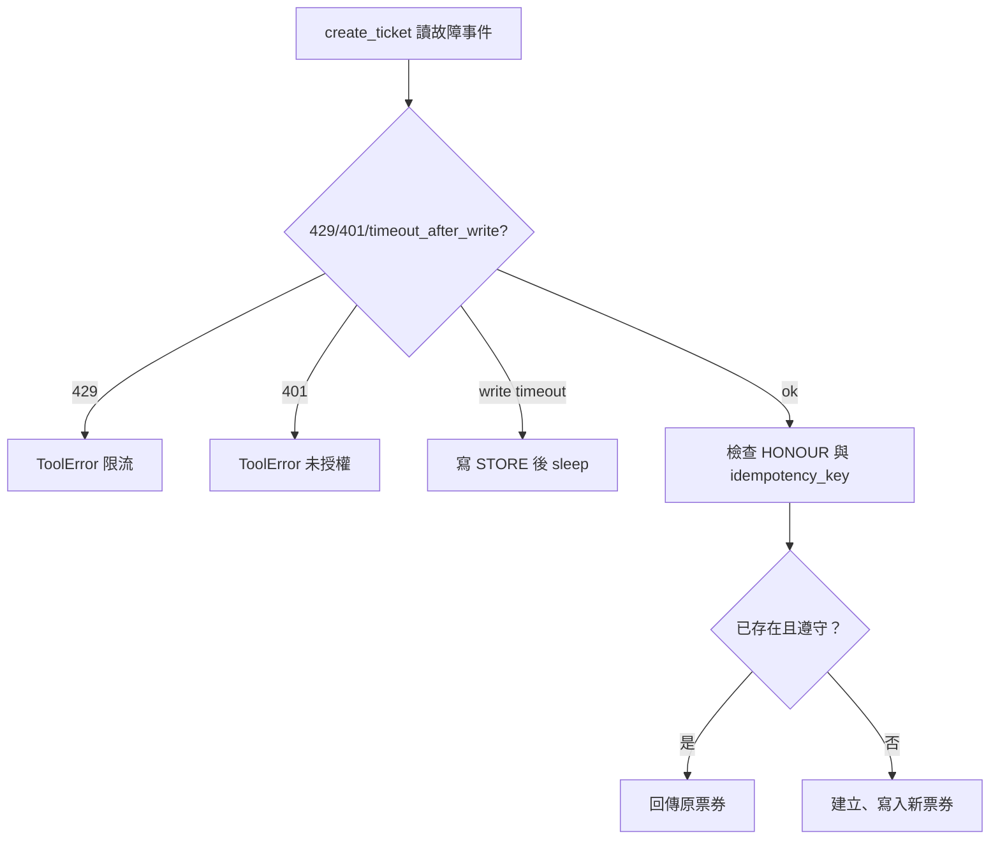

# MCP 增量整合里程碑

> **正文改版：20E07-E03-06｜對應新版 LLM 第 44 節：MCP 增量整合里程碑。**
> 第 32 節把 RAG、政策、HITL、重試、trace 接成一條流程；第 33～37 節做了 MCP server 與 client。本節**不另建系統**：直接載入第 32 節的流程，graph、政策、HITL、重試、trace 一行都不改，只把「開單服務」換成一個 stdio MCP server。換之前、換之後跑同一組 9 個案例，對照輸出契約與副作用。核心主張：**換 transport 是增量，不是重寫；驗收是「同一組案例、同一份契約」，不是「MCP 跑起來了」。但契約裡有些東西（例如冪等）不會自動跟著搬過去，要在新的那一側重新驗證。**

[回 51 節必修＋9 節選修課綱](https://hackmd.io/@yillkid/HJl8JXTNkl)

## 流程圖：MCP 增量整合里程碑



## 學習目標與時間

先修第 32 節（整合骨架）、第 35～39 節。課前已能執行第 32 節 Demo。

| 時間 | 內容 |
| --- | --- |
| 0–10 分鐘 | 增量替換：介面不變、錯誤翻譯、副作用以 server 端為準 |
| 10–25 分鐘 | 跑 Demo：替換前後 9 個案例對照 |
| 25–35 分鐘 | 契約沒有自動搬過去的地方：冪等、授權、逾時 |
| 35–50 分鐘 | Workshop：成功、連線失敗、人工拒絕三類 |

驗收能力：交出**增量差異**（改了哪些行）、**三類測試結果**，以及**尚未完成的遠端驗證項**。

## 一、要換的只有一個東西

第 32 節的開單走 `world.tickets.create(site, key)`，背後是第 29 節的 `TicketService`。本節寫一個 `McpTickets` 類別，提供**完全相同的介面**（`create`、`tickets`），底下改成：

1. 用 stdio 啟動 `ticket_server.py`（一個 MCP server，工單寫在磁碟上的 JSON 檔）。
2. 呼叫 `create_ticket` 工具，帶上冪等鍵。
3. 把 MCP 的錯誤**翻譯回第 29 節的兩類**：401 是永久錯誤（不重試），429、逾時、連線失敗是暫時錯誤（重試）。

`run_case` 裡唯一的差別是一行：`world.tickets = McpTickets(...)`。graph 不知道開單已經換成 MCP。

### 錯誤翻譯是契約的一部分

第 32 節的重試規則依錯誤類別決定。MCP client 拿到的錯誤長得不一樣：工具錯誤是 `is_error=True` 的結果，逾時是 `MCPError`，server 啟動不了是 `FileNotFoundError`。**沒有翻譯，重試規則就失效**：例如 401 被當成暫時錯誤重試三次，或逾時被當成永久錯誤直接放棄。

### 副作用以 server 端為準

`McpTickets.tickets` 讀磁碟上的工單檔，不是讀 client 收到的回應。逾時的時候 client 什麼都沒收到，但工單可能已經寫進去了（第 29 節的 `timeout_after_write`）。**數副作用要數真的發生的，不是數 client 以為發生的。**

## 二、可執行 Demo

需要 `langgraph==1.2.12`、`mcp==2.3.0`。同資料夾要有第 24、26、29、31、32 節的程式（`NN_*.py` 或講義 `NN-*.md`），以及 `data/sop_corpus.json`、`data/search_cases.json`（同第 24 節）。示範機約 22 秒，大部分時間在等 I-RETRY 的逾時（每案例各一次，3 秒）。

### Call session 1：MCP transport 替換與契約對照

**System layer**


**Internal function flow**


### Call session 2：逾時後寫入與冪等鍵

**System layer**


**Internal function flow**


<!-- demo: 51_mcp_increment.py -->
```python
"""第 40 節：MCP 增量整合里程碑。

不另建系統：直接載入第 32 節的流程（graph、政策、HITL、重試、trace 全部不動），
只把「開單服務」換成一個 stdio MCP server。換之前、換之後跑同一組案例，對照輸出契約與副作用。
需要 langgraph==1.2.12、mcp==2.3.0；不需要模型。
"""
import asyncio
import json
import logging
import re
import sys
import tempfile
import types
from pathlib import Path

from mcp.client.client import Client
from mcp.client.stdio import StdioServerParameters

HERE = Path(__file__).resolve().parent

SERVER_SOURCE = r'''
"""開單 MCP server。用法：python ticket_server.py <工單檔> <故障劇本檔> <是否遵守冪等鍵 1/0>"""
import json, logging, sys, time
from pathlib import Path
from mcp.server.mcpserver import MCPServer
from mcp.server.mcpserver.exceptions import ToolError

logging.getLogger("mcp").setLevel(logging.CRITICAL)
STORE, FAULTS, HONOUR = Path(sys.argv[1]), Path(sys.argv[2]), sys.argv[3] == "1"
server = MCPServer("tickets", version="1.0.0")


def next_fault():
    faults = json.loads(FAULTS.read_text(encoding="utf-8"))
    event = faults.pop(0) if faults else "ok"
    FAULTS.write_text(json.dumps(faults), encoding="utf-8")
    return event


@server.tool()
def create_ticket(site: str, idempotency_key: str) -> dict:
    """建立工單。同一把 idempotency_key 只會建立一張，重送時回傳原本那張。"""
    event = next_fault()
    if event == "rate_limited":
        raise ToolError("429 限流")
    if event == "unauthorized":
        raise ToolError("401 未授權")
    data = json.loads(STORE.read_text(encoding="utf-8"))
    if HONOUR and idempotency_key in data["keys"]:
        return data["keys"][idempotency_key]
    ticket = {"id": f"T{len(data['tickets']) + 1}", "site": site}
    data["tickets"].append(ticket)
    data["keys"][idempotency_key] = ticket
    STORE.write_text(json.dumps(data, ensure_ascii=False), encoding="utf-8")   # 先寫入
    if event == "timeout_after_write":
        time.sleep(30)                                                          # 回應遲遲不來：client 會逾時
    return ticket


server.run("stdio")
'''


def lesson(nn):
    """同第 32 節：先找 NN_*.py，再找講義 NN-*.md；讀原始碼後 exec。"""
    found = [(p, p.read_text(encoding="utf-8")) for p in sorted(HERE.glob(f"{nn}_*.py"))]
    for md in sorted(HERE.glob(f"{nn}-*.md")):
        found += [(md, src) for _, src in re.findall(r"<!-- demo: ([\w.]+) -->\n```python\n(.*?)\n```",
                                                     md.read_text(encoding="utf-8"), re.S)]
    if not found:
        raise FileNotFoundError(f"找不到第 {nn} 節的程式（{nn}_*.py 或 {nn}-*.md）")
    path, source = found[0]
    module = types.ModuleType(f"lesson{nn}")
    module.__file__ = str(path)
    exec(compile(source, path.name, "exec"), module.__dict__)
    return module


L31 = lesson("32")
RETRY = L31.RETRY
READ_TIMEOUT = 3          # 秒；每次 tools/call 等回應的上限


def root_cause(error):
    while getattr(error, "exceptions", None):
        error = error.exceptions[0]
    return error


class McpTickets:
    """與第 29 節 TicketService 相同的介面（create、tickets），底下改走 MCP。

    介面一樣，流程就不用改；錯誤要翻譯回第 29 節的兩類，重試規則才會照舊。
    """

    def __init__(self, base, failures=(), honour_keys=True, command=sys.executable):
        self.store = base / "tickets.json"
        self.store.write_text(json.dumps({"tickets": [], "keys": {}}), encoding="utf-8")
        faults = base / "faults.json"
        faults.write_text(json.dumps(list(failures)), encoding="utf-8")
        server_file = base / "ticket_server.py"
        server_file.write_text(SERVER_SOURCE, encoding="utf-8")
        self.params = StdioServerParameters(command=command,
                                            args=[str(server_file), str(self.store), str(faults), "1" if honour_keys else "0"])
        self.calls = []                                 # 每次呼叫的結果：審計用

    @property
    def tickets(self):
        """副作用以磁碟上的工單檔為準，不以 client 收到的回應為準。"""
        return json.loads(self.store.read_text(encoding="utf-8"))["tickets"]

    def create(self, site, key):
        async def go():
            async with Client(self.params, read_timeout_seconds=READ_TIMEOUT) as client:
                return await client.call_tool("create_ticket", {"site": site, "idempotency_key": key})

        try:
            result = asyncio.run(go())
        except Exception as error:
            cause = root_cause(error)
            text = str(cause)
            if "Timed out" in text or "timed out" in text.lower():
                self.calls.append("逾時")
                raise RETRY.TransientError("MCP 逾時（寫入可能已完成）")
            self.calls.append(f"連線失敗 {type(cause).__name__}")
            raise RETRY.TransientError(f"MCP 連線失敗（{type(cause).__name__}）")
        text = result.content[0].text
        if result.is_error:
            self.calls.append(text.split(": ", 1)[-1])
            if "401" in text:
                raise RETRY.PermanentError("401 未授權")
            raise RETRY.TransientError("429 限流")
        self.calls.append("成功")
        return json.loads(text)


def run_case(case, base=None, **mcp):
    """base 為 None：第 32 節原樣（本地服務）；否則把 world.tickets 換成 McpTickets。"""
    case_id, _, role, action, qid, script, answer, faults, _, _ = case
    world = L31.World(faults)
    if base is not None:
        world.tickets = McpTickets(base, faults, **mcp)
    app = L31.build(world, script)
    config = {"configurable": {"thread_id": case_id}}
    out = app.invoke({"case_id": case_id, "role": role, "action": action, "qid": qid}, config)
    if "__interrupt__" in out:
        out = app.invoke(L31.Command(resume=answer), config)
    return out, world


def summary(out, world):
    statuses = ",".join(f"{s['name']}={s['status']}" for s in world.tracer.spans)
    return out["result"], world.side_effects(), statuses


def main():
    logging.getLogger("mcp").setLevel(logging.CRITICAL)
    import importlib.metadata as metadata
    print("langgraph:", metadata.version("langgraph"), "｜mcp:", metadata.version("mcp"),
          "｜沿用第 32 節流程，只換開單服務")

    print("\n== 一、替換前後：同一組案例，比結果、副作用、trace ==")
    same = 0
    rows = {}
    for case in L31.CASES:
        with tempfile.TemporaryDirectory() as tmp:
            before = summary(*run_case(case))
            out, world = run_case(case, Path(tmp))
            after = summary(out, world)
            rows[case[0]] = world.tickets.calls
        same += before == after
        print(f"  {case[0]:<9}{'相同' if before == after else '不同！'}  {after[0]}｜副作用 {after[1]}")
        if before != after:
            print(f"           替換前：{before}")
    print(f"  {same}／{len(L31.CASES)} 案例輸出契約相同")

    print("\n== 二、MCP 呼叫紀錄（client 端每次呼叫的結果） ==")
    for case_id, calls in rows.items():
        print(f"  {case_id:<9}{'、'.join(calls) if calls else '未呼叫 MCP'}")

    print("\n== 三、Workshop 三類：成功、連線失敗、人工拒絕 ==")
    cases = {c[0]: c for c in L31.CASES}
    with tempfile.TemporaryDirectory() as tmp:
        out, world = run_case(cases["I-OK"], Path(tmp))
        print(f"  成功      {out['result']}｜工單檔 {world.tickets.tickets}")
    with tempfile.TemporaryDirectory() as tmp:
        out, world = run_case(cases["I-OK"], Path(tmp), command=str(Path(tmp) / "沒有這個程式"))
        span = next(s for s in world.tracer.spans if s["name"] == "tool:create_ticket")
        print(f"  連線失敗  {out['result']}")
        print(f"            副作用 {world.side_effects()}｜trace {span['status']}，嘗試 {span['attrs']['attempts']} 次")
    with tempfile.TemporaryDirectory() as tmp:
        out, world = run_case(cases["I-REJ"], Path(tmp))
        print(f"  人工拒絕  {out['result']}｜MCP 呼叫 {len(world.tickets.calls)} 次｜工單檔 {world.tickets.tickets}")

    print("\n== 四、換了 transport，契約有沒有跟著搬過去？ ==")
    with tempfile.TemporaryDirectory() as tmp:
        out, world = run_case(cases["I-RETRY"], Path(tmp), honour_keys=False)
        print(f"  server 不遵守冪等鍵、I-RETRY：{out['result']}｜工單檔實際 {len(world.tickets.tickets)} 張"
              f"（{[t['id'] for t in world.tickets.tickets]}）")
    with tempfile.TemporaryDirectory() as tmp:
        staff_ticket = ("I-STAFF", "正常", "visitor", "create_ticket", "Q02", "A1", None, (), "", 0)
        out, world = run_case(staff_ticket, Path(tmp))
        print(f"  角色 visitor 開單：{out['result']}｜MCP 呼叫 {len(world.tickets.calls)} 次")

    print("\n== 五、尚未完成（遠端驗證） ==")
    for gap in ("本節只用 stdio；改走第 37 節的 Streamable HTTP 時，token 與 Origin 檢查要重測一次",
                "server 的權限是「能啟動它的人」；沒有每位使用者的身分，角色檢查仍只在 host 端",
                "工單檔是本機 JSON，不是真實工單系統；冪等鍵沒有到期時間",
                "逾時後 server 程序被結束，但寫入已經發生：要靠冪等鍵，不能靠「逾時就當沒做」"):
        print("-", gap)


if __name__ == "__main__":
    main()
```

執行（程式也放在 [llm-demo](https://github.com/4-learn/llm-demo)）：

```bash
python 51_mcp_increment.py
```

關鍵輸出（示範機 4-learn：Ubuntu 24.04／Python 3.12.3／langgraph 1.2.12／mcp 2.3.0，20E07-E03-06；備課機 Python 3.10.15 逐字相同）：

```text
langgraph: 1.2.12 ｜mcp: 2.3.0 ｜沿用第 32 節流程，只換開單服務

== 一、替換前後：同一組案例，比結果、副作用、trace ==
  I-OK     相同  已開單 T1｜副作用 1
  I-RETRY  相同  已開單 T1｜副作用 1
  I-UNK    相同  轉人工覆核｜副作用 0
  I-BADCIT 相同  轉人工覆核｜副作用 0
  I-REJ    相同  未通知（人工拒絕）｜副作用 0
  I-DENY   相同  未通知（政策拒絕）｜副作用 0
  I-APPR   相同  已通知工地｜副作用 1
  I-FAIL   相同  開單失敗（第 3 次：429 限流 → 預算用完，放棄）→ 轉人工｜副作用 0
  I-AUTH   相同  開單失敗（第 1 次：401 未授權 → 永久錯誤，不重試）→ 轉人工｜副作用 0
  9／9 案例輸出契約相同

== 二、MCP 呼叫紀錄（client 端每次呼叫的結果） ==
  I-OK     成功
  I-RETRY  逾時、成功
  I-UNK    未呼叫 MCP
  I-BADCIT 未呼叫 MCP
  I-REJ    未呼叫 MCP
  I-DENY   未呼叫 MCP
  I-APPR   未呼叫 MCP
  I-FAIL   429 限流、429 限流、429 限流
  I-AUTH   401 未授權

== 三、Workshop 三類：成功、連線失敗、人工拒絕 ==
  成功      已開單 T1｜工單檔 [{'id': 'T1', 'site': 'A'}]
  連線失敗  開單失敗（第 3 次：MCP 連線失敗（FileNotFoundError） → 預算用完，放棄）→ 轉人工
            副作用 0｜trace error，嘗試 3 次
  人工拒絕  未通知（人工拒絕）｜MCP 呼叫 0 次｜工單檔 []

== 四、換了 transport，契約有沒有跟著搬過去？ ==
  server 不遵守冪等鍵、I-RETRY：已開單 T2｜工單檔實際 2 張（['T1', 'T2']）
  角色 visitor 開單：未開單（角色 visitor 無權使用 create_ticket）｜MCP 呼叫 0 次

== 五、尚未完成（遠端驗證） ==
- 本節只用 stdio；改走第 37 節的 Streamable HTTP 時，token 與 Origin 檢查要重測一次
- server 的權限是「能啟動它的人」；沒有每位使用者的身分，角色檢查仍只在 host 端
- 工單檔是本機 JSON，不是真實工單系統；冪等鍵沒有到期時間
- 逾時後 server 程序被結束，但寫入已經發生：要靠冪等鍵，不能靠「逾時就當沒做」
```

## 三、結果怎麼讀

### 1. 9／9 契約相同

第一段比的是三樣東西：結果文字、副作用數、trace 狀態。三樣都相同才算「相同」。只比結果文字會漏掉「說沒開、其實開了」。

### 2. 重試與冪等照樣成立

第二段 I-RETRY 是「逾時、成功」：第一次呼叫時 server 已經寫入，但回應遲遲不來，client 3 秒後放棄；第 32 節的重試規則把逾時當暫時錯誤，再送一次，server 看到同一把冪等鍵，回傳原本那張 T1。結果仍是 1 張。

I-FAIL 三次 429、I-AUTH 一次 401：錯誤翻譯讓重試規則照舊。

### 3. 拒絕時 MCP 根本沒被呼叫

I-REJ、I-DENY、I-APPR 走的是通知，不是開單，而且拒絕發生在 host 端（第 26 節政策、第 32 節 HITL），所以 MCP 呼叫數是 0。**拒絕要在呼叫之前，不是呼叫之後再撤銷。**

### 4. 連線失敗

第三段把 server 的啟動指令改成不存在的程式：三次都是暫時錯誤，預算用完後轉人工，副作用 0，trace 記錄 error 與嘗試 3 次。

### 5. 契約沒有自動搬過去的地方

第四段：

- **冪等**：如果 server 不遵守冪等鍵，同樣的 I-RETRY 會開出 2 張單（T1、T2），而 client 只回報「已開單 T2」。第 32 節的冪等是本地服務保證的；換成 MCP 後，這個保證要由 server 提供，**host 端的測試看不出來**，要在 server 那一側重新驗證。
- **授權**：角色 `visitor` 被第 26 節政策擋下，MCP 呼叫 0 次。但 server 本身不知道角色，它只信任「能啟動它的人」。如果有別的 client 直接連這個 server，政策就被繞過了。這是第五段第 2 點。

## 四、常見誤判

| 誤判 | 實際 |
| --- | --- |
| 「接 MCP 要重寫流程」 | 介面不變，graph 一行都不用改 |
| 「MCP 有錯誤訊息，重試規則會自己處理」 | 要翻譯回永久／暫時兩類 |
| 「逾時就是沒做」 | 寫入可能已經完成，靠冪等鍵 |
| 「本地測過冪等，換成 MCP 也一樣」 | 冪等要 server 端提供，換 server 就要重測 |
| 「host 端有角色檢查，server 就安全」 | server 不知道角色，別的 client 可以直接連 |

## Workshop：成功、連線失敗、人工拒絕

### 任務

1. （3 分鐘）跑一次 Demo，用自己的話說明第一段「相同」比的是哪三樣東西。
2. （4 分鐘）列出本節對第 32 節的**增量差異**：新增了哪些東西、改了第 32 節哪幾行（提示：`run_case` 裡的一行）。
3. （4 分鐘）在第三段加一個案例：I-AUTH 換成 MCP。trace 的 `attempts` 是多少？為什麼不是 3？
4. （4 分鐘）把 `READ_TIMEOUT` 改成 1 再跑。I-RETRY 結果有變嗎？Demo 時間呢？

### 參考判讀

- 第 1 題：結果文字、副作用數（以 server 端工單檔為準）、trace 各 span 的狀態。
- 第 2 題：新增 `SERVER_SOURCE`（開單 MCP server）、`McpTickets`（同介面、錯誤翻譯、副作用讀工單檔）。第 32 節本身沒有改；本節的 `run_case` 與第 32 節相同，只多了 `world.tickets = McpTickets(...)` 一行。
- 第 3 題：`attempts=1`。401 被翻譯成永久錯誤，第 29 節的規則不重試。如果翻譯錯成暫時錯誤，就會是 3。
- 第 4 題：結果不變（仍是 T1、1 張），每次逾時從 3 秒變 1 秒，Demo 快 4 秒左右（I-RETRY 在第一段跑、第四段不遵守冪等鍵又跑一次）。逾時太短的風險：正常但較慢的呼叫也會被當成失敗而重試，冪等鍵就更重要。

### 驗收

- 增量差異（第 2 題）。
- 三類測試：成功、連線失敗、人工拒絕（Demo 第三段），各附副作用數。
- 尚未完成的遠端驗證項（Demo 第五段），至少寫出你的環境還缺哪一項。

## 教師紀錄與下一步

- 證據等級：**本機實測**（真實 stdio MCP server 子程序、真實 LangGraph；生成沿用第 24 節劇本，不呼叫模型）。示範機 4-learn（Python 3.12.3）與備課機（Python 3.10.15）各連跑 2 次，輸出逐字相同、stderr 為空，結束後沒有殘留的 server 程序。
- Workshop 第 3、4 題的答案**尚未在學生機實跑**；第 3 題由測試涵蓋。
- 本節只用 stdio。改走第 37 節的 Streamable HTTP 並部署到遠端，**待驗證**。
- 舊教材 [總整合](https://hackmd.io/@yillkid/rbdsDQ3iQmu1QyG5dK9dGg)、[MCP 真資料](https://hackmd.io/@yillkid/OC56rJxWRYOjcJ78K4kSmg) **尚未修改**。
- 下一步：第 41 節。
