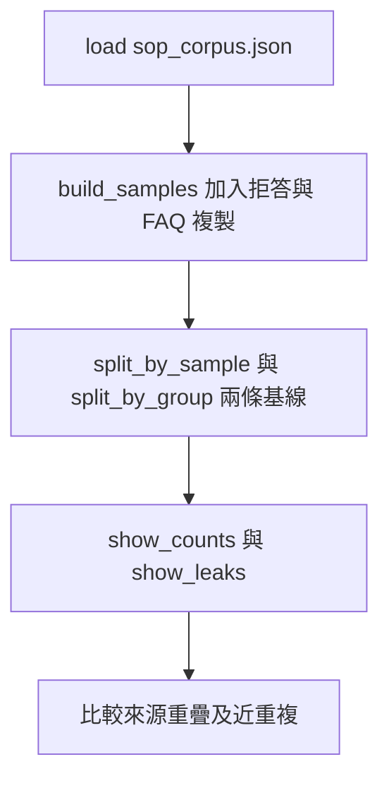
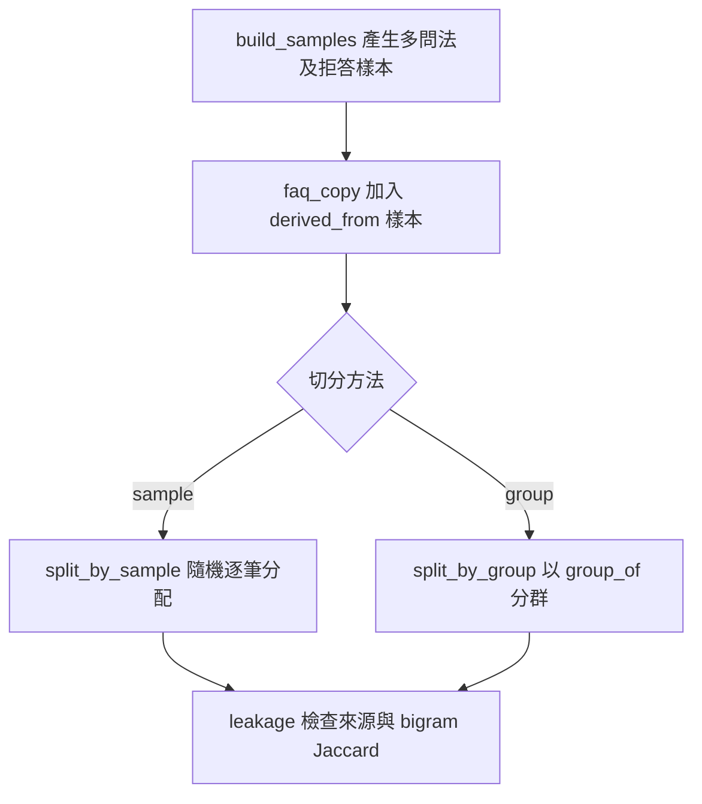
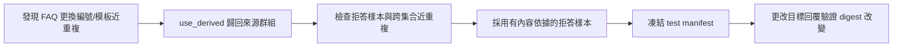
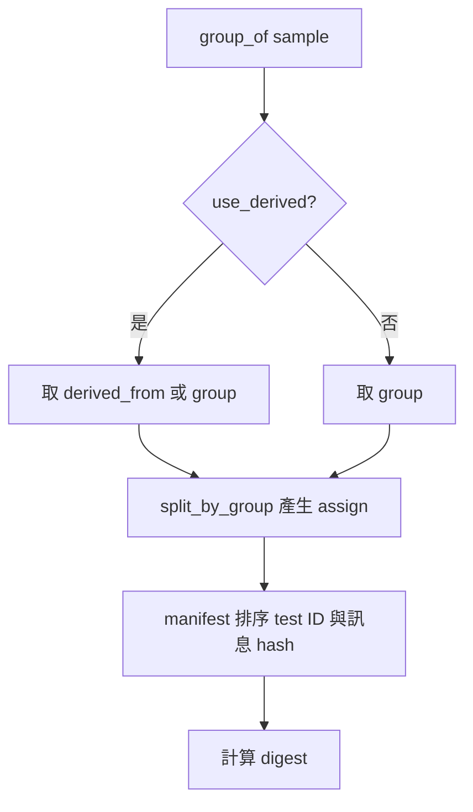

# SFT 資料與按來源拆分

> **新版正文：20E07-E03-05｜對應新版 LLM 第 42 節：SFT 資料與按來源拆分。**
> 微調之前，先把**資料**做對：train／validation／test 要**按來源**拆，不是逐筆隨機拆；拆完還要用近重複檢查抓「換了編號的複製品」與「同一個模板」；最後凍結 test manifest。本節只用 Python 標準函式庫，**不訓練任何模型**——洩漏在訓練之前就已經發生，也在訓練之前就能檢查。

[回 50 節課綱](https://hackmd.io/@yillkid/HJl8JXTNkl)

## 學習目標與時間

先修第 08 節（dev／holdout）、第 19 節（chunk ID 與來源版本）、第 41 節（判斷是否值得 SFT）。

| 時間 | 內容 |
| --- | --- |
| 0–8 分鐘 | SFT 樣本長什麼樣：messages、目標回覆、拒答樣本 |
| 8–18 分鐘 | 為什麼逐筆隨機拆會洩漏：同一段落的三種問法 |
| 18–28 分鐘 | 群組拆分的兩個漏洞：改了編號的複製品、共用模板 |
| 28–35 分鐘 | 跑 Demo |
| 35–50 分鐘 | Workshop：調門檻、換 seed、修一個同源跨集合問題 |

驗收能力：交付 **split manifest、來源分布與洩漏檢查**——test 不參與訓練、挑 checkpoint 或調整提示；能說明每一個群組規則是為了擋哪一種洩漏。

> **授權與資料來源**：本節的樣本全部由 MariaDB 課的虛構教學語料 `sop_corpus.json` 合成，每段都標「本段為虛構教學資料」。真實專案在產生樣本前要先確認**授權**（文件能不能拿來訓練）與**個資**；這兩件事本節不處理，但驗收表要列出來。

## 一、SFT 樣本

```json
{"id": "C003-q1", "group": "D002", "source": "C003",
 "messages": [{"role": "user", "content": "教學閘道器無線連線限制要怎麼做？"},
              {"role": "assistant", "content": "教學閘道器 A 與 B 只支援 2.4 GHz 無線網路……"}]}
```

| 欄位 | 用途 |
| --- | --- |
| `id` | 樣本編號；manifest 用它列出 test 內容 |
| `group` | 拆分單位；**同一群組的樣本只能落在同一個集合** |
| `source` | 最細的來源（chunk ID）；檢查「同一段落是否跨集合」 |
| `derived_from` | 這份資料是從哪裡改寫來的；沒有這欄，複製品就會變成「新來源」 |
| `messages` | 對話格式；真實訓練時還要套上模型自己的 chat template（第 05 節） |

**拒答樣本**和一般樣本一樣重要：如果 train 裡沒有任何「文件沒寫就不能推測」的例子，微調後的模型會傾向**什麼都回答**。

## 二、Demo 裡的資料

- 14 個 active 段落 × 3 種問法 = 42 筆（三種問法共用**同一個**目標回覆）。
- 7 份 active 文件各 1 題拒答 = 7 筆。
- 1 筆「FAQ 整理」：從 D006 的 C012 複製、改了幾個字，卻拿到新的文件編號 F001。

這三類分別代表真實資料裡最常見的三種洩漏來源：**同一段落的多種問法**、**共用模板的回覆**、**二手整理的複製品**。

## 三、可執行 Demo

### Call session 1：隨機切分對照來源群組切分

**System layer**


**Internal function flow**


### Call session 2：修正來源與凍結 test manifest

**System layer**


**Internal function flow**


<!-- demo: E07_sft_split.py -->
```python
"""第 42 節：SFT 資料與按來源拆分（只用 Python 標準函式庫，不訓練任何模型）。

從 MariaDB 課的 SOP 語料產生合成 SFT 樣本，比較兩種切分：
  - 逐樣本隨機切：同一段落的改寫題同時出現在 train 與 test → 洩漏
  - 按來源群組切：同一份文件的樣本只會在同一個集合
再用近重複檢查找出群組切分漏掉的兩種洩漏——換了編號的複製品、共用模板的拒答——
修正後凍結 test manifest。近重複用回覆的字元 bigram Jaccard，是教學用的粗略指標。
"""

import hashlib
import json
import random
import re
from collections import Counter, defaultdict
from pathlib import Path

BOILERPLATE = "本段為虛構教學資料，不適用真實設備。"
SEED = 20261005
RATIO = {"train": 0.7, "validation": 0.15, "test": 0.15}
NEAR_DUP = 0.6          # 回覆的字元 bigram Jaccard ≥ 此值視為近重複


def load(name):
    here = Path(__file__).resolve().parent
    for base in (here, here.parent / "mariadb", Path.cwd(), Path.cwd().parent / "mariadb"):
        if (base / "data" / name).exists():
            return json.loads((base / "data" / name).read_text(encoding="utf-8"))
    raise FileNotFoundError(f"找不到 data/{name}（在 MariaDB 課的教材目錄）")


TEMPLATES = ("{title}要怎麼做？", "請說明{title}的步驟。", "關於{title}，有什麼要注意的？")


def refusal(style, title, first_rule):
    """三種拒答寫法：同一句模板／只換標題／引用該文件實際寫了什麼。"""
    if style == "template":
        return "文件沒有定義的情況不能推測，請保留紀錄並回報教師。"
    if style == "title":
        return f"《{title}》沒有寫到這個情況，我不能推測；請保留目前的紀錄並回報教師。"
    return f"文件只寫到「{first_rule}」，沒有寫到你問的情況，所以不能推測。"


def build_samples(corpus, refusal_style="template"):
    """每個 active 段落 3 題（同一個目標回覆），每份文件再加 1 題拒答。"""
    titles = {d["document_id"]: d["title"] for d in corpus["documents"] if d["status"] == "active"}
    first_rule = {}
    for chunk in corpus["chunks"]:
        first_rule.setdefault(chunk["document_id"], re.split("[。；]", chunk["text"].replace(BOILERPLATE, ""))[0])
    samples = []
    for chunk in corpus["chunks"]:
        doc = chunk["document_id"]
        if doc not in titles:
            continue
        answer = chunk["text"].replace(BOILERPLATE, "")
        for n, template in enumerate(TEMPLATES, 1):
            samples.append({"id": f"{chunk['chunk_id']}-q{n}", "group": doc, "source": chunk["chunk_id"],
                            "messages": [{"role": "user", "content": template.format(title=titles[doc])},
                                         {"role": "assistant", "content": answer}]})
    for doc, title in sorted(titles.items()):
        samples.append({"id": f"{doc}-refuse", "group": doc, "source": doc,
                        "messages": [{"role": "user", "content": f"{title}的文件沒寫到的情況，可以自己推測嗎？"},
                                     {"role": "assistant", "content": refusal(refusal_style, title, first_rule[doc])}]})
    return samples


# 一份「FAQ 整理」：內容是從 D006 複製改寫來的，卻拿到新的文件編號。
def faq_copy(corpus):
    c012 = next(c for c in corpus["chunks"] if c["chunk_id"] == "C012")
    text = c012["text"].replace(BOILERPLATE, "").replace("資料上傳逾時時", "上傳逾時的時候，")
    return [{"id": "F001-q1", "group": "F001", "source": "F001", "derived_from": "D006",
             "messages": [{"role": "user", "content": "上傳一直沒回應怎麼辦？"},
                          {"role": "assistant", "content": text}]}]


def bigrams(text):
    text = re.sub(r"\s+", "", text)
    return {text[i:i + 2] for i in range(len(text) - 1)}


def jaccard(a, b):
    a, b = bigrams(a), bigrams(b)
    return len(a & b) / len(a | b) if a | b else 0.0


def answer(sample):
    return sample["messages"][-1]["content"]


def split_by_sample(samples):
    order = sorted(samples, key=lambda s: s["id"])
    random.Random(SEED).shuffle(order)
    cut1, cut2 = round(len(order) * RATIO["train"]), round(len(order) * (RATIO["train"] + RATIO["validation"]))
    return {s["id"]: ("train" if i < cut1 else "validation" if i < cut2 else "test") for i, s in enumerate(order)}


def group_of(sample, use_derived=False, template_group=False):
    if template_group and sample["id"].endswith("-refuse"):
        return "TEMPLATE-refuse"           # 同一個模板產生的回覆，視為同一個來源
    if use_derived:
        return sample.get("derived_from") or sample["group"]
    return sample["group"]


def split_by_group(samples, **rule):
    """群組依雜湊排序後輪流分配；同一群組的樣本必在同一集合。"""
    groups = sorted({group_of(s, **rule) for s in samples},
                    key=lambda g: hashlib.sha256(f"{SEED}:{g}".encode()).hexdigest())
    plan = {g: ("test", "validation", "train", "train", "train", "train", "train")[i % 7] for i, g in enumerate(groups)}
    return {s["id"]: plan[group_of(s, **rule)] for s in samples}, plan


def leakage(samples, assign):
    """回傳 (validation／test 中來源段落也出現在別的集合的樣本數, 跨集合的近重複對)。

    validation 也要查：它用來挑 checkpoint，洩漏到 validation 一樣會讓挑選失真。
    """
    sources = defaultdict(set)
    for s in samples:
        sources[s["source"]].add(assign[s["id"]])
    same_source = sum(1 for s in samples if assign[s["id"]] != "train" and len(sources[s["source"]]) > 1)
    pairs = sorted((a["id"], b["id"], round(jaccard(answer(a), answer(b)), 2))
                   for i, a in enumerate(samples) for b in samples[i + 1:]
                   if assign[a["id"]] != assign[b["id"]] and jaccard(answer(a), answer(b)) >= NEAR_DUP)
    return same_source, pairs


def manifest(samples, assign, split="test"):
    rows = sorted((s["id"], hashlib.sha256(json.dumps(s["messages"], ensure_ascii=False, sort_keys=True)
                                           .encode()).hexdigest()[:12]) for s in samples if assign[s["id"]] == split)
    digest = hashlib.sha256(json.dumps(rows).encode()).hexdigest()[:16]
    return rows, digest


def show_counts(title, samples, assign):
    counts = Counter(assign[s["id"]] for s in samples)
    refuse = Counter(assign[s["id"]] for s in samples if s["id"].endswith("-refuse"))
    groups = defaultdict(set)
    for s in samples:
        groups[assign[s["id"]]].add(s["group"])
    print(f"  {title}")
    for split in ("train", "validation", "test"):
        print(f"    {split:<10} {counts[split]:>2} 筆（拒答 {refuse[split]}）｜文件 {' '.join(sorted(groups[split]))}")


def show_leaks(samples, assign):
    same, pairs = leakage(samples, assign)
    refuse = [p for p in pairs if p[0].endswith("-refuse")]
    other = [p for p in pairs if not p[0].endswith("-refuse")]
    print(f"  validation／test 中，來源段落也在別的集合：{same} 筆")
    print(f"  跨集合近重複對（回覆 Jaccard ≥ {NEAR_DUP}）：{len(pairs)} 對｜其中拒答模板 {len(refuse)} 對")
    for pair in other[:3]:
        print(f"    {pair}")
    return same, pairs


def main():
    corpus = load("sop_corpus.json")
    samples = build_samples(corpus) + faq_copy(corpus)
    print(f"語料 {corpus['dataset_version']}｜合成樣本 {len(samples)} 筆（14 段 × 3 題＋7 題拒答＋1 題 FAQ 複製品）｜seed {SEED}")
    print()

    print("=== 一、逐樣本隨機切 ===")
    naive = split_by_sample(samples)
    show_counts("70／15／15", samples, naive)
    show_leaks(samples, naive)
    print()

    print("=== 二、按文件群組切 ===")
    grouped, _ = split_by_group(samples)
    show_counts("群組依雜湊輪流分配", samples, grouped)
    show_leaks(samples, grouped)
    print("  來源編號檢查是 0，近重複檢查卻不是：F001 換了編號；拒答回覆是同一個模板。")
    print()

    print("=== 三、修正 F001：依 derived_from 歸回 D006 ===")
    derived, _ = split_by_group(samples, use_derived=True)
    show_counts("F001 併入 D006", samples, derived)
    show_leaks(samples, derived)
    print()

    print("=== 四、拒答模板的三種修法 ===")
    lumped, _ = split_by_group(samples, use_derived=True, template_group=True)
    show_counts("(a) 7 題拒答視為同一群組", samples, lumped)
    show_leaks(samples, lumped)
    print("  近重複歸零，但 7 題拒答整組落在同一個集合：train 一題拒答都沒有，模型學不到拒答。")
    titled = build_samples(corpus, "title") + faq_copy(corpus)
    show_counts("(b) 模板裡換上各文件標題", titled, derived)
    show_leaks(titled, derived)
    print("  只換標題，句子其他部分一樣：仍是近重複。")
    samples = build_samples(corpus, "content") + faq_copy(corpus)
    fixed, _ = split_by_group(samples, use_derived=True)
    show_counts("(c) 拒答引用該文件實際寫了什麼", samples, fixed)
    show_leaks(samples, fixed)
    print()

    print("=== 五、凍結 test manifest（採用 (c)）===")
    rows, digest = manifest(samples, fixed)
    print(f"  test {len(rows)} 筆｜manifest 摘要 {digest}")
    print(f"  前 3 列：{rows[:3]}")
    tampered = [dict(s, messages=[s["messages"][0], {"role": "assistant", "content": answer(s) + "。"}])
                if s["id"] == rows[0][0] else s for s in samples]
    _, changed = manifest(tampered, fixed)
    print(f"  {rows[0][0]} 的回覆多加一個句號 → 摘要 {changed}（{'不同' if changed != digest else '相同'}）")
    shots = [s["id"] for s in samples if fixed[s["id"]] == "train"][:2]
    print(f"  few-shot 範例取自 train：{shots}｜與 test 交集 {len(set(shots) & {r[0] for r in rows})} 筆")


if __name__ == "__main__":
    main()
```

執行指令（在 [`llm-demo`](https://github.com/4-learn/llm-demo) 目錄下；語料在 `data/sop_corpus.json`，**不需要網路、不需要模型**）：

```bash
python3 E07_sft_split.py
```

關鍵輸出（Linux／Python 3.10.15，20E07-E03-05）：

```text
語料 sop-v1｜合成樣本 50 筆（14 段 × 3 題＋7 題拒答＋1 題 FAQ 複製品）｜seed 20261005

=== 一、逐樣本隨機切 ===
  70／15／15
    train      35 筆（拒答 5）｜文件 D001 D002 D004 D005 D006 D007 D008 F001
    validation  7 筆（拒答 2）｜文件 D001 D002 D006 D007 D008
    test        8 筆（拒答 0）｜文件 D002 D004 D005 D006 D007
  validation／test 中，來源段落也在別的集合：10 筆
  跨集合近重複對（回覆 Jaccard ≥ 0.6）：30 對｜其中拒答模板 10 對
    ('C001-q1', 'C001-q2', 1.0)
    ('C001-q2', 'C001-q3', 1.0)
    ('C002-q1', 'C002-q3', 1.0)

=== 二、按文件群組切 ===
  群組依雜湊輪流分配
    train      35 筆（拒答 5）｜文件 D001 D002 D004 D007 D008
    validation  7 筆（拒答 1）｜文件 D006
    test        8 筆（拒答 1）｜文件 D005 F001
  validation／test 中，來源段落也在別的集合：0 筆
  跨集合近重複對（回覆 Jaccard ≥ 0.6）：14 對｜其中拒答模板 11 對
    ('C0E02-q1', 'F001-q1', 0.86)
    ('C0E02-q2', 'F001-q1', 0.86)
    ('C0E02-q3', 'F001-q1', 0.86)
  來源編號檢查是 0，近重複檢查卻不是：F001 換了編號；拒答回覆是同一個模板。

=== 三、修正 F001：依 derived_from 歸回 D006 ===
  F001 併入 D006
    train      35 筆（拒答 5）｜文件 D001 D002 D004 D007 D008
    validation  8 筆（拒答 1）｜文件 D006 F001
    test        7 筆（拒答 1）｜文件 D005
  validation／test 中，來源段落也在別的集合：0 筆
  跨集合近重複對（回覆 Jaccard ≥ 0.6）：11 對｜其中拒答模板 11 對

=== 四、拒答模板的三種修法 ===
  (a) 7 題拒答視為同一群組
    train      30 筆（拒答 0）｜文件 D001 D002 D004 D007 D008
    validation  7 筆（拒答 0）｜文件 D006 F001
    test       13 筆（拒答 7）｜文件 D001 D002 D004 D005 D006 D007 D008
  validation／test 中，來源段落也在別的集合：0 筆
  跨集合近重複對（回覆 Jaccard ≥ 0.6）：0 對｜其中拒答模板 0 對
  近重複歸零，但 7 題拒答整組落在同一個集合：train 一題拒答都沒有，模型學不到拒答。
  (b) 模板裡換上各文件標題
    train      35 筆（拒答 5）｜文件 D001 D002 D004 D007 D008
    validation  8 筆（拒答 1）｜文件 D006 F001
    test        7 筆（拒答 1）｜文件 D005
  validation／test 中，來源段落也在別的集合：0 筆
  跨集合近重複對（回覆 Jaccard ≥ 0.6）：11 對｜其中拒答模板 11 對
  只換標題，句子其他部分一樣：仍是近重複。
  (c) 拒答引用該文件實際寫了什麼
    train      35 筆（拒答 5）｜文件 D001 D002 D004 D007 D008
    validation  8 筆（拒答 1）｜文件 D006 F001
    test        7 筆（拒答 1）｜文件 D005
  validation／test 中，來源段落也在別的集合：0 筆
  跨集合近重複對（回覆 Jaccard ≥ 0.6）：0 對｜其中拒答模板 0 對

=== 五、凍結 test manifest（採用 (c)）===
  test 7 筆｜manifest 摘要 22d8af3e37000af1
  前 3 列：[('C0E02-q1', 'ff3c9bd2c70a'), ('C0E02-q2', '430ad46fcea6'), ('C0E02-q3', 'e3eadc9b48a7')]
  C0E02-q1 的回覆多加一個句號 → 摘要 1f9cb9b28bd0fcc0（不同）
  few-shot 範例取自 train：['C001-q1', 'C001-q2']｜與 test 交集 0 筆
```

## 四、結果怎麼讀

### 1. 逐筆隨機拆：test 的題目在 train 裡有原題

validation 與 test 共 15 筆，其中 **10 筆**的來源段落也出現在別的集合，跨集合的近重複有 **30 對**，很多是 Jaccard 1.0——三種問法共用同一個回覆，一筆進 train、另一筆進 test，模型只要**背下回覆**就能在 test 拿分。這時 test 量到的是記憶，不是能力。

另一個問題是 test 裡**拒答 0 筆**：隨機拆不保證每種樣本都會出現在 test，這樣根本量不到模型會不會拒答。

### 2. 按文件拆：來源檢查歸零，近重複檢查沒有

改成按文件群組拆以後，「來源段落跨集合」變成 0。如果只看這一個指標，會以為洩漏已經解決。但近重複還有 **14 對**：

- **3 對是 F001**：「FAQ 整理」是從 C012 複製後改了幾個字，Jaccard 0.86。它拿到新的文件編號，群組規則就把它當成新來源，結果複製品進了 test、原文留在 validation。
- **11 對是拒答模板**：7 題拒答的回覆是**同一句話**。雖然問題來自不同文件，但模型看過 train 裡的 5 次之後，test 的拒答等於是送分題。

**兩種檢查要一起做**：來源 ID 檢查只抓得到有標記的同源，近重複檢查才抓得到沒有標記的同源。

### 3. 修 F001：`derived_from`

把 F001 依 `derived_from` 歸回 D006 的群組以後，F001 的 3 對消失，剩下 11 對都是拒答模板。真實資料裡，`derived_from` 往往**根本沒有人填**——那時只能靠近重複檢查先找出來，再回頭補標記。

### 4. 拒答模板：三種修法，只有一種對

| 修法 | 近重複 | train 的拒答 | 結論 |
| --- | --- | --- | --- |
| (a) 7 題拒答當成同一群組 | 0 對 | **0 題** | 洩漏沒了，但模型學不到拒答 |
| (b) 模板裡換上各文件標題 | 11 對 | 5 題 | 只換標題，句子其他部分一樣，仍是近重複 |
| (c) 拒答引用該文件實際寫了什麼 | **0 對** | 5 題 | 採用 |

(a) 是最常見的「修好了」：數字歸零，但它把 7 題拒答整組丟進 test，train 一題都沒有。**洩漏檢查的數字歸零，不代表資料是對的**；要同時看每個集合裡各類樣本的分布。

(c) 讓每一題拒答都說出「文件寫了什麼、沒寫什麼」，回覆自然就不同。這也比較接近我們希望模型學到的行為：拒答時要說明依據。

### 5. 凍結 test manifest

manifest 列出 test 每一筆的 `id` 與內容雜湊，再對整份清單取一個摘要。只要 test 有任何一個字改變（例如多一個句號），摘要就會改變。訓練、挑 checkpoint、調提示的過程中，都要先比對摘要，確認 test 沒有被動過。

few-shot 範例只能從 train 選；Demo 最後一行確認它和 test 的交集是 0 筆。

## 五、常見誤判

| 誤判 | 為什麼錯 |
| --- | --- |
| 「隨機拆 70／15／15 就公平」 | 同源樣本會跨集合，test 量到的是記憶 |
| 「來源 ID 檢查是 0，就沒有洩漏」 | 換了編號的複製品、共用模板都抓不到；要加近重複檢查 |
| 「近重複歸零就修好了」 | 可能是把整類樣本搬進同一個集合（修法 a）；要看各集合的樣本分布 |
| 「拒答樣本不重要」 | train 沒有拒答，微調後的模型傾向什麼都回答 |
| 「只要 test 乾淨，validation 無所謂」 | validation 用來挑 checkpoint；它洩漏一樣會讓挑選失真 |
| 「Jaccard 0.6 是標準門檻」 | 那是本節選的教學值；門檻要依資料調整，並報告用的值 |
| 「few-shot 範例挑最好的就好」 | 從 test 挑就是洩漏；只能從 train 挑 |

## Workshop：調門檻、換 seed、修一個問題

### 任務

以下每題都**重新執行原始程式**後單獨修改，不要累積前一題的修改。

1. 把 `NEAR_DUP` 改成 0.9 與 0.5，第二段（按文件拆）的跨集合近重複各剩幾對？再對採用的 (c) 版本把門檻降到 0.4，會出現幾對？那些是真的洩漏嗎？
2. 把 `SEED` 改成 1、2、3，對 (c) 版本執行群組拆分。test 與 validation 各是哪份文件？test 的筆數會變嗎？
3. 用 (c) 版本的全部樣本（含拒答）改走**逐筆隨機拆**（第一段的 `split_by_sample`）。來源跨集合與近重複各是多少？這說明拒答寫法和拆分方法各自解決了什麼？
4. 自己加一筆從 C004 複製、改幾個字的「同學筆記」，**不填** `derived_from`。只靠近重複檢查，能不能找到它？
5. 寫一份 split 報告：群組規則、各集合的文件與筆數（含拒答筆數）、兩種洩漏檢查的結果、使用的門檻、manifest 摘要。

### 參考判讀

以下每一題都是**重新載入程式後**單獨修改、實際執行的結果。

- 第 1 題：0.9 時剩 **11 對**（只剩 Jaccard 1.0 的拒答模板，F001 的 0.86 漏掉了）；0.5 時是 **14 對**，和 0.6 相同。(c) 版本在 0.4 會出現 **4 對**，全是拒答之間的對（最高 0.52）。它們的句型相同（「文件只寫到……所以不能推測」），但內容不同，算不算洩漏需要人工判斷；**門檻太高會漏掉真的複製品，太低會把句型相同誤報成洩漏**。
- 第 2 題：seed 1 時 test＝D007、validation＝D001；seed 2 時 test＝D001、validation＝D004；seed 3 時 test＝D007、validation＝D008。test 都是 **7 筆**（一份文件 2 段 × 3 題＋1 題拒答）。哪份文件進 test 會影響成績，所以 seed 必須寫進報告，**不能換 seed 換到成績好看為止**。
- 第 3 題：來源跨集合 **10 筆**、近重複 **20 對**。拒答寫法修好了拒答之間的近重複，但同一段落的三種問法仍會跨集合；兩個問題要分別用不同方法解決。
- 第 4 題：沒有標準答案。要報告你的筆記與 C004 的 Jaccard，以及它在你選的門檻下有沒有被抓到。
- 第 5 題：沒有標準答案。

### 驗收

- 交付 split manifest（test 每筆 `id`＋內容雜湊＋整體摘要）、各集合的來源分布（含拒答筆數）。
- 同時報告兩種洩漏檢查：來源 ID 跨集合筆數、跨集合近重複對數與使用的門檻。
- 至少修正一個同源跨集合的問題，並說明修正後各集合的樣本分布沒有因此失衡。
- 寫明 seed；few-shot 範例只從 train 選。
- 寫明資料授權與個資檢查的狀態（本節是虛構語料，但欄位要在）。

## 教師紀錄與下一步

- 本節**不需要模型、網路或任何 SDK**，也**不訓練**。證據等級：**本機實測（資料拆分與洩漏檢查）**。「洩漏會讓 test 分數虛高多少」需要實際微調才能量，屬**待驗證**，留給第 43–44 節（依模型下載政策而定）。
- 樣本由 MariaDB 課的虛構語料合成，問題用 3 個固定模板產生，**不是**真實使用者的問題；它的目的只是製造可檢查的洩漏。真實 SFT 資料的問題分布要另外設計。
- 撰寫時的實際紀錄：① 第一版的洩漏檢查只比 test 對 train，漏掉了 validation；改為檢查所有跨集合的組合。② 第一版拒答的修法是「把拒答當成同一群組」，近重複歸零就以為修好了，看到各集合的拒答筆數才發現 train 一題拒答都沒有；改為三種修法並列，並在每個集合的筆數旁列出拒答筆數。③ 第二版的拒答只換上文件標題，還是有 7～11 對近重複；最後改成引用文件實際內容。
- 第 43 節接上：用 (c) 版本的 train／validation 做 LoRA 教師訓練紀錄，test manifest 摘要寫進訓練紀錄。
