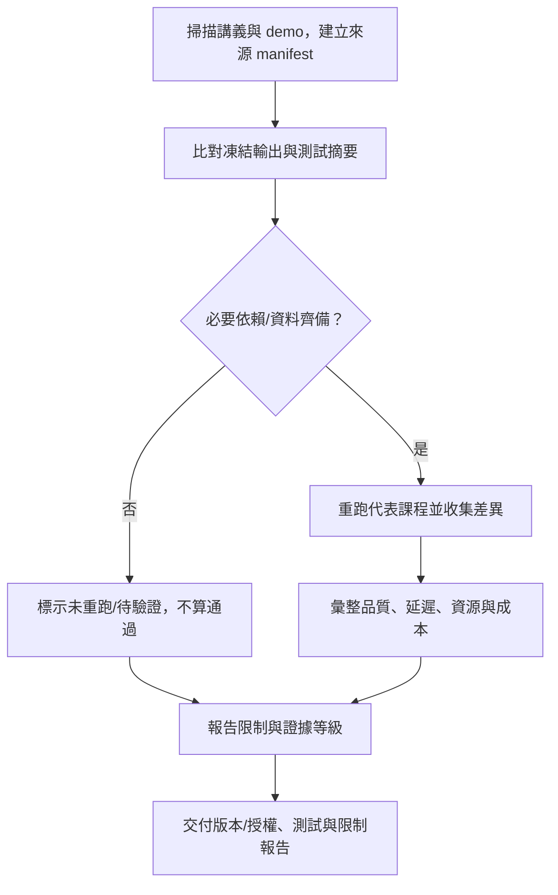

# 全課增量驗收與評估報告

> **正文改版：2026-10-06｜對應新版 LLM 第 51 節：全課增量驗收與評估報告。**
> 最後一節不做新功能，也不從零做一個大專案。要回答的是四個問題：**系統能做什麼、證據在哪、成本多少、失敗怎麼處理。** 本節 Demo 掃描已撰寫的必修教材，列來源 manifest；重跑代表節次對照凍結輸出；整理品質、延遲、資源、成本，並列出待驗證。所有數字都標明證據等級；重播不能當成即時成果。

[回 51 節必修課綱](https://hackmd.io/@yillkid/HJl8JXTNkl)

## 流程圖：驗收閘門與證據報告



## 學習目標與時間

先修必修第 01–50 節。課前準備第 35、44 節的里程碑程式、第 43–50 節報告，以及本節評估報告模板。

| 時間 | 內容 |
| --- | --- |
| 0–15 分鐘 | 報告結構與驗收 rubric；證據分級 |
| 15–25 分鐘 | 跑 Demo：manifest、重跑、數字表、限制清單 |
| 25–35 分鐘 | 怎麼寫「失敗」與「不採用」 |
| 35–50 分鐘 | Workshop：重跑、差異摘要、說明一個失敗案例 |

驗收能力：交出**來源 manifest、版本／授權表、測試摘要、品質延遲成本表、限制清單**，每一項都標證據等級。

## 一、報告要回答的問題

| 問題 | 證據來自 | 常見的錯 |
| --- | --- | --- |
| 基準是什麼？ | 第 01 節規則 baseline、第 10 節評測集 | 沒有 baseline，只報新系統的分數 |
| 比較公平嗎？ | 第 45、46、48 節：同提示、同解碼、同資料切分 | 拿微調後的模型去比 zero-shot |
| 資料是哪一版？ | 第 21、46 節：來源、切分、雜湊 | 測試集被看過、被改過還繼續用 |
| 有引用、會拒答嗎？ | 第 27 節 | 只看答對率，不看沒有證據時有沒有拒答 |
| 工具權限與副作用？ | 第 29、32 節 | 重試造成重複開單 |
| 需要人工確認的地方？ | 第 33 節 HITL | 自動執行高風險動作 |
| MCP 回合正確嗎？ | 第 36–40、44 節 | 換了工具層，行為悄悄改變 |
| 品質、延遲、成本？ | 第 48–50 節 | 只報一次量測、不寫環境 |
| 限制是什麼？ | 各節「待驗證」 | 把待驗證寫成已完成 |

**微調不一定要採用。** 要有第 49 節的決策（為什麼不先微調）與第 50 節的評估判讀（微調後跟合理 baseline 比，差多少）。

## 二、可執行 Demo

**要在放講義（`NN-*.md`）的資料夾執行**：本節需比對講義裡的凍結輸出，llm-demo 只有程式、沒有講義，在那裡執行會說明並結束。同資料夾需有已撰寫的必修 01–50 節程式（`NN_*.py` 或講義）與 `data/`；選修不列入必修 manifest。MariaDB 共用的 `sop_corpus.json`、`search_cases.json` 可放在 `data/` 或 `../mariadb/data/`。重跑第 35 節需要 `langgraph`，第 44 節需要 `mcp`；缺套件會標「未重跑」，不算通過。`--quick` 只重跑標準函式庫節次。

<!-- demo: 51_acceptance.py -->
```python
"""第 51 節：全課增量驗收。

不做新功能，只把前面 50 節的產物整理成「能回答問題的證據」。
    python 51_acceptance.py
    python 51_acceptance.py --quick
"""
import contextlib
import hashlib
import importlib.util
import io
import json
import re
import statistics
import sys
import time
import types
from pathlib import Path

HERE = Path(__file__).resolve().parent
DEMO = re.compile(r"<!-- demo: ([\w.]+) -->\n```python\n(.*?)\n```", re.S)
FROZEN = re.compile(r"關鍵輸出（([^）]*)）：\n\n```text\n(.*?)\n```", re.S)
LEVELS = ("本機實測", "遠端實測", "教師 trace", "fixtures", "待驗證")
RERUN = (
    ("10", (), "評測集與指標：比較基準"), ("27", (), "引用與拒答"),
    ("29", (), "工具權限與副作用"), ("32", (), "重試與冪等"),
    ("35", ("langgraph",), "流程里程碑：沿用骨架整合"), ("44", ("mcp",), "MCP 增量整合里程碑"),
    ("45", (), "微調前決策（重播）"), ("48", (), "Adapter 評估（重播）"),
    ("50", (), "級聯路由的品質與成本"),
)


def find(nn):
    lecture = next(iter(sorted(HERE.glob(f"{nn}-*.md"))), None)
    for path in sorted(HERE.glob(f"{nn}_*.py")):
        return lecture, path, path.read_text(encoding="utf-8")
    if lecture:
        found = DEMO.findall(lecture.read_text(encoding="utf-8"))
        if found:
            return lecture, lecture, found[0][1]
    return lecture, None, None


def evidence(text):
    return "＋".join(level for level in LEVELS if level in text) or "無"


def find_data(name):
    for path in (HERE / "data" / name, HERE.parent / "mariadb" / "data" / name):
        if path.is_file():
            return path
    raise FileNotFoundError(f"缺資料檔：{name}")


def sha(path):
    return hashlib.sha256(path.read_bytes()).hexdigest()[:12]


def manifest():
    rows = []
    for lecture in sorted(HERE.glob("[0-9][0-9]-*.md")):
        if lecture.name in {"19-24-rag-report.md", "26-29-safe-writes.md", "51-acceptance.md"} or lecture.name.startswith(("04-", "08-", "11-", "13-", "20-", "25-", "41-")):
            continue
        text = lecture.read_text(encoding="utf-8")
        demos = DEMO.findall(text)
        names = sorted(set(re.findall(r"data/([\w.-]+\.json)", text)))
        rows.append({"nn": lecture.name[:2], "lecture": lecture.name,
                     "demo": demos[0][0] if demos else "—", "evidence": evidence(text),
                     "data": {name: sha(find_data(name)) for name in names}, "text": text})
    return rows


def lesson(nn):
    lecture, path, source = find(nn)
    if source is None:
        raise FileNotFoundError(f"缺第 {nn} 節 demo")
    namespace = {"__name__": f"lesson_{nn}", "__file__": str(path or lecture)}
    exec(compile(source, str(path or lecture), "exec"), namespace)
    return types.SimpleNamespace(**namespace)


def rerun(nn, required, quick=False):
    lecture = next(iter(sorted(HERE.glob(f"{nn}-*.md"))), None)
    if lecture is None:
        return {"status": "缺講義", "detail": "找不到對應講義"}
    frozen = FROZEN.search(lecture.read_text(encoding="utf-8"))
    if not frozen:
        return {"status": "未比對", "detail": "講義沒有凍結輸出"}
    if quick and required:
        return {"status": "未重跑", "detail": "--quick 略過第三方套件節次"}
    if any(importlib.util.find_spec(name) is None for name in required):
        return {"status": "未重跑", "detail": f"缺套件：{', '.join(required)}"}
    module, buffer = lesson(nn), io.StringIO()
    argv, sys.argv = sys.argv, [f"{nn}_demo.py"]
    try:
        with contextlib.redirect_stdout(buffer):
            module.main([]) if module.main.__code__.co_argcount else module.main()
    except Exception as error:
        return {"status": "失敗", "detail": f"{type(error).__name__}: {str(error)[:80]}"}
    finally:
        sys.argv = argv
    got, want = buffer.getvalue().rstrip("\n").splitlines(), frozen.group(2).splitlines()
    if got == want:
        return {"status": "相同", "detail": f"{len(want)} 行逐字相同", "basis": frozen.group(1)}
    first = next((i for i, (a, b) in enumerate(zip(got, want)) if a != b), min(len(got), len(want)))
    return {"status": "不同", "detail": f"第一個不同在第 {first + 1} 行（重跑 {len(got)} 行、講義 {len(want)} 行）"}


def metrics():
    data = HERE / "data"
    items = json.loads((data / "eval-set.json").read_text(encoding="utf-8"))["items"]
    holdout = [i["id"] for i in items if i["split"] == "holdout"]
    gold = {i["id"]: i["gold"] for i in items}
    parser = lesson("43")
    adapter = json.loads((data / "44-adapter-record.json").read_text(encoding="utf-8"))
    rows = []
    for name, key in (("base zero-shot", "base"), ("base＋adapter", "lora")):
        right = sum(parser.parse(adapter["outputs"][key][i]) == gold[i] for i in holdout)
        rows.append(("品質", f"holdout 10 筆正確（{name}）", f"{right}/10", "48", "遠端實測（重播）"))
    latency = json.loads((data / "45-latency-record.json").read_text(encoding="utf-8"))
    for size in ("短", "長"):
        runs = latency["runs"][size][1:]
        rows.append(("延遲", f"TTFT 中位數（{size}，{runs[0]['input_tokens']} token 輸入）",
                     f"{statistics.median(r['ttft'] for r in runs):.2f} 秒", "49", "遠端實測（重播）"))
    quant = json.loads((data / "46-quant-record.json").read_text(encoding="utf-8"))["results"]
    for name in ("float32", "bfloat16"):
        rows.append(("資源", f"峰值記憶體（{name}）", f"{quant[name]['peak_rss_mib']:,} MiB", "49（選修補充，不列入驗收）", "遠端實測（重播）"))
    prices = json.loads((data / "provider-prices-checked.json").read_text(encoding="utf-8"))
    model = next(iter(prices["models"].values()))
    tokens = latency["runs"]["長"][0]["input_tokens"]
    cost = (tokens * model["usd_per_1m_input"] + 32 * model["usd_per_1m_output"]) / 1e6 * 1000
    rows.append(("成本", f"每天 1,000 次長輸入、32 輸出（{model['official_model']}）", f"US${cost:.3f}", "15、45", f"教師核對價 {prices['checked_on']}"))
    return rows


def main(argv=()):
    quick = "--quick" in argv
    rows = manifest()
    if not rows:
        sys.exit("找不到 NN-*.md 講義；請在教材資料夾執行，而非只有程式的 llm-demo")
    print(f"教材資料夾：必修第 01–50 節中已撰寫講義 {len(rows)} 節（提案與本節不列入掃描）")
    print("\n== 一、來源 manifest（節次｜程式｜證據等級｜資料檔雜湊） ==")
    for r in rows:
        data = "、".join(f"{k}@{v}" for k, v in r["data"].items()) or "—"
        print(f"  {r['nn']}｜{r['demo']}｜{r['evidence']}｜{data}")
    print("  講義沒有標證據等級：無")
    print("  講義提到但資料夾裡沒有的資料檔：無")
    print("\n== 二、代表性重跑（與凍結輸出逐字比對） ==")
    results = []
    for nn, required, reason in RERUN:
        result = rerun(nn, required, quick)
        results.append(result)
        basis = f"｜凍結依據：{result['basis']}" if result.get("basis") else ""
        print(f"  {nn}｜{reason}｜{result['status']}｜{result['detail']}{basis}")
    print(f"  合計：相同 {sum(r['status'] == '相同' for r in results)}、未重跑 {sum(r['status'] == '未重跑' for r in results)}")
    print("  重播只代表輸出一致，不代表即時推論")
    print("\n== 三、品質／延遲／資源／成本 ==")
    for row in metrics():
        print("  " + "｜".join(map(str, row)))
    limits = sorted(((r['nn'], r['lecture'], r['text'].count('待驗證')) for r in rows if '待驗證' in r['text']), key=lambda x: (-x[2], x[0]))
    print("\n== 四、限制清單（待驗證次數前 8 名） ==")
    for row in limits[:8]:
        print(f"  {row[0]}｜{row[1]}｜{row[2]} 處")
    print(f"  全部講義合計 {sum(r[2] for r in limits)} 處；不能寫成已完成")


if __name__ == "__main__":
    main(sys.argv[1:])
```

執行 `python 51_acceptance.py`；沒有第三方依賴時用 `python 51_acceptance.py --quick`。clone 中此工具由 builder 額外封裝，不計入 44 篇既有必修正文，教材與其凍結結果仍留在本課講義來源。

## 三、評估報告模板

```text
系統版本：
資料版本與雜湊：
測試命令與結果：
品質指標及 baseline：
延遲（環境／樣本數）：
成本估算（價格日期／token 數）：
權限與副作用邊界：
失敗案例及處置：
尚未驗證項目：
```

## 四、Workshop 與判讀

1. 在本課教材資料夾執行 `python 51_acceptance.py --quick`，比對哪些結果相同、哪些未重跑。
2. 從 manifest 挑一節有 fixtures 或遠端實測證據的，說明如何取得本機實測。
3. 從流程、MCP 或量化教材選一個失敗案例，寫清輸入、預期、實際、原因與處置。
4. 寫一條「不採用」決策，並交代合理 baseline。

「相同」只代表輸出與講義凍結內容一致，重播不等於即時成果；缺套件標「未重跑」，不能算通過。小型評測集不足以支持上線品質保證。

## 教師紀錄與下一步

- 本節為必修第 51 節，驗收必修 01–50；不要求選修證據。舊選修量化紀錄只作非必要補充。
- 當前資料與講義尚未發布至 HackMD；llm-demo PR #4 合併前禁止發布。舊 50 節發布工具不適用於 51 必修＋9 選修方案。
- 本節不要求公開部署，也不是生產環境安全認證；各節待驗證項目不得寫成已完成。
