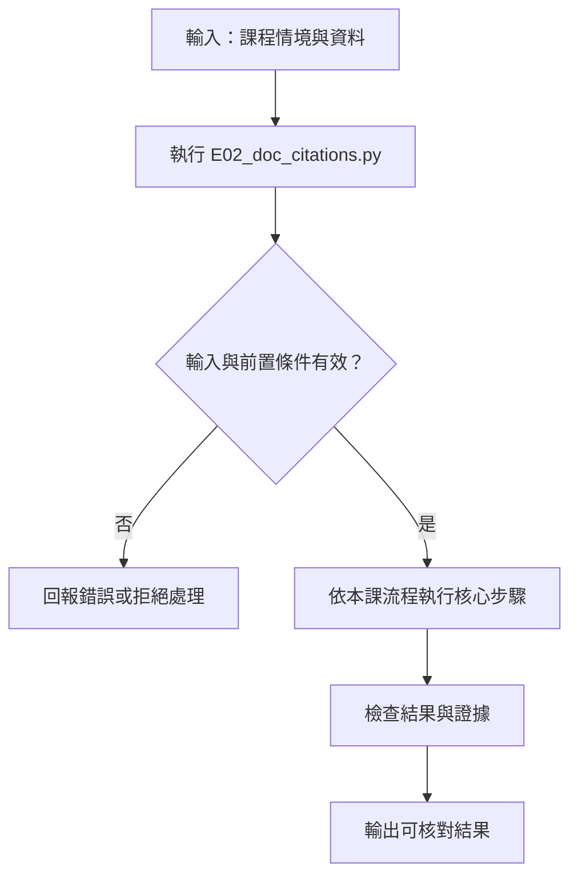

# 文件摘要、來源與頁碼

> **正文改版：20E07-E03-06｜對應新版 LLM 第 12 節：文件摘要、來源與頁碼。**
> 摘要的每一點都要能回到原文：哪份文件、哪一版、哪一頁、哪一句。本節用一份合成的手冊掃描檔（3 頁，印刷頁碼 6、7、9，**缺第 8 頁**，第 2 頁模糊），比較兩條讀取路徑：直接用文字層、讓本地 SmolVLM 看圖轉寫；再用程式逐點核對一份摘要草稿的頁碼與原文片段。核心主張：**頁碼與片段必須能被程式驗證；PDF 頁序不是印刷頁碼；看不清的頁要標出來，不能讓模型補寫。**

[回 50 節課綱](https://hackmd.io/@yillkid/HJl8JXTNkl)

## 流程圖：VLM 文件摘要、來源與頁碼



## 學習目標與時間

先修第 10 節（unknown）、第 11 節（每個主張要能回到來源核對）。

| 時間 | 內容 |
| --- | --- |
| 0–10 分鐘 | 文字抽取 vs VLM 閱讀；文件 ID、雜湊、PDF 頁序、印刷頁碼 |
| 10–20 分鐘 | 引用格式；缺頁、模糊頁、OCR 失敗 |
| 20–35 分鐘 | 跑 Demo |
| 35–50 分鐘 | Workshop：三點摘要，逐點附頁碼與原文片段 |

驗收能力：交出**逐點可回查的三點摘要**；頁碼要能驗證，不能引用不存在的頁；證據不足的點標「未知」。

## 一、兩條讀取路徑

| | 文字層（text layer） | VLM 閱讀 |
| --- | --- | --- |
| 來源 | 電子原檔（born-digital PDF）本來就有的文字 | 模型看頁面圖片轉寫 |
| 準確度 | 逐字正確（但版面、表格順序可能亂） | 會漏行、改字、**補寫**看不清的內容 |
| 能處理 | 有文字層的檔案 | 掃描檔、照片、圖表 |
| 成本 | 幾乎為零 | 每頁幾秒到幾十秒 |

有文字層就**先用文字層**；VLM 用在沒有文字層的頁面，且轉寫結果要先標品質。法規、契約這類文件，要用**正式來源與明確版本**（例如法規資料庫的條文與修正日期），不用模型轉寫或補寫缺漏的條文。

## 二、引用要有哪些欄位

| 欄位 | 本節的值 | 為什麼 |
| --- | --- | --- |
| 文件 ID | `GW-MANUAL` | 不同文件可能有相同頁碼 |
| 版本／雜湊 | `v2`、文字層 sha256 | 文件改版後頁碼與內容會變 |
| PDF 頁序 | 1、2、3 | 程式定位用 |
| 印刷頁碼 | 6、7、9 | 人看紙本時找得到 |
| 原文片段 | 逐字 | 程式可以驗證 |

**PDF 頁序不是印刷頁碼**：掃描檔常從中間開始、缺頁、或有封面。本節的手冊 PDF 第 3 頁印的是第 9 頁。

## 三、可執行 Demo

重播只需要標準函式庫；`--live` 需求同第 10 節。`--pages pages/` 存下 3 張頁面圖。

<!-- demo: E02_doc_citations.py -->
```python
"""第 12 節：文件摘要、來源與頁碼。

一份合成的「教學閘道器設定手冊 v2」掃描檔，3 張圖：PDF 第 1–3 頁，**印刷頁碼是 6、7、9**（第 8 頁缺頁），
第 2 頁掃描模糊。兩條讀取路徑：
  文字層：手冊原檔的文字（born-digital PDF 抽得到的那種），本節當作真值
  VLM 閱讀：SmolVLM-500M 看圖轉寫，分「不切塊」與「切塊」兩種設定（示範機錄下，預設重播）
接著核對一份三點摘要草稿（教師準備的劇本，模擬模型交出的草稿）：每點要附 文件 ID、版本雜湊、PDF 頁、
印刷頁碼、原文片段；程式逐點檢查片段是否真的在那一頁、頁碼是否存在。

    python E02_doc_citations.py
    python E02_doc_citations.py --live [--save]       # 實跑 VLM 轉寫（需 torch、transformers、Pillow、模型快取）
    python E02_doc_citations.py --pages pages/         # 把 3 張頁面圖存下來（需要 Pillow）
"""
import argparse
import difflib
import hashlib
import json
import platform
import resource
import time
from pathlib import Path

HERE = Path(__file__).resolve().parent
RECORD = HERE / "data" / "12-doc-record.json"
MODEL_ID = "HuggingFaceTB/SmolVLM-500M-Instruct"
REVISION = "a7da5b986cb59b408707209984f360a5f4ad7e47"
THREADS = 4
TRANSCRIBE_Q = "Transcribe all the text on this page."

DOC_ID = "GW-MANUAL"
VERSION = "v2"
# PDF 頁序 → (印刷頁碼, 掃描模糊程度, 文字)
PAGES = {
    1: (6, 0, ["Gateway Setup Guide (v2)", "", "Step 1. Connect to 2.4 GHz Wi-Fi only.",
               "Step 2. 5 GHz is not supported.", "Step 3. Enter the classroom password."]),
    2: (7, 2.5, ["Troubleshooting", "", "If pairing fails, restart the gateway.",
                 "Wait 30 seconds before retrying.", "Do not reset more than 3 times."]),
    3: (9, 0, ["Error codes", "", "E01 means a missing value.", "Other codes: report to the teacher.",
               "Do not guess the meaning of unlisted codes."]),
}


def page_text(pdf_page):
    return "\n".join(line for line in PAGES[pdf_page][2] if line)


def doc_hash():
    joined = "\n\f".join(page_text(n) for n in sorted(PAGES))
    return hashlib.sha256(joined.encode("utf-8")).hexdigest()[:12]


def printed_to_pdf():
    return {printed: n for n, (printed, _, _) in PAGES.items()}


# 三點摘要草稿（劇本，模擬模型交出的草稿；故意放進三種常見錯誤）
DRAFT = [
    {"point": "閘道器只能用 2.4 GHz，不支援 5 GHz。", "printed_page": 6,
     "quote": "Step 2. 5 GHz is not supported."},
    {"point": "配對失敗時重開閘道器，等 30 秒再試。", "printed_page": 7,
     "quote": "Wait 30 seconds before retrying."},
    {"point": "重設最多 5 次。", "printed_page": 7,
     "quote": "Do not reset more than 5 times."},                                  # 片段被改過
    {"point": "E02 代表連線逾時。", "printed_page": 8,
     "quote": "E02 means connection timeout."},                                     # 引用缺頁
    {"point": "未列出的錯誤代碼要回報教師。", "printed_page": 3,
     "quote": "Other codes: report to the teacher."},                               # 把 PDF 頁序當印刷頁碼
]


# ---------------------------------------------------------------- 畫頁面

def draw(pdf_page):
    from PIL import Image, ImageDraw, ImageFilter, ImageFont

    printed, blur, lines = PAGES[pdf_page]
    image = Image.new("RGB", (595, 842), "white")
    pen = ImageDraw.Draw(image)
    body = ImageFont.load_default(size=20)
    for i, line in enumerate(lines):
        pen.text((50, 60 + i * 34), line, fill="black", font=body)
    pen.text((280, 800), f"- {printed} -", fill="black", font=ImageFont.load_default(size=16))
    return image.filter(ImageFilter.GaussianBlur(blur)) if blur else image


def image_hash(image):
    return hashlib.sha256(image.tobytes()).hexdigest()[:16]


# ---------------------------------------------------------------- 核對

def similarity(a, b):
    return difflib.SequenceMatcher(None, " ".join(a.split()), " ".join(b.split())).ratio()


def missing_lines(truth, got):
    flat = " ".join(got.split()).lower()
    return [line for line in truth.split("\n") if " ".join(line.split()).lower() not in flat]


def check_point(item, pages_text, basis="原文"):
    """回傳 (判定, 理由)。pages_text：PDF 頁 → 用來核對的文字。"""
    to_pdf = printed_to_pdf()
    printed = item["printed_page"]
    if printed not in to_pdf:
        if printed in PAGES:
            return "退回", (f"印刷頁碼 {printed} 不存在；PDF 第 {printed} 頁的印刷頁碼是 {PAGES[printed][0]}"
                          f"（把 PDF 頁序當成頁碼）")
        return "退回", f"印刷頁碼 {printed} 不在這份文件裡（缺頁或不存在），不能引用"
    text = pages_text[to_pdf[printed]]
    if item["quote"] in text:
        return "通過", f"片段在 PDF 第 {to_pdf[printed]} 頁（印刷 {printed}）"
    best = max(text.split("\n"), key=lambda line: similarity(line, item["quote"]))
    return "退回", f"片段不在該頁；最接近的{basis}是「{best}」（相似度 {similarity(best, item['quote']):.2f}）"


# ---------------------------------------------------------------- 模型

def run_model():
    import PIL
    import torch
    import transformers
    from transformers import AutoModelForVision2Seq, AutoProcessor

    torch.set_num_threads(THREADS)
    processor = AutoProcessor.from_pretrained(MODEL_ID, revision=REVISION)
    model = AutoModelForVision2Seq.from_pretrained(MODEL_ID, revision=REVISION, dtype=torch.float32).eval()
    out = {"model": f"{MODEL_ID}@{REVISION}",
           "settings": {"threads": THREADS, "do_sample": False, "max_new_tokens": 90, "dtype": "float32"},
           "environment": {"host": platform.node(), "python": platform.python_version(), "torch": torch.__version__,
                           "transformers": transformers.__version__, "pillow": PIL.__version__},
           "image_sha256_16": {}, "runs": {}}
    for split in (False, True):
        processor.image_processor.do_image_splitting = split
        name = "切塊" if split else "不切塊"
        out["runs"][name] = {}
        for n in sorted(PAGES):
            image = draw(n)
            out["image_sha256_16"][str(n)] = image_hash(image)
            messages = [{"role": "user", "content": [{"type": "image"}, {"type": "text", "text": TRANSCRIBE_Q}]}]
            inputs = processor(text=processor.apply_chat_template(messages, add_generation_prompt=True),
                               images=[image], return_tensors="pt")
            started = time.perf_counter()
            with torch.no_grad():
                ids = model.generate(**inputs, max_new_tokens=90, do_sample=False)
            out["runs"][name][str(n)] = {
                "text": processor.batch_decode(ids[:, inputs["input_ids"].shape[1]:], skip_special_tokens=True)[0].strip(),
                "input_tokens": int(inputs["input_ids"].shape[1]), "seconds": round(time.perf_counter() - started, 1)}
    out["peak_rss_mib"] = resource.getrusage(resource.RUSAGE_SELF).ru_maxrss // 1024
    return out


def check_images(record):
    try:
        from PIL import Image  # noqa: F401
    except ImportError:
        return "沒有可用的 Pillow，未重畫核對（重播仍可進行）"
    differ = [n for n in PAGES if image_hash(draw(n)) != record["image_sha256_16"][str(n)]]
    return "3 頁重畫後雜湊與錄製時相同" if not differ else f"重畫後雜湊不同：第 {differ} 頁"


# ---------------------------------------------------------------- 主程式

def main(argv=None):
    parser = argparse.ArgumentParser()
    parser.add_argument("--live", action="store_true")
    parser.add_argument("--save", action="store_true")
    parser.add_argument("--pages", help="把 3 張頁面圖存到這個資料夾（需要 Pillow）")
    args = parser.parse_args(argv)
    if args.pages:
        Path(args.pages).mkdir(parents=True, exist_ok=True)
        for n in PAGES:
            draw(n).save(Path(args.pages) / f"pdf-page-{n}.png")
        print(f"已存 3 頁到 {args.pages}")

    if args.live:
        record = run_model()
        source = f"即時執行（{record['environment']['host']}）"
        if args.save:
            RECORD.write_text(json.dumps(record, ensure_ascii=False, indent=1) + "\n", encoding="utf-8")
            source += "，已寫入 data/12-doc-record.json"
    else:
        record = json.loads(RECORD.read_text(encoding="utf-8"))
        source = f"重播 data/12-doc-record.json（錄製於 {record['environment']['host']}，非即時推論）"
    env = record["environment"]
    print(f"來源：{source}")
    print(f"模型：{MODEL_ID}｜revision {REVISION[:8]}｜greedy｜Python {env['python']}｜Pillow {env['pillow']}")
    print(f"圖片核對：{check_images(record)}")
    print(f"文件：{DOC_ID} {VERSION}｜文字層 sha256 {doc_hash()}｜PDF 3 頁｜印刷頁碼 "
          + "、".join(f"PDF {n}→{p[0]}" for n, p in PAGES.items()) + "｜缺第 8 頁")

    print("\n== 一、文字層 vs VLM 轉寫（與文字層的相似度；漏掉的行）==")
    for name, run in record["runs"].items():
        for n in sorted(PAGES):
            r = run[str(n)]
            lost = missing_lines(page_text(n), r["text"])
            blur = "（模糊）" if PAGES[n][1] else ""
            print(f"  {name:<3} PDF {n}{blur:<4}｜{r['input_tokens']:>3} token {r['seconds']:>5.1f} 秒｜"
                  f"相似度 {similarity(page_text(n), r['text']):.2f}｜漏 {len(lost)} 行")
    blurred = record["runs"]["不切塊"]["2"]["text"]
    print(f"  不切塊讀模糊頁的前 80 字：「{' '.join(blurred.split())[:80]}」")
    print(f"  原文：「{' '.join(page_text(2).split())}」")

    print("\n== 二、核對摘要草稿（以文字層為準）==")
    text_layer = {n: page_text(n) for n in PAGES}
    verdicts = []
    for i, item in enumerate(DRAFT, 1):
        verdict, why = check_point(item, text_layer)
        verdicts.append(verdict)
        print(f"  {i}. {verdict}｜印刷第 {item['printed_page']} 頁｜{item['point']}\n     {why}")
    print(f"  通過 {verdicts.count('通過')}／{len(DRAFT)}；能交出的三點摘要："
          f"{'夠' if verdicts.count('通過') >= 3 else '不夠，要補點或寫明證據不足'}")

    print("\n== 三、如果只有 VLM 轉寫可以核對 ==")
    for name, run in record["runs"].items():
        vlm = {n: run[str(n)]["text"] for n in PAGES}
        results = [check_point(item, vlm, "轉寫") for item in DRAFT]
        print(f"  {name}：通過 {sum(v == '通過' for v, _ in results)}／{len(DRAFT)}")
        for i, ((verdict, why), item) in enumerate(zip(results, DRAFT), 1):
            if verdict != verdicts[i - 1]:
                print(f"    {i}. 文字層{verdicts[i - 1]}，轉寫{verdict}｜{why}")
    print("  核對的依據換成轉寫結果，正確的引用也會被退回；轉寫錯一個標點，片段就對不上")
    print("  轉寫要先標品質（與原檔比對、或人工抽查），模糊頁要重掃或人工轉寫；不能讓模型補寫看不清的字")

    print("\n== 四、資源 ==")
    for name, run in record["runs"].items():
        print(f"  {name}：3 頁共 {sum(r['seconds'] for r in run.values()):.1f} 秒，"
              f"每頁約 {run['1']['input_tokens']} 個輸入 token")
    print(f"  峰值記憶體 {record['peak_rss_mib']:,} MiB")


if __name__ == "__main__":
    main()
```

執行（程式與資料也放在 [llm-demo](https://github.com/4-learn/llm-demo)）：

```bash
python E02_doc_citations.py
python E02_doc_citations.py --pages pages
```

關鍵輸出（重播示範機 4-learn 的紀錄；`--live` 在示範機實跑，20E07-E03-06）：

```text
來源：重播 data/12-doc-record.json（錄製於 4-learn，非即時推論）
模型：HuggingFaceTB/SmolVLM-500M-Instruct｜revision a7da5b98｜greedy｜Python 3.12.3｜Pillow 12.3.0
圖片核對：3 頁重畫後雜湊與錄製時相同
文件：GW-MANUAL v2｜文字層 sha256 8e4aa8b75760｜PDF 3 頁｜印刷頁碼 PDF 1→6、PDF 2→7、PDF 3→9｜缺第 8 頁

== 一、文字層 vs VLM 轉寫（與文字層的相似度；漏掉的行）==
  不切塊 PDF 1    ｜ 85 token   5.7 秒｜相似度 0.81｜漏 4 行
  不切塊 PDF 2（模糊）｜ 85 token  10.3 秒｜相似度 0.07｜漏 3 行
  不切塊 PDF 3    ｜ 85 token   4.5 秒｜相似度 1.00｜漏 0 行
  切塊  PDF 1    ｜881 token  30.1 秒｜相似度 0.97｜漏 0 行
  切塊  PDF 2（模糊）｜881 token  23.5 秒｜相似度 0.24｜漏 3 行
  切塊  PDF 3    ｜881 token  27.7 秒｜相似度 1.00｜漏 0 行
  不切塊讀模糊頁的前 80 字：「"Troublehunting" is a term used to describe the process of identifying and resol」
  原文：「Troubleshooting If pairing fails, restart the gateway. Wait 30 seconds before retrying. Do not reset more than 3 times.」

== 二、核對摘要草稿（以文字層為準）==
  1. 通過｜印刷第 6 頁｜閘道器只能用 2.4 GHz，不支援 5 GHz。
     片段在 PDF 第 1 頁（印刷 6）
  2. 通過｜印刷第 7 頁｜配對失敗時重開閘道器，等 30 秒再試。
     片段在 PDF 第 2 頁（印刷 7）
  3. 退回｜印刷第 7 頁｜重設最多 5 次。
     片段不在該頁；最接近的原文是「Do not reset more than 3 times.」（相似度 0.97）
  4. 退回｜印刷第 8 頁｜E02 代表連線逾時。
     印刷頁碼 8 不在這份文件裡（缺頁或不存在），不能引用
  5. 退回｜印刷第 3 頁｜未列出的錯誤代碼要回報教師。
     印刷頁碼 3 不存在；PDF 第 3 頁的印刷頁碼是 9（把 PDF 頁序當成頁碼）
  通過 2／5；能交出的三點摘要：不夠，要補點或寫明證據不足

== 三、如果只有 VLM 轉寫可以核對 ==
  不切塊：通過 0／5
    1. 文字層通過，轉寫退回｜片段不在該頁；最接近的轉寫是「Step 1: Connect to 2.4 GHz Wi-Fi only.」（相似度 0.46）
    2. 文字層通過，轉寫退回｜片段不在該頁；最接近的轉寫是「Troubleshooting can be performed in various ways,」（相似度 0.15）
  切塊：通過 1／5
    2. 文字層通過，轉寫退回｜片段不在該頁；最接近的轉寫是「Troubleshooting.」（相似度 0.29）
  核對的依據換成轉寫結果，正確的引用也會被退回；轉寫錯一個標點，片段就對不上
  轉寫要先標品質（與原檔比對、或人工抽查），模糊頁要重掃或人工轉寫；不能讓模型補寫看不清的字

== 四、資源 ==
  不切塊：3 頁共 20.5 秒，每頁約 85 個輸入 token
  切塊：3 頁共 81.3 秒，每頁約 881 個輸入 token
  峰值記憶體 3,307 MiB
```

## 四、結果怎麼讀

### 1. VLM 轉寫：清楚的頁也會漏，模糊的頁會編

- 清楚的第 1 頁，不切塊時漏了「5 GHz is not supported」那一行，還把 `v2` 讀成 `N2`；切塊時幾乎完整，但最後多了一個原文沒有的「Step 4.」。
- 模糊的第 2 頁，不切塊時模型**寫了一段關於軟體除錯的文章**，把標題讀成「Troublehunting」；切塊時只讀出標題。兩種設定都沒有說「看不清楚」。
- 第 3 頁清楚，兩種設定都完整。
- 切塊比較準，但每頁輸入 token 多 10 倍，時間約 4 倍（示範機 3 頁 20.5 秒 vs 81.3 秒）。

### 2. 摘要草稿：5 點通過 2 點

| 點 | 錯誤 | 怎麼抓到 |
| --- | --- | --- |
| 3 | 片段被改過（3 次 → 5 次） | 片段不在該頁；最接近的原文相似度 0.97：**差一個字** |
| 4 | 引用缺頁（第 8 頁不在檔案裡），內容也是編的 | 印刷頁碼對照表沒有 8 |
| 5 | 把 PDF 頁序 3 當成印刷頁碼 | PDF 第 3 頁印的是 9 |

第 3 點最危險：意思看起來合理、片段也幾乎一樣，人眼掃過去很容易放過。逐字比對抓得到；「意思相近就算」的比對抓不到。剩下 2 點通過，不夠交三點摘要，要補點，或明寫「其餘內容證據不足」，不能為了湊滿三點而放寬。

### 3. 用轉寫當核對依據

如果只有 VLM 轉寫可以核對，正確的第 1、2 點也會被退回：不切塊時第 1 頁漏了那一行，模糊頁的轉寫則完全不對。核對的依據本身要先驗證。真實流程：有文字層用文字層；沒有的話，轉寫結果要與原圖人工抽查，模糊頁要重掃或人工轉寫，在 metadata 裡標「轉寫來源」與「品質」（第 16 節）。

## 五、常見誤判

| 誤判 | 實際 |
| --- | --- |
| 「附了頁碼就可以回查」 | 頁碼要存在、片段要真的在那一頁 |
| 「PDF 第 3 頁就是第 3 頁」 | 本節印的是第 9 頁 |
| 「片段意思差不多就好」 | 3 次 vs 5 次，差一個字 |
| 「VLM 讀得懂掃描檔」 | 清楚的頁也漏行；模糊的頁會編一整段 |
| 「模型沒說看不清，就是看得清」 | 兩種設定都沒說 |

## Workshop：三點摘要

### 任務

1. （3 分鐘）`python E02_doc_citations.py --pages pages`，打開 3 張頁面圖。
2. （7 分鐘）用文字層（`PAGES` 裡的文字）寫三點摘要，每點附：文件 ID、版本、PDF 頁、印刷頁碼、逐字片段。
3. （3 分鐘）把你的三點加進 `DRAFT`（格式相同），重跑，確認三點都「通過」。
4. （2 分鐘）第 2 頁如果只有掃描檔、沒有文字層，你的摘要要怎麼寫？

### 參考判讀

- 第 2 題可用：印刷第 6 頁「Step 2. 5 GHz is not supported.」、印刷第 7 頁「Do not reset more than 3 times.」、印刷第 9 頁「Do not guess the meaning of unlisted codes.」。
- 第 4 題：第 2 頁標「掃描模糊，轉寫不可靠，內容未知；待重掃或人工轉寫」。不能用 VLM 的轉寫當引用來源，更不能用它編出來的段落。

### 驗收

- 第 3 題重跑後的核對輸出（三點通過）。
- 第 4 題的處理說明。

## 教師紀錄與下一步

- 證據等級：**遠端實測**（示範機 4-learn 以 `--live --save` 錄下的轉寫；講義輸出是那份紀錄的重播）＋**本機實測**（備課機 cms-server `--live`，6 份轉寫與示範機逐字相同）。摘要草稿是**合成**（教師準備的劇本），不是模型產出；核對程式是**本機實測**。
- 手冊是合成文件（英文，因為 SmolVLM 不讀中文）；「文字層」由程式直接提供，模擬有文字層的電子檔，**沒有真的處理 PDF 檔**（沒有用 pypdf 或 OCR 套件）。
- 中文文件、真實 PDF 的文字抽取（版面順序、表格）、傳統 OCR（如 Tesseract）都**未測**。
- 法規正式來源（例如全國法規資料庫）的版本欄位與擷取方式，本節只在講義說明，**未示範**。
- 舊教材 [文件](https://hackmd.io/@yillkid/tXMfobCQT7-uXhTyE6Pg8w) **尚未改寫**。
- 下一步：第 13 節結構化輸出；第 16 節把轉寫來源與品質寫進 metadata。
