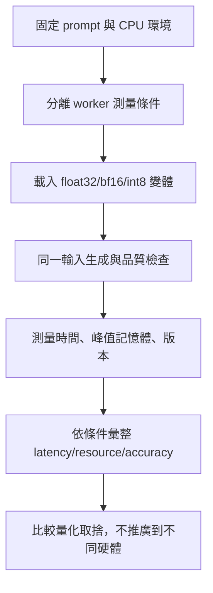
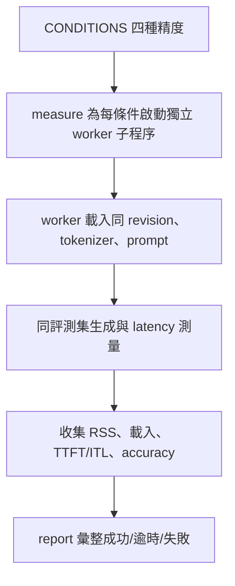
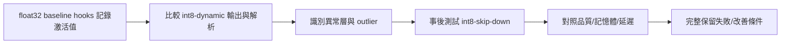
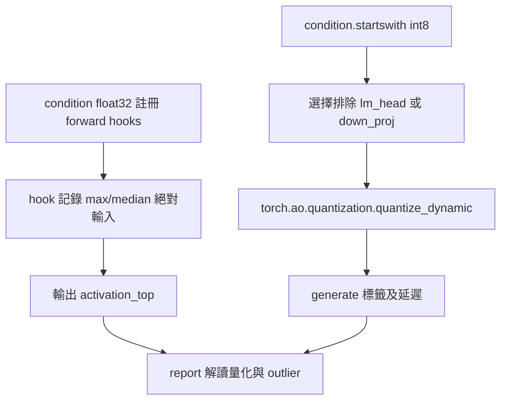

# 量化與 CPU 實驗

> **正文改版：20E07-E03-06｜對應新版 LLM 第 E07 節：量化與 CPU 實驗。**
> 「量化會更省、更快，品質差不多」是常見說法。本節在示範機的 CPU 上，用同一個 Qwen2.5-0.5B、同一份提示與解碼，只改精度：float32、bfloat16、torch 內建的 int8 動態量化（全部 Linear），以及看過激活值統計後才決定的「跳過 down_proj」版本。每個條件在**獨立子程序**裡跑，才量得到各自的峰值記憶體。結果和常見說法**大多不符**：bfloat16 省一半記憶體但 TTFT 慢 6 倍；int8 全部量化之後 25 筆有 24 筆連標籤都解析不出來，而且峰值記憶體一點都沒省。核心主張：**量化的效果要在你的硬體、你的 runtime、你的任務上實測；失敗也要完整記錄，不能只報成功的條件。**

[回 51 節必修＋9 節選修課綱](https://hackmd.io/@yillkid/HJl8JXTNkl)

## 流程圖：量化與 CPU 實驗



## 學習目標與時間

先修第 05 節（權重大小估算）、第 07 節（CPU 載入）、第 08 節（評測）、第 44 節（公平比較）、第 45 節（TTFT、ITL）。

| 時間 | 內容 |
| --- | --- |
| 0–10 分鐘 | 精度、量化誤差、格式與 runtime；只改一個條件 |
| 10–25 分鐘 | 跑 Demo（重播），讀對照表 |
| 25–35 分鐘 | int8 為什麼壞：激活值的離群值 |
| 35–50 分鐘 | Workshop：寫同條件量化對照或完整失敗紀錄 |

驗收能力：交出**同條件量化對照**（或完整失敗紀錄），每一欄都能說明怎麼量的；模型不一致時不把差異歸因給量化。

## 一、四個條件

| 條件 | 權重 | 計算 | 說明 |
| --- | --- | --- | --- |
| float32 | 32 位元浮點 | 32 位元浮點 | 基準；第 07 節以來都用這個 |
| bfloat16 | 16 位元浮點 | 16 位元浮點 | 權重只占一半；**能不能更快取決於 CPU 有沒有對應指令** |
| int8-dynamic | 8 位元整數（每層一個刻度） | 激活值在執行時也量化成 int8 | torch 內建 `quantize_dynamic`，除 `lm_head` 外 168 個 Linear 全部量化 |
| int8-skip-down | 同上 | 同上 | 同樣做法，但 24 個 `mlp.down_proj` 保留浮點 |

固定不變的：同一個 base revision、tokenizer、chat template、提示、greedy、`parse`；第 45 節的「中」輸入（396 token）量延遲；同一台機器、2 個執行緒。

**int8-skip-down 是看了 int8-dynamic 的結果與激活值統計之後才加的**，所以它的分數不是「事先決定的條件」，要照實標示（見第四節）。

## 二、可執行 Demo

預設重播示範機的紀錄，只需要標準函式庫；同資料夾要有第 39、45 節的程式（`NN_*.py` 或講義）與 `data/eval-set.json`、`data/46-quant-record.json`。`--live` 需要 `torch`、`transformers` 與第 07 節的 Qwen 快取，四個條件各開一個子程序，示範機約 6 分鐘。每個條件上限 600 秒，逾時或失敗只記錄、不重試。峰值 RSS 用 `resource` 模組讀，Windows 沒有這個模組（同第 07 節）。

### Call session 1：CPU 精度變體公平比較

**System layer**


**Internal function flow**
```mermaid
flowchart TD
    A[worker(condition)] --> B[載入 float32/bfloat16 base]
    B --> C{condition 是 int8？}
    C -- 是 --> D[quantize_dynamic 指定 Linear]
    C -- 否 --> E[保留 dtype]
    D --> F[generate 固定 prompt/greedy]
    E --> F
    F --> G[記錄 RSS 與 Stamps 時間]
```

### Call session 2：量化失敗與 down_proj 激活值診斷

**System layer**


**Internal function flow**


<!-- demo: E07_quant_cpu.py -->
```python
"""第 46 節：量化與 CPU 實驗。

同一個 Qwen2.5-0.5B（同 revision、同 tokenizer、同提示、greedy），只改精度：
  float32（基準）、bfloat16（16 位元浮點）、
  int8 動態量化（torch 內建；權重存 int8，激活值在執行時也量化成 int8）——除 lm_head 外的全部 Linear，
  以及同樣做法但跳過 24 個 mlp.down_proj（看完激活值統計後才決定，見第四段）。
每個條件在**獨立子程序**裡跑，才量得到各自的峰值記憶體；逾時或失敗就記下來，不重試。
量：峰值 RSS、載入秒數、TTFT 與 decode 速率（第 45 節的「中」輸入）、第 08 節 25 筆 zero-shot 正確數。

    python E07_quant_cpu.py          # 重播示範機 4-learn 的紀錄（不需要模型）
    python E07_quant_cpu.py --live   # 本機實測（需要 torch、transformers、Qwen 快取）；加 --save 覆寫紀錄
"""
import json
import re
import subprocess
import sys
import time
import types
from pathlib import Path

HERE = Path(__file__).resolve().parent
RECORD = HERE / "data" / "46-quant-record.json"
CONDITIONS = ("float32", "bfloat16", "int8-dynamic", "int8-skip-down")
THREADS = 2
LATENCY_REPEATS = 3
TIMEOUT_SECONDS = 600     # 單一條件的上限：超過就停，記為逾時


def lesson(nn):
    """同第 32 節：先找 NN_*.py，再找講義 NN-*.md；讀原始碼後 exec。"""
    found = [(p, p.read_text(encoding="utf-8")) for p in sorted(HERE.glob(f"{nn}_*.py"))]
    for md in sorted(HERE.glob(f"{nn}-*.md")):
        found += [(md, src) for _, src in re.findall(r"<!-- demo: ([\w.]+) -->\n```python\n(.*?)\n```",
                                                     md.read_text(encoding="utf-8"), re.S)]
    if not found:
        raise FileNotFoundError(f"找不到第 {nn} 節的程式（{nn}_*.py 或 {nn}-*.md）")
    path, source = found[0]
    module = types.ModuleType(f"lesson{nn}")
    module.__file__ = str(path)
    exec(compile(source, path.name, "exec"), module.__dict__)
    return module


# ---------------------------------------------------------------- 子程序：一個條件

def worker(condition):
    import resource
    import statistics
    import torch
    from huggingface_hub import snapshot_download
    from transformers import AutoModelForCausalLM, AutoTokenizer

    l38, l44 = lesson("43"), lesson("49")
    torch.set_num_threads(THREADS)
    path = snapshot_download(l38.MODEL_ID, revision=l38.REVISION, local_files_only=True)
    started = time.perf_counter()
    tokenizer = AutoTokenizer.from_pretrained(path)
    dtype = torch.bfloat16 if condition == "bfloat16" else torch.float32
    model = AutoModelForCausalLM.from_pretrained(path, dtype=dtype)
    stats = {}
    if condition == "float32":                          # 量化前先看：每個 Linear 收到的輸入有多大
        def hook(name):
            def record(module, inputs, output):
                a = inputs[0].detach().abs()
                old = stats.get(name, (0.0, 0.0))
                stats[name] = (max(old[0], a.max().item()), max(old[1], a.median().item()))
            return record
        hooks = [m.register_forward_hook(hook(n)) for n, m in model.named_modules() if type(m) is torch.nn.Linear]
    if condition.startswith("int8"):
        skip = ("lm_head",) if condition == "int8-dynamic" else ("lm_head", "down_proj")
        names = {n for n, m in model.named_modules() if type(m) is torch.nn.Linear and not n.endswith(skip)}
        torch.ao.quantization.quantize_dynamic(model, names, dtype=torch.qint8, inplace=True)
    load_seconds = time.perf_counter() - started
    for name in ("temperature", "top_p", "top_k"):
        setattr(model.generation_config, name, None)
    linear = sum(1 for m in model.modules() if type(m) is torch.nn.Linear)

    def generate(messages, max_new_tokens, streamer=None, fixed=False):
        inputs = tokenizer.apply_chat_template(messages, add_generation_prompt=True,
                                               return_tensors="pt", return_dict=True)
        extra = {"min_new_tokens": max_new_tokens} if fixed else {}
        with torch.no_grad():
            out = model.generate(**inputs, max_new_tokens=max_new_tokens, do_sample=False, streamer=streamer, **extra)
        return tokenizer.decode(out[0][inputs["input_ids"].shape[1]:], skip_special_tokens=True).strip()

    items = json.loads(l38.find_data("eval-set.json").read_text(encoding="utf-8"))["items"]
    labels = {}
    for item in items:
        messages = [{"role": "system", "content": l38.TASK}, {"role": "user", "content": f"通報：{item['text']}\n標籤："}]
        labels[item["id"]] = generate(messages, l38.MAX_NEW_TOKENS)

    if condition == "float32":
        for h in hooks:
            h.remove()
    prompt = l44.build_prompt(l44.CONTEXT_COPIES["中"])
    timings = []
    for _ in range(LATENCY_REPEATS + 1):
        stamps = l44.Stamps()
        begin = time.perf_counter()
        generate(prompt, l44.OUTPUT_TOKENS, stamps, fixed=True)
        gaps = [b - a for a, b in zip(stamps.times, stamps.times[1:])]
        timings.append({"ttft": round(stamps.times[0] - begin, 4), "itl": round(statistics.median(gaps), 4)})
    answer = generate([{"role": "user", "content": "用一句話說明：工人進入工地前要做什麼安全檢查？"}], 40)
    print(json.dumps({
        "condition": condition, "load_seconds": round(load_seconds, 2), "plain_linear_left": linear,
        "peak_rss_mib": resource.getrusage(resource.RUSAGE_SELF).ru_maxrss // 1024,
        "rss_end_mib": int(Path("/proc/self/statm").read_text().split()[1]) * resource.getpagesize() // 2 ** 20,
        "labels": labels, "timings": timings, "answer": answer,
        "activation_top": sorted(([n, round(mx, 1), round(md, 3)] for n, (mx, md) in stats.items()),
                                 key=lambda r: -r[1])[:6],
    }, ensure_ascii=False))


def version(metadata, package):
    try:
        return metadata.version(package)
    except metadata.PackageNotFoundError:
        return "未安裝"


def measure():
    import importlib.metadata as metadata
    import platform
    results = {}
    for condition in CONDITIONS:
        try:
            done = subprocess.run([sys.executable, str(Path(__file__).resolve()), "--worker", condition],
                                  capture_output=True, text=True, timeout=TIMEOUT_SECONDS)
        except subprocess.TimeoutExpired:
            results[condition] = {"status": f"逾時（超過 {TIMEOUT_SECONDS} 秒）"}
            continue
        if done.returncode != 0:
            tail = done.stderr.strip().splitlines()[-1:] or [f"exit {done.returncode}"]
            results[condition] = {"status": f"失敗：{tail[0][:120]}"}
            continue
        results[condition] = dict(json.loads(done.stdout.strip().splitlines()[-1]), status="完成")
    return {
        "note": "第 46 節重播用：示範機實測。每個條件在獨立子程序執行；不同機器、負載、torch 版本都可能不同。",
        "threads": THREADS, "results": results,
        "versions": {p: version(metadata, p) for p in ("torch", "transformers")},
        "recorded_on": f"{platform.node()}｜{platform.machine()}｜Python {platform.python_version()}",
    }


# ---------------------------------------------------------------- 報告

def report(record, source):
    import statistics
    l38 = lesson("43")
    items = json.loads(l38.find_data("eval-set.json").read_text(encoding="utf-8"))["items"]
    gold = {i["id"]: i["gold"] for i in items}
    results = record["results"]
    print(f"模型 {l38.MODEL_ID}@{l38.REVISION[:7]}｜CPU {record['threads']} 執行緒｜greedy｜同提示、同 parse")
    print(f"來源：{source}｜{record['recorded_on']}｜" + "、".join(f"{k} {v}" for k, v in record["versions"].items()))

    print("\n== 一、同一個模型，只改精度 ==")
    print("條件 | 狀態 | 峰值 RSS | 結束時 RSS | 載入 | TTFT 中位數 | ITL 中位數 | 25 筆正確 | 解析失敗")
    base = results.get("float32", {})
    for name in CONDITIONS:
        r = results.get(name, {"status": "未執行"})
        if r["status"] != "完成":
            print(f"{name} | {r['status']} | — | — | — | — | — | — | —")
            continue
        rest = r["timings"][1:]
        ttft = statistics.median(t["ttft"] for t in rest)
        itl = statistics.median(t["itl"] for t in rest)
        parsed = {i: l38.parse(t) for i, t in r["labels"].items()}
        right = sum(parsed[i] == gold[i] for i in gold)
        fails = sum(v is None for v in parsed.values())
        print(f"{name} | 完成 | {r['peak_rss_mib']:,} MiB | {r['rss_end_mib']:,} MiB | {r['load_seconds']:.1f} 秒 | {ttft:.2f} 秒 | "
              f"{itl * 1000:.0f} ms | {right} | {fails}")

    if base.get("status") == "完成":
        print("\n== 二、跟 float32 比：逐筆標籤有幾筆不同？ ==")
        for name in CONDITIONS[1:]:
            r = results.get(name, {})
            if r.get("status") != "完成":
                print(f"  {name}：沒有結果，不能比")
                continue
            diff = [i for i in gold if l38.parse(r["labels"][i]) != l38.parse(base["labels"][i])]
            detail = "、".join(f"{i}（{l38.parse(base['labels'][i])}→{l38.parse(r['labels'][i])}）" for i in diff)
            print(f"  {name}：{len(diff)} 筆不同{'：' + detail if diff else ''}")

        print("\n== 三、開放式回答（40 token）==")
        for name in CONDITIONS:
            r = results.get(name, {})
            if r.get("status") == "完成":
                print(f"  {name:<13}{r['answer']}")

        print("\n== 四、為什麼全部量化會壞：每層收到的輸入有多大（float32，25 筆分類時） ==")
        print("  層 | 最大絕對值 | 中位數")
        for name, peak, median in base["activation_top"]:
            print(f"  {name} | {peak:,.1f} | {median}")
        print("  動態量化用「最大值」決定每個 int8 刻度：最大值 1,800 時，刻度約 14，中位數 0.05 的值全部變成 0")
        for name in CONDITIONS[2:]:
            r = results.get(name, {})
            if r.get("status") == "完成":
                print(f"  {name}：仍是浮點 Linear 的層數 {r['plain_linear_left']}／{base['plain_linear_left']}")

def main(argv=()):
    if "--worker" in argv:
        worker(argv[argv.index("--worker") + 1])
        return None
    if "--live" in argv:
        record = measure()
        if "--save" in argv:
            RECORD.parent.mkdir(exist_ok=True)
            RECORD.write_text(json.dumps(record, ensure_ascii=False, indent=1) + "\n", encoding="utf-8")
        source = "本機實測"
    else:
        record = json.loads(RECORD.read_text(encoding="utf-8"))
        source = "重播示範機紀錄"
    report(record, source)
    return record


if __name__ == "__main__":
    main(sys.argv[1:])
```

執行（程式與資料也放在 [llm-demo](https://github.com/4-learn/llm-demo)）：

```bash
python E07_quant_cpu.py
```

關鍵輸出（重播示範機 4-learn 20E07-E03-06 的 `--live --save` 紀錄；當次即時輸出只差「來源」一行的開頭）：

```text
模型 Qwen/Qwen2.5-0.5B-Instruct@7ae5576｜CPU 2 執行緒｜greedy｜同提示、同 parse
來源：重播示範機紀錄｜4-learn｜x86_64｜Python 3.12.3｜torch 2.8.0+cpu、transformers 4.57.3

== 一、同一個模型，只改精度 ==
條件 | 狀態 | 峰值 RSS | 結束時 RSS | 載入 | TTFT 中位數 | ITL 中位數 | 25 筆正確 | 解析失敗
float32 | 完成 | 3,245 MiB | 2,385 MiB | 0.9 秒 | 2.02 秒 | 141 ms | 13 | 0
bfloat16 | 完成 | 1,419 MiB | 1,420 MiB | 0.4 秒 | 13.34 秒 | 92 ms | 12 | 0
int8-dynamic | 完成 | 3,245 MiB | 2,652 MiB | 3.7 秒 | 1.52 秒 | 87 ms | 0 | 24
int8-skip-down | 完成 | 3,245 MiB | 2,554 MiB | 2.9 秒 | 1.59 秒 | 108 ms | 12 | 0

== 二、跟 float32 比：逐筆標籤有幾筆不同？ ==
  bfloat16：1 筆不同：B05（unknown→missing）
  int8-dynamic：25 筆不同：A01（present→None）、A02（present→None）、A03（present→None）、A04（present→None）、A05（present→None）、A06（present→None）、A07（present→None）、A08（unknown→None）、B01（missing→None）、B02（unknown→None）、B03（unknown→None）、B04（unknown→None）、B05（unknown→None）、B06（unknown→None）、C01（unknown→None）、C02（present→None）、C03（missing→None）、C04（present→None）、C05（present→None）、D01（unknown→None）、D02（present→None）、D03（present→None）、D04（present→unknown）、D05（present→None）、D06（unknown→None）
  int8-skip-down：14 筆不同：A01（present→unknown）、A02（present→missing）、A04（present→unknown）、B01（missing→present）、B03（unknown→missing）、B05（unknown→missing）、C01（unknown→present）、C02（present→missing）、C03（missing→unknown）、C04（present→unknown）、C05（present→unknown）、D02（present→unknown）、D03（present→unknown）、D05（present→unknown）

== 三、開放式回答（40 token）==
  float32      工人進入工地前需要进行全面的安全檢查，包括但不限于以下方面：

1. **了解工作环境**：確保工人的安全知識和技能符合项目要求。
2. **检查个人防护装备
  bfloat16     工人進入工地前需要进行全面的安全檢查，包括但不限于：

1. 確認工器具是否齐全且符合要求。
2. 检查施工区域是否有潜在的危险源，
  int8-dynamic 在回答这个问题时，我需要提供一些关于安全检查和工人进入工地的详细信息。首先，我们需要了解什么是“安全检查”以及它通常包括哪些内容。然后，我们还需要
  int8-skip-down工人進入工地前需要做安全檢查。

== 四、為什麼全部量化會壞：每層收到的輸入有多大（float32，25 筆分類時） ==
  層 | 最大絕對值 | 中位數
  model.layers.2.mlp.down_proj | 1,817.0 | 0.042
  model.layers.21.mlp.down_proj | 1,730.1 | 0.111
  model.layers.3.mlp.down_proj | 1,002.6 | 0.05
  model.layers.3.mlp.gate_proj | 336.4 | 0.537
  model.layers.3.mlp.up_proj | 336.4 | 0.537
  model.layers.21.mlp.gate_proj | 256.8 | 0.883
  動態量化用「最大值」決定每個 int8 刻度：最大值 1,800 時，刻度約 14，中位數 0.05 的值全部變成 0
  int8-dynamic：仍是浮點 Linear 的層數 1／169
  int8-skip-down：仍是浮點 Linear 的層數 25／169
```

## 三、結果怎麼讀

### 1. bfloat16：省一半記憶體，prefill 反而慢 6 倍

峰值 RSS 從 3,245 MiB 降到 1,419 MiB，跟第 05 節「權重位元數減半」的估算一致。ITL 從 141 ms 降到 92 ms：decode 每個 token 要把全部權重讀一遍，權重變小就快。**但 TTFT 從 2.02 秒變成 13.34 秒**：示範機的 i7-8565U 只有 AVX2，沒有原生 bfloat16 的矩陣指令，prefill 的大量矩陣乘法要先轉換，反而變慢。

品質：25 筆裡 1 筆標籤不同（B05），正確數 13 → 12。

### 2. int8 全部量化：輸出壞掉

24 筆連標籤都解析不出來，開放回答變成不相干的長篇。這不是「品質略降」，是**不能用**。

### 3. int8 也沒有省記憶體

int8 的峰值 RSS 和 float32 一樣（3,245 MiB）：`quantize_dynamic` 要先載入完整的 float32 模型再轉換，峰值發生在轉換之前。轉換後的結束 RSS 也沒有降（2,652 MiB）：embedding 仍是浮點（約 136M 參數），而且釋放的記憶體不一定還給作業系統。**「int8 省 4 倍記憶體」是權重檔大小的算術，不是這個做法在這台機器上的實測。** 要真的省，需要直接存成量化格式、載入時不經過 float32 的 runtime（例如 GGUF＋llama.cpp），那是另一個格式、另一個 runtime，要另外驗證。

### 4. 跳過 down_proj：分數回來了，但不是同一個模型的行為

正確數 12，看起來接近 float32 的 13；但逐筆對照有 **14 筆標籤和 float32 不同**，只是錯的和對的剛好互相抵銷。**只看總分會以為量化沒影響。** 而且這個條件是看過結果才設計的，要標示「事後調整」。

### 5. 兩台機器不完全一樣

備課機（Python 3.10.15）同日跑：bfloat16 有 2 筆不同、int8-dynamic 25 筆全部解析失敗、int8-skip-down 13 筆正確但 13 筆與 float32 不同。大方向相同，細節不同；**量化的結果比 float32 更容易隨硬體與執行緒變動**。

## 四、為什麼 int8 會壞：激活值的離群值

動態量化把每一層的輸入切成 255 格，格子大小由**這一批輸入的最大絕對值**決定。第四段的統計：`layers.2.mlp.down_proj` 的輸入最大值 1,817，中位數 0.042。

- 每一格約 1817 ÷ 127 ≈ 14。
- 中位數 0.042 遠小於半格，量化後變成 0。
- 也就是說，這一層大部分的輸入資訊被量化抹掉了。

這種「少數維度的值特別大」的離群激活值在 Transformer 裡很常見，也是 LLM 量化方法要特別處理的地方（例如只量化權重、或針對離群維度另外處理）。只量化權重、激活值保持浮點，就不會碰到這個問題；撰寫時以模擬實驗確認過（權重四捨五入成 int8 再轉回浮點），25 筆正確數仍是 13，但 torch 內建沒有現成、可在 CPU 上加速的 weight-only int8 路徑，所以沒有放進對照表。

## 五、常見誤判

| 誤判 | 實際 |
| --- | --- |
| 「量化一定更快」 | bfloat16 在 AVX2 CPU 上 prefill 慢 6 倍 |
| 「int8 省 4 倍記憶體」 | `quantize_dynamic` 的峰值與 float32 相同 |
| 「量化只會略降品質」 | 全部量化後 24 筆無法解析 |
| 「總分接近，就是沒影響」 | 12 vs 13，但 14 筆標籤不同 |
| 「換個格式（GGUF）結果也一樣」 | 不同格式、不同 runtime，要重測；本節沒測 |
| 「在 A 機器可以，在 B 也可以」 | 量化結果隨硬體、指令集、執行緒變動 |

## Workshop：同條件量化對照或完整失敗紀錄

### 任務

1. （3 分鐘）跑 Demo（重播），對每個條件寫一句：記憶體、速度、品質各是變好還是變差。
2. （4 分鐘）用第四段的數字說明：`layers.21.mlp.down_proj` 的最大值 1,730.1、中位數 0.111，中位數量化後會變成多少？
3. （5 分鐘，有模型快取的同學）在自己的電腦跑 `python E07_quant_cpu.py --live`，填寫：CPU 型號、是否支援 AVX-512／AMX（Linux 用 `lscpu`）、四個條件的結果。和示範機哪裡不同？
4. （3 分鐘）你的主管看到「int8-skip-down：12 筆正確」想直接上線。你會補充哪兩件事？

### 參考判讀

- 第 1 題：bfloat16 記憶體減半、decode 快、prefill 慢很多、品質略降；int8-dynamic 記憶體沒省、品質崩壞；int8-skip-down 記憶體沒省、TTFT 略快、總分接近但逐筆差很多。
- 第 2 題：一格約 1730.1 ÷ 127 ≈ 13.6；0.111 不到半格，四捨五入成 0。
- 第 3 題：結果不同是正常的；如果你的 CPU 支援 AMX 或 AVX-512 BF16，bfloat16 的 TTFT 可能不會變慢。重點是把硬體寫清楚。
- 第 4 題：① 14 筆標籤與 float32 不同，總分接近是抵銷的結果；② 這個條件是看過結果才設計的，要在新的資料上重新驗證；另外記憶體也沒有省，上線的理由不成立。

### 驗收

- 第 3 題的對照表，或第 1 題（用示範機紀錄，註明來源）。
- 第 4 題的兩點補充。

## 教師紀錄與下一步

- 證據等級：**遠端實測**。20E07-E03-06 示範機 4-learn（i7-8565U，AVX2，無 AVX-512／AMX；8 GB；Python 3.12.3；torch 2.8.0+cpu；2 執行緒）以 `--live --save` 實測，四個條件全部完成、無逾時，紀錄存為 `data/46-quant-record.json`；重播與當次即時輸出相同（只差來源標示）。
- 撰寫時的實際紀錄：第一版只有三個條件，int8 全部 25 筆解析失敗。我先後試了逐通道刻度、跳過 `lm_head`、只量化 MLP、換成 `qnnpack` 引擎，都還是壞；用 forward hook 看激活值，才找到 `down_proj` 的離群值。模擬的「只量化權重」正確數 13，確認問題出在**激活值量化**。int8-skip-down 是在這之後才加的。
- `torch.ao.quantization` 在 torch 2.8 會印出遷移到 torchao 的提示；torchao 未安裝，**沒有測**。GGUF、llama.cpp、MLX 都**沒有測**，不得宣稱可用。
- 課綱提到的 i5／16 GB 學生機**待驗證**；示範機是 i7-8565U／8 GB。
- 舊教材 [Transformers](https://hackmd.io/@yillkid/BjrFbbgkTMG2F-tDL1h0VQ) **尚未修改**。
- 下一步：第 47 節（已完成）分析 KV cache 與 prefix cache；第 49 節推測解碼。
