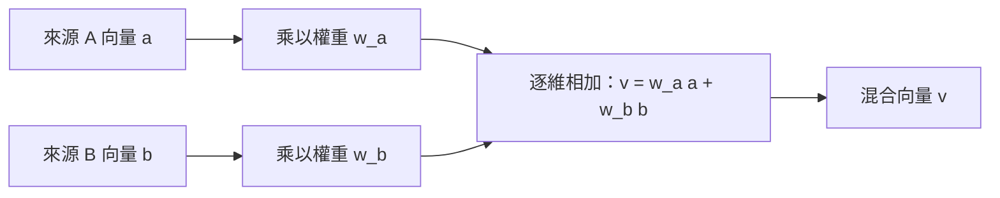

# Day 4 延伸｜加權混合向量（課程補充）

> 本頁為課程增補，不是 iThome 原系列 Day 4 原文內容。原文主題是提示詞工程。

## 概念

向量是以一串數值表示的資料；加權混合是依權重縮放不同向量後逐項相加。Mermaid 是以文字描述繪製圖表的標記語法。此技巧可用來說明組合表示，但實際用途、尺度與正規化必須依任務驗證。



## 動手做

```python
a = [1.0, 0.0]
b = [0.0, 1.0]
w_a, w_b = 0.7, 0.3
mixed = [w_a * x + w_b * y for x, y in zip(a, b)]
print(mixed)
```

**實際輸出：**
```text
[0.7, 0.3]
```

這是純數學示意，不是 embedding API 結果。原文連結：[Day 4：提示詞工程](https://ithelp.ithome.com.tw/articles/10352881?sc=rss.iron)。