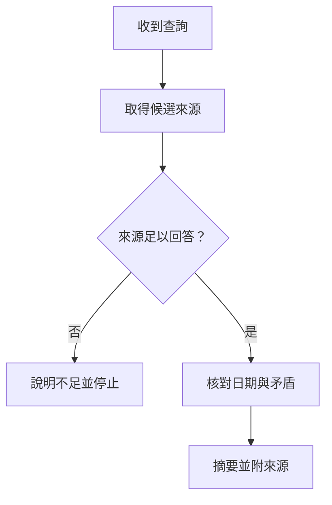

# Day 15｜Dify Agent 查詢：工具有用，答案仍須查證

> **主題：** Agent 可依任務選用搜尋或其他工具，再整理結果；工具回傳資料是證據來源，不代表摘要必然正確。

Agent 是在受限工具範圍內，依觀察選擇下一步的程式流程；UI（使用者介面）是使用者操作應用程式的畫面或互動入口。本例只整理模擬結果，不啟動 Dify 或連線搜尋服務。

## 動手做：把來源與摘要分開

```python
results = [
    {"title": "市府公告", "snippet": "活動將於週六上午十點開始。", "url": "https://example.org/event"},
    {"title": "社群貼文", "snippet": "有人說活動改到下午。", "url": "https://example.org/post"},
]

for item in results:
    print(f"來源：{item['title']} ({item['url']})")
    print(f"摘錄：{item['snippet']}")
```

預期輸出：

```text
來源：市府公告 (https://example.org/event)
摘錄：活動將於週六上午十點開始。
來源：社群貼文 (https://example.org/post)
摘錄：有人說活動改到下午。
```

這個程式只展示如何保留來源，不會上網搜尋。實際 Agent 工作流應檢查工具權限、來源可信度、資料時間與失敗情況；資訊互相矛盾時，明確呈現差異，不要讓模型自行捏造結論。`example.org` 為示意網址。

## 流程補充圖

下圖是課程對 Agent「觀察後選下一步」的補充，非原文截圖或 Dify 畫面：



## 小練習

新增第三筆來源，並手動標記哪一筆是官方來源、哪一筆需要查證。寫一條規則：沒有足夠可信證據時應如何回答。

## 原文與版本

原文：[Day 15｜Dify 入門 (1)：讓 Agent 幫報新聞查資料唬爛...還有好多好多](https://ithelp.ithome.com.tw/articles/10360295?sc=rss.iron)

原文工具、搜尋節點和 UI 以發文時的 Dify 版本為背景；目前功能與節點介面可能不同。若接入搜尋或其他外部工具，授課前核對官方文件、服務條款及資料處理方式。
