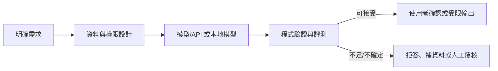
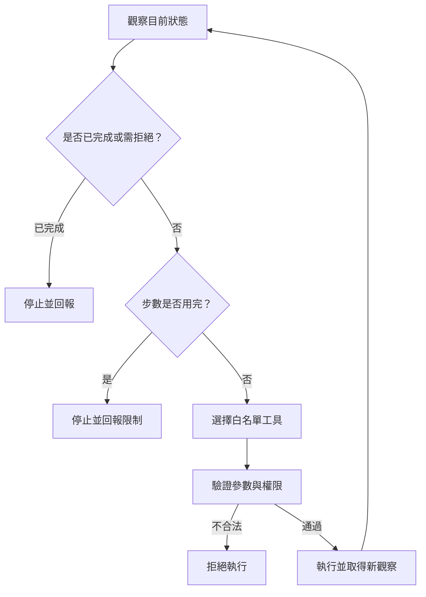

# Day 30｜結語：從需求到可用的 LLM 應用

> **定位**：回顧本系列如何從需求定義走向模型 API、提示、工具、檢索、工作流、安全與微調，並用驗收清單檢視一個應用是否準備好。

## 學習目標
- 用自己的話說明 LLM 應用不等於聊天介面。
- 指出模型、程式、資料與人工覆核各自的責任。
- 為下一個小型專案列出可測試需求與安全邊界。

## 回顧：應用由多個責任邊界組成

LLM 是大型語言模型；API 是程式依規格呼叫模型服務的介面。Schema 是欄位與型別的資料規格。Agent 是能在受限範圍內依觀察選擇下一步的流程。一個可用的 LLM 應用不只需要模型回答，還需要清楚的需求、適當資料、可控的提示與流程、程式端驗證、錯誤處理及使用者確認。應用可借用供應商的模型服務，不代表可以省略評測、隱私、權限與成本管理。



## 動手做：程式檢查驗收清單

將要求存在的項目列出，找出尚未完成的項目：

```python
checks = {
    "需求與範圍": True,
    "固定測試案例": True,
    "輸出與權限驗證": False,
    "資料保存與刪除規則": False,
}
missing = [name for name, done in checks.items() if not done]
print("可進入試用" if not missing else "尚未就緒：" + "、".join(missing))
```

**實際輸出：**
```text
尚未就緒：輸出與權限驗證、資料保存與刪除規則
```

把其中一項 `False` 改成 `True`，觀察結果如何變化。這是簡易清單檢查，不代表完整安全審查。

## 專案驗收清單

在把原型交給別人使用前，逐項回答：

- [ ] 問題、輸入、輸出和不處理的範圍是否寫清楚？
- [ ] 是否有固定測試案例，包括空值、錯誤與不確定輸入？
- [ ] 模型輸出是否經 schema、業務規則和權限檢查？
- [ ] 外部工具是否採最小權限，且高風險動作有人確認？
- [ ] 資料來源、保存期限、刪除方式和第三方傳輸是否清楚？
- [ ] 模型/API 版本、費用、延遲與失敗替代方案是否確認？

## 練習
寫下一個你想製作的 LLM 應用構想，完成上述清單並標記三項尚未解決的風險。挑一項設計可重現的測試，而不是只用一次成功示範作為完成證據。

## 延伸：Agent 迴圈圖（對應原系列 Day 41 補充，不是 Day 30 原文）



這張圖是課程補充，用來回扣 Agent 設計；原系列結語重點是應用價值與上游模型服務競爭，不應誤認本圖是原文內容。

## 原文與版本註記
[原文 Day 30：結語：從零開始打造屬於你的 LLM 應用](https://ithelp.ithome.com.tw/articles/10367152?sc=rss.iron)

原文談及 OpenAI DevDay 2024、Prompt Caching、視覺微調、模型蒸餾及當年模型比較。模型功能、API、費用與服務狀態可能已改變；本文保留其「善用上游能力、聚焦應用價值」的課程脈絡，不把當年規格當作現況。OpenAI API 路線仍按教師要求保留，實作前須查當前官方文件。
